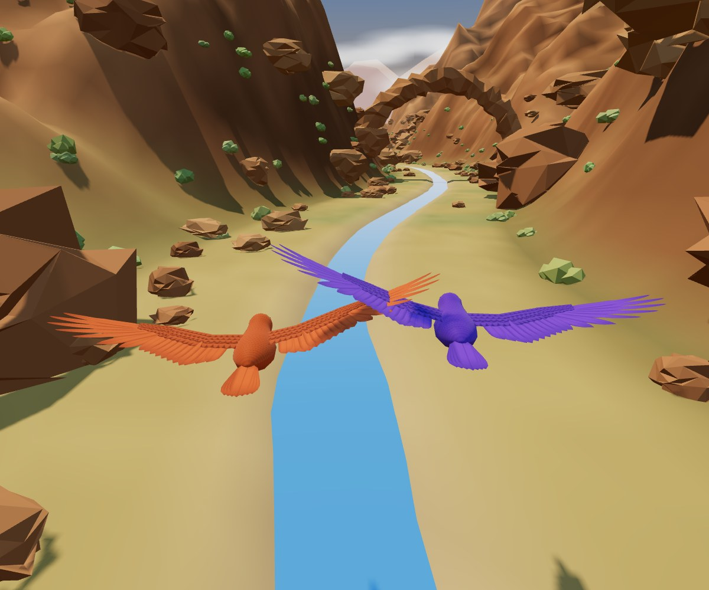

# Heartbeat Games: the whole project in one file

Version 2.29.0, bundled 2026-11-10 by `tools/make-ai-bundle.mjs`.
This is a snapshot for AI tools and readers: if it disagrees with the real files, the real files win.
Start with AGENTS.md (the first file below). Each file appears under a heading with its path.

## Contents

- AGENTS.md
- README.md
- READ ME FIRST.txt
- llms.txt
- docs/making-games/README.md
- docs/making-games/storyboards.md
- docs/making-games/sensor-and-feel.md
- docs/making-games/testing.md
- storyboards/fly-together/README.md
- storyboards/climb-together/README.md
- storyboards/crow-model/README.md
- streamdeck/README.txt
- config.js
- heartbeat-games.html
- js/app.js
- js/sensor.js
- games/fly-together.js
- games/lib/flight.js
- games/lib/flight3d.js
- games/lib/crow.js
- games/lib/photo-finish.js
- games/lib/glow.js
- games/climb-together.js
- games/lib/climb3d.js
- games/lib/chameleon.js
- games/lib/cat.js
- games/lib/creature-kit.js
- blender/build_crow.py
- blender/export_crow.py
- tools/crow-skeleton.cjs
- blender/build_chameleon.py
- blender/export_chameleon.py
- tools/chameleon-skeleton.cjs
- storyboards/chameleon-model/README.md
- blender/model_kit.py
- blender/export_model.py
- blender/build_cat.py
- blender/export_cat.py
- tools/cat-skeleton.cjs
- storyboards/cat-model/README.md
- games/examples/game-template.js
- heartbeat-launcher.ahk
- setup.bat
- setup.ps1
- tools/try-game.mjs
- tools/Game-Lab.html
- tools/game-lab/lab.js
- tools/game-lab/catalog.js
- tools/game-lab/stages.js
- tools/game-lab/orbit.js
- tools/game-lab/marks.js
- lab-notes/README.md
- tools/make-ai-bundle.mjs
- tools/ABOUT-TOOLS.txt
- .claude/skills/new-game/SKILL.md
- GET-UIA.txt
- games/art/climb-together-pose.svg
- games/art/fly-together-pose.svg
- games/examples/energy-bars.js
- games/examples/freeze.js
- games/examples/tilt-zone.js
- games/examples/valley-flight.js

## Not included as text

- **Pictures** (look at them in the project folder): blender/textures/cat_body.png, blender/textures/cat_eye.png, blender/textures/cat_fur_bump.png, blender/textures/cat_head.png, blender/textures/cat_leg.png, blender/textures/cat_tail.png, blender/textures/cat_tuft.png, blender/textures/cham_eye.png, blender/textures/cham_head.png, blender/textures/cham_head_bump.png, blender/textures/cham_limb.png, blender/textures/cham_limb_bump.png, blender/textures/cham_skin.png, blender/textures/cham_skin_bump.png, blender/textures/cham_tail.png, blender/textures/cham_tail_bump.png, blender/textures/crow_covert.png, blender/textures/crow_feather.png, blender/textures/crow_plumage.png, climb-2.18-preview.png, climb-2.18.1-hearts.png, climb-2.18.2-finale.png, climb-2.18.3-right-step.png, climb-2.19-room-light.png, climb-2.20-alley-light.png, climb-2.21-roof-rocks-light.png, climb-2.22-golden-hour.png, climb-2.23-end.png, climb-2.24-creases.png, climb-2.25-glow.png, fly-2.27-light.png, fly-2.27.1-shadows.png, game-lab-2.29-arch.png, game-lab-2.29-highlighter.png, game-lab-2.29-whole-climb.png, games/art/climb-together-menu.jpg, games/art/fly-together-menu.jpg, menu-2.28-other-pictures.png, menu-2.28.png, storyboards/climb-together/All_levels_zoom_out.jpg, storyboards/climb-together/All_levels_zoom_out_marked_rocks_tree.jpg, storyboards/climb-together/All_levels_zoom_out_marked_window_boxes.jpg, storyboards/climb-together/Base_Geometry_Cham_Game.jpg, storyboards/climb-together/Bend_up_at_right_angle.jpg, storyboards/climb-together/Bend_up_at_right_angle_animation.jpg, storyboards/climb-together/Cat_jumping.jpg, storyboards/climb-together/Cat_walking.jpg, storyboards/climb-together/Cham_climbing.jpg, storyboards/climb-together/In_Game_geo_populated.jpg, storyboards/climb-together/Level_001.jpg, storyboards/climb-together/Level_002.jpg, storyboards/climb-together/Level_003.jpg, storyboards/climb-together/Level_004.jpg, storyboards/climb-together/Player_actions.jpg, storyboards/climb-together/climb_over_ledge_animation.jpg, storyboards/climb-together/zoom_thru_open_window_001.jpg, storyboards/climb-together/zoom_thru_open_window_002.jpg, storyboards/climb-together/zoom_thru_open_window_003.jpg, storyboards/fly-together/Base_geometry.jpg, storyboards/fly-together/Bird_flying_through_canyon.jpg, storyboards/fly-together/End_screen_concept.png, storyboards/fly-together/Player_wearable.jpg, storyboards/fly-together/Ready_in_nest.jpg, storyboards/fly-together/Simple_mountains_and_bird.jpg, storyboards/fly-together/Transition_to_canyon.jpg, streamdeck/back.png, streamdeck/game-1.png, streamdeck/game-2.png, streamdeck/start.png.
- **Licences:** `LICENSE` is the MIT License (the code); `LICENSE-ART.txt` is CC BY-SA 4.0 (art, storyboards, docs).
- **Third-party and large files:** `js/vendor/three.min.js` (three.js r158, MIT) and `UIA.ahk` (downloaded separately).
- **By name only** (troubleshooting tools, see tools/ABOUT-TOOLS.txt; and the animals' generated model data): blender/cat-skeleton.json, blender/chameleon-skeleton.json, blender/crow-skeleton.json, games/lib/cat-model.js, games/lib/chameleon-model.js, games/lib/crow-model.js, tools/auto-allow-polar-pairing.ahk, tools/fast-motion.html, tools/heart-rate-test.html, tools/motion-test.html, tools/motion-viewer.html, tools/polar-auto-pair.ahk, tools/popup-inspector.ahk, tools/popup-logger.ahk, tools/two-player-motion.html.
- **Left out on purpose:** the old prototypes in `games/archive/`, private reference photos, logs and test output.

---

## File: AGENTS.md

````markdown
# Heartbeat Games: guide for AI assistants (and people)

This is the project's memory: what it is, how it fits together, the decisions made so far
and why, and the known quirks. It's written to get any AI model, or any person, up to speed.
Keep it current when something important changes. (`CLAUDE.md` just loads this file for
Claude Code; other tools look for `AGENTS.md` directly.)

## Start here

**If you can read only one file,** read [`HEARTBEAT-GAMES-BUNDLE.md`](HEARTBEAT-GAMES-BUNDLE.md). It holds
all the documentation and source code in one text file (built by `tools/make-ai-bundle.mjs`). It's a
snapshot: if it disagrees with the real files, the real files win.

Otherwise, read in this order:

1. [`README.md`](README.md): what this is, for a first-time visitor.
2. **This file:** how it all works, the hard-won hardware facts, and the decisions made.
3. **The top of [`js/app.js`](js/app.js):** the game contract, i.e. how a game plugs into the shell.
4. **[`games/fly-together.js`](games/fly-together.js) and [`games/lib/`](games/lib/):** a complete game and its shared parts.
5. **[`docs/making-games/`](docs/making-games/):** how new games are designed (from storyboards), built, tested and shipped.
6. **Only when touching the hardware side:** [`js/sensor.js`](js/sensor.js) (Bluetooth) and [`heartbeat-launcher.ahk`](heartbeat-launcher.ahk) (Windows popups).

[`llms.txt`](llms.txt) is a short index of the project in the llms.txt format.

## Ground rules for changing things

- **The page runs from `file:///`, with no server.** So: no ES modules (Chrome blocks them on file://), only
  classic `<script src>` tags and globals. Offline-safe: no runtime downloads except the Google font,
  which falls back to a system font.
- **Kids first:** big visuals, few words, short rounds, nothing a child can break by mashing buttons.
  **Cooperation over competition.**
- **Calibrate every round, per player.** Never assume which wrist, or how the strap sits.
- **Every tunable number goes in a "Tuning" block** at the top of its file, with a plain-English
  comment and its units. Comments are written for a curious non-programmer, and for strangers (the project is open source).
- **Test with simulated sensors** (`node tools/try-game.mjs`; see `docs/making-games/testing.md`), and
  *look at the screenshots*. Bluetooth, the launcher and real-world speed can only be checked on the
  real laptop: say so, rather than claiming they work.
- **When you ship a change:**
  - Bump `VERSION` in `js/app.js`.
  - Update this file, `README.md` (the public front door) and `READ ME FIRST.txt` (for staff).
  - Rebuild the bundle: `node tools/make-ai-bundle.mjs`.
  - Add a line to **History** at the end of this file, and keep the footer's "Built with Claude Code
    <version> (model: <model>)" credit (in `heartbeat-games.html` and the README's Licence section) current.
- **New games and big changes:** follow the playbook in `docs/making-games/` (Claude Code: the `new-game`
  skill in `.claude/skills/new-game/` points there).
- **Licences:** code is MIT and art/docs are CC BY-SA 4.0. Only add third-party material whose licence
  allows it, and credit it in the README. Never commit pictures we don't own (see "Open source" below).

## What this is

Movement games for a public drop-in **movement studio** (lots of kids). Players
wear a **Polar Verity Sense** optical sensor on the wrist; a Windows laptop runs
the games full screen in Chrome; a **Stream Deck MK.2** is the controller. It must
be simple enough for a **volunteer** to start: turn on laptop, turn on sensors,
double-click "Start Heartbeat Games", wait for "All set!".

Current version: **2.29.0** (shown bottom-right on screen; set in `js/app.js`).

## Folder layout

```
README.md               the public-facing overview: keep it up to date
AGENTS.md               this guide (CLAUDE.md just loads it, for Claude Code)
llms.txt                a short index of the project for AI tools
HEARTBEAT-GAMES-BUNDLE.md  generated: every doc and source file in one text file (tools/make-ai-bundle.mjs)
LICENSE                 MIT (the code); LICENSE-ART.txt: CC BY-SA 4.0 (storyboards, art, pictures, docs)
heartbeat-games.html    page layout and styling; loads the scripts below in order
config.js               SETTINGS: sensor IDs, sample rate, default round length
js/sensor.js            Polar Bluetooth connection + accelerometer decoding (proven; change rarely)
js/app.js               shell: setup screen, menu, controller buttons, reconnection, game runner,
                        and THE GAME CONTRACT (documented at the top of the file)
js/vendor/three.min.js  three.js r158 (last version with a classic single-file build; MIT)
games/lib/flight.js     flying-game gameplay: valley shape, Wings calibration, Launch (nest) sequence
games/lib/flight3d.js   flying-game 3D world: terrain, ecosystems, river, plants, rocks, arches, sky, birds, nest, camera
games/lib/glow.js       the soft glow round the brightest things and the darker corners (HG.glow; both 3D games)
games/lib/photo-finish.js  end-of-round photo: freeze the last frame, zoom on the players, pull back into a
                        Polaroid on the right with the game's words on the left (any canvas game can use it)
games/lib/crow.js       the realistic low-poly crow: Fly Together's birds since 2.5.0 (see "Crow model" below)
games/lib/crow-model.js GENERATED (blender/export_crow.py): the crow's version-2 skin, made in Blender
blender/                the crow's source in Blender: crow.blend (the saved scene, opens on "Crow"; textures
                        linked from textures/), build_crow.py (builds the model on the skeleton),
                        export_crow.py (writes games/lib/crow-model.js), crow-skeleton.json (joint positions,
                        from tools/crow-skeleton.cjs), textures/ (the painted feather pictures); and the same set for
                        the chameleon (chameleon.blend, build_chameleon.py, export_chameleon.py, chameleon-skeleton.json
                        from tools/chameleon-skeleton.cjs, textures/cham_*.png) and the cat (cat.blend, build_cat.py,
                        export_cat.py, cat-skeleton.json from tools/cat-skeleton.cjs, textures/cat_*.png);
                        model_kit.py (shared building helpers, used by build_cat.py) and export_model.py (the
                        shared exporter behind export_chameleon.py and export_cat.py)
games/fly-together.js   button 1: one OR two players (see below)
games/climb-together.js button 2: one OR two players (see "Climb Together" below)
                        (button 3: no game; since 2.28.0 the menu shows just the two games)
games/lib/climb3d.js    Climb Together's 3D world: the level data (level.SECTIONS, ledges, perches), the nine
                        sections built in code, the level camera, and the camouflage render pass
games/lib/chameleon.js  the chameleon (climbing walk, swivelling eyes, curling tail, camouflage): its skeleton and movement
games/lib/chameleon-model.js  GENERATED (blender/export_chameleon.py): the chameleon's version-2 skin, made in Blender
games/lib/cat.js        the cat (stand, walk, sit, crouch, leap; look, hiss, squint): its skeleton and movement
games/lib/cat-model.js  GENERATED (blender/export_cat.py): the cat's version-2 skin, made in Blender
games/lib/creature-kit.js  shared parts for animals: Tube (bendy bodies/tails), reach (two-bone legs), aim (point a
                        joint), limb, camoMaterial (fades into the picture behind it), skinAssets + bindSkin
                        (wrap a Blender-made skin round an animal's joints)
games/examples/         not loaded: game-template.js (start new games here), energy-bars, tilt-zone,
                        freeze (the old button-3 placeholder), retired valley-flight
games/archive/          not loaded; old prototypes kept for reference (flock-flight, game-2, valley-flight)
games/art/              pictures games show: introArt (fly-together-pose.svg, climb-together-pose.svg; plain SVG,
                        editable in any vector app) and menuArt (fly-together-menu.jpg, climb-together-menu.jpg)
docs/making-games/      the playbook: storyboards → describe back → check → build → test → ship, plus
                        storyboards.md, sensor-and-feel.md, testing.md
streamdeck/             key pictures for the Stream Deck (game-1, game-2, start, back; 144 x 144 PNG) + how to set them
storyboards/<game>/     the designer's whiteboard storyboard photos, one folder per game, named by panel, each
                        with a README saying what each panel became. unpublished/ subfolders and
                        crow-model/references/ hold photo-based or stock pictures: kept locally, never published.
heartbeat-launcher.ahk  AutoHotkey v2: opens Chrome kiosk, connects players, clicks pairing popups
setup.bat / setup.ps1   one-time install: Task Scheduler task (runs launcher as admin) + desktop shortcut
tools/                  Game-Lab.html (every 3D piece and both whole levels, to look at and mark up; its parts in
                        tools/game-lab/; see "Game Lab" below), try-game.mjs (simulated-sensor test runs),
                        make-ai-bundle.mjs, crow-skeleton.cjs (joint positions for Blender), and sensor test pages
                        and old scripts for troubleshooting
lab-notes/              notes the designer leaves in the Game Lab (a picture + a notes file per save); only its
                        README (how to read them) is published
.claude/skills/new-game/  a pointer for Claude Code to docs/making-games/ (the real playbook)
UIA.ahk                 NOT included (another project's file): Lib/UIA.ahk of the UIA-v2 project (Descolada, MIT)
                        on GitHub; known to work: 1.1.3. GET-UIA.txt says where to get it and where to put it;
                        setup.ps1 offers to download it, and the launcher says what to do if it's missing
```

To add a game: a new file in `games/`, a free `key`, and a script tag in `heartbeat-games.html`.

## How the pieces talk

- **Page → launcher:** the window title, e.g. `Heartbeat Games | P1:ready P2:connecting-pairing`.
  States: `idle, connecting, settling, ready, failed, reconnecting`; the part after `-` is the
  current connection step (logged by the launcher). Since 2.2.1 the page's latest problem may follow,
  numbered: `… | note 3 P2 Reconnect attempt failed - …` (colons become " -"); the launcher copies
  each new note into the log as `Page, Player 2: …`. Page errors were otherwise lost on close.
- **Launcher → page:** keyboard shortcuts (a key press counts as a user gesture for Chrome):
  `Ctrl+Alt+Shift+F1/F2` connect player 1/2, `F3` "Windows finished pairing", `F4` disconnect both.
- **Stream Deck → page:** `Ctrl+Alt+Shift` + `1..9` open game, `S` start, `B` back
  (twice during a round; the second press returns to the menu). `F9` = demo mode (fake sensors).
- **Staff (launcher):** `Ctrl+Alt+Shift+R` reconnect, `X` or `Alt+F4` tidy close (sensors back to
  normal mode), `P` pause popup helper, `D` snapshot the Pairing window into the log.

## Sensors and Bluetooth: hard-won facts

- Standard heart rate service works, but **the sensor demands pairing** before it streams.
  On the studio's **Logitech BT adapter**, permanent pairing (Windows Settings) breaks the
  connection; **temporary pairing via the popup works**. Each new connection re-pairs (~60 s).
- The pairing flow has **three popups**: Chrome's picker ("file:/// wants to pair"), Windows'
  "Add a device. Tap to set up your Polar Sense…" notification (must be tapped), and the
  "Pair Device" window (Allow; AutomationId `ButtonOk`). The launcher handles all three via
  UI Automation, **only for sensor IDs in config.js**, and needs admin rights.
- Windows doesn't expose "connection succeeded" text; pairing is done when the Pair Device window
  **switches away from the "Do you want to allow this?" question** (~60 s after Allow). Closing it
  earlier breaks the connection. The launcher hides the Pairing/Settings windows off-screen
  (not minimised: that can pause them).
- Accelerometer comes via Polar's PMD service (UUID `fb005c80-…`), documented in the
  polar-ble-sdk repo. Data arrives in **packets (~0.7 s at 52 Hz)**; that bundling is the main
  latency. **SDK mode** (fast mode) allows 104/208/416 Hz but **turns heart rate off**; the games
  use SDK mode at 416 Hz. The mode persists until told to stop or the sensor is switched off,
  hence the tidy shutdown. Verity Sense **skin contact is unreliable** (Polar says so); don't use it.
- A sensor still in fast mode sends no heart rate, so the "first reading means paired" check
  times out after 25 s and carries on anyway.
- Every Bluetooth step has a time limit (`withTimeout` in sensor.js) so a hung step becomes a
  failed attempt and is retried, never a permanent hang.
- Auto-reconnect: the page keeps the chosen sensor and retries `gatt.connect()` every 4 s
  (no picker, no click needed); the launcher handles the re-pairing popups.
- **Sleep breaks everything** (Bluetooth off, both sensors drop). Since 2.2.1 the launcher asks Windows
  to stay awake with the screen on while it runs (`SetThreadExecutionState`, like a video player;
  `KEEP_AWAKE`). This doesn't stop sleep from closing the lid or pressing the power button.
- **After a wake (2026-10-22 log), reconnects looped for 5 minutes:** Player 2's Pairing window appeared
  ~1 s *after* the launcher had given the go-ahead, the page moved on to Player 1, and when Player 1's
  attempt ended the launcher closed "its" Pairing window, which was really Player 2's, ~28 s in, which
  broke that pairing; repeat. Fixed in 2.2.1: the launcher reads which sensor a Pairing window is for
  and never closes another player's window mid-pairing (closes it once done), and waits up to
  `LATE_PAIRING_WAIT` (12 s) for a Pairing window before the go-ahead. Why Player 1's connection also
  dropped during its 25 s fast-mode wait is still unknown: the new page notes should show it.

## The game contract (summary; full version at top of js/app.js)

`HG.registerGame({ key, name, icon, colour, howTo, introArt?, menuArt?, fullScreen?, needs: "motion", roundSeconds,
countdown: false?, clock: "manual"?, start(ctx), update(ctx, dt), end(ctx), showResults(el, result)?, cleanup(ctx), warmUp()? })`.
`warmUp` (since 2.26.0): a list of small steps that get the game ready in the background (see "Getting ready in the
background" below).
`menuArt` (since 2.6.0): a picture on the game's menu tile instead of the emoji icon. `fullScreen` (since 2.6.0):
during the countdown and play the stage fills the screen; the title + clock shrink to the top-left and the BACK
hint to the bottom-right (white with a shadow); the player chips hide; a `.fl-hud` moves down below the title.
The menu always shows `MENU_SLOTS` tiles; numbers without a game are greyed "Coming soon", and pressing
one (e.g. button 3) shows a short "Game N is coming soon!" notice (cleared when a game opens). **Since 2.28.0** the
designer is debuting just the two games: `MENU_SLOTS` is 2, so the menu is two tiles, each half the screen, and a
tile with `menuArt` (class `has-art`) is filled by its picture, with the button number in a badge of the game's
colour at the top and the name over a fade of that colour at the bottom. The pictures (`games/art/*-menu.jpg`,
1200x1000) were re-shot from the new graphics: Fly Together's birds flying up the High Desert canyon toward a stone
arch, with their shadows; Climb Together's chameleons on the sunlit bookshelf with the cat eyeing them (from a
one-off script that drives `HG.flight3d` / `HG.climb3d` directly; other candidates were the Alpine, the Deep
Desert, the plants by the window and the very top at golden hour).
`showResults` (since 2.4.0) lets a game draw its own results screen from what `end()` returned; if it's
missing or throws, the shell shows the plain headline and detail (so `end()` should still return those).
`ctx`: `stage, players, phase, elapsed, remaining, endRound(), startClock(), state`.
Player view: `n, name, colour, connected, energy() 0..1, motion() mG, tilt(), up(), latest()`.
A game that throws is stopped and the menu returns; other games keep working.

## Getting ready in the background (since 2.26.0)

The designer saw little stutters on the studio laptop after the lighting work. Most came from things the graphics
card prepares the first time they're seen (a shader for each kind of surface and light, each picture uploaded): the
start of a round, the first cat or crow, the first hide (camouflage draws the world a second way), the first
desert, the valley. Now, while the sensors connect, `warmUpGames()` in app.js runs each game's `warmUp()` steps one
at a time (`WARM_UP_FIRST` 1.5 s after the page opens, then `WARM_UP_PAUSE` 150 ms apart; never during a round; a
failing step skips the rest of that game's). `HG.climb3d.warmUp()` builds the scene and draws it in a hidden
full-size view from each part of the climb, with the cat, the crow, hiding, the very top and the valley;
`HG.flight3d.warmUp()` draws the nest and a stretch of each ecosystem. About 10 s in tests; when done, `HG.warm`
is true and the console says "games ready".
**The catch, found by measuring:** the browser puts drawing off until it must show it, so the warm-up's drawing
was all done in one go when the first round started (a 13 s frame in tests, worse than none). So each step reads
one dot back from the graphics card (`gl.readPixels`), which forces the drawing to happen then; `gl.finish()` was
not enough. Measured in the test browser (software drawing, so slow overall): Climb Together's start went from a
4 s frame to 0.7 s, the hitch at the first hide (1.3-1.9 s) is gone, and Fly Together starts with none.
`?nowarm` on the page's address skips it (for comparing). `try-game.mjs` has `--warm` (wait for it before opening
the game), `--no-warm`, and `--frames` (frame times and any frame over a second, with when).
Also: Climb Together's soft-light strengths are set on a list of materials gathered once per round, no longer by
walking the whole scene each time the light changes.

## Fly Together (button 1)

- **START screen** (since 2.3.0): `games/art/fly-together-pose.svg`, redrawn from the Player_wearable
  storyboard: both players (orange, purple) standing arms out, sensor on top of one wrist (pulsing
  ring), green seesaw arrows, arms gently tilting together. Shown on a white card left of the howTo
  text (`introArt`); games without introArt keep the centred text layout.
- **Full screen during play** (since 2.6.0; `fullScreen: true`), and a cropped screenshot on its menu tile.
- **Nest start** (from storyboards): birds in a nest on a branch; checklist: hold wings out
  (steady 1.5 s, learns "level"), tilt to the left (learns "left", so either wrist works),
  wings level… 3, 2, 1 (waits until wings are level, the fix for "launching while leaning").
  Take-off: camera pulls back to a wide shot, birds fly off, tree and nest pass beneath.
  The round clock starts at take-off.
- **Who's playing** is decided at the tilt step: a player who never tilts is left out.
  If their sensor barely moved all round (on a table, peak energy < 0.2) the wait is ~1.2 s;
  if it moved, up to 5 s. Nobody tilts → keep everyone. Shows "Flying solo!".
- **The birds** (since 2.5.0) are the crows from `games/lib/crow.js`, solid orange and solid purple for
  readability, 6.6 m wingspan (game-sized). They flap in bursts with glides between (`FLAP_BURST`,
  `GLIDE_TIME`, `FLIGHT_FLAP`), glide more in hard turns, flap hard at take-off, and hold their wings out
  in the nest (sitting up on the rim, a little apart, P1 slightly higher so inner wings don't cross).
- **Two players:** close together → tiny white hearts stream out from halfway between the birds and arc
  down to both sides, growing as they drift toward the camera; they start after 2 s together, at 2 per
  second, plus 0.75 more per second for each second of the streak, up to 15 (halved in 2.5.1 at the
  designer's request; `HEARTS_*`). (The old glowing link and sparkles are gone.) Plus a speed boost that
  keeps growing with the "together streak" (drains when apart, reset by a bump); gentle magnet within 6 m;
  birds pass over/under each other (no collisions); camera centres and zooms to frame both;
  leaning the same way together banks the whole view ("In sync!"). Team score.
- **Solo:** speed grows the whole time you avoid walls; a bonk resets to starting speed.
- **Bonk:** besides the BONK! flash, a puff of feathers in the bird's colour tumbles out behind it toward
  the wall side (`BONK_FEATHERS`). Hearts and feathers are drawn on the 2D effects layer over the 3D view.
  (Both effects came from photo-based concepts kept in `storyboards/fly-together/unpublished/`, which are
  described in that folder's README.)
- The valley **narrows with distance flown**: 15 → 9 m half-width over 2,600 m, then keeps
  narrowing more and more slowly toward 6 m (never closes).
- **Ecosystems** (since 2.2.0), 1,000 m each, the last 200 m of each blending into the next, looping:
  **Alpine** (pines, grassy slopes, snowy peaks) → **High Desert** (tan rock, boulders, sage bushes,
  3 natural stone arches spanning the valley) → **Deep Desert** (sand floor, red layered rock, cactus,
  long stretches of sheer vertical cliffs with mesa tops) → Alpine again. Sky haze, distant ranges and
  sunlight warm up in the deserts. All of it is looks only: walls bump by valley width as before, and
  the arches are scenery (23 m high; the camera never goes above ~14 m). A normal round reaches
  2,000-2,500 m, so most players see all three; only strong teams loop back to Alpine.
- The camera is kept over the valley floor, so on sharp bends it never ends up inside a cliff.
- **End screen** (since 2.4.0, from `storyboards/fly-together/End_screen_concept.png`): when time runs
  out the last frame freezes (copied at 2x sharpness, without the score overlay), zooms in to frame the
  birds, then pulls back into a tilted Polaroid on the right. On the left, fading in line by line:
  "JUST TWO BIRDS / LOOKING FOR A NEW LIFE / TOGETHER" (solo: "JUST ONE BIRD / LOOKING FOR / A NEW LIFE"),
  "YOU FLEW" + the distance, then AS A TEAM % (solo: LONGEST CLEAN RUN), BONKS, TOP SPEED. House style,
  not the concept's black/red: cream background, the page font, values in the orange→purple player
  gradient (solo: that player's colour). About 4.5 s; START works at any moment. Timings: `PHOTO_*`
  in fly-together.js. Stopping a round with BACK still goes straight to the menu.
- Tuning numbers are at the top of `games/fly-together.js`, `games/lib/flight.js`
  (steering, nest timing, solo detection) and `games/lib/flight3d.js` (look, light, performance).
- **Light (since 2.27.0, the designer asked for a graphics pass like Climb Together's):** in flight3d.js's "Light"
  block. **Real shadows** (`SHADOWS`): the sun casts shadows in a long box that follows the birds (in the nest,
  round the nest): since 2.27.1, at the designer's request after the laptop test (at first 18 m round the birds,
  so shadows only showed close to the camera), `SHADOW_BEHIND` 15 m behind them to `SHADOW_AHEAD` 150 m ahead,
  `SHADOW_WIDE` 50 m either side, `SHADOW_DETAIL` 2048 dots. The sun's view is turned so "up" points down the
  valley (`shadow.camera.up`), making the box's long side run ahead; sideways it sits halfway between the birds and
  the valley's middle 90 m on, so it stays on the valley round bends. Cost in the test browser: shadows went from
  about 11 to 27 ms a frame (79 to 94 ms in all). The shadows: the birds' own wing-shaped shadows (they replace the grey blobs, which
  stay only when shadows are off), and those of trees, bushes, cactus, rocks, arches and the nest. The ground itself
  doesn't cast (the walls' shadows stopped in a hard line at the box's edge). The sun was raised (`SUN_FROM`, from
  [-0.55, 0.65, -0.5]) so the birds' shadows fall close under them instead of off the bottom of the screen.
  **Ground:** small lighter and darker patches (`GROUND_SPECKLE`) and **creases** (`CREASES`): darker where the
  ground dips below the ground three columns either side (the foot of the slopes, gullies, the river banks), worked
  out across the valley only so the 60 m sections still match. **Sky light:** the hemisphere light's lower colour is
  the light bounced off each ecosystem's floor (`BOUNCE`, blended like the sky). **The river** mirrors the sky
  (`SOFT_LIGHT`: a blurred picture of the sky dome, `this.skyPicture`, given to the river and, at half strength, the
  birds; smoother water). **Measured, and trimmed for the laptop:** giving that soft sky light to the whole scene
  (as in Climb Together) tripled the drawing work in tests (the whole screen is valley), so only the river and birds
  have it; the glow (`GLOW`, shared with Climb Together in games/lib/glow.js) is off here by default (the sun is
  never in view, so it showed little, and it was the next biggest cost). In the test browser a frame went from about
  60-67 ms to 79 ms (shadows about 11 ms of that).

## Climb Together (button 2, since 2.8.0)

From the storyboards in `storyboards/climb-together/` (its README says what each panel became).
- **The story:** two chameleons (orange, purple) escape from a tank on a bookshelf and climb to safety.
  The climb, bottom to top, about 11 m: bookshelf → potted plants → through the open window → along the
  alley floor to the boxes → brick wall with two pipes → broken windows → wooden crates on the roof → big
  rocks with grass → giant tree. Both reaching the top (`level.TOP`, 11.16 m) wins; otherwise the round is 90 s.
- **The very top (since 2.18.0, at the designer's request):** after both reach `level.TOP`, they climb on by
  themselves (`FINALE_SPEED`) up the trunk through the leafy crown (three rings of clumps; the ones in front hide
  them for a moment) to a level bough across the very top (`CROWN` / `level.LOOKOUT`; the route goes round its
  front and a little way back across it, so they sit side by side, `FINALE_SPOTS` apart, facing away, eyes on the
  view). They slow down over the last `FINALE_SLOW` and sit, perfectly still (`c.sat`; since 2.18.2, at the
  designer's request: before, the view turned while they were still stepping round the bough, which looked like
  walking on the spot). Once both have sat for `SIT_SECONDS`, the camera rises, steps back and tips down
  (`VALLEY_RISE`, `VALLEY_BACK`, `VALLEY_LOOK` in climb3d.js) over `VIEW_SECONDS`, holds `VIEW_HOLD`, then the
  photo. The peaceful valley (`buildValley()`: meadows, a winding river, patches of little pine trees, snowy
  mountains; one height function, `valleyHeight()`) only shows then: it fades in (eased) as the town skyline fades
  out, and the haze and camera range open up so the mountains show. Its materials are see-through from the start
  and its shaders are prepared when the scene is built, so it doesn't stutter or pop in when it appears
  (it did in 2.18.0). The end photo is of that view.
- **Through the window (since 2.14.0, from the zoom_thru_open_window storyboards):** the room's window opens
  onto a real alley. Everything from the alley up is built in its own group, moved back `ALLEY_DEPTH` 1.4 m and
  down `OUT_DY` (so the alley floor is level with the sill); `level.SECTIONS`, `TOP`, perches, boxes and pipes
  are all shifted by it (`BOXES_AT` / `PIPE_AT` keep the unshifted numbers the builders use). The chameleons
  crawl over the sill and along the alley floor (`level.ALLEY`) to the boxes. The game passes the camera a
  depth (`cam.z`, eased toward the chameleons by `CAM_DEPTH_SPEED`); in climb3d.js the camera goes in through
  the opening after them (`WINDOW_PASS`), stops just past the wall (`WALL_THROUGH`), and turns to look straight
  on as it passes. The light gets brighter outside. The potted plants fade (`PLANT_FADE`) while both
  chameleons are at sill height, so the leaves don't hide them.
- **The movement:** hands up, climbing on the spot. `Climber` (in the game file) reads each sensor:
  `effort` from how much they move (`CLIMB_START` 0.45 → `CLIMB_FULL` 0.78), and `lean` from the arm's
  direction averaged over `LEAN_SMOOTHING` (0.8 s, because a climbing arm swings a lot), measured from
  the arm's average direction *while climbing* ("centre") along a learned "left". Speed `CLIMB_SPEED`
  0.26 m/s; leaning climbs sideways. Climbing within `TOGETHER_NEAR` 0.35 m of each other is twice as fast
  (`TOGETHER_BOOST` 1; raised from 0.15 by the designer in 2.18.0, after playtesting: it felt good).
- **Hearts (since 2.18.0):** within `HEARTS_NEAR` 0.25 m (the designer asked for 0.2, but side by side they're
  nudged to stay 0.2 apart, so 0.2 would hardly ever show), tiny white hearts trail out from between them and
  drift down behind in a single, gently wavering stream (since 2.18.1, at the designer's request; at first they
  went out to both sides as in Fly Together): `HEARTS_START` 3 a second plus `HEARTS_PER_SECOND` more for each second
  close, up to `HEARTS_MAX` 8. Not shown in the finale (they'd be in the photo).
- **The start (the escape), per round, per player:** hands up, hold still → climb on the spot (learns the
  centre; the tank rocks; **who's playing is decided here**, like Fly Together's tilt step) → climb to the
  left (learns "left", averaged while leaning) → climb to the right (since 2.18.3, at the designer's request:
  players sometimes got stuck drifting left) → freeze → the escape. **Why the right step matters:** a climbing
  arm swings forward and back, and "left" learned from a left lean alone picks up part of that swing (in tests
  about a third), so the swing itself read as leaning left and a right lean read short (-7° for a 25° lean).
  `finishRight()` takes "left" as the line from the right lean to the left lean (the swing cancels out) and moves
  straight-up halfway to the middle between them, so an arm that drifted during "climb on the spot" doesn't
  steer all round. In the right step only a lean away from the left one counts (`rightDegrees()`); if the left
  step timed out, either way does. With no right lean (it timed out), the left step's numbers stay. Tested with
  simulated sensors only, including an arm drifting 8° during the centre step: straight read within ±4°,
  25° leans read about 19-23° both ways. The escape (`ESCAPE_SECONDS` 1.8): the tank shakes as
  they shove its front, which pops off, tips forward off the shelf and lands flat on the floor (since 2.18.0, at the
  designer's request; before, the whole tank fell over). The tank stays, open at the front (inside: gravel and a little plant; its stick was taken out in 2.18.3). The clock starts at
  the escape. In the tank the route goes up its back glass to `TANK.leapFrom` and leaps out through the open front
  to the shelf above; until then the game keeps them inside the tank's sides.
- **Hiding:** still (`STILL_ENERGY` 0.32) for `HIDE_AFTER` 0.25 s → the chameleon camouflages: its skin
  shows the picture behind it (slightly bent, with a faint glassy rim) and only its eyes, in the
  player's colour, stay visible. Its shadow goes too. How: `climb3d.js` draws the world without the
  animals (they're on layer 1) into a half-size picture first, and the chameleon's materials
  (`HG.kit.camoMaterial`) mix that in by screen position. Only done while someone is hiding.
- **Visits** (numbers as tuned by the designer in 2.18.0 after playtesting): a cat (below `CROWS_ABOVE` 5.85 m: the
  roof) or a crow (above) comes every `VISIT_EVERY` 5-8 s (first after `FIRST_VISIT` 3 s). It arrives on a spot from `level.ledges` /
  `level.perches` in the top part of the view (`VISIT_HIGH`; lower down only if there's nothing up there), off
  to the side (`VISIT_ASIDE`), at about the chameleons' depth, and at least `VISIT_CLEAR` sideways from any
  chameleon at its height; `WARNING` 1.4 s later it starts looking for `LOOK_SECONDS` 2.4 s (since 2.10.1 there's no
  "Shh… it's looking!" message or 👀 over it, at the designer's request: just the cat or crow looking about).
  Anyone moving for `SPOT_SECONDS` 0.5 s is caught: the cat crouches and pounces (the crow pecks), the
  chameleon slides `FALL_BACK` 0.6 m down, the view pulls back. Nobody moved: "Phew! You hid!".
  **The warning is generous on purpose:** holding still only registers about a second after a player
  stops (the sensor measures over half a second and its readings arrive about half a second late).
  **Warier higher up (since 2.17.0, at the designer's request):** each visit gets a `wary` 0..1 from the team's
  average height (tank to `level.TOP`), and in between by it: the next visit comes after `VISIT_EVERY` [5, 8] s at
  the bottom down to `VISIT_EVERY_TOP` [2, 5] s at the top; it looks for `LOOK_SECONDS` 2.4 → `LOOK_SECONDS_TOP`
  1.0 s; it spots a moving chameleon after `SPOT_SECONDS` 0.5 → `SPOT_SECONDS_TOP` 0.3 s; it arrives and leaves
  up to `QUICKER_TOP` 1.2x faster. `WARNING` (1.4 s to freeze) stays the same everywhere, because of the sensor
  lag above. `VISIT_ASIDE` is 0.1 m. (Still to check with real kids: whether 1.4 s is enough time to freeze,
  given that lag.) The crows' tree perches are halfway
  along each branch, near the trunk (further out they were too far to the side ever to be chosen).
- **The tree's branches** (fixed in 2.17.1: they floated just off the trunk) are each a line from a root sunk
  inside the trunk to a tip (`branchLine()` in climb3d.js, thickness `BRANCH_RADIUS`); the leaf clumps and the
  crows' perches use the same line.
- **Staying together:** above `GAP_WARN` 0.6 m apart, "Wait for your friend!" over the leader; above
  `GAP_MAX` 0.95 m, the leader loses its grip and slides to just above its friend. If a sensor drops out
  mid-round, that chameleon tags along just below its friend.
- **The climbing map (since 2.12.0; the whole climb since 2.16.0):** the big solid shapes are plain numbers in
  `climb3d.js` (`level.SHELF`, `BAYS`, `BOOKS`, `POTS`, `SILL`, `WIN`, `BOXES`, `PIPE`, `WINDOWS`, `ROOF`, `CRATES`,
  `ROCKS`, `TRUNK`; the outdoor ones also as built, before the alley shift: `BOXES_AT`, `PIPE_AT`, `WINDOWS_AT`...),
  and the 3D scene is built from them.
  Books are pushed back so the front third of each shelf (`CAT_WALK`) is clear for the cat; the gap from the books
  up to the shelf above is `BOOK_GAP`. `level.route(x)` gives the path a chameleon climbs at sideways position x:
  back across the plinth, up the books' fronts (each book's own height), **leap** to the front edge of the shelf
  above, over the edge and back across the cat walk to the next books; on top, back to a pot, up it, over the rim,
  up its plant's stems and leap to the window sill (between pots: up the wall and leap out to the sill). Then
  (since 2.14.0) back across the sill and out along the alley floor to the boxes, up the boxes (leaping to the
  stacked box where it overhangs a shorter one; a chameleon within half a body-width of a box's side counts as on
  it, so it never hides inside), across the top to the wall, and up the brick wall, climbing round the front of
  each pipe. **Above the brick wall (since 2.16.0, from the `All_levels_zoom_out_marked_*` storyboards):** a
  staircase stepping back from the camera, with a short walk (`STEP` 0.4 m, about 1.5 s) back across each top:
  over a broken window's sill, up inside it (on the dark glass, over its cross bar) and out under its top frame;
  over the parapet's cap and back across the flat roof; up a low crate and back across it; up a tall crate (two
  stacked) and back across it; up three rows of big rocks (two side by side in each row, rounded lumpy blocks
  whose fronts and tops stay nearly flat: `rockBlock()`), back across each; back across the top rock to the giant
  tree, up its flaring roots (`ROOTS`) and round its trunk. The brick wall has holes for the windows. The whole
  route is now about 17 m (at the designer's choice the climbing speed and 90 s round stay as they were, so
  reaching the tree is an achievement). `choices(x)` lists what's at each sideways position (book, pot, sill,
  boxes, pipes, window, crates, rocks, and a 5 cm slice of the round trunk); positions with the same choices
  share a cached route. `level.surface(y)` is now only a rough fallback (the tank, perches).
  The game moves each chameleon by distance along its route (`c.s`); `level.at(x, s)` gives its height, depth
  and segment; `level.tilt(x, s)` the angle of the surface around it, averaged a little ahead and behind, so it
  tips forward over edges and back up onto faces (eased by `TILT_SPEED`; the 3D scene turns it by `pitch`).
  **Bending (since 2.15.0, from the Bend_up_at_right_angle and climb_over_ledge storyboards):** the game also
  passes each chameleon's `s` (null while leaping or before the escape); `surfaceFor()` in climb3d.js turns the
  route around it into the chameleon's `controls.surface`, with corners rounded by `BEND_ROUND`, so its back half,
  chest, head, each foot and the tail each lie on the route where they are: at an inside corner the front climbs
  the new face while the back and tail stay on the floor; over an outside edge the body curls over it.
  Reaching a leap segment starts `cham.leap()` automatically (players just keep climbing); the leap commits once
  started and arcs out by `LEAP_LIFT`. Moving sideways onto a different book or pot re-finds the same spot on its
  route (`level.project`). Catches, falls and "too far apart" are measured along the route (`s`), not in height.
  Cat ledges (`level.ledges`, built from the map): the cat walks (`z` mid-strip), the bookcase top in front of
  the pots, the window sill, the alley floor, the box tops, and along the tops of the pipes (marked `pipe: true`).
  Crow perches (`level.perches`, also from the map): the roof in front of the crates, every crate and rock top,
  and the tree's branches.
- **The camera** stays level (two-point perspective, as on the Base_Geometry storyboard), looking at the
  climb `VIEW_FROM_SIDE` 17° from one side, framing both chameleons (`VIEW_HEIGHT` 1.2 m of climb).
- **The world** is built in code from boxes, tubes, lathes, lumpy balls and rounded rock blocks, with painted-in-code
  textures (plaster, wood, books as one instanced shape, bricks, cardboard, crates, bark, rock); soft
  shadows from a sun that follows the view (`SHADOWS` in climb3d.js to turn off). Sections blend into
  each other over `BLEND` 0.22 m (their names are what the end screen says was reached); the chameleons
  follow the climbing map's routes, not the sections.
- **The room's light (since 2.19.0, the first step of a lighting pass the designer chose to start here):**
  late-afternoon sun through a window off to the left (off screen). Three parts, all numbers in "the light
  in the room" in climb3d.js's Tuning: a warm spotlight (`roomSun()`, `ROOM_SUN_*`) whose light is shaped by a
  painted picture of a six-pane window with faint leaf shadows (`TEX.sunbeam`, as the spotlight's `map`), so a
  window-shaped patch with the bars' shadows falls across the wall, bookshelf and books, and it casts its own
  shadows (shelves shade the bays, the chameleons cast shadows in it); soft light from all round
  (`roomEnvironment()`: a simple warm room with a bright window, blurred by three.js's PMREMGenerator into the
  scene's `environment`, strength `ROOM_BOUNCE`); and dust specks drifting in front of the shelf (`buildDust()`,
  `DUST`; its own random numbers so the rest of the level is unchanged). The old even light is turned down in
  the room (`ROOM_FILL`, `ROOM_FRONT`). All of it fades out with `outside` as the camera goes through the
  window (the soft light's strength is set on every material, only when it changes).
- **The alley's light (since 2.20.0, the second step):** cool blue shade below, warm evening sun across the top
  of the brick wall, so the chameleons climb out of the shade into the sun (the edge falls between the two
  pipes). Numbers in "the light in the alley" in climb3d.js's Tuning. The sun is a second `sunbeam()` spotlight
  (`ALLEY_SUN_*`) whose picture (`TEX.alleySun`) is bright above and dark below: the shadow of the room's own
  building behind the camera, its roofline with a step and an aerial. Soft light from all round comes from
  `alleyEnvironment()` (blue sky above, red bricks, damp grey ground); the plain lights turn down and cooler
  (`ALLEY_FILL`, `ALLEY_FRONT`, `ALLEY_SHADE`). The ground is damp concrete with faint puddles (`M.alleyGround`:
  a colour picture and a matching "where it's wet" roughness picture, `alleyPuddles()`, own random numbers).
  **How the moods mix:** in `frame()`, `inside` (the room), `alley` (outside, below `ALLEY_UP`) and `open`
  (daylight above; its own mood since 2.21.0, below) add up to 1 (since 2.22.0 `open` splits into `open` and `gold`). The soft light switches from the room's picture to
  the alley's halfway through the window, fading to nothing and back so there's no jump. Each sunbeam's shadows
  are only drawn while it's lit (`shadow.autoUpdate` off, `needsUpdate` set each frame), so the extra lights
  cost little where they're not used.
- **The light in the open (since 2.21.0, the third step: the roof, the rocks and, for now, the tree):** a sunny
  afternoon. The sun that follows the view moves round to where the afternoon sun is (`OPEN_SUN_FROM`: from the
  right, above, a little in front), so crates throw shadows to the left across the rocks and the trunk is lit on
  its right; warmer sunlight (`OPEN_SUN_COLOUR`, `OPEN_SUN_STRENGTH`); the plain even light turned well down
  (`OPEN_FILL`, from 1.3) and soft light from all round instead (`openEnvironment()`: blue sky overhead, paler
  at the horizon, green below, a bright sun patch; `OPEN_BOUNCE`). The rocks are tinted a little warm
  (`M.rock` colour). The soft light picks whichever mood is strongest (`moods` in `frame()`), fading to nothing
  at each halfway point where its picture changes. Checked: the climb from the alley onto the roof, and the
  finale's valley view.
- **Golden hour at the tree top (since 2.22.0, the fourth step):** a fourth mood, `gold`, taking over from open
  daylight as the view rises through `GOLD_UP` (the tree's trunk, up to the finish), so the finale is all golden.
  Numbers in "golden hour at the tree top" in climb3d.js's Tuning. A lower, deeper-orange sun (`GOLD_SUN_*`), a
  golden soft light (`goldEnvironment()`), warm hemisphere colours; the sky picture is repainted toward
  `GOLD_SKY` (`paintSky()`, only when the amount has changed by a 40th), the haze turns `GOLD_HAZE` and the
  distant town/hills picture is tinted warm. At the very end, as the view turns out over the valley, the
  setting sun appears just above the far mountains (`this.sunset`: a glowing sprite 200 m out along
  `SUNSET_FROM`, fading in with `view`; it shows once the camera's range has opened up), and the light swings
  `SUNSET_TURN` of the way round to come from it.
- **The end, polished (since 2.23.0, at the designer's request):** the valley no longer waits for the view to
  turn: it fades in (`reveal` in `frame()`, the larger of `view` and how far the view has climbed through
  `VALLEY_SHOW`) while the chameleons are hidden in the leaves, so when they come out on the bough it's already
  there, with the setting sun just above the mountains. The light's swing toward the sun, the haze and the
  camera's range follow `reveal` too. Added: golden pollen drifting round the bough (`POLLEN`, the same
  `buildDust()` as the room's dust, which now takes its box, size and colour) and a loose line of birds gliding
  across far out over the valley, flapping now and then (`buildBirds()`, `BIRDS`, `BIRD_*`: dark "v" shapes,
  one shape for all, its points moved each frame). The end photo now frames the setting sun too
  (`scene.sunScreen`, added to the photo's focus in `end()`), so the Polaroid shows the chameleons, the sun,
  the birds and the valley.
- **Shading in creases (since 2.24.0, the fifth step):** soft dark gradients wherever two surfaces meet, so things
  sit into each other instead of floating ("contact shading", a cheap stand-in for ambient occlusion). Each crease is
  the soft shadow of a shape on a flat surface beside it: a rounded-rectangle outline that fades out over `soft`
  metres, drawn by a tiny shader (`CREASE_SHADER`, `creaseSet()`: `add()` for one, `step()` for a box stepping up
  from the one in front: on its top at the back and on the face behind at the bottom). All of a set is one shape,
  one draw. Laid out from the climbing map's own numbers (`roomCreases()`: floor along the wall, the bookcase on
  the floor and wall, in front of the books and under each shelf, the tank, the pots, the sill, the picture;
  `outdoorCreases()`, in the outdoors' own layout: the alley's ground and wall, each box on the ground or the box
  below and against the wall, the pipes, the window sills, the parapet, the crates on the roof, every crate-to-crate,
  crate-to-rock and rock-to-rock step, and the tree on the top rock, kept off the rocks' rounded edges).
  `CREASES` turns it off, `CREASE_DARK` (1.7) sets how dark. A screen-space ambient occlusion pass was considered
  and not used: three.js's is a module (not loadable from file://) and it would cost a full extra render each frame.
- **Glow (since 2.25.0, the last step of the lighting pass):** a soft bloom round the brightest things (the patch
  of sun in the room, the setting sun, sunlit snow) and slightly darker corners (a vignette). Hand-written, as
  three.js's add-on is a module: `HG.glow.make()` in games/lib/glow.js (in climb3d.js until 2.27.0, when it was
  shared with Fly Together). `draw()` renders the world into a picture
  (`glow.world`: half-float, 4x multisampled for smooth edges), then `glow.show()` keeps only what is brighter
  than `GLOW_FROM` at quarter size, blurs it there and again at an eighth (a 9-tap blur in 5 looks, `GLOW_SPREAD`),
  and lays both over the picture on the way to the screen (`GLOW_STRENGTH`, `VIGNETTE`). **Two three.js quirks it
  works round, so the picture looks exactly like drawing straight to the screen (checked pixel by pixel):**
  three.js only finishes colours for a screen (tone mapping, then screen colours) when drawing to the screen, so
  the picture is marked `isXRRenderTarget` with an sRGB colour space, which makes it finish them the same way;
  and drawn into any picture, three.js hands the haze (fog) its colour unconverted, so in `frame()` the fog colour
  is converted to screen colours first (`convertLinearToSRGB()`) while the glow is on. The pre-compile at start-up
  draws into the picture too, so nothing has to be prepared mid-game. `GLOW` false goes back to drawing straight
  to the screen. Camouflage (its own picture of the world) is unchanged. Not yet checked: speed on the studio laptop.
- **End screen:** Fly Together's Polaroid: "JUST TWO CHAMELEONS / CLIMBING TO FREEDOM / TOGETHER" (solo:
  "JUST ONE CHAMELEON / CLIMBING TO / FREEDOM"), "YOU CLIMBED" + height (or "YOU MADE IT TO / The top!"),
  then hid from, caught, and the section reached. Reaching the top, the photo is the view from the very top.
- **Tuning:** the top of `games/climb-together.js` (climbing, hiding, visits, start, camera) and of
  `games/lib/climb3d.js` (look, sizes, shadows).

## Chameleon and cat (made in code; meant for future games too)

- **`HG.Chameleon({ colour })`** (`games/lib/chameleon.js`): lies on a wall (its z = 0), head up +y,
  back toward +z; 1 unit = snout to tail base. Controls each frame: `velocity [x, y]` (body lengths per
  second; feet stay planted on the wall and step when stretched, in diagonal pairs), `camo` 0..1, `fall`
  0..1 (legs flailing), `lookAt` (a point, or null for each eye roaming on its own). Legs use `HG.kit.reach`.
  - **Leap (since 2.11.0):** `cham.leap(seconds)` (default `LEAP_SECONDS` 0.9): coil (feet drawn in, chin down),
    spring, fly stretched out (front feet reaching ahead `LEAP_REACH`, back legs pushed out behind `LEAP_PUSH`, tail
    straight, both eyes fixed ahead), catch with the front feet, swing the back legs in, settle. The chameleon poses
    itself; whoever moves `cham.root` carries it from start to landing spot with `HG.Chameleon.leapPath(cham.leapProgress)`
    → `{ along, lift }` (stays put while coiling, springs off fast and slows at the catch; `lift` = off the wall).
    Meant for gaps a climb can't cross (top of the books to an overhanging shelf edge, plant to sill, rock to rock),
    triggered automatically by the game while the players just keep climbing: used by Climb Together since
    2.12.0 on the bookshelf (books to shelf edge) and plants (to the sill). See it in the Game Lab (Chameleon, "Leap").
  - **Skeleton (since 2.9.0):** named joints in `cham.joints`: `body`, `chest` (since 2.15.0: the front half, so
    the body can bend), `head`, `eye.0/1` and `look.0/1` (the eye turrets turn with "look"), `tail.0`-`tail.15`,
    and `leg.0`-`leg.3` `.upper/.lower/.foot` (leg 0 = front left; the front legs hang from the chest). `pose()`
    sets them all each frame; `bindPose()` is the pose the model is built in (feet at rest, tail straight down,
    eyes ahead).
  - **Bending round corners (since 2.15.0):** `controls.surface` = null (a flat wall) or `{ at(d) → { y, z, a },
    turn }`, the surface's middle line d body lengths ahead of (or behind) the root, in the root's space. `pose()`
    works out the pose flat, then lays each stiff part on the surface where it is (`onSurface`, `bendFrame`): the
    back half at `HIPS_ON`, the chest at `CHEST_ON`, the head at `HEAD_ON`; each foot where it stepped (legs reach
    after that); each tail point. It eases in and out (`BEND_SPEED`) and goes flat while leaping. In the model
    the body blends from `body` to `chest` from `CHEST_FROM` over `CHEST_BLEND` (build_chameleon.py).
  - **Version 2 (since 2.9.0): its look is made in Blender**, the same way as the crow's, from panther-chameleon
    references and the designer's choices (`storyboards/chameleon-model/README.md`): a tall, rounded body about
    twice a real one's width from behind (1.5x at first; widened in 2.9.1 at the designer's request so it reads
    from across the room: `BODY_WIDTH`, `HEAD_WIDTH`, `TAIL_WIDTH` in build_chameleon.py), a spiky back ridge, a low rounded helmet head with a ridge over each
    eye and a pale lip line in a mouth groove, turret eyes with rings of scales, thin legs with mitten feet, a
    tapering tail. About 7,000 triangles after smoothing, in 8 skinned meshes (one per material) on one skeleton.
    Skin pictures (grey, one-channel PNGs painted in code): soft scale bumps everywhere, the pale stripe of
    blotches along each side and faint tail bands. The game tints them in the player's colour: the colour is
    brightened by `SKIN_SHADE` first so the skin comes out in the player's colour with lighter markings;
    `SKIN_BUMPS` sets how strongly the scales stand out. The eyes are never camouflaged.
  - **How it's made:** `node tools/chameleon-skeleton.cjs . blender/chameleon-skeleton.json` (if the skeleton
    changes), then in Blender `blender/build_chameleon.py` (shape numbers at its top; works in its own
    "Chameleon" scene, saved as `blender/chameleon.blend`), then `blender/export_chameleon.py` (writes
    `games/lib/chameleon-model.js`, ~600 KB). Check it in `tools/Game-Lab.html`. Without the model file,
    or with `{ model: "v1" }`, the old shapes built in code are used.
- **`HG.Cat()`** (`games/lib/cat.js`): stands on y = 0 facing -z; 1 unit = chest to hips. Controls:
  `mode` stand/walk/sit/crouch/leap (blended), `speed`, `look` -1..1, `hiss` 0..1, `squint` 0..1.
  Drawn from the Cat_walking and Cat_jumping storyboards.
  - **Skeleton (since 2.10.0):** `cat.joints`: `body`, `neck`, `head`, `jaw`, `ear.0/1`, `eye.0/1`, `lidU.0/1` and
    `lidL.0/1` (eyelids that swing over the eye), `tail.0`-`tail.13` (scaled fatter when it hisses: `TAIL_PUFF`),
    and `leg.0`-`leg.3` `.upper/.lower/.paw` plus `.hock` on the back legs (legs 0-1 front; 0 and 2 its left).
    `pose(p)` sets them from a blended pose; `bindPose()` is the model's pose (standing, tail out behind).
  - **Version 2 (since 2.10.0): its look is made in Blender**, from cat references and the designer's choices
    (`storyboards/cat-model/README.md`): a fluffy-faced grey tabby with painted fur: mackerel stripes down the
    sides breaking up a little, a dark spine stripe, leg bars, tail rings to a dark tip, an "M" on the forehead,
    dark lines from the eyes, a pale muzzle, chin, chest and belly (colour pictures, painted in code); fringes of
    fur round the cheeks (the storyboard's zigzag cheeks); almond yellow-green eyes with slit pupils and lids;
    thin pointed ears with pink insides; a chin and lower mouth on the jaw, with fangs that show when it hisses.
    ~3,700 triangles before smoothing, 13 skinned meshes on one skeleton; whiskers stay plain lines.
    One shared fine-fur bump picture (`FUR_BUMPS`). Chest tufts were tried and dropped: they looked like teeth.
  - **2.10.1 fixes (designer's notes):** a face closer to a real cat's (flatter face, short nose bridge, a pink
    triangle nose, two round whisker pads, soft brows over the eyes); the ears' bases run down inside the head
    and the cheek fur grows from just inside the cheek surface, so neither floats off the head; in a leap the
    ears go flat back (`LEAP_EARS`) and the back legs stretch straight out behind (poses can now set `ears` and
    the back legs' `hock`); and nothing goes through the floor: the sit and crouch heights were raised
    (`SIT_HEIGHT`, `CROUCH_HEIGHT`), elbows and knees bend a little upward, and the tail lies along the floor
    where it would otherwise go through it.
  - **How it's made:** `node tools/cat-skeleton.cjs . blender/cat-skeleton.json` (if the skeleton changes), then
    in Blender `blender/build_cat.py` (shape and colour numbers at its top; its own "Cat" scene, saved as
    `blender/cat.blend`), then `blender/export_cat.py` (writes `games/lib/cat-model.js`, ~650 KB). Without the
    model file, or with `{ model: "v1" }`, the old shapes built in code are used.
- Try the chameleon, the cat and the crow in `tools/Game-Lab.html` (`?asset=cat&action=leap&t=1&freeze=1&ui=0` for
  screenshots; see "Game Lab" below).

## Crow model (Fly Together's birds; meant for future games too)

- `games/lib/crow.js` (`new HG.Crow({ accent, style })` black with colour accents (the Game Lab's "Black with colour" look);
  `new HG.Crow({ colour })` solid colour, as in the games), built in code (no model files): wingspan 1 unit,
  proportions from reference photos (kept locally, see `storyboards/crow-model/README.md`): wingspan ≈ 2.2×
  body length, broad inner wing, five separated "finger" primaries, rounded fan tail, heavy beak. Rig:
  shoulder/elbow/wrist per wing; tertials, 8 secondaries and 8 primaries that fan and fold with the joints;
  coverts that slim as the wing folds; head that stays level when the body tilts; tail that fans/twists;
  legs that tuck in flight.
- Driven by controls each frame: `crow.controls = { mode: "fly"|"land"|"perch", flap: 0..1, bank: -1..1 }`,
  then `crow.update(dt)`; it eases between them. Since 2.8.0 (for Climb Together's crows), when perched:
  `controls.look` (turn the head to an angle instead of glancing about), `controls.peck` 0..1 (stab down,
  beak open) and `crow.caw()`; in the Game Lab as "Peck" and "Stare". The wingbeat is six key poses read from a four-frame
  reference (the key realism: on the upstroke the wrist folds and the hand trails back). Perched idle:
  quick head turns, an occasional caw. The perched fold angles came from a numeric search that keeps
  every feather inside the body outline.
- Look: black with a cool blue-purple gloss (strong warm highlights made it look pale from behind);
  player colour on wing leading edges and finger tips (`setStyle`: edges+tips, tips, edges, none).
- Test it in `tools/Game-Lab.html` ("Crow": actions, colour, model v1/v2, black or solid look, speed;
  `?asset=crow&action=flap&t=1.2&freeze=1&ui=0` for screenshots; `lab.setCamera()` from scripts).
- **Version 2 (since 2.7.0): the crow's look is made in Blender**; the skeleton and movement are unchanged.
  - **What it is:** a smooth one-piece body/neck/head (a loft, skinned to the body and head joints so
    it bends at the neck), a hooked two-part beak, inset eyes, flight feathers and two rows of covert
    feathers per wing bone with painted textures (vane lines, darker edges and tips; soft body
    plumage), and legs. ~2,000 triangles in 7 skinned meshes (one per material) sharing one skeleton.
  - **Why it's faster:** a frame went from 232 to 107 draw calls with two birds.
  - **How it's made:**
    - `blender/build_crow.py` builds every part exactly on the skeleton, placed from
      `blender/crow-skeleton.json`: crow.js's joints in the bind pose (`BIND_POSE`: wings straight,
      fingers spread, tail half fanned, legs down).
    - Each part carries a `bone` property naming its joint, e.g. `wing.1.primary.4`
      (wing 0 = left), or vertex groups for smooth blending.
    - `blender/export_crow.py` writes `games/lib/crow-model.js` (`HG.crowModel`: base64 triangles per
      material, joint pairs and weights per corner, the textures as embedded PNGs).
  - **How the game uses it:** `crow.js` names its joints (`crow.joints`), poses them in `BIND_POSE`,
    binds `THREE.SkinnedMesh`es and maps the model's materials onto its own (so colours, styles and
    `setStyle` still work). It falls back to the built-in shapes if the model isn't loaded, or with
    `{ model: "v1" }`. The model is decoded once and shared by both birds. Tucked legs are shrunk to
    nothing (skin can't be hidden part by part).
  - **To change the look:**
    1. Edit the numbers at the top of `build_crow.py`, or sculpt the parts by hand in Blender
       (keep each part's `bone` property).
    2. Run `export_crow.py`.
    3. Check it in the Game Lab.
  - **If crow.js's skeleton changes:** run `node tools/crow-skeleton.cjs . blender/crow-skeleton.json`
    first, then rebuild.
  - **Blender access:** Blender is driven through the Blender MCP connector, which needs
    `UV_PYTHON=3.13`: its `pywin32` dependency has no Python 3.15 build yet.
- Speed on the studio laptop: Fly Together runs smoothly (the designer's check, 2026-10-30).

## Game Lab (since 2.29.0)

`tools/Game-Lab.html`, asked for by the designer as part of "how we make games": every 3D piece on its own, both
whole levels, and a 3D highlighter for saying what should change. It replaced `creature-lab.html` and `bird-lab.html`.
How the designer uses it is in `docs/making-games/README.md` ("Looking at and marking up 3D pieces").
- **Layout:** a side menu of assets in groups (Animals; Climb Together: parts; Fly Together: pieces; Whole levels),
  the view in the middle, and a panel on the right (view buttons, the asset's actions and options, "Go to" places
  in the whole levels, the highlighter, notes, Save for Claude).
- **The parts** (in `tools/game-lab/`, loaded with classic script tags like the games): `orbit.js` (drag to turn, scroll
  to zoom toward the spot under the mouse, right-drag or shift-drag to slide, double-click to look at a spot, W A S D Q E
  and arrows; three.js's OrbitControls is a module, so this is a small one of its own), `stages.js` (where things are
  shown), `catalog.js` (the list: one entry per asset; add new pieces there), `marks.js` (the highlighter), `lab.js`
  (the page, and the address settings: `asset`, `action`, `t`, `freeze`, `ui=0`, `cam=x,y,z,turn,tilt,distance`,
  `marks=0`).
- **Three stages:** the *studio* (a plain backdrop: the animals, as in the old labs, and Fly Together's pine, bush,
  cactus and boulders); *climb* (Climb Together's own scene, `HG.climb3d.get()`, in the game's own light for where
  the view looks); *fly* (Fly Together's own scene with the whole 3 km canyon built, `buildRange()`). The game scenes
  are used as they are, through small hooks added for the lab: `f.lookFrom` (the lab's camera), `f.beforeDraw`
  (e.g. show one part), `f.keepTerrain` (Fly), and names: `tagged()` in climb3d.js labels each part of the climb
  (`userData.part`: room, shelf, plants, alley, boxes, pipes, windows, roof, crates, rocks, tree, creases, sky; and the
  tank and valley), and both files name their materials and Fly's shapes, so marks can say what they're on.
  The lab's canyon is always the same one (made with a fixed seed, `CANYON_SEED` in stages.js), so notes still match.
- **The highlighter** (`marks.js`): 🖌 Paint (round dabs laid flat on the surface, one shape drawn many times),
  📍 Pin (numbered, always drawn on top, each with a note), 🧽 Erase; Look to move again (Esc). Animals hold still
  while marking. Marks are kept per asset in the browser (`localStorage`), with a pink dot in the menu.
  **Save for Claude** writes `<date>_<time>_<asset>.png` (the view with the marks) and `.json` (the notes: each pin's
  and the paint's `on`: part, material, shape, the animal's nearest joint and action, copy number, metres down the
  canyon and ecosystem; positions; the view; a `reopen` link) into a folder picked once (the project's `lab-notes/`,
  remembered by the browser), or Downloads. **When the designer says they left notes:** read the newest pair in
  `lab-notes/` (or ask where they saved them), look at the picture, follow `lab-notes/README.md`, and describe back
  what you understood before changing anything.
- Tested with the hidden test browser (software drawing): every asset opens without errors; painting, pins, notes and
  saving work. Not checked on the studio laptop (it's a design tool, meant for any computer with Chrome).

## Decisions and preferences

- Kids first: big visuals, few words, short rounds, nothing a child can break by mashing buttons.
- **Cooperation over competition** is the goal for games.
- Calibrate per round, relative to each player; never assume which wrist or strap orientation.
- Prefer "wait for the players, with time limits" over fixed timers.
- Offline-safe: no runtime downloads except the Google font (falls back to a system font).
- Changes ship as a zip extracted over `C:\HeartbeatGames` (keeps UIA.ahk); bump `VERSION`.
- Stylized-realistic 3D look (three.js), low-poly, warm light, haze.

## Open source

- **Licences (chosen by the designer):** code under the **MIT License** (`LICENSE`, "Copyright (c) 2026
  Jack's Urban Meeting Place (JUMP)"; it was GPLv3 until 2.28.1, switched to match JUMP's standard for all its
  projects); storyboards, art, pictures and docs under **CC BY-SA 4.0** (`LICENSE-ART.txt`). Both are official texts, and the README's Licence section
  explains which applies where. Third-party parts keep their own licences (three.js MIT, the font OFL,
  UIA-v2 separate). Anything added must be compatible and credited.
- **`README.md` is the public front door.** This file is the detailed memory, and the bundle is the
  everything-in-one copy. Keep all three current.
- **Never commit pictures or files we don't own.** `.gitignore` leaves out `UIA.ahk`,
  `storyboards/crow-model/references/` (stock and web photos), `storyboards/chameleon-model/references/`
  and `storyboards/cat-model/references/` (Wikimedia Commons photos, credited in their `CREDITS.txt`)
  and every `storyboards/**/unpublished/`
  (photo-based concepts, e.g. the two `Realistic_Birds_*.png`). Write down what was learned from them instead.
- **On GitHub (since 2.28.1):** published as a public repo in the Jack-s-Urban-Meeting-Place organization.
  `.gitignore` also leaves out Chrome's data, the launcher's log, the test tools and test output, and the
  comparison screenshots saved in the main folder while working (`/*.png`).
- **The credit footer:** setup and menu screens show, small in the bottom-right corner beside the version,
  "Free and open source under the MIT License (linked to `LICENSE`) · Built with Claude Code <version>
  (model: <model>)". It hides on the game screen (`body:has(#game.active)`), so it never covers a game.
- **Write code and comments for a stranger:** no personal names, emails, or studio-only paths.
- **Made for AI readers too:** this file (`AGENTS.md`) is the vendor-neutral entry point, `llms.txt` is the
  index, and `HEARTBEAT-GAMES-BUNDLE.md` is the one-file copy. Nothing important lives only in a hidden
  (dot) folder, because some upload tools skip them.

## Working with the designer

The games are designed by an artist and studio lead, not a programmer. They share game ideas as
whiteboard storyboard photos with a short description (colour-coded: pink world, blue characters,
green movement, black body/text). Always describe the storyboards back and confirm before building.
Follow `docs/making-games/README.md` for any new game or big change. Speak plainly and show screenshots.

## Known quirks and open items

- 3D performance: both games run smoothly on the studio laptop (the designer's check, 2026-10-30,
  version 2.18.3). If a later change makes one slow: lower `AHEAD`,
  `PLANTS_PER_CHUNK`, `BOULDERS_PER_CHUNK`, or the pixel-ratio cap in flight3d.js.
  The deserts draw about as many triangles as the Alpine (~200k in tests).
- Sheer cliff faces are one smooth colour gradient (the ground is a height map, so a vertical face
  has no points in between for rock layers); the layers show on slopes and mesa tops.
- The studio laptop's own Bluetooth may behave differently from the Logitech adapter
  (maybe no popups, maybe permanent pairing works). The launcher copes either way.
- Hand-off detection (sensor taken off one kid, put on another) is unsolved: drift over 5 s
  was the most promising signal; not yet built into the games.
- heartbeat-log.txt grows forever (no trimming yet).
- **Climb Together is tested only with simulated sensors.** Still to check with real kids: whether the
  climbing motion's movement levels match `CLIMB_START` / `CLIMB_FULL` / `STILL_ENERGY`, whether leaning
  a climb steers reliably (the lean is measured while the arm swings), whether the freeze warning is
  long enough, and how long a good team takes to reach the top (aimed at 70-85 s of a 90 s round).
- **Climb Together's length:** the route to the top is about 17 m since 2.16.0 (it was 12 m of height when
  `CLIMB_SPEED` was set). The designer chose to keep the speed and the 90 s round; check with real kids how far
  teams get. The cat still appears on a ledge rather than walking between walkways.
- Climb Together uses its own 3D drawing surface (graphics context), separate from Fly Together's; both
  are made once and reused. It ran smoothly on the studio laptop (2.18.3, 2026-10-30), before the room's
  and alley lighting (2.19.0, 2.20.0) added two shadow-casting spotlights (only one drawn at a time) and soft
  image-based light, and the glow (2.25.0) draws the world into a picture first; if that's slow, set `GLOW` false, lower
  `DUST`, or turn off `SHADOWS` or lower `CAMO_DETAIL` in climb3d.js.
- Ideas: a game for button 3, a laminated instruction sheet, heart-rate games (would need switching
  sensors out of fast mode), birds of prey, sparkling river, sunset option, arches as a bonus to fly
  through. (The mesa-canyon storyboard is now the Deep Desert.)

## Testing

`tools/try-game.mjs` (Node.js + Playwright) replaces `PolarSensor` with simulated sensors, plays a
movement timeline in game time (`app.gameTime`), prints events and saves screenshots. See
`docs/making-games/testing.md`. The launcher/AutoHotkey parts can only be tested on the real laptop:
check `heartbeat-log.txt`.

## Glossary

| Term | Meaning |
|---|---|
| **shell** | `js/app.js`: everything around the games (setup, menu, buttons, reconnection, running rounds) |
| **game contract** | the object a game passes to `HG.registerGame`, documented at the top of `js/app.js` |
| **player view** | what a game sees of each player: `energy()`, `up()`, `tilt()`, `motion()`, `connected` |
| **energy** | 0 to 1: how much a player is moving right now (half-second window) |
| **up()** | the direction of "up" for the sensor, used for tilt; meaningful only after calibration |
| **SDK mode / fast mode** | the Verity Sense mode that streams motion at up to 416 Hz but turns heart rate off |
| **PMD** | Polar Measurement Data, the Bluetooth service that carries the motion data |
| **Wings** | the per-player calibration in `flight.js`: learns "level", then "left" |
| **Launch / nest start** | the start of a Fly Together round: checklist in the nest, 3-2-1, take-off |
| **solo** | one player: decided at the tilt step (a player who never tilts is left out) |
| **together / streak** | Fly Together: how close the birds are (0 to 1), and how many seconds they've stayed together |
| **bonk / bump** | hitting the valley wall: costs speed and resets the streak |
| **ecosystem** | Alpine, High Desert or Deep Desert: the 1,000 m looks the valley loops through |
| **chunk** | a 60 m section of 3D valley, built just ahead of the birds and dropped behind |
| **introArt / menuArt** | a game's picture on its START screen / its menu tile |
| **photo finish** | the end-of-round freeze → zoom → Polaroid effect (`games/lib/photo-finish.js`) |
| **launcher** | `heartbeat-launcher.ahk`: starts Chrome, connects sensors, clicks Windows' pairing popups |
| **episode** | in the launcher's log: one player's connection attempt, from "connecting" to finished |
| **settling** | the page waiting for Windows to finish pairing before starting motion |
| **demo mode** | Ctrl+Alt+Shift+F9: simulated sensors, for trying the games without hardware |
| **escape** | the start of a Climb Together round: the checklist in the tank, then its front pops off |
| **lookout / finale** | Climb Together's end: on up through the leaves to the bough at the very top, looking out over the valley |
| **climber / effort / lean** | Climb Together: how one player's sensor is read; effort = how hard they climb (0 to 1), lean = steering (-1 to 1) |
| **camo** | camouflage: a hiding chameleon shows the picture behind it, all but its eyes |
| **visit** | a cat or crow coming to look: arrive → look → (catch) → leave |
| **ledge / perch** | where a cat can stand / a crow can land (`level.ledges`, `level.perches` in climb3d.js) |
| **storyboard** | a photographed whiteboard drawing of a game idea; colours: pink world, blue characters, green movement, black body/text |

## History

Version, date and what changed (newest first). Exact dates were only noted from 2.18; earlier versions
were all made in October 2026. The sections above say more about each.

| Version | Date | What changed |
|---|---|---|
| 2.29.0 | 2026-11-10 | The Game Lab (`tools/Game-Lab.html`) replaces the creature and bird labs: every 3D piece and both whole levels, a side menu, drag to turn and scroll to zoom, and a 3D highlighter (paint, numbered pins, notes) that saves a picture and a notes file for Claude into `lab-notes/`. Small hooks in climb3d.js and flight3d.js for it (named parts and materials, the lab's camera); the games themselves are unchanged. |
| 2.28.1 | 2026-11-04 | Brought up to JUMP's project standard: code now under the MIT License (art and docs stay CC BY-SA 4.0); open-source credit footer on the setup and menu screens; one-line `CLAUDE.md`; this History; published on GitHub. Clear help for getting `UIA.ahk` (not included): `GET-UIA.txt`, the README and READ ME FIRST give the link and where to put it, `setup.bat` offers to download it, and the launcher shows a message if it's missing. |
| 2.28.0 | 2026-10-30 | The menu shows just the two games, each half the screen, with new pictures shot from the new graphics. |
| 2.27.0-2.27.1 | 2026-10-30 | Fly Together graphics pass: real shadows (reaching 150 m ahead since 2.27.1), ground creases and speckle, sky-coloured bounce light, the river mirroring the sky. Glow shared in `games/lib/glow.js`. |
| 2.26.0 | 2026-10-30 | Games get ready in the background while the sensors connect (`warmUp()`), to stop first-time stutters. |
| 2.19.0-2.25.0 | 2026-10-30 | Climb Together lighting pass: window-shaped sunbeam and dust in the room, shade and evening sun in the alley, afternoon sun in the open, golden hour at the tree top, the valley loading while hidden in the leaves, creases, glow. |
| 2.18.0-2.18.3 | 2026-10-29 | Climb Together after playtesting: the finale on the very top and the valley view; hearts (one stream since 2.18.1); chameleons sit still at the top (2.18.2); a "climb to the right" step and no stick in the tank (2.18.3). |
| 2.17.0-2.17.1 | October 2026 | Visits get warier higher up; the tree's branches fixed. |
| 2.14.0-2.16.0 | October 2026 | Through the window into the alley; chameleons bend round corners; the whole climb mapped above the brick wall (windows, roof, crates, rocks, tree). |
| 2.11.0-2.12.0 | October 2026 | The chameleon's leap; the climbing map (bookshelf, plants, sill). |
| 2.8.0-2.10.1 | October 2026 | Climb Together (button 2); the chameleon's and the cat's looks made in Blender. |
| 2.5.0-2.7.0 | October 2026 | The crow model (made in Blender since 2.7.0); full-screen games and menu pictures. |
| 2.2.0-2.4.0 | October 2026 | Fly Together's ecosystems; the launcher's pairing fix after a wake (2.2.1, from the 2026-10-22 log); the START-screen picture; the Polaroid end screen. |
````

---

## File: README.md

````markdown
# Heartbeat Games

Players wear a small optical sensor on their wrists, and their movement controls games. 
Big visuals, few words, short rounds, and **cooperation over competition**.



## The games

| Button | Game | Players | How it plays |
|---|---|---|---|
| 1 | **Fly Together** | 1 or 2 | Two birds leave the nest in search of a better life together! Arms out like wings; tilt to steer a bird down a winding canyon. Flying close together speeds you up. The canyon narrows and changes as you go: Alpine → High Desert → Box Canyon. Each round starts in a nest, where the game learns each player's arm pose, and ends with a "photo" of the two birds. |
| 2 | **Climb Together** | 1 or 2 | Two chameleons escape captivity together! Hands up and climb on the spot to climb as a chameleon; lean the climb to steer. Push the front off your tank, then climb past books, potted plants, and through an open window to freedom. When a cat or a crow comes, **freeze**: a chameleon that holds still camouflages into the background. Climbing close together is faster. |

## What you need

- **Sensors:** two Polar Verity Sense optical sensors, worn on top of the wrist.
- **A Windows laptop** with Bluetooth, and **Google Chrome** (the page uses Web Bluetooth).
- **[AutoHotkey v2](https://www.autohotkey.com)**, plus **`UIA.ahk`**, a free library from the [UIA-v2 project](https://github.com/Descolada/UIA-v2) (MIT License). These drive the launcher that clicks through Windows' Bluetooth pairing popups. **`UIA.ahk` isn't in this download, and the launcher won't run without it:** see step 2 below.
- **Optional:** an Elgato **Stream Deck** as the controller. Key pictures are in [`streamdeck/`](streamdeck/). Any keyboard works too: every button is Ctrl + Alt + Shift + a key (see below).
- **Optional, for testing:** **Node.js**, for the simulated-sensor test scripts.

## Getting started

1. Download the zip of this repo and put it somewhere that isn't synced by OneDrive or similar, for example `C:\HeartbeatGames`.
2. **Get `UIA.ahk`:** download it from
   <https://raw.githubusercontent.com/Descolada/UIA-v2/main/Lib/UIA.ahk> (the link downloads it straight away;
   it's the `Lib/UIA.ahk` file of the [UIA-v2 project](https://github.com/Descolada/UIA-v2)) and put it in the
   main folder, **next to `heartbeat-launcher.ahk`**, named exactly `UIA.ahk`. Or skip this step: `setup.bat`
   (step 4) offers to download it for you. Step-by-step help is in [`GET-UIA.txt`](GET-UIA.txt).
   Known to work: UIA-v2 version 1.1.3.
3. Edit [`config.js`](config.js) with your sensors' IDs (the 8 characters printed after "Polar Sense").
4. Double-click `setup.bat` once and accept the permission prompt. It creates a **Start Heartbeat Games** desktop shortcut. The launcher needs administrator rights, because Windows hides its pairing prompts from ordinary programs.
5. Turn on both sensors, double-click the shortcut, and wait for **All set!** (about a minute per sensor, since Windows pairs each sensor every time).

At closing time press **Alt + F4**. This also switches the sensors back to their normal mode.

**No sensors?** Open `heartbeat-games.html` in Chrome and press **Ctrl + Alt + Shift + F9** for demo mode with simulated sensors.

### Controls (Ctrl + Alt + Shift + …)

| Key | Does |
|---|---|
| 1–9 | Open a game from the menu |
| S | Start / play again |
| B | Back (press twice to stop a round) |
| R | Reconnect a sensor that never connected (staff) |
| X | Closing time, the same as Alt + F4 (staff) |
| F9 | Demo mode: simulated sensors |

## How it works

- **The games are a web page, opened straight from the folder** (`file:///`, no server, no internet needed). Plain JavaScript with classic `<script>` tags; 3D is drawn with [three.js](https://threejs.org) (r158, included in `js/vendor/`).
- **Sensors:** [`js/sensor.js`](js/sensor.js) connects over Web Bluetooth and switches each Verity Sense into its fast "SDK mode" for 416 Hz motion data, using Polar's measurement service (documented in Polar's [polar-ble-sdk](https://github.com/polarofficial/polar-ble-sdk)). The games read simple things from it: how much a player is moving, which way is up (tilt), and sudden bursts.
- **Calibration, every round:** each game learns each player's pose (for example "hold your wings out", then "tilt to the left"), so it doesn't matter which wrist the sensor is on or how the strap sits.
- **The launcher** ([`heartbeat-launcher.ahk`](heartbeat-launcher.ahk)) opens Chrome full screen, asks the page to connect each sensor, and clicks through Chrome's and Windows' pairing popups, but only for the sensor IDs in `config.js`. The page reports its progress in the window title; the launcher writes what happens to `heartbeat-log.txt`.
- **The shell** ([`js/app.js`](js/app.js)) runs the setup screen, menu, controller buttons, automatic reconnection and the game runner. Each game is one file in [`games/`](games/) that calls `HG.registerGame({...})`. The full "game contract" is documented at the top of `js/app.js`. While the sensors connect, the shell gets the 3D games ready in the background (building their worlds and drawing them once, hidden), so they don't stutter when first played.

Hard-won notes about the sensors and Bluetooth are in [`AGENTS.md`](AGENTS.md), under "Sensors and Bluetooth".

## Reusable pieces

- **[`games/lib/crow.js`](games/lib/crow.js):** a low-poly crow with a real wing skeleton (shoulder, elbow, wrist, separate flight feathers that fan and fold). It glides, flaps, banks, flares to land and perches, steered by three simple controls. Its look is made in **Blender** ([`blender/`](blender/)): a script builds the model on the skeleton and another exports it as a plain script file the game loads, so it still runs offline from the folder. See it on its own in the [Game Lab](tools/Game-Lab.html).
  It can also look at something, peck and caw (the crows in Climb Together).
- **[`games/lib/chameleon.js`](games/lib/chameleon.js) and [`cat.js`](games/lib/cat.js):** a chameleon that climbs walls with a rocking walk, swivels each eye on its own, curls its tail and camouflages; and a cat that prowls, sits, looks around, crouches, pounces and hisses. Both are built from the parts in [`creature-kit.js`](games/lib/creature-kit.js) (bendy tubes for bodies and tails, two-bone legs that keep their feet planted, and the camouflage material). The chameleon's and the cat's looks are made in Blender like the crow's, from reference photos (see [`storyboards/chameleon-model/`](storyboards/chameleon-model/README.md) and [`storyboards/cat-model/`](storyboards/cat-model/README.md)). See them on their own in the [Game Lab](tools/Game-Lab.html).
- **[`games/lib/flight.js`](games/lib/flight.js) and [`flight3d.js`](games/lib/flight3d.js):** the winding valley, the ecosystems, the nest start with per-player calibration, and the 3D world, with real shadows (the birds', and trees' and rocks' well down the valley ahead) and a river that mirrors the sky.
- **[`games/lib/glow.js`](games/lib/glow.js):** a soft glow round the brightest things and slightly darker corners, for any three.js scene, written to work from a plain folder (three.js's own version needs modules).
- **[`games/lib/climb3d.js`](games/lib/climb3d.js):** Climb Together's world, built in code from the storyboards, with a level camera that keeps two-point perspective. The room is lit by warm afternoon sun through a window (a spotlight shaped by a painted window picture), soft light bouncing from all round, and dust floating in the light; the alley is in cool shade, with evening sun across the top of its brick wall; and above, the roof and rocks are in raking afternoon sun with soft blue light from the sky; and climbing the giant tree, it turns to golden hour, ending with the sun setting over the valley, birds gliding across it and pollen drifting in the light. Soft shading where surfaces meet (floor and wall, a box on the ground, a rock stepping up from the one in front) makes things sit into each other, and a soft glow spills round the brightest things.
- **[`games/lib/photo-finish.js`](games/lib/photo-finish.js):** the end-of-round effect that freezes the last frame, zooms in, and turns it into a Polaroid.

## How we made these games

Games start as **hand drawn whiteboard storyboards**, photographed and colour-coded: **pink** for the world, **blue** for characters, **green** for movement, **black** for the body and on-screen text. The storyboards behind the games are in [`storyboards/fly-together/`](storyboards/fly-together/) and [`storyboards/climb-together/`](storyboards/climb-together/).

This project is developed with Claude Code (Anthropic's coding assistant), and the whole process is written down as a playbook in [`docs/making-games/`](docs/making-games/):

1. Read the storyboards.
2. Describe them back to the artist and confirm.
3. Check each movement against what the sensor can sense.
4. Build the game from the template.
5. Test it with simulated sensors.
6. Ship it.

The playbook is useful even without Claude: it holds the design rules, the sensor facts and the testing approach.

To look closely at the 3D pieces, open the **[Game Lab](tools/Game-Lab.html)** in Chrome: every animal, every part of
the levels and both whole levels, to turn and zoom with the mouse. Its 3D highlighter (paint, numbered pins and notes)
saves a picture and a notes file saying exactly what should change, for whoever works on it next (see
[`lab-notes/README.md`](lab-notes/README.md)).

To try a game without sensors:

```
npm install --save-dev playwright
npx playwright install chromium
node tools/try-game.mjs --game 1
```

This plays the game in a hidden browser with simulated sensors, prints what happens and saves screenshots to `test-output/`.

## Project layout

```
heartbeat-games.html    the page: layout, styling, and the list of scripts
config.js               settings: sensor IDs, sample rate, round length
js/                     sensor connection, the shell, and three.js
games/                  one file per game; lib/ for shared parts; art/ for pictures; examples/ for templates
tools/                  the Game Lab (every 3D piece, to look at and mark up), troubleshooting pages (sensor tests), test scripts
lab-notes/              notes left in the Game Lab (only its README is published)
storyboards/            the storyboards each game was designed from
blender/                the crow's source in Blender: build and export scripts, painted textures
streamdeck/             Stream Deck key pictures
heartbeat-launcher.ahk  the launcher; setup.bat / setup.ps1 install it
AGENTS.md               detailed project notes: how it all works, decisions made, known quirks, glossary
READ ME FIRST.txt       the short version, for staff and volunteers
docs/making-games/      the playbook for making a new game
```

## Using this project with an AI assistant

The project is set up so that any AI model can get up to speed quickly:

- **[`AGENTS.md`](AGENTS.md)** is the starting point: a reading order, ground rules, the full project notes
  and a glossary. Many AI coding tools read this file automatically.
- **[`llms.txt`](llms.txt)** is a short index of the important files.
- **`HEARTBEAT-GAMES-BUNDLE.md`** is every document and source file in one text file, for tools that take a
  single upload. Rebuild it with `node tools/make-ai-bundle.mjs`. (Pictures aren't in it: upload any you need.)

## Credits

- [three.js](https://threejs.org), MIT licence (`js/vendor/three-LICENSE.txt`).
- [Bricolage Grotesque](https://fonts.google.com/specimen/Bricolage+Grotesque), SIL Open Font Licence, loaded from Google Fonts (falls back to a system font offline).
- [UIA-v2](https://github.com/Descolada/UIA-v2) by Descolada, used by the launcher and downloaded separately (see its licence there).
- Sensor protocol details from Polar's [polar-ble-sdk](https://github.com/polarofficial/polar-ble-sdk) documentation.

## Licence

Heartbeat Games is free and open source, made by Jack's Urban Meeting Place (JUMP). It uses two
licences, one for code and one for everything else:

- **Code** (`.js`, `.mjs`, `.cjs`, `.py`, `.html`, `.ahk`, `.ps1`, `.bat` files) is under the
  **[MIT License](https://opensource.org/license/mit)**. The full text is in [`LICENSE`](LICENSE).
  Use it, change it and share it however you like, as long as you keep the copyright notice.
- **Storyboards, artwork, pictures and documentation** are under
  **[Creative Commons Attribution-ShareAlike 4.0](https://creativecommons.org/licenses/by-sa/4.0/)** (CC BY-SA 4.0).
  The full text is in [`LICENSE-ART.txt`](LICENSE-ART.txt). You're free to use, change and share them,
  including commercially, as long as you **give credit** to Heartbeat Games and **share what you make
  from them under the same terms**.

Built with Claude Code 2.1.317 (model: Claude Opus 5.5).

The third-party parts keep their own licences: three.js (MIT, `js/vendor/three-LICENSE.txt`),
Bricolage Grotesque (SIL Open Font Licence) and UIA-v2 (downloaded separately; see its own licence).
````

---

## File: READ ME FIRST.txt

```text
HEARTBEAT GAMES  (version 2.29.0; the version also shows in the corner of the screen)
=================================================================================

FOR THE VOLUNTEER
  1. Turn on the laptop.
  2. Turn on both sensors (blue side light).
  3. Double-click "Start Heartbeat Games" on the desktop.
  4. Wait until the screen says "All set!" (about two minutes). Meanwhile the games
     get themselves ready in the background, so they play smoothly from the start.
  At closing time: press Alt + F4, then switch both sensors off.

INSTALLING ON A NEW LAPTOP (once)
  1. Install Google Chrome, and AutoHotkey v2 from https://www.autohotkey.com
  2. Copy this whole folder somewhere OneDrive doesn't sync, e.g. C:\HeartbeatGames
  3. Get UIA.ahk, a free file from another project that the launcher needs. Either:
       - let setup.bat download it for you (it asks, in the next step), or
       - download it from
           https://raw.githubusercontent.com/Descolada/UIA-v2/main/Lib/UIA.ahk
         and put it in this folder, next to heartbeat-launcher.ahk.
     Step-by-step help: GET-UIA.txt.
  4. Double-click setup.bat and select Yes on the permission prompt. It creates the
     "Start Heartbeat Games" shortcut. If you move the folder, run setup.bat again.

WHAT'S IN THE FOLDER
  heartbeat-games.html    the games page (layout and styling)
  config.js               SETTINGS: sensor IDs, sample rate, round length
  js\sensor.js            connecting to the sensors (proven; change rarely)
  js\app.js               the shell: setup, menu, buttons, reconnecting, game runner
  js\vendor\three.min.js  the 3D library (three.js r158, MIT licence; see three-LICENSE.txt)
  games\                  one file per game (the game contract is at the top of app.js)
                            fly-together.js (button 1: one or two players),
                            climb-together.js (button 2: one or two players),
                            (the menu shows just these two)
  streamdeck\             pictures for the Stream Deck keys, and how to put them on
  games\lib\flight.js     gameplay shared by the flying games: the valley, wings and nest start
  games\lib\flight3d.js   the 3D world for the flying games: terrain, trees, sky, birds, nest
  games\lib\crow.js       the crow (the birds), with a real wing skeleton; try it in tools\Game-Lab.html
  games\lib\crow-model.js the crow's look, made in Blender (blender\ holds its source; not needed to run)
  games\lib\photo-finish.js  the end-of-round Polaroid photo
  games\lib\glow.js       the soft glow round bright things (used by both 3D games)
  games\lib\climb3d.js    the 3D world for Climb Together: bookshelf, window, alley, rocks, giant tree
  games\lib\chameleon.js, cat.js, creature-kit.js   the chameleons and the cat; try them in tools\Game-Lab.html
  games\lib\chameleon-model.js, cat-model.js  the chameleons' and the cat's looks, made in Blender (blender\ holds their source; not needed to run)
  games\art\              pictures the games show, e.g. Fly Together's "how to stand" picture
  games\examples\         example games that aren't loaded, handy as templates
  storyboards\            the whiteboard storyboard photos each game was made from (not needed to run)
  heartbeat-launcher.ahk  opens everything and clicks through the pairing popups
  GET-UIA.txt             where to get UIA.ahk (the launcher needs it) and where to put it
  setup.bat / setup.ps1   one-time setup
  tools\                  test pages and older scripts, for troubleshooting
  README.md               the overview for anyone new to the project
  AGENTS.md               project notes for AI assistants (and people): how it all works, decisions, quirks
  docs\making-games\      the playbook for making new games
  HEARTBEAT-GAMES-BUNDLE.md  everything in one file, for uploading to an AI assistant
  heartbeat-log.txt       the launcher's log (created when it runs)

CONTROLLER BUTTONS (Stream Deck sends Ctrl + Alt + Shift + key)
  1, 2         open a game        S  start        B  back (twice during a round)

STAFF SHORTCUTS
  Ctrl + Alt + Shift + R   connect a sensor that never connected
  Ctrl + Alt + Shift + X   closing time (same as Alt + F4 on the games)
  Ctrl + Alt + Shift + F9  demo mode: simulated sensors, for testing without hardware
  Sensors that drop out (a child wanders off) reconnect by themselves when they
  come back in range; this takes about a minute because Windows pairs again.

CHANGING A SENSOR
  Edit the sensors line in config.js. Nothing else needs changing.

ADDING A GAME
  Copy a file from games\examples\, change its key, name and logic, then add a matching
  <script src="games/..."> line near the bottom of heartbeat-games.html.

BACKUPS
  Keep this folder in a private GitHub repository (GitHub Desktop makes this
  point-and-click), so any change can be undone. The .gitignore file already
  leaves out Chrome's data and the log.
```

---

## File: llms.txt

```text
# Heartbeat Games

> Movement games for a drop-in movement studio full of kids. Players wear Polar Verity Sense optical sensors on their wrists; their movement steers games on a big screen; a Stream Deck is the controller. A web page (plain JavaScript and three.js, run straight from the folder with no server) talks to the sensors over Web Bluetooth, and an AutoHotkey launcher handles Windows' pairing popups. Code: MIT License. Art and docs: CC BY-SA 4.0. Made by Jack's Urban Meeting Place (JUMP).

Start with AGENTS.md: it's the project's memory, written for AI assistants and people. To read everything at once, use HEARTBEAT-GAMES-BUNDLE.md (a generated one-file copy of all docs and source; the real files win if they differ).

## Docs

- [AGENTS.md](AGENTS.md): how it all works, hardware facts, decisions, quirks, glossary (start here)
- [README.md](README.md): public overview, setup, controls, credits, licences
- [docs/making-games/README.md](docs/making-games/README.md): the playbook for designing, building, testing and shipping a game
- [docs/making-games/storyboards.md](docs/making-games/storyboards.md): how to read the whiteboard storyboards games are designed from
- [docs/making-games/sensor-and-feel.md](docs/making-games/sensor-and-feel.md): what the sensor can sense, calibration, designing for a room of kids
- [docs/making-games/testing.md](docs/making-games/testing.md): testing with simulated sensors
- [READ ME FIRST.txt](READ%20ME%20FIRST.txt): short instructions for staff and volunteers

## Code

- [js/app.js](js/app.js): the shell (setup, menu, controller buttons, reconnection, game runner) and the game contract (top of file)
- [js/sensor.js](js/sensor.js): Polar Verity Sense over Web Bluetooth, fast motion mode, accelerometer decoding
- [games/fly-together.js](games/fly-together.js): game 1, Fly Together (one or two players, tilt to steer crows down a canyon)
- [games/lib/flight.js](games/lib/flight.js): flying-game gameplay: valley, per-player Wings calibration, nest start
- [games/lib/flight3d.js](games/lib/flight3d.js): the 3D world: terrain, ecosystems, river, plants, arches, sky, light and shadows, camera
- [games/lib/glow.js](games/lib/glow.js): the soft glow round bright things and darker corners, shared by both 3D games
- [games/lib/crow.js](games/lib/crow.js): a rigged low-poly crow built in code (glide, flap, bank, land, perch, look, peck, caw)
- [games/lib/photo-finish.js](games/lib/photo-finish.js): end-of-round freeze → zoom → Polaroid effect
- [games/climb-together.js](games/climb-together.js): game 2, Climb Together (one or two players climb on the spot as chameleons; freeze to hide from cats and crows)
- [games/lib/climb3d.js](games/lib/climb3d.js): Climb Together's 3D world (bookshelf to giant tree), level data, camouflage rendering
- [games/lib/chameleon.js](games/lib/chameleon.js), [games/lib/cat.js](games/lib/cat.js): the animals (climb, hide, walk, sit, pounce); their looks are made in Blender ([blender/build_chameleon.py](blender/build_chameleon.py), [blender/build_cat.py](blender/build_cat.py))
- [games/lib/creature-kit.js](games/lib/creature-kit.js): shared parts for animals made in code: bendy tubes, two-bone legs, the camouflage material
- [games/examples/game-template.js](games/examples/game-template.js): start a new game from here
- [heartbeat-launcher.ahk](heartbeat-launcher.ahk): AutoHotkey v2 launcher; clicks Chrome's and Windows' pairing popups
- [heartbeat-games.html](heartbeat-games.html): the page: layout, styles, script order
- [config.js](config.js): sensor IDs and settings

## Optional

- [tools/try-game.mjs](tools/try-game.mjs): plays a game in a hidden browser with simulated sensors (Node.js + Playwright)
- [tools/Game-Lab.html](tools/Game-Lab.html): every 3D piece and both whole levels, to look at and mark up (notes saved to lab-notes/)
- [lab-notes/README.md](lab-notes/README.md): how to read the notes the designer leaves in the Game Lab
- [storyboards/climb-together/README.md](storyboards/climb-together/README.md): the storyboards behind Climb Together
- [tools/make-ai-bundle.mjs](tools/make-ai-bundle.mjs): rebuilds HEARTBEAT-GAMES-BUNDLE.md
- [storyboards/fly-together/README.md](storyboards/fly-together/README.md): the storyboards behind Fly Together
- [streamdeck/README.txt](streamdeck/README.txt): Stream Deck key pictures and how to set them
```

---

## File: docs/making-games/README.md

```markdown
# Making a Heartbeat Game: the playbook

How games for this project are designed, built, tested and shipped. It's written for
whoever does the building: an AI coding assistant (this project was built with
Claude Code) or a person. Read [`AGENTS.md`](../../AGENTS.md) in the project root first:
it explains the whole system, the hard-won Bluetooth facts and the decisions already made.

The other files in this folder:

| File | What it's for |
|---|---|
| [`storyboards.md`](storyboards.md) | How to read the whiteboard storyboards (colours, labels, kinds of panel), with worked examples from Fly Together |
| [`sensor-and-feel.md`](sensor-and-feel.md) | What the sensor can and can't sense, per-player calibration, and what makes a game work in a busy room of kids |
| [`testing.md`](testing.md) | Testing without sensors, using simulated sensors in a hidden browser (`tools/try-game.mjs`) |

Heartbeat Games are movement games for a public drop-in movement studio full of
kids. Players wear a sensor on the wrist; the game reads their movement and shows
it on a big screen; staff and kids use a Stream Deck as the controller.

**Who the ideas come from.** The project's games are designed by an artist and studio lead,
not a programmer, who thinks in drawings and physical movement. Speak plainly, show
pictures of results, and keep the momentum: small working steps they can try, rather
than big leaps.

## The workflow

Follow these steps in order. The second step (describe it back) matters most:
it's how misunderstandings get caught before any time goes into building.

### 1. Understand the idea

Ideas usually arrive as **whiteboard storyboard photos plus a short description**.
Read [`storyboards.md`](storyboards.md) for how to read them (colour conventions, labels,
what each kind of panel means, and worked examples from Fly Together).

Look at every photo carefully, together with the description. Work out: the scene
and camera view, what the player's body does, what moves on screen and how, how a
round starts and ends, what makes it fun or hard, and whether it's one player, two,
or both.

### 2. Describe it back, and ask only what matters

Before building anything, describe what you see, panel by panel, in plain words:
"Here's what I see, so you can check I've understood". Name the things you're
unsure about. Then propose how the movement maps to the sensor and how the game
plays, and ask the few questions that genuinely change the build (for example:
one player or two, how a round is won, what a bump costs). Offer choices rather
than open questions. When the answers are clear from the sketches, don't ask.

Small honest adjustments are welcome when they help ("the birds face away from
us, into the valley, since they're about to fly into it"); say what and why.

### 3. Check it against the sensor and the room

Read [`sensor-and-feel.md`](sensor-and-feel.md). Check that every action in the sketch is
something the sensor can sense well (tilt, how much someone moves, sudden bursts,
holding still), and that the game suits a busy room of kids: big visuals, few
words, short rounds, nothing that breaks if buttons are mashed. If something
won't work well, say so and suggest the closest thing that will.

### 4. Build it

- Start from [`games/examples/game-template.js`](../../games/examples/game-template.js). A game is
  one file in `games/` that calls `HG.registerGame({...})`; the full contract is at the top of
  `js/app.js`. The shell already handles connecting, the menu, Start/Back, protecting a running
  round, results and recovery if the game crashes. Don't rebuild those.
- Add the game with a `<script src="games/your-game.js">` line in
  `heartbeat-games.html` (after `games/lib/*` if it uses them), using a free button
  number. Check `AGENTS.md` for which buttons are taken.
- Flying games should build on `games/lib/flight.js` (valley, `Wings` calibration,
  `Launch` nest start, solo detection) and `games/lib/flight3d.js` (the 3D world).
  Other 3D games can reuse three.js (`js/vendor/three.min.js`, loaded as a global
  `THREE`; r158; no ES modules because the page runs from `file:///`).
  Birds: reuse the crow in `games/lib/crow.js` (try it in `tools/Game-Lab.html`).
- Save the storyboard photos in `storyboards/<game-name>/`, named by panel, with a short
  `README.md` saying what each became (see `storyboards/fly-together/`). Concepts made from
  photos we don't own go in `storyboards/<game-name>/unpublished/`, which is never published.
- Give the START screen a picture of the starting pose (`introArt: "games/art/<game>-pose.svg"`):
  redraw the wearable panel cleanly as SVG with both players in their colours. People copy the
  picture far more readily than they read the text. See `games/art/fly-together-pose.svg`.
  Give the menu tile a screenshot (`menuArt`), as Fly Together does.
- **Every tunable number goes in a "Tuning" block at the top of the file**, each
  with a plain-English comment saying what it does and its units. The designer tunes
  the feel after playtesting, so these must be easy to find and safe to change.
- Write comments for a curious non-programmer (and for strangers: the project is
  open source): say what a section does and why.
- Calibrate per round and per player (see the sensor reference). Never assume which
  wrist, or how the strap sits.
- Prefer "wait for the players, with time limits" over fixed timers.
- Make sure a game works with one sensor missing or dropping out mid-round.
- Keep everything offline-safe: no new downloads at runtime. If a library is truly
  needed, save it in `js/vendor/` with its licence, and only if its licence is
  compatible with MIT (code) / CC BY-SA 4.0 (art).

- **Add each new 3D piece to the Game Lab** (`tools/game-lab/catalog.js`: one entry each; parts of a level
  built in code can be labelled with `tagged()`, as in `games/lib/climb3d.js`), so the designer can look at it
  on its own, turn it, zoom in and mark it up. See "Looking at and marking up 3D pieces" below.

### 5. Test it with simulated sensors

Read [`testing.md`](testing.md), then run `tools/try-game.mjs` against the game.
It plays the game in a hidden browser with simulated sensors, follows a movement
timeline, prints what happens and saves screenshots. Always:

- Look at the screenshots yourself and fix what looks wrong before showing anyone.
  Several real problems (ground drawn facing the wrong way, birds too small to
  read, text overlapping) were only caught by looking.
- Test one player and two players, a player who never calibrates, a sensor that
  drops out, Back pressed twice mid-round, and reaching the results screen.
- Check the existing games still work (the shell and shared libraries are shared).

### 6. Ship it

- Bump `VERSION` in `js/app.js` (new game or big change: minor version, e.g.
  2.1 → 2.2; small fix: patch, e.g. 2.1.1 → 2.1.2). Update the version and file list
  in `READ ME FIRST.txt` if they changed.
- Update `AGENTS.md`: what the game is, its button, its key mechanics and any new
  decisions or quirks. This file is the project's memory.
- Update `README.md`, the public-facing overview: the games table, controls, and any
  new reusable piece. Credit any third-party code or assets there. Keep stock or web
  images out of the repo (see `.gitignore`).
- Rebuild the single-file AI bundle: `node tools/make-ai-bundle.mjs` (see `AGENTS.md`).
- If the folder is a Git repository, commit with a clear message.
- Tell the designer what changed in plain words, what to try on the real sensors, and
  which tuning numbers they're most likely to want to adjust.
- Things only the real setup can confirm (Bluetooth, the launcher, 3D speed on the
  studio laptop, how kids actually move): say so, and ask them to report back.

## Looking at and marking up 3D pieces: the Game Lab

[`tools/Game-Lab.html`](../../tools/Game-Lab.html) (open it in Chrome, straight from the folder) shows every 3D
piece of the games on its own, and both whole levels, so the designer can look closely and say what should change:

1. **Pick something** in the menu on the left: an animal (with its actions: climb, leap, hiss, flap...), a part of
   a level (the bookshelf, the giant tree, the stone arch...), or a whole level (with "Go to" buttons for each place).
2. **Look around:** drag to turn, scroll to zoom (toward the spot under the mouse), right-drag to slide, double-click
   to look at a spot. The Front / Side / Back / Top buttons and "Start view" put the view back.
3. **Mark it up:** 🖌 Paint over an area, 📍 Pin an exact spot (each pin has its own note), 🧽 Erase. Write what should
   change in the notes. Animals hold still while you mark them. Marks are kept per piece (a pink dot in the menu).
4. **Save for Claude:** a picture of the view with the marks, and a notes file, go into `lab-notes/` (the first save
   asks for the folder: pick the project's `lab-notes` folder) or into Downloads. Then tell Claude "I left notes".

For whoever acts on the notes: [`lab-notes/README.md`](../../lab-notes/README.md) says how to read them. Each mark says
what it's on (the level part, its material, the animal's joint, how far down the canyon) and exactly where in 3D, and
`reopen` opens the same view. Describe back what you understood from the marks before changing anything, as with a
storyboard.

## Look and feel

The games have a consistent style: warm, friendly and readable from across a room.
The shell's colours live in CSS variables in `heartbeat-games.html` (`--p1` orange
and `--p2` purple are the players' colours; use them for anything belonging to a
player). Game worlds use a stylized-realistic look: low-poly 3D, warm low sun,
soft haze. On-screen text is short, big and white with a soft shadow over scenes.
Effects that reward cooperation (hearts streaming between the birds, the view
tilting when players lean together) work well.

## Things that have gone wrong before

- Building straight from a sketch without describing it back led to small
  misreadings; describe first.
- Ending calibration on "tilt left" and launching immediately made players crash:
  always finish calibration with "back to level" before the countdown.
- The nest/warm-up must wait for the players; fixed timers rushed kids.
- Overlapping things on screen (notices over scores, text pushing the controller
  hints off-screen) are easy to miss without screenshots at a real screen size.
```

---

## File: docs/making-games/storyboards.md

```markdown
# Reading the storyboards

Game ideas arrive as **photos of whiteboard drawings** plus a short written
description. The fast workflow (draw on the whiteboard, snap a photo) is
deliberate: the drawings are quick, clear and fully readable, so don't ask for
cleaner versions unless something truly can't be read.

## What the photos look like

- A rectangle frame per panel, drawn as the screen. Several panels may share a photo;
  partial neighbouring panels at the edges belong to other storyboards.
- Glare spots and faint ghost lines from earlier drawings are normal. Ignore them.
- Each photo has a descriptive file name (e.g. `Ready_in_nest.jpeg`,
  `Transition_to_canyon.jpeg`), which hints at its role.

## Colour conventions

The user colour-codes consistently and explains it in the description. So far:

| Colour | Means |
|---|---|
| **Pink** | The world: scenery, geometry, the sensor itself on a wrist |
| **Blue** | The players' characters (e.g. the birds); "PLAYER 1 / PLAYER 2" labels |
| **Green** | Movement: arrows for motion through the world, or of arms and wings |
| **Black** | The player's body (on wearable diagrams), or on-screen text prompts |

Always check the description: if it gives a different key, use that.

## Labels and text

- Labels in block capitals name things: TREE, NEST, LEAVES, MOUNTAINS, BASE GEOMETRY,
  MOTION, PLAYER 1. A line often connects a label to its object.
- Black text inside a frame (often as bullet lines) is **on-screen copy**, in order:
  e.g. "HOLD WINGS OUT / TILT TO THE LEFT / GET READY. 3.2.1" became the nest checklist.

## Kinds of panel, and what to take from each

- **Wearable panel** (person in black, sensor in pink, arrows in green): where the
  sensor is worn and the body movement that controls the game. Example: arms out
  in a T, sensor on top of one wrist, arms seesawing like wings → steering by tilt.
- **Base geometry panel**: the camera and space. Example: one-point perspective,
  vanishing point centred, horizon a quarter of the way down, green arrow = always
  moving forward into the screen. Respect these numbers when building the camera.
- **Scene panels**: what the world contains and how it's laid out (layered ridges
  forming a valley, a river down the middle, a mesa canyon, a nest on a branch).
- **Character placement**: where the player's character sits on screen and what it
  does (bird near the bottom centre, seen from behind, wings banked; green arrow
  showing the path it can take).
- **Transition panels**: an animation between two moments, read the arrows as
  movement over time (camera pulls back, birds lift out of the nest, tree and nest
  slide away into the foreground).
- **Stretch-goal panels**: the user often says which panels are "later". Build the
  core first and keep the stretch goal in mind (and in AGENTS.md's ideas list).

## Describing it back

Before building, write back what you see, one short paragraph per photo, in the
user's terms. Mention colours and labels you relied on, say where you're unsure, and
point out sensible small adjustments. Example from the nest storyboard:

> **Ready in nest:** a close-up of a big nest on a branch, with leaves, and both
> birds sitting in it with their wings out. The green arrows show the wing
> movements for calibration, and the black text at the top is a checklist of
> prompts: "Hold wings out," "Tilt to the left," "Get ready, 3, 2, 1."

Then propose the gameplay, and ask only the questions that change the build.
The user answers quickly when given clear options.

## How the Fly Together storyboards became the game

| Storyboard | Became |
|---|---|
| Player wearable (T-pose, sensor on wrist, seesaw arrows) | Steering by tilt, learned per player by the `Wings` calibration (level, then lean left) |
| Base geometry (one-point perspective, horizon at 1/4, forward arrow) | Camera pitched so the horizon sits a quarter of the way down; endless forward flight |
| Simple mountains and bird (layered ridges, bird at bottom centre) | The winding valley with ridges both sides, bird seen from behind, camera following |
| Bird flying through canyon (stretch goal) | The Deep Desert ecosystem (2.2.0): sheer red cliffs, mesa tops, cactus, the river |
| Ready in nest (nest, two birds, checklist) | The nest start: checklist with ticks per player, birds mirroring arms |
| Transition to canyon (pull back, fly out, tree and nest to foreground) | The take-off animation; the round clock starts here |

Ideas that came from conversation rather than drawings, and worked well: flying
close together for a speed boost that grows (cooperation), the view tilting when
both lean together, a loose "magnet" between birds, passing over/under instead of
colliding, the valley narrowing with distance, going solo automatically when only
one player calibrates.

## From body movement to sensor signal

| What the drawing shows | Sensor signal to use |
|---|---|
| Arms tilting / leaning / banking | Tilt from `p.up()`, calibrated with `Wings` (level + lean) |
| Moving a lot, dancing, running on the spot | `p.energy()` (0 to 1) |
| Freezing like a statue | `p.energy()` staying low for a while |
| Jumps, stomps, punches | Sudden spikes in `p.motion()` (react on arrival; don't wait for smoothing) |
| Where someone is in the room, or which way they face | **Not possible.** Suggest a tilt or movement alternative |
| Heart rate | Not in the current fast mode; would need a mode switch (see sensor reference) |
```

---

## File: docs/making-games/sensor-and-feel.md

```markdown
# The sensor, and what makes a game feel good

## What the sensor gives a game

Games never talk to Bluetooth. They read each player through the player view
(`ctx.players[i]`), updated about 52 times a second (packets arrive several times
a second at the 416 Hz fast mode the games use):

| Call | What it is | Good for |
|---|---|---|
| `p.connected` | true while the sensor is streaming | showing who's in, ignoring a missing player |
| `p.energy()` | 0 to 1: how much they're moving now (half-second window, log scale) | dance, run, shake, freeze games |
| `p.motion()` | the same, raw, in milli-G (about 3 to 5 lying still, hundreds when moving) | detecting bursts: jumps, stomps |
| `p.up()` | unit vector: which way is up for the sensor (smoothed) | tilt and lean, with calibration |
| `p.tilt()` | `{pitch, roll}` in degrees, from `up()`, uncalibrated | quick experiments only |
| `p.latest()` | newest raw reading `[x, y, z]` in milli-G | custom signal processing |

## What it can't do (say so early)

- No position in the room, no facing direction (accelerometer only, no compass).
- No heart rate while in fast mode. Heart-rate games would need the sensor switched
  out of SDK mode, which makes motion slower (52 Hz, about 0.7 s packets). Not built yet.
- Skin contact detection is unreliable on the Verity Sense (Polar says so). A sensor
  being taken off isn't detected instantly; lying still on a table looks like "very
  low movement and no orientation drift over several seconds".
- About half a second of delay comes from the sensor's packets. Design for flowing
  control (steering, filling meters), not split-second reflexes.

## Calibration: always per round, per player

Strap orientation and which wrist differ for every child, so never assume an axis.
The proven pattern (`HG.flight.Wings`, usable outside flying games too):

1. **Hold still in the start pose** for about 1.5 s: record "level" (average `up()`).
2. **Do the motion once** (e.g. "tilt to the left"): record its direction.
3. **Return to the start pose** before anything starts. Never launch straight
   after step 2: players will still be leaning (this caused crashes).

Each step waits for the players (with a time limit). Show a tick per player as they
complete a step, and mirror their movement on their character once calibrated, so
kids can see it working. A player who never does step 2 is treated as not playing:
that's how one-player mode is chosen automatically. See `Launch` in
`games/lib/flight.js`, including the quick/slow wait for an idle sensor.

## Steering feel

- A dead zone (about 4°) so tiny wobbles don't steer; full steering at about 35°.
- Smooth everything that's shown (ease toward targets), but act on the raw signal
  for collisions and scoring so the game stays fair.
- Steering can strengthen a little at high speed so fast moments stay possible.

## Designing for the room

- Kids, big screen, busy room: big shapes, few words, plain instructions, short
  rounds (about a minute of play). Visuals over reading.
- **Cooperation is the goal.** Reward doing things together (hearts streaming between the birds, speed,
  the view turning). Team scores; a single player should still have a good time.
- Don't end rounds on mistakes; make mistakes cost a little (a BONK, slowdown,
  streak reset) so the round keeps flowing.
- Difficulty rises with progress (narrower, faster), and good play earns speed.
- Gentle assists are welcome (a loose magnet pulling near-misses together) as long
  as a child can always override them with a clear movement.
- Arms get tired: rounds of about 60 to 80 seconds; rest between rounds.
- Anything a child can mash must be harmless: game buttons are ignored mid-round,
  Back needs a second press, Start only works on intro and results screens.
- One sensor missing or dropping mid-round must never break a game (the shell
  reconnects it automatically; meanwhile that player's input is simply quiet).

## On-screen copy

Short, warm, imperative, readable from across the room: "Hold your wings out",
"Tilt to the left ⬅", "Fly together!", "BONK!", "Together 12 s 🔥". Results lead with
a celebratory headline ("You flew 1,250 m together!") and one line of detail.
```

---

## File: docs/making-games/testing.md

````markdown
# Testing a game without the sensors

The real sensors, Bluetooth pairing and the launcher can only be tested on the
studio setup. Everything else (the game itself, calibration, one and two players,
results, the shell) can be tested in a hidden browser with simulated sensors, and
should be, before handing anything to the user.

## Setup (once per computer)

From the HeartbeatGames folder (Node.js must be installed):

```
npm install --save-dev playwright
npx playwright install chromium
```

Add `node_modules/`, `package.json`, `package-lock.json` and `test-output/` to
`.gitignore` if they shouldn't be committed. They aren't needed to run the games.

## The script: tools/try-game.mjs

```
node tools/try-game.mjs --game 1
node tools/try-game.mjs --game 1 --players 1 --seconds 40
node tools/try-game.mjs --game 1 --timeline moves.json --size 960x540
```

It replaces `PolarSensor` with simulated sensors (the sensor IDs come from
`config.js`), connects both players through the real shell, opens the game by its
button number, presses Start, plays a movement timeline, prints each change of
screen/phase/nest step/big message, saves screenshots, then ends the round and
prints the results. Timeline times are in **game seconds** (`app.gameTime`), so it
stays in step even when 3D drawing is slow.

A timeline is a JSON list. Tilt is in degrees: positive = lean left, negative =
lean right, 0 = level. `"shake": true` adds big random movement (running, jumping).
`"climb": true` swings the arm as if climbing on the spot (Climb Together; game 2 has
its own default timeline). `{ "at": 13, "js": "..." }` runs a line of code in the page
instead, e.g. to jump the chameleons up the climb or bring the next cat sooner.
For Climb Together the script also prints whether each player counts as moving.

```json
[
  { "at": 0, "player": "both", "tilt": 0 },
  { "at": 3, "player": 1, "tilt": 25 },
  { "at": 3, "player": 2, "tilt": 25 },
  { "at": 5.5, "player": "both", "tilt": 0 },
  { "at": 15, "player": 1, "tilt": -20, "shake": true },
  { "at": 18, "player": 1, "tilt": 0, "shake": false }
]
```

`--players 1` makes player 2's sensor lie still "on a table" (tests solo detection).

**Smoothness:** `--frames` reports how long frames took (the usual frame, the longest, and any over a second,
with the game time). `--warm` waits until the games have got ready in the background before opening one;
`--no-warm` skips that, to compare. Use a screenshot interval longer than the run (e.g. `--every 999`) when
measuring: taking a screenshot is itself a long frame. The hidden test browser draws in software, so compare
runs with each other rather than reading the numbers as the laptop's.

For checks the script doesn't cover, write a small one-off script in the same
style: open the page, run the MOCK, then use `page.evaluate` to read game state
(`app.ctx.state` is the running game's own state) or to force situations (move a
bird next to a wall, set a streak, end the round).

## What to test for every game

1. Two players, start to results, following the game's intended movements.
2. One player (`--players 1`): solo behaviour and wording.
3. A player who never calibrates; a sensor dropping out mid-round
   (call the simulated sensor's `h.disconnected()`, then let the shell reconnect).
4. Back pressed once (warning) and twice (menu) during a round; Start again from results.
5. Other games still work: open each menu button briefly.
6. **Look at the screenshots** at a realistic size (1366x768 or 1920x1080) in light
   and dark mode. Check text doesn't overlap, players are readable, the controller
   hints stay on screen.

## Pitfalls met before

- With Playwright's `page.evaluate("...")`, a string that is a function expression
  gets *called*. To install a function (e.g. replace a method), wrap it:
  `page.evaluate("() => { thing.method = () => {...}; }")`.
- Software 3D (`--software`, or a hidden browser without graphics) can run at one
  or two frames a second. Use game time, small sizes (e.g. `--size 640x360`) for
  long runs, and full size only for screenshots you'll inspect.
- The round timer on screen follows real time; `app.gameTime` follows game time.
  They differ when drawing is slow; that's expected in tests.
- A 404 for the Google font is normal when offline.
- `HG.flight3d` keeps one shared 3D renderer for all rounds (graphics contexts are
  limited); a game using it must detach it in `cleanup()`.
- A new 3D game should offer `warmUp()` steps (see the game contract) that draw its world once from each place
  a round goes, so shaders and pictures are ready, and read one dot back after each step: the browser otherwise
  puts the drawing off until the first round, which then stutters badly.
````

---

## File: storyboards/fly-together/README.md

```markdown
# Fly Together storyboards

Whiteboard storyboards, photographed. Colours: **pink** the world, **blue** the
characters, **green** movement, **black** the body and on-screen text.

| Storyboard | Became |
|---|---|
| `Player_wearable.jpg` | Steering by tilting your arms like wings; the START screen picture |
| `Base_geometry.jpg` | The camera: one-point perspective, horizon a quarter of the way down, always flying forward |
| `Simple_mountains_and_bird.jpg` | The winding valley, with the bird seen from behind |
| `Bird_flying_through_canyon.jpg` | The Deep Desert canyon, with its sheer cliffs |
| `Ready_in_nest.jpg` | The nest start, with its checklist |
| `Transition_to_canyon.jpg` | The take-off from the nest |
| `End_screen_concept.png` | The end-of-round Polaroid photo screen |

Two more concepts, for the hearts streaming between the birds and the feather poof on a bonk, were
made from photographs and are kept out of the published project (the `unpublished/` folder). In short:
tiny white hearts stream out from halfway between the two birds and arc down toward the screen's
corners, growing as they come; and on a bonk, a few feathers in the bird's colour tumble out behind
it toward the wall.
```

---

## File: storyboards/climb-together/README.md

```markdown
# Climb Together: storyboards

Whiteboard storyboards for the second game, drawn by the designer (CC BY-SA 4.0, like all the
project's art). Colours as usual: pink = world, blue = characters, green = movement, black = body.

**The idea:** two chameleons (one per player) escape from an aquarium and climb to safety: up a
bookshelf, out a window, through an alley, up a brick wall, over rocks and up a giant tree.
Players climb on the spot to climb; leaning the climb steers left or right. When a cat or a crow
comes by, players hold still and their chameleon camouflages (takes on the background, all but
its eyes). A chameleon that's caught falls back a few steps; if the two get too far apart, the
top one falls back to join the other. Both reaching the top of the tree wins.

Built in version 2.8.0 as button 2: `games/climb-together.js`, with the world in
`games/lib/climb3d.js` and the animals in `games/lib/chameleon.js` and `games/lib/cat.js`.

| Panel | What it shows | What it became |
|---|---|---|
| `Base_Geometry_Cham_Game.jpg` | The camera: two-point perspective with the horizon across the middle of the screen; the green arrow is the usual motion (up, winding a little). | The camera stays level as it rises with the chameleons (it never looks up or down), and looks at the climb a little from one side (`VIEW_FROM_SIDE`), so upright edges stay upright and shelves and boxes show their depth. |
| `In_Game_geo_populated.jpg` | The opening shot: the bottom of a bookshelf, books on the shelves, an aquarium with the two chameleons (P1, P2) inside. Calibrating knocks the aquarium over so they escape. | The round starts close up on the tank on the bottom shelf. The start checklist is the calibration: hands up and still, climb on the spot (the tank rocks), climb to the left, then to the right (it rocks harder), freeze, and they shove the tank's front off (since 2.18.0; at first the whole tank tipped over and fell away). |
| `Cham_climbing.jpg` | A chameleon climbing up the spines of books; arrows show the path upward. | The chameleons climb with their bellies to the surface and backs to the camera, in a rocking diagonal walk (front-left with back-right), feet planted as they go. |
| `Player_actions.jpg` | The player's move: hands up, palms forward, reaching up one hand after the other. The sensor (pink) is on the wrist. | How hard a player climbs sets their chameleon's speed; the climbing arm's average lean steers. Redrawn with both players for the START screen (`games/art/climb-together-pose.svg`). |
| `Cat_walking.jpg` | A cat prowling: cats walk along flat surfaces like the shelves. | `games/lib/cat.js`: a grey tabby with sly half-closed eyes. It jumps onto a shelf, sill, box top or pipe near the chameleons, looks around, strolls a little, sits, and jumps away. |
| `Cat_jumping.jpg` | A cat leaping into the scene, claws out, hissing. | The cat's pounce: a crouch with its bottom wiggling, then a leap with its mouth open, ears back and tail puffed. |
| `All_levels_zoom_out.jpg` | The whole climb, bottom to top. | The nine sections of the climb, in the same order, about 11 m in all (`level.SECTIONS` in climb3d.js). |
| `Level_001.jpg` to `Level_004.jpg` | Close-ups of the same climb, bottom to top. | Bookshelf and potted plants; open window, alley boxes on a ledge, brick wall with two pipes; broken windows, a parapet with wooden crates on the roof; big rocks with grass and small plants in front of a grassy hill; the giant tree with three branches and a leafy crown. |
| `zoom_thru_open_window_001.jpg` to `_003.jpg` | The camera move (green) at the top of the plants: the chameleons leap from the plants into the open window, crawl through it, and come out in an alley with boxes against a brick wall. | Since 2.14.0 the room's window opens onto a real alley, 1.4 m deep, its floor level with the sill. The chameleons crawl over the sill and along the alley floor to the boxes, and the camera follows them in through the window (it turns to look straight on as it passes the opening). The potted plants fade while the chameleons cross the sill, so the leaves don't hide them. |
| `All_levels_zoom_out_marked_window_boxes.jpg`, `All_levels_zoom_out_marked_rocks_tree.jpg` | The whole climb again, with small green and black arrows marking short flat stretches: the alley floor between the window and the brick wall, the top of the broken-window block, the crate tops, the rock tops. | The alley floor is in (2.14.0); the rest since 2.16.0. Above the brick wall the climb is a staircase stepping back: over a broken window's sill and up inside it, over the parapet and back across the roof, up a low crate and across, up the tall crates and across, up three rows of rocks (grass and small flowers on top) and across each, then back across the top rock to the tree's roots and up the trunk. Each walk is short (about 1.5 s), at the designer's choice. |
| `Bend_up_at_right_angle.jpg`, `Bend_up_at_right_angle_animation.jpg` | A chameleon reaching an inside corner (floor to wall), and a side view of it bending its body up the wall, front first. | Since 2.15.0 the chameleon's body bends through the corner: its front half climbs the new face while its back legs and tail are still on the floor, then the rest follows. (The chameleon has a chest joint now, and every part lies on the surface where it is.) |
| `climb_over_ledge_animation.jpg` | A side view of a chameleon climbing over an outside edge (the panels go down over it; in the game they climb up a face and over onto the top). | Since 2.15.0 the body curls over the edge the same way: the front over the top, the back legs gripping the face, the tail hanging down it. |

Visitors (from the designer's notes with these panels): since 2.14.0 a cat or crow comes more often
(every 7-11 s) and arrives in the top part of the view, so it's easy to see while it looks around. Since
2.17.0 they get warier as the climb goes up: near the top they come every 4-6.5 s, look for less time,
spot a moving chameleon quicker, and fly off sooner (the time to freeze stays the same).

Things added that aren't in the panels: crows come instead of cats once the climb is above the roof
(they land on the parapet, crates, flat rocks and tree branches, look about, caw, and peck); a short
"Wait for your friend!" warning before the top chameleon slides back; and the Polaroid ending from
Fly Together ("Just two chameleons climbing to freedom together").
```

---

## File: storyboards/crow-model/README.md

```markdown
# Crow model references

The crow in `games/lib/crow.js` was modelled from reference pictures of crows and
ravens: gliding from above, landing from behind with the tail fanned, a four-frame
wingbeat, and sheets of perched and flying poses. Those pictures came from photo
and stock-image sites, so they are **not published with this project** (the
`references/` folder is left out by `.gitignore`).

What was taken from them is written down instead, in the comments at the top of
`games/lib/crow.js` and under "Crow model" in `AGENTS.md`: the proportions (wingspan
about 2.2 times the body length, five separated "finger" feathers, a rounded fan
tail), the six moments of a wingbeat, and the landing and perched poses.
```

---

## File: streamdeck/README.txt

```text
STREAM DECK KEY PICTURES (144 x 144 pixels, the size the Stream Deck app recommends)

  game-1.png   Fly Together: the two players' colours (orange and purple) with a big 1
  game-2.png   Climb Together: the same colours, with a big 2
  start.png    green, START
  back.png     red, BACK

TO PUT A PICTURE ON A KEY
  1. Open the Stream Deck app on the laptop and click the key you want to change.
  2. In the settings area at the bottom, click the key's picture (the square next to "Title").
  3. Choose "Set from File" and pick the matching file from this folder.
  4. Clear the key's "Title" box, so no extra words are written over the picture.
  The keys' actions (the Ctrl + Alt + Shift shortcuts) don't change.

The pictures are drawn by Claude Code; ask for a new one when game 3 arrives.
```

---

## File: config.js

```js
// ============================================================================
// Heartbeat Games settings
// ----------------------------------------------------------------------------
// This is the one place to change settings. The launcher reads the sensor
// IDs from this file too, so a replaced sensor only needs changing here.
// After editing, close the games (Alt + F4) and start them again.
// ============================================================================

window.HG_CONFIG = {
  // The ID printed on each sensor, shown after "Polar Sense" (8 characters).
  sensors: { 1: "22B4EA3A", 2: "22B27C35" },

  // Motion samples per second in fast motion mode: 52, 104, 208 or 416.
  sampleRate: 416,

  // Default length of a game round, in seconds (a game can choose its own).
  roundSeconds: 30
};
```

---

## File: heartbeat-games.html

```html
<!DOCTYPE html>
<html lang="en">
<head>
<meta charset="utf-8">
<meta name="viewport" content="width=device-width, initial-scale=1">
<title>Heartbeat Games | P1:idle P2:idle</title>
<link rel="preconnect" href="https://fonts.googleapis.com">
<link rel="stylesheet" href="https://fonts.googleapis.com/css2?family=Bricolage+Grotesque:opsz,wght@12..96,400;12..96,600;12..96,800&display=swap">
<style>
  :root {
    --bg: #f3efe8; --ink: #1f1a24; --muted: #6c6472; --line: #ddd5ca; --panel: #ffffff;
    --p1: #e0662b; --p2: #7a4fd6; --good: #2a9a5a; --bad: #c8102e; --track: #ebe4da;
    --g1: #ef476f; --g2: #118ab2; --g3: #f2a541;
    color-scheme: light;
  }
  @media (prefers-color-scheme: dark) {
    :root {
      --bg: #17131c; --ink: #f2edf5; --muted: #a79fae; --line: #3a3241; --panel: #221c29;
      --p1: #ff8a50; --p2: #a989ff; --good: #4fd18b; --bad: #ff5a6e; --track: #2f2837;
      --g1: #ff6b8e; --g2: #3fb6dc; --g3: #ffbf5e;
      color-scheme: dark;
    }
  }
  * { box-sizing: border-box; }
  html, body { height: 100%; }
  body { margin: 0; background: var(--bg); color: var(--ink); overflow: hidden;
         font-family: "Bricolage Grotesque", system-ui, -apple-system, "Segoe UI", sans-serif; line-height: 1.4; }
  .screen { position: fixed; inset: 0; display: none; flex-direction: column; padding: 4vh 5vw; }
  .screen.active { display: flex; }
  h1 { font-size: clamp(2rem, 5vw, 4rem); font-weight: 800; margin: 0; letter-spacing: -.02em; }
  .sub { font-size: clamp(1rem, 2vw, 1.5rem); color: var(--muted); margin: .5rem 0 0; }
  .p1 { --player: var(--p1); } .p2 { --player: var(--p2); }

  /* ---- Setup ---- */
  #setup { justify-content: center; gap: 4vh; }
  .overall { height: 1.6rem; border-radius: 999px; background: var(--track); overflow: hidden; }
  .overall > div { height: 100%; width: 0; border-radius: 999px; background: linear-gradient(90deg, var(--p1), var(--p2)); transition: width .4s ease-out; }
  .setup-players { display: grid; grid-template-columns: 1fr 1fr; gap: 3vw; }
  .setup-card { background: var(--panel); border-radius: 22px; padding: 2.5vh 2vw; border-top: 10px solid var(--player); }
  .setup-card h2 { margin: 0 0 1.5vh; font-size: clamp(1.4rem, 3vw, 2.4rem); color: var(--player); }
  .steps { list-style: none; margin: 0; padding: 0; display: grid; gap: 1.2vh; font-size: clamp(1rem, 1.9vw, 1.5rem); }
  .steps li { display: flex; align-items: center; gap: .75rem; color: var(--muted); }
  .steps li .mark { width: 1.6em; height: 1.6em; border-radius: 50%; border: 3px solid var(--line); display: grid; place-items: center;
                    font-size: .8em; font-weight: 800; flex: none; }
  .steps li.now { color: var(--ink); font-weight: 600; }
  .steps li.now .mark { border-color: var(--player); animation: pulse 1.2s ease-in-out infinite; }
  .steps li.done .mark { background: var(--good); border-color: var(--good); color: #fff; }
  .steps li.done { color: var(--ink); }
  .steps .time { margin-left: auto; font-variant-numeric: tabular-nums; color: var(--muted); font-weight: 400; }
  .bar { height: 1rem; border-radius: 999px; background: var(--track); overflow: hidden; margin-top: 2vh; }
  .bar > div { height: 100%; width: 0; background: var(--player); border-radius: 999px; transition: width .4s ease-out; }
  .setup-card.failed { border-top-color: var(--bad); }
  .setup-card.failed .bar > div { background: var(--bad); }
  .card-note { margin: 1.5vh 0 0; font-size: clamp(.95rem, 1.6vw, 1.25rem); color: var(--muted); min-height: 1.5em; }
  .setup-card.failed .card-note { color: var(--bad); font-weight: 600; }
  .setup-hint { font-size: clamp(1rem, 1.8vw, 1.4rem); color: var(--muted); text-align: center; margin: 0; }
  @keyframes pulse { 50% { transform: scale(1.15); } }

  /* ---- Menu ---- */
  #menu { gap: 3vh; }
  .tiles { flex: 1; display: grid; grid-template-columns: repeat(3, 1fr); gap: 3vw; align-items: stretch; }
  .tile { border-radius: 28px; padding: 3vh 2vw; color: #fff; display: flex; flex-direction: column; justify-content: space-between;
          background: var(--tile); box-shadow: 0 10px 0 color-mix(in srgb, var(--tile) 65%, #000); }
  .tile .num { font-size: clamp(3rem, 9vw, 8rem); font-weight: 800; line-height: 1; opacity: .9; }
  .tile .icon { font-size: clamp(3rem, 8vw, 7rem); line-height: 1; text-align: center; }
  .tile .name { font-size: clamp(1.4rem, 3vw, 2.6rem); font-weight: 800; }
  .tile .shot { flex: 1; min-height: 0; margin: 1.5vh 0; border-radius: 18px; background: center / cover no-repeat #0003;
                box-shadow: inset 0 0 0 3px #ffffff40; }
  /* A tile with a picture: the picture fills it; the number sits in a badge at the top, the name across the bottom. */
  .tile.has-art { position: relative; overflow: hidden; padding: 0; }
  .tile.has-art .shot { position: absolute; inset: 0; margin: 0; border-radius: inherit; box-shadow: none; }
  .tile.has-art .num, .tile.has-art .name { z-index: 1; }
  .tile.has-art .num { position: relative; align-self: flex-start; margin: 2.6vh 0 0 1.8vw; padding: .4vh 1.4vw .2vh; border-radius: 22px;
                       background: var(--tile); opacity: 1; font-size: clamp(3rem, 6.5vw, 7rem); box-shadow: 0 6px 0 color-mix(in srgb, var(--tile) 65%, #000); }
  .tile.has-art .name { position: relative; padding: 9vh 1.8vw 3vh; font-size: clamp(2rem, 4.4vw, 4.6rem); line-height: 1.05;
                        background: linear-gradient(to bottom, transparent, color-mix(in srgb, var(--tile) 88%, #000) 62%); }
  .tile.soon { --tile: #c9c2b8; color: #f6f2ec; box-shadow: 0 10px 0 #aaa297; }
  .tile.soon .name { font-size: clamp(1.2rem, 2.4vw, 2.1rem); }
  @media (prefers-color-scheme: dark) { .tile.soon { --tile: #3a3241; color: #8d8494; box-shadow: 0 10px 0 #2a242f; } }

  /* ---- A full-screen game (fullScreen: true): the view fills the screen, the words shrink into corners ---- */
  #game.full #gameStage { position: fixed; inset: 0; z-index: 1; }
  #game.full .fl-view { border-radius: 0 !important; }
  #game.full .game-head { position: fixed; top: 2.2vh; left: 2vw; z-index: 4; gap: .7vw; pointer-events: none;
                          color: #fff; text-shadow: 0 2px 6px rgba(0,0,0,.5); }
  #game.full .game-head .icon { font-size: clamp(1.2rem, 2.4vw, 2.1rem); }
  #game.full .game-head h1 { font-size: clamp(1.1rem, 2.1vw, 1.9rem); }
  #game.full .game-head .timer { font-size: clamp(1.1rem, 2.1vw, 1.9rem); margin-left: 1vw; }
  #game.full .footer { position: fixed; right: 2vw; bottom: 3.2vh; z-index: 4; pointer-events: none; }
  #game.full .footer .chips { display: none; }
  #game.full .footer .hint { font-size: clamp(.8rem, 1.3vw, 1.15rem); color: #fff; text-shadow: 0 1px 4px rgba(0,0,0,.6); }
  #game.full .fl-hud { top: 9vh !important; }       /* a game's own scores sit below the title */
  .footer { display: flex; justify-content: space-between; align-items: center; gap: 2vw; flex-wrap: wrap; }
  .chips { display: flex; gap: 1.5vw; }
  .chip { display: flex; align-items: center; gap: .6rem; background: var(--panel); border-radius: 999px; padding: .5rem 1rem .5rem .6rem;
          font-size: clamp(.9rem, 1.6vw, 1.3rem); font-weight: 600; border: 3px solid var(--player); }
  .chip .meter { width: 5rem; height: .7rem; border-radius: 999px; background: var(--track); overflow: hidden; }
  .chip .meter > div { height: 100%; width: 0; background: var(--player); }
  .chip.off { border-color: var(--line); color: var(--muted); }
  .hint { font-size: clamp(1rem, 2vw, 1.6rem); color: var(--muted); }
  .key { display: inline-block; min-width: 1.8em; padding: .05em .45em; border-radius: .4em; background: var(--ink); color: var(--bg);
         font-weight: 800; text-align: center; }

  /* ---- Game ---- */
  #game { gap: 2vh; }
  .game-head { display: flex; align-items: center; gap: 1.5vw; }
  .game-head .icon { font-size: clamp(2.5rem, 6vw, 5rem); }
  .game-body { flex: 1; min-height: 0; display: grid; place-items: center; text-align: center; }
  .press { font-size: clamp(2.5rem, 7vw, 6.5rem); font-weight: 800; white-space: nowrap; margin: 5vh 0 0; }
  .big { font-size: clamp(3rem, 12vw, 11rem); font-weight: 800; line-height: 1; }
  .timer { font-size: clamp(1.5rem, 3.5vw, 3rem); font-weight: 800; font-variant-numeric: tabular-nums; margin-left: auto; }
  .notice { position: fixed; left: 50%; top: 3vh; transform: translateX(-50%); background: var(--ink); color: var(--bg);
            padding: .8rem 1.4rem; border-radius: 14px; font-size: clamp(1rem, 2vw, 1.5rem); font-weight: 600; display: none; z-index: 5; }
  .notice.show { display: block; }
  .demo-badge { position: fixed; top: 1rem; right: 1rem; background: var(--g3); color: #000; font-weight: 800; padding: .3rem .8rem; border-radius: 999px; display: none; z-index: 5; }
  .demo .demo-badge { display: block; }

  #log { display: none; }
  .version { position: fixed; right: 1rem; bottom: .6rem; font-size: .8rem; color: var(--muted); opacity: .7; z-index: 4; }
  /* The open-source credit beside the version: on the setup and menu screens only, so it never covers a game. */
  .version a { color: inherit; }
  body:has(#game.active) .version .credit { display: none; }
  #countdown { position: fixed; inset: 0; display: grid; place-items: center; pointer-events: none; z-index: 3;
               font-size: clamp(4rem, 16vw, 14rem); font-weight: 800; text-shadow: 0 4px 0 var(--bg); }
  #gameIntro, #gameResults { flex: 1; display: grid; place-items: center; text-align: center; }
  #gameIntro[hidden], #gameResults[hidden], #gameStage[hidden] { display: none; }
  #gameStage { flex: 1; min-height: 0; display: flex; position: relative; }
  .howto { font-size: clamp(1.3rem, 3vw, 2.4rem); max-width: 60rem; margin: 0 auto; white-space: pre-line; }   /* "\n" in howTo starts a new line */
  /* A game's picture (introArt), e.g. how to stand: big on the left, the words on the right. */
  #gameIntro.with-art > div { display: grid; grid-template-columns: minmax(0, 1.15fr) minmax(0, 1fr);
                              grid-template-areas: "art text" "press press"; align-items: center; gap: 1vh 3vw; width: 100%; }
  .intro-art { grid-area: art; width: 100%; max-height: 50vh; object-fit: contain; background: #fff;
               border-radius: 26px; padding: 2.5vh 2vw; }
  .intro-art[hidden] { display: none; }
  #gameIntro.with-art .howto { grid-area: text; font-size: clamp(1.2rem, 2.5vw, 2.6rem); font-weight: 600; line-height: 1.5; text-align: left; margin: 0; }
  #gameIntro.with-art .press { grid-area: press; margin-top: 2vh; }
  #gameResults.custom { place-items: stretch; text-align: left; }
  #resultsCustom { position: relative; min-height: 0; }
  #resultsPlain[hidden], #resultsCustom[hidden] { display: none; }
  .results-headline { font-size: clamp(2.5rem, 8vw, 7rem); font-weight: 800; margin: 0; line-height: 1.05; }
  .results-detail { font-size: clamp(1.2rem, 2.5vw, 2rem); color: var(--muted); margin: 2vh 0 0; }

  /* ---- Shared styles that games can use ---- */
  .hg-lanes { flex: 1; display: grid; grid-template-columns: 1fr 1fr; gap: 4vw; }
  .hg-lane { display: flex; flex-direction: column; gap: 1.5vh; min-height: 0; }
  .hg-lane-name { font-size: clamp(1.4rem, 3vw, 2.4rem); font-weight: 800; color: var(--player); text-align: center; }
  .hg-track { flex: 1; min-height: 20vh; border-radius: 26px; background: var(--track); position: relative; overflow: hidden; }
  .hg-fill { position: absolute; left: 0; right: 0; bottom: 0; height: 0; background: var(--player); border-radius: 26px 26px 0 0; }
  .hg-score { font-size: clamp(1.4rem, 3vw, 2.4rem); font-weight: 800; font-variant-numeric: tabular-nums; text-align: center; }
  @media (prefers-reduced-motion: reduce) { .steps li.now .mark { animation: none; } }
</style>
</head>
<body>

<!-- ======================= Setup screen ======================= -->
<section class="screen active" id="setup" aria-labelledby="setupTitle">
  <div>
    <h1 id="setupTitle">Getting ready…</h1>
    <p class="sub" id="setupSub">Connecting the sensors. This takes about a minute per sensor. There’s nothing to do but wait.</p>
  </div>
  <div class="overall" role="progressbar" aria-label="Overall progress" aria-valuemin="0" aria-valuemax="100"><div id="overallFill"></div></div>
  <div class="setup-players">
    <div class="setup-card p1" id="card1"></div>
    <div class="setup-card p2" id="card2"></div>
  </div>
  <p class="setup-hint" id="setupHint">&nbsp;</p>
</section>

<!-- ======================= Menu screen ======================= -->
<section class="screen" id="menu" aria-label="Choose a game">
  <div>
    <h1>Pick a game!</h1>
    <p class="sub">Press a number button on the controller.</p>
  </div>
  <div class="tiles" id="tiles"></div>
  <div class="footer"><div class="chips" id="chips"></div><div class="hint"></div></div>
</section>

<!-- ======================= Game screen ======================= -->
<section class="screen" id="game" aria-live="polite">
  <div class="game-head">
    <span class="icon" id="gameIcon"></span>
    <h1 id="gameName"></h1>
    <span class="timer" id="gameTimer"></span>
  </div>
  <div id="gameIntro" hidden>
    <div>
      
      <p class="howto" id="gameHowTo"></p>
      <p class="press">Press <span class="key">START</span></p>
    </div>
  </div>
  <div id="gameStage" hidden></div>
  <div id="gameResults" hidden>
    <div id="resultsPlain">
      <p class="results-headline" id="resultsHeadline"></p>
      <p class="results-detail" id="resultsDetail"></p>
    </div>
    <div id="resultsCustom" hidden></div>   <!-- a game's own results screen (showResults) -->
  </div>
  <div class="footer"><div class="chips" id="gameChips"></div><div class="hint" id="gameHint"></div></div>
</section>

<div id="countdown" aria-live="assertive"></div>
<div class="notice" id="notice" role="status"></div>
<div class="demo-badge">DEMO: simulated sensors</div>
<div class="version"><span class="credit">Free and open source under the <a href="LICENSE">MIT License</a>
  · Built with Claude Code 2.1.317 (model: Claude Opus 5.5) · </span><span id="version"></span></div>
<ol id="log"></ol>

<template id="setupCardTemplate">
  <h2></h2>
  <ol class="steps">
    <li data-step="finding"><span class="mark">1</span>Finding the sensor<span class="time"></span></li>
    <li data-step="pairing"><span class="mark">2</span>Pairing with the laptop<span class="time"></span></li>
    <li data-step="starting"><span class="mark">3</span>Starting the motion data<span class="time"></span></li>
    <li data-step="ready"><span class="mark">✓</span>Ready to play<span class="time"></span></li>
  </ol>
  <div class="bar" role="progressbar" aria-valuemin="0" aria-valuemax="100"><div></div></div>
  <p class="card-note"></p>
</template>

<!-- Settings, then the system, then the games, then start. -->
<script src="config.js"></script>
<script src="js/sensor.js"></script>
<script src="js/app.js"></script>

<!-- Games: one file each. To add a game, put its file in the games folder and add a line here. -->
<script src="js/vendor/three.min.js"></script>   <!-- the 3D library (three.js r158, MIT licence) -->
<script src="games/lib/glow.js"></script>       <!-- the soft glow round bright things (both 3D games) -->
<script src="games/lib/flight.js"></script>      <!-- shared by the flying games; load first -->
<script src="games/lib/crow-model.js"></script> <!-- the crow's look, made in Blender (blender/) -->
<script src="games/lib/crow.js"></script>       <!-- the crow (the birds in the flying games) -->
<script src="games/lib/flight3d.js"></script>    <!-- the 3D world for the flying games -->
<script src="games/lib/photo-finish.js"></script> <!-- the end-of-round Polaroid photo -->
<script src="games/fly-together.js"></script>
<script src="games/lib/creature-kit.js"></script> <!-- shared parts for animals made in code -->
<script src="games/lib/chameleon-model.js"></script> <!-- the chameleons' look, made in Blender (blender/) -->
<script src="games/lib/chameleon.js"></script>    <!-- the chameleons -->
<script src="games/lib/cat-model.js"></script>    <!-- the cat's look, made in Blender (blender/) -->
<script src="games/lib/cat.js"></script>          <!-- the cat -->
<script src="games/lib/climb3d.js"></script>      <!-- the 3D world for Climb Together -->
<script src="games/climb-together.js"></script>
<!-- The menu shows two tiles (MENU_SLOTS in js/app.js); a game for button 3 would be added here. -->


<script>HG.start();</script>
</body>
</html>
```

---

## File: js/app.js

```js
// ============================================================================
// app.js: the Heartbeat Games shell
// ----------------------------------------------------------------------------
// Connects the players' sensors (and reconnects them after a drop), shows the
// setup, menu and game screens, handles the controller buttons, and runs
// games through the game contract below. Games live in the games/ folder.
// ============================================================================

const VERSION = "2.29.0";
const CONFIG = Object.assign({ sensors: { 1: "", 2: "" }, sampleRate: 416, roundSeconds: 30 }, window.HG_CONFIG || {});

// ============================================================================
// The game contract
// ----------------------------------------------------------------------------
// Each game file calls HG.registerGame({...}) with:
//   key          1 to 9: the controller button that opens it (required)
//   name         shown on the menu and in the game (required)
//   icon         an emoji for the menu tile
//   colour       tile colour, e.g. "var(--g1)" or "#ef476f"
//   howTo        one or two sentences shown before the round starts
//   introArt     optional picture shown beside howTo, e.g. how to stand: "games/art/my-game.svg"
//   menuArt      optional screenshot shown on the game's menu tile, e.g. "games/art/my-game-menu.jpg"
//   fullScreen   true to play edge to edge: the title, clock and BACK hint shrink into the corners
//   needs        "motion" (fast motion data; heart rate games come later)
//   roundSeconds length of a round (defaults to the setting in config.js)
//   countdown    false to skip the shell's 3-2-1 (for games with their own start sequence)
//   clock        "manual" to start the round clock yourself with ctx.startClock(),
//                e.g. after a warm-up; until then no timer shows and the round can't time out
//   start(ctx)        build the game's scene inside ctx.stage (called as the countdown begins)
//   update(ctx, dt)   called every frame during the countdown and the round;
//                     dt is seconds since the last frame; check ctx.phase
//                     ("countdown" or "playing") before scoring
//   end(ctx)          return the results: { scores: [p1, p2], scoreLabel, headline, detail }
//                     (all optional; with scores, the shell works out the winner)
//   showResults(el, result)  optional: draw your own results screen inside el, using
//                     what end() returned (e.g. Fly Together's photo). Without it, or if
//                     it fails, the shell shows the headline and detail.
//   cleanup(ctx)      optional: stop anything the game started (timers, sounds)
//   warmUp()          optional: return a list of small steps (functions) that get the game ready in the
//                     background (build its 3D world, draw it once so the graphics card is prepared). The
//                     shell runs them one at a time, with pauses, while the sensors connect and on the menu,
//                     never during a round, so the first round doesn't stutter.
//
// ctx gives the game:
//   ctx.stage       the element to draw in (empty at start)
//   ctx.players     two player views (below)
//   ctx.phase       "countdown" or "playing"
//   ctx.elapsed     seconds played so far; ctx.remaining: seconds left
//   ctx.endRound()  finish the round early (for example, when someone wins)
//   ctx.startClock() start the round clock (only for games with clock: "manual")
//   ctx.state       an empty object the game can keep its own data in
//
// Each player view offers:
//   p.n, p.name, p.colour    1 or 2, "Player 1", and the player's CSS colour
//   p.connected              true while their sensor is streaming
//   p.energy()               0 to 1: how much they're moving right now
//   p.motion()               the same, raw, in milli-G
//   p.tilt()                 { pitch, roll } in degrees
//   p.up()                   [x, y, z]: which way is up for the sensor (length 1)
//   p.latest()               [x, y, z]: the newest raw reading, in milli-G
//
// A game that throws an error is stopped and the menu comes back, so a bug in
// one game can't break connecting or the other games.
// ============================================================================
const HG = {
  games: [],
  problems: [],
  registerGame(game) {
    const errors = [];
    if (!game || typeof game !== "object") errors.push("it isn't an object");
    else {
      if (!Number.isInteger(game.key) || game.key < 1 || game.key > 9) errors.push("key must be a whole number from 1 to 9");
      if (!game.name) errors.push("it needs a name");
      if (typeof game.update !== "function") errors.push("it needs an update(ctx, dt) function");
      if (game.needs && game.needs !== "motion") errors.push('needs must be "motion" for now');
      if (this.games.some((g) => g.key === game.key)) errors.push("button " + game.key + " is already used by another game");
    }
    if (errors.length) {
      const message = "Game “" + ((game && game.name) || "unnamed") + "” wasn’t added: " + errors.join("; ") + ".";
      this.problems.push(message);
      console.error("[heartbeat]", message);
      return;
    }
    this.games.push(Object.assign({ icon: "🎮", colour: "var(--g1)", howTo: "", needs: "motion", roundSeconds: CONFIG.roundSeconds }, game));
    this.games.sort((a, b) => a.key - b.key);
  }
};

// ============================================================================
// Players: connection progress, automatic reconnection and live motion
// ============================================================================
// Page states (also reported in the window title for the launcher):
//   idle, connecting, settling, ready, failed, reconnecting (waiting to retry)
const STEP_ORDER = ["finding", "pairing", "starting", "ready"];
// Progress bar per step: [start, end, typical seconds]. The bar eases toward
// the end of a step without reaching it, then jumps when the step completes.
const STEP_PROGRESS = { finding: [0, .1, 5], pairing: [.1, .88, 60], starting: [.88, .98, 2] };
const RECONNECT_DELAY = 4000;        // ms between reconnection attempts
let busyPlayer = null;               // only one player connects at a time, so popups never overlap
let pageNote = null;                 // the latest problem, shown in the title for the launcher's log

class Player {
  constructor(n) {
    this.n = n; this.id = String(CONFIG.sensors[n] || "").toUpperCase();
    this.state = "idle"; this.step = null; this.stepStarted = 0; this.stepTimes = {};
    this.note = ""; this.sensor = null; this.finishSettle = null; this.closing = false;
    this.rate = CONFIG.sampleRate; this.window = []; this.motion = 0; this.lastSample = 0;
    this.up = [0, 0, 1]; this.latest = [0, 0, 1000]; this.reconnectTimer = null; this.everConnected = false;
    const card = document.getElementById("card" + n);
    card.appendChild(document.getElementById("setupCardTemplate").content.cloneNode(true));
    card.querySelector("h2").textContent = "Player " + n;
    this.card = card;
    this.view = this.makeView();
  }

  // The stable, read-only view of this player that games use.
  makeView() {
    const p = this;
    return Object.freeze({
      n: p.n, name: "Player " + p.n, colour: "var(--p" + p.n + ")",
      get connected() { return p.state === "ready" && performance.now() - p.lastSample < 2000; },
      energy: () => p.energy(),
      motion: () => p.motion,
      tilt: () => p.tilt(),
      up: () => p.up.slice(),
      latest: () => p.latest.slice()
    });
  }

  setStep(step) {
    if (this.step && this.step !== step) this.stepTimes[this.step] = (performance.now() - this.stepStarted) / 1000;
    this.step = step; this.stepStarted = performance.now();
    updateTitle();
  }
  setState(state, note = "") {
    this.state = state; this.note = note;
    if (state !== "connecting" && state !== "settling") this.detail = "";
    updateTitle();
  }

  progress() {
    if (this.state === "ready") return 1;
    if (!this.step || !STEP_PROGRESS[this.step]) return 0;
    const [from, to, typical] = STEP_PROGRESS[this.step];
    const t = (performance.now() - this.stepStarted) / 1000;
    return from + (to - from) * (1 - Math.exp(-t / (typical * 0.6)));
  }

  handlers() {
    return {
      log: (m, e) => log(this.n, m, e),
      status: () => {},
      stage: (s) => this.setStep(s === "starting" ? "starting" : "pairing"),
      detail: (d) => { this.detail = d; updateTitle(); },
      waitForSettle: (seconds) => this.waitForSettle(seconds),
      samples: (s) => this.addSamples(s),
      started: (rate) => this.onStarted(rate),
      disconnected: () => this.onDisconnected()
    };
  }

  // First connection: must come from a key press or click (Chrome's rule for its picker).
  async connect() {
    if (busyPlayer || this.state === "ready" || this.state === "connecting" || this.state === "settling") return;
    if (!/^[0-9A-F]{8}$/.test(this.id)) { this.setState("failed", "No sensor ID set for Player " + this.n + " in config.js."); return; }
    clearTimeout(this.reconnectTimer);
    busyPlayer = this; this.closing = false;
    this.setState("connecting"); this.stepTimes = {}; this.setStep("finding");
    this.sensor = new PolarSensor(this.id, this.handlers());
    try {
      await this.sensor.connect(this.rate);
    } catch (err) {
      if (busyPlayer === this) busyPlayer = null;
      this.setState("failed", err.name === "NotFoundError"
        ? "Couldn’t find sensor " + this.id + ". Is it switched on, with its blue side light showing?"
        : "Couldn’t connect. Check the sensor is on; the system will keep trying.");
      log(this.n, "Connect failed: " + err.message, true);
    }
  }

  onStarted(rate) {
    this.rate = rate; this.everConnected = true;
    this.setStep("ready"); this.setState("ready");
    if (busyPlayer === this) busyPlayer = null;
    if (app.screen !== "setup") showNotice("Player " + this.n + " is connected again!");
    onPlayerReady();
  }

  onDisconnected() {
    if (busyPlayer === this) busyPlayer = null;
    if (this.closing) { this.setState("idle", "Disconnected."); this.step = null; return; }
    log(this.n, "Sensor connection lost; reconnecting automatically.", true);
    showNotice("Player " + this.n + "’s sensor lost connection. Reconnecting… (stay close to the screen)");
    this.setState("reconnecting");
    this.scheduleReconnect(1500);
  }

  scheduleReconnect(ms) {
    clearTimeout(this.reconnectTimer);
    this.reconnectTimer = setTimeout(() => this.tryReconnect(), ms);
  }

  // Retries the same sensor until it's back in range. No picker, so no click needed.
  async tryReconnect() {
    if (this.closing || this.state === "ready" || !this.sensor) return;
    if (busyPlayer && busyPlayer !== this) { this.scheduleReconnect(RECONNECT_DELAY); return; }
    busyPlayer = this;
    this.setState("connecting"); this.stepTimes = {}; this.setStep("pairing");
    try {
      await this.sensor.reconnect(this.rate);       // onStarted runs when it's streaming again
    } catch (err) {
      if (busyPlayer === this) busyPlayer = null;
      log(this.n, "Reconnect attempt failed: " + err.message, true);
      this.setState("reconnecting");
      this.scheduleReconnect(RECONNECT_DELAY);
    }
  }

  // Waits while Windows finishes pairing. The launcher ends it early (F3) once
  // the Pairing window reports success; this timeout is the fallback.
  waitForSettle(seconds) {
    this.setState("settling");
    return new Promise((resolve) => {
      const finish = () => { clearTimeout(timer); clearInterval(watch); this.finishSettle = null; this.setState("connecting"); resolve(); };
      const timer = setTimeout(finish, seconds * 1000);
      const watch = setInterval(() => {               // stop waiting if the sensor dropped
        if (!this.sensor || !this.sensor.device || !this.sensor.device.gatt.connected) finish();
      }, 1000);
      this.finishSettle = finish;
    });
  }

  addSamples(samples) {
    const alpha = 1 - Math.pow(1 - 0.12, 52 / this.rate);
    for (const s of samples) {
      this.window.push(s);
      const m = Math.hypot(s[0], s[1], s[2]) || 1;
      this.up = this.up.map((v, c) => v + alpha * (s[c] / m - v));
    }
    const um = Math.hypot(...this.up) || 1;
    this.up = this.up.map((v) => v / um);
    this.latest = samples[samples.length - 1].slice();
    const keep = Math.round(this.rate / 2);           // motion over the last half second
    if (this.window.length > keep) this.window.splice(0, this.window.length - keep);
    let total = 0;
    for (let c = 0; c < 3; c++) {
      const mean = this.window.reduce((a, s) => a + s[c], 0) / this.window.length;
      total += this.window.reduce((a, s) => a + (s[c] - mean) ** 2, 0) / this.window.length;
    }
    this.motion = Math.sqrt(total);
    this.lastSample = performance.now();
  }

  energy() {
    if (performance.now() - this.lastSample > 2000) return 0;
    return Math.min(1, Math.log10(1 + this.motion / 15) / Math.log10(1 + 600 / 15));
  }

  tilt() {
    const [x, y, z] = this.up;
    return { pitch: Math.atan2(-x, Math.hypot(y, z)) * 180 / Math.PI, roll: Math.atan2(y, z) * 180 / Math.PI };
  }

  renderCard() {
    const failed = this.state === "failed";
    const waiting = this.state === "reconnecting";
    this.card.classList.toggle("failed", failed);
    const current = STEP_ORDER.indexOf(this.state === "ready" ? "ready" : this.step);
    this.card.querySelectorAll(".steps li").forEach((li, i) => {
      li.classList.toggle("done", this.state === "ready" ? true : i < current);
      li.classList.toggle("now", !failed && !waiting && this.state !== "ready" && i === current);
      const time = li.querySelector(".time"), step = li.dataset.step;
      if (step === this.step && this.state !== "ready" && !failed && !waiting) time.textContent = clock((performance.now() - this.stepStarted) / 1000);
      else if (this.stepTimes[step] !== undefined) time.textContent = clock(this.stepTimes[step]);
      else time.textContent = "";
    });
    this.card.querySelector(".bar > div").style.width = (this.progress() * 100).toFixed(1) + "%";
    let note = this.note;
    if (!note) {
      if (waiting) note = "Lost connection. Trying again… make sure the sensor is on and nearby.";
      else if (this.state === "idle" && busyPlayer && busyPlayer !== this) note = "Waiting for Player " + busyPlayer.n + " to finish.";
      else if (this.state === "idle") note = "Waiting to start.";
      else if (this.step === "pairing") note = "Windows is pairing with the sensor. This takes about a minute.";
      else if (this.step === "finding") note = "Looking for sensor " + this.id + "…";
      else if (this.step === "starting") note = "Almost there…";
      else if (this.state === "ready") note = "Connected and streaming.";
    }
    this.card.querySelector(".card-note").textContent = note;
  }

  chipLabel() {
    if (this.state === "ready") return "Player " + this.n;
    if (this.state === "reconnecting" || this.state === "connecting" || this.state === "settling") return "Player " + this.n + ": reconnecting…";
    return "Player " + this.n + ": not connected";
  }
}

// ---- Demo mode: simulated sensors for building games without hardware ----
function startDemo() {
  document.body.classList.add("demo");
  for (const p of players) {
    if (p.state === "ready") continue;
    p.rate = 52; p.setStep("ready"); p.setState("ready");
    let phase = Math.random() * 10;
    setInterval(() => {
      phase += 0.05;
      const lively = (Math.sin(phase * 0.7 + p.n) + 1) / 2;
      const tiltX = Math.sin(phase * 0.3 + p.n) * 500;
      p.addSamples(Array.from({ length: 5 }, () => [
        tiltX + (Math.random() - .5) * 600 * lively, (Math.random() - .5) * 600 * lively,
        Math.sqrt(Math.max(0, 1e6 - tiltX * tiltX)) + (Math.random() - .5) * 600 * lively]));
    }, 100);
  }
  onPlayerReady();
}

// ============================================================================
// Screens and the game runner
// ============================================================================
const app = { screen: "setup", game: null, phase: null, ctx: null, roundEnds: 0, roundStarted: 0, countdownEnds: 0, backArmedUntil: 0 };
let players = [];

function show(screen) {
  app.screen = screen;
  for (const el of document.querySelectorAll(".screen")) el.classList.toggle("active", el.id === screen);
}

function onPlayerReady() {
  if (players.every((p) => p.state === "ready") && app.screen === "setup") {
    document.getElementById("setupTitle").textContent = "All set!";
    document.getElementById("setupSub").textContent = "Both sensors are connected. Opening the games…";
    setTimeout(() => { if (app.screen === "setup") show("menu"); }, 2500);
  }
}

// Calls a game function safely: a failing game is stopped and the menu returns.
function callGame(name, ...args) {
  const fn = app.game && app.game[name];
  if (typeof fn !== "function") return undefined;
  try {
    return fn.apply(app.game, args);
  } catch (err) {
    console.error("[heartbeat] " + app.game.name + " failed in " + name + "():", err);
    log(0, app.game.name + " failed in " + name + "(): " + err.message, true);
    const failedGame = app.game;
    stopGame();
    show("menu");
    showNotice("Sorry, " + failedGame.name + " hit a problem and was stopped.");
    return undefined;
  }
}

function stopGame() {
  if (app.ctx && app.game && typeof app.game.cleanup === "function") {
    try { app.game.cleanup(app.ctx); } catch (err) { console.error("[heartbeat] cleanup failed:", err); }
  }
  app.ctx = null; app.phase = null;
  document.getElementById("gameStage").innerHTML = "";
  document.getElementById("countdown").textContent = "";
}

function openGame(game) {
  stopGame();
  hideNotice();                        // e.g. a "coming soon" message from the menu
  app.game = game; app.phase = "intro";
  document.getElementById("gameIcon").textContent = game.icon;
  document.getElementById("gameName").textContent = game.name;
  show("game");
  renderGamePhase();
}

function startRound() {
  stopGame();
  app.gameTime = 0;                    // seconds of game time since Start (tests follow this clock)
  app.phase = "countdown";
  app.countdownEnds = performance.now() + 3000;
  const stage = document.getElementById("gameStage");
  const ctx = {
    stage, players: players.map((p) => p.view), phase: "countdown", elapsed: 0,
    remaining: app.game.roundSeconds, state: {},
    endRound: () => { if (app.phase === "playing") finishRound(); },
    startClock: () => { if (!app.clockRunning) startClock(performance.now()); }
  };
  app.clockRunning = false;
  app.ctx = ctx;
  renderGamePhase();
  callGame("start", ctx);
}

function finishRound() {
  const ctx = app.ctx;
  if (!ctx) return;
  const result = callGame("end", ctx) || {};
  if (!app.ctx) return;                                // the game failed in end()
  try { if (typeof app.game.cleanup === "function") app.game.cleanup(ctx); } catch (err) {}
  app.ctx = null;
  app.phase = "results";
  app.result = result;
  renderGamePhase();
}

function renderGamePhase() {
  const intro = document.getElementById("gameIntro"), results = document.getElementById("gameResults");
  const stage = document.getElementById("gameStage"), hint = document.getElementById("gameHint");
  intro.hidden = app.phase !== "intro";
  results.hidden = app.phase !== "results";
  stage.hidden = !(app.phase === "countdown" || app.phase === "playing");
  document.getElementById("game").classList.toggle("full", !!(app.game && app.game.fullScreen) && !stage.hidden);
  document.getElementById("gameTimer").textContent = "";
  if (app.phase === "intro") {
    document.getElementById("gameHowTo").textContent = app.game.howTo;
    const art = document.getElementById("gameArt");
    intro.classList.toggle("with-art", !!app.game.introArt);
    art.hidden = !app.game.introArt;
    if (app.game.introArt && art.getAttribute("src") !== app.game.introArt) art.src = app.game.introArt;
    hint.innerHTML = '<span class="key">BACK</span> for the menu';
  } else if (app.phase === "countdown" || app.phase === "playing") {
    hint.innerHTML = '<span class="key">BACK</span> twice to stop';
  } else if (app.phase === "results") {
    const r = app.result || {};
    hint.innerHTML = '<span class="key">START</span> to play again · <span class="key">BACK</span> for the menu';
    // The game's own results screen, if it has one.
    const custom = document.getElementById("resultsCustom"), plain = document.getElementById("resultsPlain");
    let own = typeof app.game.showResults === "function";
    custom.innerHTML = "";
    if (own) {
      results.classList.add("custom"); custom.hidden = false; plain.hidden = true;
      try { app.game.showResults(custom, r); }
      catch (err) { log(0, app.game.name + " failed in showResults(): " + err.message, true); own = false; custom.innerHTML = ""; }
    }
    if (own) return;
    results.classList.remove("custom"); custom.hidden = true; plain.hidden = false;
    let headline = r.headline, detail = r.detail;
    if (Array.isArray(r.scores)) {
      const label = r.scoreLabel || "points";
      const both = players.every((p) => p.state === "ready" || p.everConnected);
      const [a, b] = r.scores.map(Number);
      // Whole numbers for big scores; one decimal for small ones like seconds.
      const show = (v) => (Number.isInteger(v) || Math.abs(v) >= 100 ? String(Math.round(v)) : v.toFixed(1));
      const tie = show(a) === show(b);
      if (!headline) headline = !both ? "Nice moving!" : tie ? "It’s a tie!" : "Player " + (a > b ? 1 : 2) + " wins!";
      if (!detail) detail = "Player 1: " + show(a) + " " + label + " · Player 2: " + show(b) + " " + label;
    }
    document.getElementById("resultsHeadline").textContent = headline || "Well done!";
    document.getElementById("resultsDetail").textContent = detail || "";
  }
}

function startClock(now) {
  app.clockRunning = true;
  app.roundStarted = now;
  app.roundEnds = now + app.game.roundSeconds * 1000;
}

function tickGame(now, dt) {
  if (app.screen !== "game" || !app.ctx) return;
  app.gameTime += dt;
  const ctx = app.ctx, timer = document.getElementById("gameTimer"), countdown = document.getElementById("countdown");
  if (app.phase === "countdown") {
    const ownStart = app.game.countdown === false;            // the game runs its own start sequence
    const left = Math.ceil((app.countdownEnds - now) / 1000);
    if (!ownStart) countdown.textContent = left > 0 ? left : "GO!";
    if (ownStart || now >= app.countdownEnds) {
      app.phase = "playing"; ctx.phase = "playing";
      if (app.game.clock !== "manual") startClock(now);
      if (!ownStart) setTimeout(() => { if (app.phase === "playing") countdown.textContent = ""; }, 600);
    }
  }
  if (app.phase === "playing") {
    if (app.clockRunning) {
      ctx.elapsed = (now - app.roundStarted) / 1000;
      ctx.remaining = Math.max(0, (app.roundEnds - now) / 1000);
      timer.textContent = clock(ctx.remaining);
    } else {
      ctx.elapsed = 0; ctx.remaining = app.game.roundSeconds;
      timer.textContent = "";
    }
  }
  callGame("update", ctx, dt);
  if (app.phase === "playing" && app.ctx && app.clockRunning && ctx.remaining <= 0) finishRound();
}

// ============================================================================
// Controller buttons: the Stream Deck sends Ctrl + Alt + Shift + key
//   1 to 9  open a game         S  start         B  back
//   F1/F2   connect a player    F3 pairing done  F4 disconnect both
//   F9      demo mode (simulated sensors)
// ============================================================================
document.addEventListener("keydown", (e) => {
  if (!(e.ctrlKey && e.altKey && e.shiftKey)) return;
  const code = e.code;
  if (code === "F1" || code === "F2") { e.preventDefault(); players[code === "F1" ? 0 : 1].connect(); return; }
  if (code === "F3") {
    e.preventDefault();
    if (busyPlayer && busyPlayer.finishSettle) { log(busyPlayer.n, "Windows finished pairing."); busyPlayer.finishSettle(); }
    return;
  }
  if (code === "F4") {
    e.preventDefault();
    for (const p of players) { p.closing = true; clearTimeout(p.reconnectTimer); if (p.sensor) p.sensor.disconnect(); }
    return;
  }
  if (code === "F9") { e.preventDefault(); startDemo(); return; }
  const digit = /^Digit([1-9])$/.exec(code);
  if (digit) {
    e.preventDefault();
    const game = HG.games.find((g) => g.key === Number(digit[1]));
    if (!game) { if (app.screen === "menu") showNotice("Game " + digit[1] + " is coming soon!", 2500); return; }
    if (app.screen === "game" && (app.phase === "playing" || app.phase === "countdown")) {
      showNotice("A game is running. Press BACK twice to stop it first.");
      return;
    }
    if (app.screen === "setup" && !players.some((p) => p.state === "ready")) return;
    openGame(game);
    return;
  }
  if (code === "KeyS") {
    e.preventDefault();
    if (app.screen === "game" && (app.phase === "intro" || app.phase === "results")) startRound();
    return;
  }
  if (code === "KeyB") {
    e.preventDefault();
    if (app.screen === "game" && (app.phase === "playing" || app.phase === "countdown")) {
      if (performance.now() < app.backArmedUntil) { app.backArmedUntil = 0; hideNotice(); stopGame(); show("menu"); }
      else { app.backArmedUntil = performance.now() + 3000; showNotice("Press BACK again to stop the game."); }
      return;
    }
    if (app.screen === "game") { stopGame(); show("menu"); return; }
    if (app.screen === "setup" && players.some((p) => p.state === "ready") && !busyPlayer) { show("menu"); return; }
  }
});

// ============================================================================
// Helpers, rendering and start-up
// ============================================================================
function clock(seconds) {
  const s = Math.max(0, Math.round(seconds));
  return Math.floor(s / 60) + ":" + String(s % 60).padStart(2, "0");
}

let noticeTimer = null;
function showNotice(text, ms = 5000) {
  const n = document.getElementById("notice");
  n.textContent = text; n.classList.add("show");
  clearTimeout(noticeTimer); noticeTimer = setTimeout(hideNotice, ms);
}
function hideNotice() { document.getElementById("notice").classList.remove("show"); }

function log(who, message, isError = false) {
  const line = (performance.now() / 1000).toFixed(1) + "s " + (who ? "P" + who : "app") + " " + message;
  (isError ? console.warn : console.log)("[heartbeat]", line);
  const list = document.getElementById("log"), item = document.createElement("li");
  item.textContent = line; list.appendChild(item);
  while (list.children.length > 300) list.firstChild.remove();
  // Problems also go into the window title, so the launcher can copy them into heartbeat-log.txt.
  if (isError) {
    const text = message.replace(/[\r\n|]+/g, " ").replace(/:/g, " -").slice(0, 160);
    pageNote = { n: (pageNote ? pageNote.n : 0) + 1, who: who ? "P" + who : "app", text };
    updateTitle();
  }
}

// The launcher reads this title to follow progress, e.g. "P1:ready P2:settling".
// A numbered problem note may follow: "... | note 3 P2 Reconnect attempt failed - ...".
// While connecting, the current step is added after a dash ("P1:connecting-pairing")
// so the launcher's log shows exactly where a connection is.
function updateTitle() {
  if (!players.length) return;
  document.title = "Heartbeat Games | " + players.map((p) => "P" + p.n + ":" + p.state + (p.detail && p.detail !== p.state ? "-" + p.detail : "")).join(" ")
    + (pageNote ? " | note " + pageNote.n + " " + pageNote.who + " " + pageNote.text : "");
}

// The menu always shows this many buttons; a number with no game yet shows "Coming soon". (2 since 2.28.0: the two
// games, each half the screen. A game's menuArt fills its whole tile, with its number in a corner and its name below.)
const MENU_SLOTS = 2;

function buildMenu() {
  const tiles = document.getElementById("tiles");
  tiles.innerHTML = "";
  const slots = Math.max(MENU_SLOTS, ...HG.games.map((g) => g.key));
  for (let key = 1; key <= slots; key++) {
    const g = HG.games.find((game) => game.key === key);
    const tile = document.createElement("div");
    tile.className = "tile" + (g ? "" : " soon") + (g && g.menuArt ? " has-art" : "");
    if (g) tile.style.setProperty("--tile", g.colour);
    tile.innerHTML = '<div class="num"></div>' + (g && g.menuArt ? '<div class="shot"></div>' : '<div class="icon"></div>') + '<div class="name"></div>';
    tile.querySelector(".num").textContent = key;
    if (g && g.menuArt) tile.querySelector(".shot").style.backgroundImage = 'url("' + g.menuArt + '")';
    else tile.querySelector(".icon").textContent = g ? g.icon : "";
    tile.querySelector(".name").textContent = g ? g.name : "Coming soon";
    tiles.appendChild(tile);
  }
  tiles.style.gridTemplateColumns = "repeat(" + Math.min(slots, 4) + ", 1fr)";
  const chips = players.map((p) => '<div class="chip p' + p.n + '"><div class="meter"><div></div></div><span class="chip-label"></span></div>').join("");
  document.getElementById("chips").innerHTML = chips;
  document.getElementById("gameChips").innerHTML = chips;
}

function renderSetup() {
  for (const p of players) p.renderCard();
  const overall = (players[0].progress() + players[1].progress()) / 2;
  document.getElementById("overallFill").style.width = (overall * 100).toFixed(1) + "%";
  const failed = players.filter((p) => p.state === "failed");
  const hint = document.getElementById("setupHint");
  if (failed.length && players.some((p) => p.state === "ready"))
    hint.innerHTML = 'To play with one player for now, press <span class="key">BACK</span>.';
  else if (failed.length)
    hint.textContent = "Check the sensors are switched on (blue side light). Staff: press Ctrl + Alt + Shift + R to try again.";
  else hint.innerHTML = "&nbsp;";
  const title = document.getElementById("setupTitle");
  if (failed.length) title.textContent = "A sensor needs attention";
  else if (!players.every((p) => p.state === "ready")) title.textContent = "Getting ready…";
}

function renderChips() {
  document.querySelectorAll(".chips").forEach((group) => {
    group.querySelectorAll(".chip").forEach((chip, i) => {
      const p = players[i], live = p.state === "ready";
      chip.classList.toggle("off", !live);
      chip.querySelector(".meter > div").style.width = (live ? p.energy() * 100 : 0).toFixed(1) + "%";
      const label = p.chipLabel(), el = chip.querySelector(".chip-label");
      if (el.textContent !== label) el.textContent = label;
    });
  });
}

let lastFrame = performance.now();
function frame(now) {
  const dt = Math.min(0.1, (now - lastFrame) / 1000);
  lastFrame = now;
  if (app.screen === "setup") renderSetup();
  renderChips();
  tickGame(now, dt);
  requestAnimationFrame(frame);
}

// If the window closes without the tidy shutdown, try to leave fast mode anyway.
window.addEventListener("pagehide", () => {
  for (const p of players) {
    const s = p.sensor;
    if (s && s.sdkMode && s.controlPoint && s.device && s.device.gatt.connected) {
      try {
        s.controlPoint.writeValue(new Uint8Array([CMD_STOP, ACC]))
          .then(() => s.controlPoint.writeValue(new Uint8Array([CMD_STOP, SDK_MODE])))
          .catch(() => {});
      } catch (err) {}
    }
  }
});

// Getting the games ready in the background: each game's warmUp steps (see the game contract), one at a time,
// with a pause between so the page stays responsive while the sensors connect. Never during a round: if a
// round is on, it waits. A step that fails is skipped (the game then just gets ready when it's first played).
const WARM_UP_FIRST = 1500;          // ms after the page opens before the first step
const WARM_UP_PAUSE = 150;           // ms between steps
function warmUpGames() {
  if (/[?&]nowarm\b/.test(location.search)) return;                 // (for testing: "?nowarm" on the page's address skips it)
  const steps = [];
  for (const game of HG.games) {
    if (typeof game.warmUp !== "function") continue;
    try { for (const step of game.warmUp()) steps.push({ game, step }); }
    catch (err) { console.warn("[heartbeat] couldn't get " + game.name + " ready in the background:", err); }
  }
  const started = performance.now();
  const next = () => {
    if (!steps.length) { console.info("[heartbeat] games ready (" + ((performance.now() - started) / 1000).toFixed(1) + " s)"); HG.warm = true; return; }
    if (app.screen === "game") { setTimeout(next, 1000); return; }
    const { game, step } = steps.shift();
    try { step(); }
    catch (err) { console.warn("[heartbeat] getting " + game.name + " ready:", err); steps.splice(0, steps.length, ...steps.filter((s) => s.game !== game)); }
    setTimeout(next, WARM_UP_PAUSE);
  };
  setTimeout(next, WARM_UP_FIRST);
}

// Called at the bottom of heartbeat-games.html, after the games have loaded.
HG.start = function () {
  players = [new Player(1), new Player(2)];
  document.getElementById("version").textContent = "v" + VERSION;
  buildMenu();
  updateTitle();
  for (const message of HG.problems) showNotice(message);
  requestAnimationFrame(frame);
  warmUpGames();
};
```

---

## File: js/sensor.js

```js
// ============================================================================
// sensor.js: connects to a Polar Verity Sense and streams its accelerometer.
// This is the proven connection code. Change it rarely and carefully.
// Nothing in here touches the page; it reports through the handlers it's given.
// ============================================================================

// ============================================================================
// Polar Measurement Data (PMD) protocol, from Polar's SDK documentation
// ============================================================================
const PMD_SERVICE = "fb005c80-02e7-f387-1cad-8acd2d8df0c8";
const PMD_CONTROL = "fb005c81-02e7-f387-1cad-8acd2d8df0c8";
const PMD_DATA    = "fb005c82-02e7-f387-1cad-8acd2d8df0c8";
const ACC = 2, SDK_MODE = 9;
const CMD_GET_SETTINGS = 1, CMD_START = 2, CMD_STOP = 3, CMD_GET_FULL_SETTINGS = 4;
const SETTING_SIZES = { 0: 2, 1: 2, 2: 2, 3: 4, 4: 1, 5: 4, 6: 16, 7: 1, 8: 1, 9: 2, 10: 4, 11: 4, 12: 1 };
const SETTING_NAMES = { 0: "sample rate", 1: "resolution", 2: "range", 4: "channels", 5: "factor" };
const STATUS_NAMES = ["success", "invalid op code", "invalid measurement type", "not supported", "invalid length",
  "invalid parameter", "already running", "invalid resolution", "invalid sample rate", "invalid range",
  "invalid MTU", "invalid number of channels", "invalid state", "device in charger"];

const wait = (ms) => new Promise((resolve) => setTimeout(resolve, ms));
const bytesOf = (dataView) => new Uint8Array(dataView.buffer.slice(dataView.byteOffset, dataView.byteOffset + dataView.byteLength));
const unsignedLE = (b) => b.reduce((value, byte, i) => value + byte * 2 ** (8 * i), 0);
const normalise = (v) => { const m = Math.hypot(...v) || 1; return v.map((x) => x / m); };
const multiply = (A, B) => A.map((row) => [0, 1, 2].map((j) => row[0] * B[0][j] + row[1] * B[1][j] + row[2] * B[2][j]));
const transpose = (A) => [0, 1, 2].map((i) => [0, 1, 2].map((j) => A[j][i]));

// Proven helpers, shared with the single-sensor pages
function readSignedLE(bytes, offset, size) {
  let value = 0;
  for (let i = 0; i < size; i++) value |= bytes[offset + i] << (8 * i);
  const bits = size * 8;
  if (bits < 32 && (value & (1 << (bits - 1)))) value -= 2 ** bits;
  return value;
}

function parseDeltaFrames(bytes, channels, resolution) {
  const refSize = Math.ceil(resolution / 8);
  let offset = 0, last = [];
  for (let c = 0; c < channels; c++) { last.push(readSignedLE(bytes, offset, refSize)); offset += refSize; }
  const samples = [last];
  while (offset + 1 < bytes.length) {
    const width = bytes[offset++], count = bytes[offset++];
    let bit = 0;
    for (let s = 0; s < count; s++) {
      const next = [];
      for (let c = 0; c < channels; c++) {
        let delta = 0;
        for (let i = 0; i < width; i++, bit++) delta |= ((bytes[offset + (bit >> 3)] >> (bit & 7)) & 1) << i;
        if (width > 0 && (delta & (1 << (width - 1)))) delta -= 2 ** width;
        next.push(last[c] + delta);
      }
      samples.push(next);
      last = next;
    }
    offset += Math.ceil((width * count * channels) / 8);
  }
  return samples;
}

function parseSettings(bytes) {
  const out = {};
  let offset = 0;
  while (offset + 1 < bytes.length) {
    const type = bytes[offset++], count = bytes[offset++], size = SETTING_SIZES[type];
    if (size === undefined) break;
    out[type] = [];
    for (let i = 0; i < count; i++) { out[type].push(bytes.slice(offset, offset + size)); offset += size; }
  }
  return out;
}

function describeSettings(settings) {
  return Object.keys(settings).filter((t) => t !== "5")
    .map((t) => (SETTING_NAMES[t] || "type " + t) + " " + settings[t].map(unsignedLE).join("/"))
    .join(", ");
}

function chooseSettings(available, preferredRate = 52) {
  const pick = (type, preferred, fallback) => {
    const values = (available[type] || []).map(unsignedLE);
    if (!values.length) return null;
    return values.includes(preferred) ? preferred : fallback(values);
  };
  const chosen = [
    [0, pick(0, preferredRate, (v) => v.reduce((a, b) => Math.abs(b - preferredRate) < Math.abs(a - preferredRate) ? b : a))],
    [1, pick(1, 16, (v) => Math.max(...v))],     // resolution (bits)
    [2, pick(2, 8, (v) => Math.max(...v))],      // range (G)
    [4, pick(4, 3, (v) => Math.max(...v))]       // channels
  ].filter(([, value]) => value !== null);
  const bytes = [];
  for (const [type, value] of chosen) {
    bytes.push(type, 1);
    for (let i = 0; i < SETTING_SIZES[type]; i++) bytes.push((value >> (8 * i)) & 0xFF);
  }
  const rateEntry = chosen.find(([t]) => t === 0);
  return { bytes, summary: chosen.map(([t, v]) => SETTING_NAMES[t] + " " + v).join(", "), rate: rateEntry ? rateEntry[1] : 52 };
}

function rotationBetween(a, b) {               // rotation matrix taking unit vector a onto unit vector b
  const v = [a[1] * b[2] - a[2] * b[1], a[2] * b[0] - a[0] * b[2], a[0] * b[1] - a[1] * b[0]];
  const c = a[0] * b[0] + a[1] * b[1] + a[2] * b[2];
  if (c < -0.9999) return [[1, 0, 0], [0, -1, 0], [0, 0, -1]];   // upside down: flip about X
  const k = 1 / (1 + c);
  return [
    [v[0] * v[0] * k + c,    v[0] * v[1] * k - v[2], v[0] * v[2] * k + v[1]],
    [v[1] * v[0] * k + v[2], v[1] * v[1] * k + c,    v[1] * v[2] * k - v[0]],
    [v[2] * v[0] * k - v[1], v[2] * v[1] * k + v[0], v[2] * v[2] * k + c]
  ];
}

// Every Bluetooth step gets a time limit, so a step that never answers counts
// as a failed attempt (and is retried) instead of waiting forever.
function withTimeout(promise, seconds, what) {
  let timer;
  const limit = new Promise((resolve, reject) => {
    timer = setTimeout(() => reject(new Error(what + " didn't answer within " + seconds + " seconds.")), seconds * 1000);
  });
  return Promise.race([promise, limit]).finally(() => clearTimeout(timer));
}

// Turns one motion packet into [x, y, z] samples in milli-G (or null if it isn't motion).
function decodeAccFrame(b, factor) {
  if (b.length < 10 || (b[0] & 0x3F) !== ACC) return null;
  const frameType = b[9] & 0x7F, compressed = (b[9] & 0x80) !== 0, content = b.subarray(10);
  if (compressed) {
    const scale = frameType === 0 ? factor * 1000 : factor;
    return parseDeltaFrames(content, 3, 16).map((s) => s.map((v) => v * scale));
  }
  const size = frameType === 0 ? 1 : frameType === 1 ? 2 : 3, samples = [];
  for (let o = 0; o + 3 * size <= content.length; o += 3 * size) {
    samples.push([readSignedLE(content, o, size), readSignedLE(content, o + size, size), readSignedLE(content, o + 2 * size, size)]);
  }
  return samples;
}

// ============================================================================
// PolarSensor: one connection to one sensor. Each player gets their own.
// The page supplies handlers: log, status, waitForSettle, samples, started, disconnected.
// ============================================================================
class PolarSensor {
  constructor(id, handlers) {
    this.id = id; this.h = handlers;
    this.device = null; this.controlPoint = null; this.pending = null; this.hrWaiter = null;
    this.connecting = false; this.sdkMode = false; this.factor = 1; this.rate = 52;
  }

  // Must be called straight from a click: Chrome only opens its picker for a user action.
  async connect(rate) {
    if (!navigator.bluetooth) throw new Error("This browser can't use Bluetooth. Open the page in Chrome or Edge.");
    this.device = await navigator.bluetooth.requestDevice({
      filters: [{ name: "Polar Sense " + this.id }],
      optionalServices: ["heart_rate", PMD_SERVICE]
    });
    this.h.log("Selected " + this.device.name + ".");
    this.h.stage("pairing");
    this.device.ongattserverdisconnected = () => this.onDisconnected();
    this.connecting = true;
    try {
      for (let attempt = 1; ; attempt++) {
        try {
          await this.setUp(rate);
          return;
        } catch (err) {
          this.h.log("Attempt " + attempt + " failed: " + err.name + ": " + err.message, true);
          if (this.device.gatt.connected) this.device.gatt.disconnect();
          // After pairing has happened, starting over would restart the popups, so stop.
          if (err.afterHeartRate || attempt >= 3) throw err;
          await wait(1000 * attempt);
        }
      }
    } finally {
      this.connecting = false;
    }
  }

  async setUp(rate) {
    this.h.log("Connecting…");
    this.h.status("Connecting. If Windows asks to pair, select Allow.");
    if (this.h.detail) this.h.detail("bluetooth");
    const server = await withTimeout(this.device.gatt.connect(), 30, "Connecting");
    // A heart rate reading only arrives once Windows pairing has gone through.
    if (this.h.detail) this.h.detail("heartrate");
    const hrService = await withTimeout(server.getPrimaryService("heart_rate"), 20, "Finding the heart rate service");
    const hrChar = await withTimeout(hrService.getCharacteristic("heart_rate_measurement"), 20, "Finding the heart rate data");
    // If the sensor was left in fast mode it sends no heart rate, so don't wait forever.
    const firstReading = new Promise((resolve) => {
      this.hrWaiter = resolve;
      setTimeout(() => { if (this.hrWaiter === resolve) { this.hrWaiter = null; resolve(false); } }, 25000);
    });
    hrChar.oncharacteristicvaluechanged = () => {
      if (this.hrWaiter) { const resolve = this.hrWaiter; this.hrWaiter = null; resolve(true); }
    };
    // This is the step that makes Windows pair, so allow as long as pairing takes.
    if (this.h.detail) this.h.detail("pairing");
    await withTimeout(hrChar.startNotifications(), 120, "Starting heart rate (pairing)");
    if (this.h.detail) this.h.detail("firstreading");
    if (await firstReading) this.h.log("Paired. Giving Windows time to finish before starting fast motion…");
    else this.h.log("No heart rate arrived (the sensor may still be in fast mode from last time). Trying motion anyway…", true);
    if (this.h.detail) this.h.detail("settling");
    await this.h.waitForSettle(150);
    this.h.stage("starting");
    try {
      await this.startMotion(server, rate);
    } catch (err) {
      err.afterHeartRate = true;
      throw err;
    }
  }

  async startMotion(server, rate) {
    if (!this.device.gatt.connected) throw new Error("The sensor disconnected while waiting for pairing.");
    this.h.log("Opening Polar's measurement service…");
    if (this.h.detail) this.h.detail("motionservice");
    const pmd = await withTimeout(server.getPrimaryService(PMD_SERVICE), 20, "Opening the motion service");
    this.controlPoint = await withTimeout(pmd.getCharacteristic(PMD_CONTROL), 20, "Finding the motion controls");
    const dataChar = await withTimeout(pmd.getCharacteristic(PMD_DATA), 20, "Finding the motion data");
    this.controlPoint.oncharacteristicvaluechanged = (e) => this.onControlPoint(e);
    await withTimeout(this.controlPoint.startNotifications(), 20, "Starting the motion controls");
    dataChar.oncharacteristicvaluechanged = (e) => {
      const samples = decodeAccFrame(bytesOf(e.target.value), this.factor);
      if (samples && samples.length) this.h.samples(samples);
    };
    await withTimeout(dataChar.startNotifications(), 20, "Starting the motion data");
    if (this.h.detail) this.h.detail("fastmode");

    try { await this.sendCommand([CMD_STOP, ACC]); } catch (err) { /* nothing was running */ }
    this.h.log("Switching to fast motion mode (SDK mode)…");
    try { await this.sendCommand([CMD_START, SDK_MODE]); }
    catch (err) { if (err.status !== 6) throw err; this.h.log("It was already in fast motion mode."); }
    this.sdkMode = true;
    if (this.h.detail) this.h.detail("streaming");
    await this.startAcc(rate);
  }

  async startAcc(rate) {
    let response;
    try { response = await this.sendCommand([CMD_GET_FULL_SETTINGS, ACC]); }
    catch (err) { response = await this.sendCommand([CMD_GET_SETTINGS, ACC]); }
    const { bytes, summary, rate: chosen } = chooseSettings(parseSettings(response.params), rate);
    let started;
    try { started = await this.sendCommand([CMD_START, ACC, ...bytes]); }
    catch (err) {
      if (err.status !== 6) throw err;
      await this.sendCommand([CMD_STOP, ACC]);
      started = await this.sendCommand([CMD_START, ACC, ...bytes]);
    }
    const settings = parseSettings(started.params);
    this.factor = settings[5] ? new DataView(settings[5][0].buffer).getFloat32(0, true) : 1;
    this.rate = chosen;
    this.h.log("Streaming motion (" + summary + ").");
    this.h.started(chosen);
  }

  // Reconnects to the same sensor after a drop, without Chrome's picker, so it
  // needs no click. Windows will usually ask to pair again (the launcher handles it).
  async reconnect(rate) {
    if (!this.device) throw new Error("No sensor to reconnect to.");
    this.connecting = true;
    this.sdkMode = false;
    try {
      await this.setUp(rate);
    } catch (err) {
      if (this.device.gatt.connected) this.device.gatt.disconnect();
      throw err;
    } finally {
      this.connecting = false;
    }
  }

  async changeRate(rate) {
    if (!this.sdkMode || !this.device || !this.device.gatt.connected) return;
    this.h.log("Changing to " + rate + " Hz…");
    await this.sendCommand([CMD_STOP, ACC]);
    await this.startAcc(rate);
  }

  async disconnect() {
    if (this.device && this.device.gatt.connected && this.controlPoint && this.sdkMode) {
      this.h.log("Switching back to normal mode…");
      try { await this.sendCommand([CMD_STOP, ACC]); } catch (err) {}
      try { await this.sendCommand([CMD_STOP, SDK_MODE]); this.sdkMode = false; this.h.log("Back in normal mode; heart rate is on again."); }
      catch (err) { this.h.log("Couldn't switch back: " + err.message + " Turn the sensor off and on to reset it.", true); }
    }
    if (this.device && this.device.gatt.connected) this.device.gatt.disconnect();
  }

  onDisconnected() {
    this.h.log("Connection closed.", !this.connecting);
    if (this.connecting) return;
    this.sdkMode = false;
    this.h.disconnected();
  }

  onControlPoint(event) {
    const d = bytesOf(event.target.value);
    if (d[0] !== 0xF0) return;
    const response = { status: d[3], params: d.length > 5 ? d.slice(5) : new Uint8Array() };
    if (this.pending) { const resolve = this.pending; this.pending = null; resolve(response); }
  }

  async sendCommand(bytes) {
    const answer = new Promise((resolve, reject) => {
      this.pending = resolve;
      setTimeout(() => { if (this.pending === resolve) { this.pending = null; reject(new Error("The sensor didn't answer in time.")); } }, 6000);
    });
    const data = new Uint8Array(bytes);
    const write = this.controlPoint.writeValueWithResponse ? this.controlPoint.writeValueWithResponse(data) : this.controlPoint.writeValue(data);
    await withTimeout(write, 10, "Sending a command to the sensor");
    const response = await answer;
    if (response.status !== 0) {
      const err = new Error("The sensor refused the request (" + (STATUS_NAMES[response.status] || "error " + response.status) + ").");
      err.status = response.status;
      throw err;
    }
    return response;
  }
}
```

---

## File: games/fly-together.js

```js
// ============================================================================
// Fly Together (two players working together, or one flying solo)
// ----------------------------------------------------------------------------
// Two crows (games/lib/crow.js, one orange, one purple) share one narrow valley.
// Flying close together, tiny hearts stream out from between them, more and more
// the longer they stay together, and the pair speeds up, faster and faster.
// A bonk on a wall puffs out a few feathers. A gentle magnet helps near-misses
// join up, and the birds can fly over and under each other.
// The camera keeps both birds on screen, pulling back when they drift apart
// and moving in when they fly together. When both players lean the same way
// at once, the whole view banks with them. The score is the team's distance.
// One player: if only one player tilts left in the nest (the other sensor is
// on the table, or switched off), the game flies solo: one bird, speeding up
// the longer it flies cleanly, and back to the starting speed after a bump.
// Drawn in 3D (games/lib/flight3d.js). Each round starts in a nest, where both players calibrate their wings, then
// the birds take off into the valley. The world, birds and nest are shared with
// Valley Flight: see games/lib/flight.js.
// The full game contract is at the top of js/app.js.
// ============================================================================
(function () {
  const F = HG.flight;

  // ---- Tuning: change these to adjust the feel ------------------------------
  const ROUND_SECONDS = 75;          // flying time, from take-off
  const MAX_SIDEWAYS_SPEED = 16;     // metres per second at full bank
  const START_SPEED = 24, END_SPEED = 36;          // forward speed, metres per second
  const START_HALF_WIDTH = 15, END_HALF_WIDTH = 9; // valley floor half-width, metres...
  const NARROW_OVER = 2600;                        // ...narrowing over this many metres flown...
  const MIN_HALF_WIDTH = 6;                        // ...then more and more slowly toward this (never narrower)
  const BIRD_HALF_SPAN = 1.6;        // how close to a wall counts as touching
  const BUMP_SLOWDOWN = 0.5;         // the pair's speed drops to this fraction on a bump
  const TOGETHER_NEAR = 4.5;         // birds this close (metres) are fully together...
  const TOGETHER_FAR = 9;            // ...and this far apart, not together at all
  const TOGETHER_BOOST = 0.15;       // flying together is instantly this much faster (0.15 = 15%)
  const STREAK_SPEEDUP = 0.035;      // ...plus this much more for every second you stay together
  const MAX_SPEEDUP = 2.2;           // never more than this many times the normal speed
  const STREAK_FADE = 4;             // apart, the streak drains this many seconds per second
  const STEER_WITH_SPEED = 0.6;      // steering strengthens with speed (0 = never, 1 = fully)
  const MAGNET_RANGE = 6;            // within this many metres, the birds drift together...
  const MAGNET_PULL = 1.2;           // ...at up to this many metres per second (a full lean is 16)
  const CROSSING_LIFT = 1.1;         // how far (metres) birds rise and dip to pass each other
  const SYNC_TILT_DEGREES = 9;       // how far the view banks when both lean together
  const ZOOM_IN = 1.2, ZOOM_APART = 0.82;          // camera framing when together / when apart
  const ZOOM_OUT_LIMIT = 0.45;                     // never pull back farther than this
  const SOLO_SPEEDUP = 0.03;         // flying solo: this much faster for every second without a bump
  const SOLO_ZOOM = 1.05;            // flying solo: camera framing
  // How the crows fly: bursts of wingbeats with glides between (and hard flapping at take-off).
  const FLAP_BURST = 1.6;            // seconds of flapping...
  const GLIDE_TIME = 1.2;            // ...then seconds of gliding, and round again
  const FLIGHT_FLAP = 0.75;          // how deep the in-flight wingbeats are (1 = full, as at take-off)
  // Flying together: tiny hearts stream out from between the birds, more the longer they stay together.
  const HEARTS_AFTER = 2;            // hearts start once they've been together this many seconds...
  const HEARTS_START = 2;            // ...at this many per second...
  const HEARTS_PER_STREAK_SECOND = 0.75;  // ...plus this many more per second for every second of the streak
  const HEARTS_MAX = 15;             // never more than this many per second
  const HEART_SECONDS = 1.8;         // how long each heart floats before fading
  const BONK_FEATHERS = 8;           // feathers that puff out behind a bird when it bonks a wall
  // The end-of-round photo: the last frame freezes, zooms in on the birds, then becomes a Polaroid.
  const PHOTO_FREEZE = 0.5;          // seconds the frozen frame holds before zooming in
  const PHOTO_ZOOM_IN = 1.4;         // seconds zooming in on the birds
  const PHOTO_HOLD = 0.9;            // seconds holding the close-up
  const PHOTO_PULL_BACK = 1.6;       // seconds pulling back into the Polaroid (then the words fade in)
  const PHOTO_MAX_ZOOM = 2.8;        // never zoom in closer than this (times the game view)
  const PHOTO_TILT_DEGREES = -5;     // the Polaroid's tilt (negative = anticlockwise)
  const PHOTO_SHARPNESS = 2;         // the photo is drawn this many times finer than the screen, so the zoom stays crisp
  // ----------------------------------------------------------------------------

  const ease = (current, target, rate, dt) => current + (target - current) * Math.min(1, dt * rate);

  // ---- Hearts and feathers: little things drawn on top of the 3D view ----
  // Both drift toward the camera, so they fall down the screen and grow as they go.
  // moveParticle moves one along and returns how far through its life it is (0 to 1).
  function moveParticle(p, dt) {
    p.age += dt;
    p.vy += p.fall * dt;
    p.x += p.vx * dt + Math.sin(p.age * p.wobble) * p.sway * dt;
    p.y += p.vy * dt;
    p.spin && (p.angle += p.spin * dt);
    return p.age / p.life;
  }

  // A heart that floats out to one side (side = -1 left, +1 right) and arcs down toward a corner.
  function newHeart(from, h, side) {
    return {
      x: from.x, y: from.y, age: 0, life: HEART_SECONDS * (0.8 + Math.random() * 0.4),
      vx: side * h * (0.16 + Math.random() * 0.2), vy: -h * (0.02 + Math.random() * 0.08), fall: h * 0.45,
      wobble: 3 + Math.random() * 3, sway: h * 0.02, start: h * 0.01, end: h * (0.07 + Math.random() * 0.07)
    };
  }

  function drawHeart(g, p) {
    const t = p.age / p.life, s = (p.start + (p.end - p.start) * Math.pow(t, 1.4)) / 2;
    const { x, y } = p;
    g.save();
    g.globalAlpha = t > 0.75 ? (1 - t) / 0.25 : 1;
    g.fillStyle = "#fff"; g.shadowColor = "rgba(120,30,60,0.35)"; g.shadowBlur = s * 0.6;
    g.beginPath();
    g.moveTo(x, y + s * 0.95);
    g.bezierCurveTo(x - s * 1.7, y - s * 0.15, x - s * 0.65, y - s * 1.45, x, y - s * 0.45);
    g.bezierCurveTo(x + s * 0.65, y - s * 1.45, x + s * 1.7, y - s * 0.15, x, y + s * 0.95);
    g.fill();
    g.restore();
  }

  // A feather knocked loose by a bonk, tumbling out behind the bird toward the wall side.
  function newFeather(spot, side, colour, h) {
    return {
      x: spot.x + side * spot.size * (0.15 + Math.random() * 0.25), y: spot.y + (Math.random() - 0.3) * spot.size * 0.15,
      age: 0, life: 1.6 + Math.random() * 0.6, colour,
      vx: side * h * (0.04 + Math.random() * 0.14), vy: h * (0.1 + Math.random() * 0.15), fall: h * 0.2,
      wobble: 4 + Math.random() * 4, sway: h * 0.08, angle: Math.random() * Math.PI * 2, spin: (Math.random() - 0.5) * 6,
      start: spot.size * 0.15, end: spot.size * (0.7 + Math.random() * 0.5)
    };
  }

  function drawFeather(g, p) {
    const t = p.age / p.life, len = p.start + (p.end - p.start) * Math.pow(t, 1.2), half = len / 2;
    g.save();
    g.globalAlpha = t > 0.7 ? (1 - t) / 0.3 : 1;
    g.translate(p.x, p.y); g.rotate(p.angle);
    g.fillStyle = p.colour;
    g.beginPath();                                                   // the vane: broad near the base, pointed tip
    g.moveTo(-half, 0);
    g.quadraticCurveTo(-half * 0.2, -len * 0.2, half, 0);
    g.quadraticCurveTo(-half * 0.1, len * 0.15, -half, 0);
    g.fill();
    g.strokeStyle = "rgba(0,0,0,0.3)"; g.lineWidth = Math.max(1, len * 0.03);
    g.beginPath(); g.moveTo(-half * 1.15, 0); g.lineTo(half * 0.9, -len * 0.01); g.stroke();   // the shaft
    g.restore();
  }

  // White streaks rushing past the edges of the screen, more of them the faster you go.
  function drawSpeedLines(g, w, h, s, dt) {
    const rush = F.clamp((s.speedUp - 1.15) / 0.8, 0, 1);
    if (rush > 0 && Math.random() < rush * dt * 40) {
      const angle = Math.random() * Math.PI * 2;
      s.speedLines.push({ angle, r: 0.35 + Math.random() * 0.2, life: 1 });
    }
    s.speedLines = s.speedLines.filter((l) => (l.life -= dt * 2.2) > 0);
    const cx = w / 2, cy = h * 0.3, reach = Math.hypot(w, h) * 0.6;
    g.save();
    g.lineCap = "round";
    for (const l of s.speedLines) {
      const r1 = reach * (l.r + (1 - l.life) * 0.6), r2 = r1 + reach * 0.18;
      g.strokeStyle = "rgba(255,255,255," + (0.55 * l.life) + ")";
      g.lineWidth = Math.max(2, h * 0.006);
      g.beginPath();
      g.moveTo(cx + Math.cos(l.angle) * r1, cy + Math.sin(l.angle) * r1);
      g.lineTo(cx + Math.cos(l.angle) * r2, cy + Math.sin(l.angle) * r2);
      g.stroke();
    }
    g.restore();
  }

  HG.registerGame({
    key: 1,
    name: "Fly Together",
    icon: "🕊️",
    colour: "#7a4fd6",
    howTo: "Arms out like wings! Tilt to steer!\nFly close together to go faster!\nDon’t bonk the sides.",
    introArt: "games/art/fly-together-pose.svg",   // two players, arms out, sensor on the wrist
    menuArt: "games/art/fly-together-menu.jpg",    // the two crows flying together, for the menu tile
    fullScreen: true,
    needs: "motion",
    roundSeconds: ROUND_SECONDS,
    countdown: false,                // the nest has its own "get ready, 3, 2, 1"
    clock: "manual",                 // the clock starts at take-off
    warmUp: () => HG.flight3d.warmUp(),   // (gets the 3D valley ready in the background while the sensors connect)

    start(ctx) {
      const s = ctx.state;
      s.world = F.makeWorld({ startHalfWidth: START_HALF_WIDTH, endHalfWidth: END_HALF_WIDTH, narrowOver: NARROW_OVER, minHalfWidth: MIN_HALF_WIDTH });
      s.z = 0; s.speed = 0; s.speedFactor = 1; s.zoom = 1; s.roll = 0;
      s.distance = 0; s.togetherDistance = 0; s.syncSeconds = 0; s.bumps = 0;
      s.together = 0; s.sync = 0; s.shake = 0; s.hearts = []; s.heartsDue = 0; s.heartSide = 1; s.feathers = [];
      s.streak = 0; s.bestStreak = 0; s.speedUp = 1; s.topSpeedUp = 1; s.speedLines = [];
      s.wings = [new F.Wings(), new F.Wings()];
      s.launch = new F.Launch(ctx.players, s.wings); s.flyTime = 0; s.clockStarted = false;
      const centre = s.world.centre(F.BIRD_AHEAD);
      s.camX = centre;
      s.birds = ctx.players.map((p, i) => ({
        p, x: centre + (i === 0 ? -2 : 2), bank: 0, shown: 0, beat: i * 1.3, flapping: 0, bonk: 0, poof: false, colour: F.playerColour(ctx.stage, p)
      }));
      Object.assign(s, F.makeStage(ctx,
        '<span class="ff-distance"></span>' +
        '<span style="text-align:right"><span class="ff-badge" style="display:block"></span>' +
        '<span class="ff-bumps" style="display:block;font-size:.65em;opacity:.9"></span></span>'));
      s.distanceEl = ctx.stage.querySelector(".ff-distance");
      s.badgeEl = ctx.stage.querySelector(".ff-badge");
      s.bumpsEl = ctx.stage.querySelector(".ff-bumps");
      s.scene = HG.flight3d.get();
      s.scene.begin(s.viewEl, s.world, s.birds.map((b) => b.colour), centre);
    },

    update(ctx, dt) {
      const s = ctx.state;
      const L = s.launch;
      if (ctx.phase === "playing") L.update(dt);
      const flying = L.flying;
      if (L.step === "launch" && !s.clockStarted) { ctx.startClock(); s.clockStarted = true; }
      if (flying) s.flyTime += dt;
      const birdZ = s.z + F.BIRD_AHEAD;
      const centre = s.world.centre(birdZ);
      const solo = L.solo, active = L.active;
      const flyers = s.birds.filter((bird, i) => active[i]);

      // ---- Steering each bird ----
      // At high speed the valley's bends come faster, so steering strengthens too.
      const steerBoost = 1 + STEER_WITH_SPEED * (s.speedUp - 1);
      s.birds.forEach((b, i) => {
        b.bank = flying && active[i] && b.p.connected ? s.wings[i].bank(b.p.up()) : 0;
        if (!flying) b.x = centre + (solo ? 0 : i === 0 ? -2 : 2);   // in the nest and at take-off (centred when solo)
        else if (!b.p.connected) b.x = ease(b.x, centre, 2, dt);       // a player whose sensor drops mid-flight glides along the river
        else b.x += b.bank * MAX_SIDEWAYS_SPEED * steerBoost * dt;
      });

      // The birds don't collide: they can pass over and under each other. Close
      // together, a gentle magnet draws them in, weak enough to lean away from.
      const [a, b] = s.birds;
      const gap = Math.abs(a.x - b.x);
      if (flying && !solo && a.p.connected && b.p.connected && gap > 0.6 && gap < MAGNET_RANGE) {
        const pull = MAGNET_PULL * Math.sin(Math.PI * gap / MAGNET_RANGE) * dt;   // strongest mid-range, fading at both ends
        const dir = Math.sign(b.x - a.x);
        a.x += dir * pull / 2; b.x -= dir * pull / 2;
      }

      // ---- Together and in sync ----
      const separation = Math.abs(a.x - b.x);
      const togetherTarget = flying && !solo ? F.clamp((TOGETHER_FAR - separation) / (TOGETHER_FAR - TOGETHER_NEAR), 0, 1) : 0;
      s.together = ease(s.together, togetherTarget, 4, dt);
      const bothLive = a.p.connected && b.p.connected;
      const sameWay = Math.sign(a.bank) === Math.sign(b.bank) && Math.abs(a.bank - b.bank) < 0.3 && Math.abs(a.bank + b.bank) / 2 > 0.15;
      s.sync = ease(s.sync, flying && !solo && bothLive && sameWay ? 1 : 0, 3, dt);
      s.roll = ease(s.roll, (a.bank + b.bank) / 2 * SYNC_TILT_DEGREES * Math.PI / 180 * s.sync, 4, dt);

      // ---- Speed, valley and walls ----
      const progress = F.clamp(s.flyTime / ROUND_SECONDS, 0, 1);
      // The streak. Together: grows while together, drains away when apart.
      // Solo: grows the whole time you fly without a bump.
      if (flying && (solo || s.together > 0.6)) s.streak += dt;
      else s.streak = Math.max(0, s.streak - STREAK_FADE * dt);
      s.bestStreak = Math.max(s.bestStreak, s.streak);
      const speedUpTarget = !flying ? 1 : solo ? Math.min(MAX_SPEEDUP, 1 + SOLO_SPEEDUP * s.streak)
        : Math.min(MAX_SPEEDUP, 1 + TOGETHER_BOOST * s.together + STREAK_SPEEDUP * s.streak);
      s.speedUp = ease(s.speedUp, speedUpTarget, 1.5, dt);
      s.topSpeedUp = Math.max(s.topSpeedUp, s.speedUp);
      // Still in the nest, then easing up to speed during take-off.
      const cruise = (START_SPEED + (END_SPEED - START_SPEED) * progress) * (flying ? s.speedUp : L.speedShare);
      s.speedFactor = Math.min(1, s.speedFactor + dt * 0.35);
      s.speed = cruise * s.speedFactor;
      s.z += s.speed * dt;
      const limit = s.world.halfWidth(birdZ) - BIRD_HALF_SPAN;
      for (const bird of s.birds) {
        if (flying && active[s.birds.indexOf(bird)] && s.flyTime > 1 && Math.abs(bird.x - centre) > limit) {
          bird.x = centre + Math.sign(bird.x - centre) * (limit - 1.5);
          if (bird.bonk < 0.3) {
            s.bumps++; s.streak = 0;                                     // a bump ends the streak
            bird.poof = true;                                            // feathers puff out (drawn below)
            if (solo) s.speedUp = 1;                                    // solo: straight back to the starting speed
            else s.speedFactor = BUMP_SLOWDOWN;
          }
          bird.bonk = 1; s.shake = 1;
        }
        bird.bonk = Math.max(0, bird.bonk - dt * 1.6);
        bird.shown = ease(bird.shown, flying ? bird.bank : L.bank(s.birds.indexOf(bird)), 10, dt);
        // Wingbeats: wings held out in the nest, hard flapping at take-off, then bursts of
        // flapping with glides between (gliding more through hard turns).
        bird.beat += dt;
        const bursting = bird.beat % (FLAP_BURST + GLIDE_TIME) < FLAP_BURST;
        bird.flapping = L.step === "launch" ? 1 : !flying ? 0 : bursting ? FLIGHT_FLAP * (1 - 0.6 * Math.abs(bird.shown)) : 0;
      }
      s.shake = Math.max(0, s.shake - dt * 2);
      if (flying) {
        s.distance += s.speed * dt;
        if (s.together > 0.5) s.togetherDistance += s.speed * dt;
        if (s.sync > 0.6) s.syncSeconds += dt;
      }

      // ---- Camera: centred between the birds, zooming to keep both in view ----
      const size = F.fitCanvas(s.overlay, s.g);
      if (!size) return;
      const [w, h] = size, g = s.g;
      s.camX = ease(s.camX, flyers.reduce((sum, bird) => sum + bird.x, 0) / flyers.length, 3, dt);
      const reach = Math.max(...flyers.map((bird) => Math.abs(bird.x - s.camX)));
      const fit = s.scene.fitZoom(reach, w / h);                         // the zoom that keeps both on screen
      const wanted = !flying ? 1 : solo ? SOLO_ZOOM
        : F.clamp(Math.min(ZOOM_APART + (ZOOM_IN - ZOOM_APART) * s.together, fit), ZOOM_OUT_LIMIT, ZOOM_IN);
      s.zoom = ease(s.zoom, wanted, wanted < s.zoom ? 4 : 1.5, dt);   // pull back quickly, move in gently

      // ---- Draw the 3D world ----
      // Crossing: Player 1 rises and Player 2 dips while they overlap, so one passes over the other.
      const overlap = Math.max(0, 1 - Math.abs(a.x - b.x) / 3);
      const lift = Math.sin(overlap * Math.PI / 2) * CROSSING_LIFT;
      s.scene.frame({
        z: s.z, camX: s.camX, zoom: s.zoom, roll: s.roll, shake: s.shake, view: L.view(),
        birds: s.birds.map((bird, i) => ({ x: bird.x, y: solo ? 0 : i === 0 ? lift : -lift * 0.6, bank: bird.shown, flapping: bird.flapping, hidden: !active[i] }))
      });
      const spots = s.scene.birdScreen;

      // ---- Effects on top: hearts when together, feathers on a bonk, ticks in the nest, speed lines ----
      // Hearts stream out from halfway between the birds, more and more the longer they stay together.
      if (flying && !solo && s.together > 0.3 && s.streak > HEARTS_AFTER) {
        s.heartsDue += Math.min(HEARTS_MAX, HEARTS_START + HEARTS_PER_STREAK_SECOND * s.streak) * s.together * dt;
        const mid = { x: (spots[0].x + spots[1].x) / 2, y: (spots[0].y + spots[1].y) / 2 };
        for (; s.heartsDue >= 1; s.heartsDue--) s.hearts.push(newHeart(mid, h, (s.heartSide = -s.heartSide)));
      }
      s.hearts = s.hearts.filter((heart) => moveParticle(heart, dt) < 1);
      for (const heart of s.hearts) drawHeart(g, heart);
      // A puff of feathers behind a bird that has just bonked, drifting off toward the wall side.
      s.birds.forEach((bird, i) => {
        if (!bird.poof) return;
        bird.poof = false;
        const side = Math.sign(bird.x - centre) || 1;
        for (let k = 0; k < BONK_FEATHERS; k++) s.feathers.push(newFeather(spots[i], side, bird.colour, h));
      });
      s.feathers = s.feathers.filter((feather) => moveParticle(feather, dt) < 1);
      for (const feather of s.feathers) drawFeather(g, feather);
      const words = L.words();
      // The ticks step aside while big words are showing (3, 2, 1 or "Flying solo!"), which sit in the same spot.
      if (L.view().lift === 0 && !flying && !words.big) {
        s.scene.tickScreen.forEach((t, i) => { if (active[i]) F.drawTicks(g, t.x, t.y, Math.max(40, t.size), L.ticks[i], s.birds[i].colour); });
      }
      drawSpeedLines(g, w, h, s, dt);
      F.bonkFlash(g, w, h, Math.max(a.bonk, b.bonk));

      // ---- Words on screen ----
      if (s.list.innerHTML !== words.list) s.list.innerHTML = words.list;
      if (s.message.innerHTML !== words.big) s.message.innerHTML = words.big;
      s.distanceEl.textContent = flying ? Math.round(s.distance).toLocaleString() + " m" : "";
      s.badgeEl.textContent = !flying ? "" : solo ? (s.speedUp > 1.08 ? "Speed ×" + s.speedUp.toFixed(1) + " 🔥" : "")
        : s.sync > 0.6 ? "In sync! 🌀"
        : s.streak >= 3 ? "Together " + Math.floor(s.streak) + " s 🔥" : s.together > 0.6 ? "Together! ✨" : "Fly closer!";
      s.bumpsEl.textContent = flying ? "Bumps: " + s.bumps : "";
    },

    cleanup() {
      HG.flight3d.get().detach();
    },

    end(ctx) {
      const s = ctx.state, solo = s.launch.solo;
      const togetherShare = s.distance > 0 ? Math.round(s.togetherDistance / s.distance * 100) : 0;
      const result = {
        solo, soloPlayer: s.launch.soloIndex + 1, distance: Math.round(s.distance), together: togetherShare,
        cleanRun: Math.round(s.bestStreak), bonks: s.bumps, topSpeed: s.topSpeedUp.toFixed(1),
        // The plain wording, used if the photo screen can't be shown.
        headline: "You flew " + Math.round(s.distance).toLocaleString() + " m" + (solo ? "!" : " together!"),
        detail: (solo ? "Longest clean run: " + Math.round(s.bestStreak) + " s" : "Together for " + togetherShare + "% of the flight") +
                " · Top speed ×" + s.topSpeedUp.toFixed(1) + " · Bonks: " + s.bumps
      };
      // The photo: copy the last frame now, before the 3D view is put away, and
      // note where the birds are in it so the zoom can frame them.
      try {
        const spots = s.scene.birdScreen.filter((spot, i) => s.launch.active[i]);
        const size = Math.max(40, ...spots.map((spot) => spot.size));
        const xs = spots.map((spot) => spot.x), ys = spots.map((spot) => spot.y);
        const focus = { x: Math.min(...xs) - size * 0.6, y: Math.min(...ys) - size * 0.45 };
        focus.w = Math.max(...xs) + size * 0.6 - focus.x; focus.h = Math.max(...ys) + size * 0.4 - focus.y;
        result.photo = HG.photoFinish.take([s.scene.snapshot(PHOTO_SHARPNESS), s.overlay], s.viewEl, focus);
      } catch (err) {
        console.warn("[heartbeat] Fly Together couldn't take the end photo:", err);
      }
      return result;
    },

    // The results screen: the photo on the right, the story and the stats on the left.
    showResults(el, r) {
      if (!r.photo) throw new Error("no photo was taken");          // the shell then shows the plain results
      const accent = r.solo ? "var(--p" + r.soloPlayer + ")" : "linear-gradient(90deg, var(--p1), var(--p2))";
      const value = (text) => '<span style="background:' + accent + ';-webkit-background-clip:text;background-clip:text;color:transparent;text-transform:none">' + text + "</span>";
      const words =
        '<p style="font-size:clamp(1.3rem,2.6vw,2.6rem);line-height:1.15">' +
          (r.solo ? "Just one bird<br>looking for<br>a new life" : "Just two birds<br>looking for a new life<br>together") + "</p>" +
        '<p style="font-size:clamp(1.3rem,2.6vw,2.6rem);line-height:1;margin-top:2vh">You flew</p>' +
        '<p style="font-size:clamp(3.5rem,9vw,8.5rem);line-height:.9;letter-spacing:-.02em;text-transform:none">' + value(r.distance.toLocaleString() + "m") + "</p>" +
        '<p style="font-size:clamp(1.1rem,2.3vw,2.2rem);line-height:1.4;margin-top:2vh">' +
          (r.solo ? "Longest clean run : " + value(r.cleanRun + " s") : "As a team : " + value(r.together + "%")) + "<br>" +
          "Bonks : " + value(String(r.bonks)) + "<br>" +
          "Top speed : " + value("×" + r.topSpeed) + "</p>";
      HG.photoFinish.show(el, r.photo, words, {
        freeze: PHOTO_FREEZE, zoomIn: PHOTO_ZOOM_IN, hold: PHOTO_HOLD, pullBack: PHOTO_PULL_BACK,
        maxZoom: PHOTO_MAX_ZOOM, tilt: PHOTO_TILT_DEGREES
      });
    }
  });
})();
```

---

## File: games/lib/flight.js

```js
// ============================================================================
// games/lib/flight.js: shared gameplay for the flying games
// ----------------------------------------------------------------------------
// The winding valley (its shape, width and mountains), the wings calibration,
// and the nest launch sequence. Used by Valley Flight and Fly Together.
// The 3D drawing lives in games/lib/flight3d.js. Load this file first.
// ============================================================================
HG.flight = (function () {
  // ---- Steering feel (shared by both games) ----------------------------------
  const MAX_BANK_DEGREES = 35;       // this much tilt = full steering
  const DEADZONE_DEGREES = 4;        // tiny wobbles don't steer
  // ----------------------------------------------------------------------------

  const BIRD_AHEAD = 11;             // the birds fly this far in front of the camera (metres)

  // ---- Small maths helpers ----------------------------------------------------
  const dot = (a, b) => a[0] * b[0] + a[1] * b[1] + a[2] * b[2];
  const norm = (v) => { const m = Math.hypot(v[0], v[1], v[2]) || 1; return [v[0] / m, v[1] / m, v[2] / m]; };
  const perpendicular = (v, to) => { const k = dot(v, to); return [v[0] - k * to[0], v[1] - k * to[1], v[2] - k * to[2]]; };
  const clamp = (v, lo, hi) => Math.max(lo, Math.min(hi, v));
  const mix = (a, b, t) => a.map((v, i) => Math.round(v + (b[i] - v) * t));
  const rgb = (c, alpha = 1) => "rgba(" + c[0] + "," + c[1] + "," + c[2] + "," + alpha + ")";


  // A fresh, smoothly winding valley each round, made from a few gentle waves.
  // The valley floor narrows the farther you fly: from startHalfWidth to
  // endHalfWidth (metres either side of the river) over narrowOver metres, then
  // keeps narrowing, more and more slowly, toward minHalfWidth (if given).
  function makeWorld(options = {}) {
    const startHalf = options.startHalfWidth || 17, endHalf = options.endHalfWidth || 9;
    const narrowOver = options.narrowOver || 2400;
    const minHalf = Math.min(endHalf, options.minHalfWidth || endHalf);
    const r = Math.random;
    const waves = [
      { amp: 11, len: 430, phase: r() * 7 },
      { amp: 5.5, len: 240, phase: r() * 7 },
      { amp: 2.5, len: 140, phase: r() * 7 }
    ];
    const peaks = [{ len: 197, phase: r() * 7 }, { len: 83, phase: r() * 7 }, { len: 37, phase: r() * 7 }];
    return {
      seed: Math.floor(r() * 1e6),
      // Where the river runs, left to right, at distance z. Bends get stronger the farther you fly.
      centre(z) {
        const strength = Math.min(1, 0.35 + Math.max(0, z) / 2600);
        return waves.reduce((sum, w) => sum + w.amp * Math.sin(z / w.len * Math.PI * 2 + w.phase), 0) * strength;
      },
      // Half the width of the valley floor at distance z.
      halfWidth(z) {
        if (z <= narrowOver) return startHalf + (endHalf - startHalf) * Math.max(0, z) / narrowOver;
        // Past narrowOver: carry on at the same pace at first, then ease off so it never quite reaches minHalf.
        const room = endHalf - minHalf, pace = (startHalf - endHalf) / narrowOver;
        return room > 0 ? endHalf - room * (1 - Math.exp(-(z - narrowOver) * pace / room)) : endHalf;
      },
      // How tall the ridge is on one side (-1 left, +1 right) at distance z.
      height(z, side) {
        const s = side < 0 ? 0 : 3.1;
        return 34 + 14 * Math.sin(z / peaks[0].len * 6.28 + peaks[0].phase + s)
                  + 8 * Math.sin(z / peaks[1].len * 6.28 + peaks[1].phase + s * 1.7)
                  + 4 * Math.abs(Math.sin(z / peaks[2].len * 6.28 + peaks[2].phase + s * 2.3));
      }
    };
  }

  // Which player flies: Player 1, or Player 2 if only they are connected.
  function pilot(players) {
    return players.find((p) => p.connected) || players[0];
  }

  // ---- Wings: learns "level" and "left" for one sensor, then reads the bank ----
  class Wings {
    constructor() { this.levelSamples = []; this.level = null; this.bestLean = null; this.left = null; }
    learnLevel(up) { this.levelSamples.push(up); }
    finishLevel(up) {
      const sum = this.levelSamples.reduce((a, v) => [a[0] + v[0], a[1] + v[1], a[2] + v[2]], [0, 0, 0]);
      this.level = norm(this.levelSamples.length ? sum : up);
    }
    learnLean(up) {
      const lean = perpendicular(up, this.level);
      if (!this.bestLean || Math.hypot(...lean) > Math.hypot(...this.bestLean)) this.bestLean = lean;
    }
    finishLean() {
      if (this.bestLean && Math.hypot(...this.bestLean) > Math.sin(10 * Math.PI / 180)) {
        this.left = norm(this.bestLean);
      } else {
        // No clear lean: guess, using the sensor axis most at right angles to "up".
        const axes = [[1, 0, 0], [0, 1, 0], [0, 0, 1]];
        const guess = axes.reduce((best, a) => Math.abs(dot(a, this.level)) < Math.abs(dot(best, this.level)) ? a : best);
        this.left = norm(perpendicular(guess, this.level));
      }
    }
    // -1 (full left) to +1 (full right).
    bank(up) {
      if (!this.level || !this.left) return 0;
      let bank = -Math.atan2(dot(up, this.left), dot(up, this.level)) * 180 / Math.PI;
      bank = Math.abs(bank) < DEADZONE_DEGREES ? 0 : bank - Math.sign(bank) * DEADZONE_DEGREES;
      return clamp(bank / (MAX_BANK_DEGREES - DEADZONE_DEGREES), -1, 1);
    }
  }

  // ==========================================================================
  // The nest launch: the birds start in a nest on a branch, calibrate their
  // wings with a short checklist, count down, then take off into the valley.
  // Each step waits for the players (with time limits), and "Get ready" only
  // begins once everyone's wings are back to level, so nobody launches leaning.
  // ==========================================================================
  const LEVEL_HOLD = 1.5;            // seconds of steady wings to pass step 1
  const STEADY_ENERGY = 0.35;        // below this much movement counts as steady
  const LEAN_DEGREES = 15;           // a lean this big passes step 2...
  const LEAN_HOLD = 0.4;             // ...when held this long
  const LEVEL_TIMEOUT = 9, LEAN_TIMEOUT = 8, READY_TIMEOUT = 5;   // steps never wait longer than this
  const COUNT_SECONDS = 3;           // 3, 2, 1
  // Who's playing: a player who never tilts left is left out (their sensor is
  // probably lying on a table). If their sensor has barely moved at all since
  // the round began, the others don't wait long; otherwise they wait a little.
  const STILL_ENERGY = 0.2;          // a sensor that never moved more than this is "on the table"
  const TABLE_WAIT = 1.2;            // seconds to wait for a sensor on the table
  const SLOW_WAIT = 5;               // seconds to wait for a player who moved but hasn't tilted yet
  const LAUNCH_SECONDS = 3.2;        // the take-off animation

  const smooth = (x) => x * x * (3 - 2 * x);

  class Launch {
    constructor(players, wings) {
      this.players = players; this.wings = wings;
      this.step = "level"; this.stepTime = 0; this.progress = 0;
      this.done = players.map(() => false); this.ticks = players.map(() => [false, false]);
      this.held = players.map(() => 0); this.leaning = players.map(() => 0); this.readyHeld = 0;
      this.active = players.map(() => true);           // who's playing (decided after the lean step)
      this.decided = false; this.firstLean = null;
      this.peakEnergy = players.map(() => 0);           // the most each sensor has moved this round
    }
    get flying() { return this.step === "fly"; }
    go(step) { this.step = step; this.stepTime = 0; this.done = this.players.map(() => false); }

    update(dt) {
      this.stepTime += dt;
      const live = this.players.map((p) => p.connected);
      this.players.forEach((p, i) => { if (live[i]) this.peakEnergy[i] = Math.max(this.peakEnergy[i], p.energy()); });
      if (this.step === "level") {
        this.players.forEach((p, i) => {
          if (!live[i]) { this.done[i] = true; return; }        // a missing player doesn't hold others up
          if (this.done[i]) return;
          if (p.energy() < STEADY_ENERGY) {
            this.held[i] += dt;
            if (this.held[i] > 0.4) this.wings[i].learnLevel(p.up());
          } else {
            this.held[i] = Math.max(0, this.held[i] - dt * 2);
          }
          if (this.held[i] >= LEVEL_HOLD) { this.done[i] = true; this.ticks[i][0] = true; }
        });
        if (this.done.every(Boolean) || this.stepTime > LEVEL_TIMEOUT) {
          this.players.forEach((p, i) => this.wings[i].finishLevel(p.up()));
          this.go("lean");
        }
      } else if (this.step === "lean") {
        this.players.forEach((p, i) => {
          if (!live[i]) { this.done[i] = true; return; }
          if (this.done[i]) return;
          this.wings[i].learnLean(p.up());
          const amount = Math.hypot(...perpendicular(p.up(), this.wings[i].level));
          this.leaning[i] = amount > Math.sin(LEAN_DEGREES * Math.PI / 180) ? this.leaning[i] + dt : 0;
          if (this.leaning[i] >= LEAN_HOLD) {
            this.done[i] = true; this.ticks[i][1] = true;
            if (this.firstLean === null) this.firstLean = this.stepTime;
          }
        });
        const leaned = this.players.map((p, i) => live[i] && this.ticks[i][1]);
        const waiting = this.players.map((p, i) => live[i] && !leaned[i]);
        let decide = false;
        if (!waiting.some(Boolean) && this.stepTime > 0.6) decide = true;                 // everyone has tilted
        else if (this.firstLean !== null) {
          const since = this.stepTime - this.firstLean;
          const allStill = waiting.every((w, i) => !w || this.peakEnergy[i] < STILL_ENERGY);
          if ((allStill && since > TABLE_WAIT) || since > SLOW_WAIT) decide = true;     // someone's sensor is idle
        }
        if (this.stepTime > LEAN_TIMEOUT) decide = true;
        if (decide) {
          // Players who tilted are playing. If nobody tilted, keep everyone connected (best guess).
          this.active = leaned.some(Boolean) ? leaned : live.map((l) => l);
          if (!this.active.some(Boolean)) this.active = this.players.map(() => true);
          this.decided = true;
          this.wings.forEach((w) => w.finishLean());
          this.go("ready");
        }
      } else if (this.step === "ready") {
        const level = this.players.every((p, i) => !live[i] || !this.active[i] || Math.abs(this.wings[i].bank(p.up())) < 0.3);
        this.readyHeld = level ? this.readyHeld + dt : 0;
        if (this.readyHeld > 0.6 || this.stepTime > READY_TIMEOUT) this.go("count");
      } else if (this.step === "count") {
        if (this.stepTime >= COUNT_SECONDS) this.go("launch");
      } else if (this.step === "launch") {
        this.progress = clamp(this.stepTime / LAUNCH_SECONDS, 0, 1);
        if (this.progress >= 1) this.go("fly");
      }
    }

    // How much of full speed the world should be moving at (0 in the nest, easing up during take-off).
    get speedShare() { return this.step === "fly" ? 1 : this.step === "launch" ? smooth(clamp((this.progress - 0.3) / 0.7, 0, 1)) : 0; }

    // ---- Who's playing ----
    get activeCount() { return this.active.filter(Boolean).length; }
    get solo() { return this.decided && this.activeCount === 1; }
    get soloIndex() { return this.active.indexOf(true); }

    // The bank to show on a bird's wings: live once "left" has been learned.
    bank(i) {
      const known = this.step === "ready" || this.step === "count" || this.step === "launch" || this.step === "fly";
      return known && this.active[i] && this.players[i].connected ? this.wings[i].bank(this.players[i].up()) : 0;
    }

    // The checklist at the top of the screen, and the big centre text.
    words() {
      const together = this.decided ? this.activeCount > 1 : this.players.filter((p) => p.connected).length > 1;
      const current = { level: 0, lean: 1, ready: 2, count: 2 }[this.step];
      const lines = [
        together ? "Both of you: hold your wings out" : "Hold your wings out",
        "Tilt to the left ⬅",
        this.step === "count" ? "Get ready… 3, 2, 1" : "Wings level… get ready!"
      ];
      let list = "";
      if (current !== undefined) {
        list = lines.map((text, i) => {
          if (i < current) return '<div style="opacity:.55;font-size:.62em">✓ ' + text + "</div>";
          if (i === current) return "<div>" + text + "</div>";
          return '<div style="opacity:.4;font-size:.62em">' + text + "</div>";
        }).join("");
      }
      let big = "";
      if (this.step === "count") big = String(Math.max(1, COUNT_SECONDS - Math.floor(this.stepTime)));
      if (this.step === "ready" && this.stepTime < 1.6 && this.players.length > 1 && this.activeCount === 1) big = "Flying solo!";
      if (this.step === "launch" && this.progress < 0.35) big = together ? "Fly together!" : "Fly!";
      return { list, big };
    }

    // Where the nest scene is: close-up while calibrating; during take-off the
    // camera pulls back, then the tree and nest slide away into the foreground.
    // pull: 0 = close-up on the nest, 1 = the normal flying camera.
    // lift: 0 = sitting in the nest, 1 = at flying height.
    view() {
      if (this.step === "fly") return { pull: 1, lift: 1, inNest: false };
      if (this.step !== "launch") return { pull: 0, lift: 0, inNest: true };
      return {
        pull: smooth(clamp(this.progress / 0.45, 0, 1)),
        lift: smooth(clamp((this.progress - 0.2) / 0.6, 0, 1)),
        inNest: true
      };
    }
  }

  // Sets up the stage: the 3D view, a drawing layer on top for effects, the
  // corner scores (hud), the checklist at the top and big centre words.
  function makeStage(ctx, hud) {
    ctx.stage.innerHTML =
      '<div class="fl-view" style="position:relative;flex:1;min-height:0;border-radius:22px;overflow:hidden;background:#cfe3f2">' +
        '<canvas class="fl-overlay" style="position:absolute;inset:0;width:100%;height:100%;display:block;pointer-events:none;z-index:2"></canvas>' +
        '<div class="fl-hud" style="position:absolute;top:2.5vh;left:2.5vw;right:2.5vw;display:flex;justify-content:space-between;align-items:flex-start;z-index:3;' +
          'font-weight:800;font-size:clamp(1.3rem,3vw,2.6rem);color:#fff;text-shadow:0 2px 6px rgba(0,0,0,.45);pointer-events:none">' + hud + '</div>' +
        '<div class="fl-list" style="position:absolute;left:0;right:0;top:3vh;text-align:center;font-weight:800;line-height:1.35;z-index:3;' +
          'font-size:clamp(1.4rem,3.6vw,3.2rem);color:#fff;text-shadow:0 3px 10px rgba(0,0,0,.55);pointer-events:none;padding:0 12vw"></div>' +
        '<div class="fl-message" style="position:absolute;left:0;right:0;top:34%;text-align:center;font-weight:800;z-index:3;' +
          'font-size:clamp(3rem,10vw,9rem);color:#fff;text-shadow:0 4px 14px rgba(0,0,0,.5);pointer-events:none;padding:0 4vw"></div>' +
      '</div>';
    const overlay = ctx.stage.querySelector(".fl-overlay");
    return {
      viewEl: ctx.stage.querySelector(".fl-view"), overlay, g: overlay.getContext("2d"),
      message: ctx.stage.querySelector(".fl-message"), list: ctx.stage.querySelector(".fl-list")
    };
  }

  // Keeps the effects layer sharp at its current size. Returns [width, height] or null.
  function fitCanvas(canvas, g) {
    const ratio = window.devicePixelRatio || 1, w = canvas.clientWidth, h = canvas.clientHeight;
    if (!w || !h) return null;
    if (canvas.width !== Math.round(w * ratio) || canvas.height !== Math.round(h * ratio)) {
      canvas.width = Math.round(w * ratio); canvas.height = Math.round(h * ratio);
    }
    g.setTransform(ratio, 0, 0, ratio, 0, 0);
    g.clearRect(0, 0, w, h);
    return [w, h];
  }

  function playerColour(stage, p) {
    return getComputedStyle(stage).getPropertyValue("--p" + p.n).trim() || (p.n === 1 ? "#e0662b" : "#7a4fd6");
  }

  function bonkFlash(g, w, h, amount) {
    if (amount <= 0) return;
    g.fillStyle = "rgba(255,80,60," + (0.22 * amount) + ")"; g.fillRect(0, 0, w, h);
    g.fillStyle = "rgba(255,255,255," + amount + ")";
    g.font = "800 " + Math.round(h * 0.11) + "px system-ui, sans-serif";
    g.textAlign = "center"; g.fillText("BONK!", w / 2, h * 0.5);
  }

  // A tick above a bird once its player has finished a step.
  function drawTicks(g, x, y, size, ticks, colour) {
    const done = ticks.filter(Boolean).length;
    if (!done) return;
    g.save();
    g.font = "800 " + Math.round(size * 0.32) + "px system-ui, sans-serif";
    g.textAlign = "center";
    g.fillStyle = colour; g.strokeStyle = "rgba(255,255,255,0.9)"; g.lineWidth = size * 0.05;
    const text = "✓".repeat(done);
    g.strokeText(text, x, y); g.fillText(text, x, y);
    g.restore();
  }

  return {
    BIRD_AHEAD, makeWorld, Wings, Launch, makeStage, fitCanvas, playerColour, bonkFlash, drawTicks, pilot,
    clamp, mix, rgb, smooth
  };
})();
```

---

## File: games/lib/flight3d.js

```js
// ============================================================================
// games/lib/flight3d.js: the 3D world for the flying games
// ----------------------------------------------------------------------------
// Draws the valley in real 3D with three.js (js/vendor/three.min.js): sculpted
// terrain, a river, plants and rocks along the walls, a sky with clouds and
// distant ranges, the birds, and the nest the round starts in.
// The valley passes through ecosystems that blend into each other as you fly:
// Alpine (pines, snowy peaks) → High Desert (boulders, bushes, stone arches)
// → Deep Desert (cactus, sheer red cliffs) → Alpine again, and round and round.
// The games keep all the gameplay; each frame they tell this scene where the
// camera and birds are, and it draws them.
//
// Directions: the games measure distance (z) forward along the valley and x
// to the right. three.js looks along -z, so this file places things at -z.
// ============================================================================
HG.flight3d = (function () {
  const F = HG.flight;

  // ---- Look and feel ----------------------------------------------------------
  const FOV = 58;                    // camera field of view, degrees
  const CAMERA_HEIGHT = 8.6;         // metres above the valley floor while flying (looking down onto the wings)
  const BIRD_HEIGHT = 4.2;           // the birds' flying height
  const LOOK_DOWN_DEGREES = 15.5;    // puts the horizon about a quarter of the way down the screen
  const NEST_HEIGHT = 3.0;           // the nest sits this high on its branch
  const RIVER_HALF = 2.2;            // half the river's width, metres
  const SLOPE = 26;                  // metres from the valley edge to the ridge top
  const SNOWLINE = 50;               // snow above about this height
  const BIRD_SPAN = 6.6;             // the crows' wingspan, metres (game-sized: much bigger than a real crow, to read on screen)
  const FOG_NEAR = 160, FOG_FAR = 1050;

  // ---- Ecosystems ---------------------------------------------------------------
  const ZONE_LENGTH = 1000;          // metres of each ecosystem
  const ZONE_BLEND = 200;            // the last this-many metres of each one blend into the next
  const ARCHES_PER_ZONE = 3;         // stone arches over the valley in each High Desert stretch
  const ARCH_HEIGHT = 23;            // height of an arch's middle, metres (keep above 21: the camera flies at up to about 14 m)
  const CLIFF_SHARE = 0.55;          // in the Deep Desert, about this share of the walls are sheer cliffs
  const CLIFF_HEIGHT = 30;           // how tall the sheer cliffs are, metres
  const BOULDERS_PER_CHUNK = 22;     // rocks per 60 m of desert
  // Sky colours for each ecosystem: overhead, haze at the horizon, the two rings of distant mountains, sunlight.
  const SKIES = [
    { top: 0x5ea6e0, horizon: 0xf3dfcb, ranges: [0x9ea6c9, 0x8f91b8], sun: 0xffe8c8 },   // Alpine
    { top: 0x67acdf, horizon: 0xf5d6b0, ranges: [0xc8ab9e, 0xb59893], sun: 0xffe2b6 },   // High Desert
    { top: 0x7ab4dc, horizon: 0xf7cb94, ranges: [0xdbae8b, 0xc89679], sun: 0xffd8a2 }    // Deep Desert
  ];
  // What the light bounces off the valley floor in each ecosystem (lights the undersides of things a little).
  const BOUNCE = [0x5d7a3e, 0x9a8456, 0xb07a4a];

  // ---- Light (since 2.27.0) -------------------------------------------------------
  const SUN_STRENGTH = 2.7;          // how bright the sunlight is
  const SUN_FROM = [-0.4, 0.88, -0.32];   // which way the sun is: left, up, ahead (high, so the birds' shadows fall close under them; was [-0.55, 0.65, -0.5])
  const SKY_FILL = 1.15;             // the light from the sky: blue from above, and from below, the colour bounced off the valley floor
  const SOFT_LIGHT = 1.0;            // how strongly the river (and the birds, a little) mirror the sky (0 = not at all). Only those:
                                     // for everything, it tripled the drawing work in tests (the whole screen is valley)
  const SHADOWS = true;              // real shadows: the birds' (wings and all) on the ground, and of trees, rocks and the nest near them
  const SHADOW_AHEAD = 150;          // ...drawn this far (metres) down the valley ahead of the birds...
  const SHADOW_BEHIND = 15;          // ...this far behind them (under the camera)...
  const SHADOW_WIDE = 50;            // ...and this far to each side of the valley's middle; further away, no shadows
  const SHADOW_DETAIL = 2048;        // how finely they're drawn (dots across the shadow area; 1024 = blurrier, less work)
  const CREASES = 0.35;              // how much darker the ground is in hollows and at the foot of the slopes (0 = not at all)
  const GROUND_SPECKLE = 0.12;       // small patches of lighter and darker ground, so the valley floor isn't one flat colour
  const GLOW = false;                // a soft glow round the brightest things, and slightly darker corners. Off: the sun is never in
                                     // view here, so it showed little, and it was the next biggest cost (true to try it)
  const GLOW_FROM = 0.85, GLOW_STRENGTH = 0.4, GLOW_SPREAD = 1.0, VIGNETTE = 0.18;   // (as in Climb Together: games/lib/glow.js)
  // ----------------------------------------------------------------------------

  const CHUNK = 60, ROW = 2.5;       // terrain is built in 60 m sections, a row every 2.5 m
  const AHEAD = 1000, BEHIND = 90;   // how far ahead and behind to keep terrain
  const PLANTS_PER_CHUNK = 34;       // trees, bushes or cactus, depending on the ecosystem
  const BIRD_AHEAD = F.BIRD_AHEAD;
  const smooth = F.smooth, clamp = F.clamp;

  // ---- Noise: gentle randomness for natural-looking ground --------------------
  function hash(x, z, seed) { const n = Math.sin(x * 127.1 + z * 311.7 + seed * 0.0131) * 43758.5453; return n - Math.floor(n); }
  function noise(x, z, seed) {
    const xi = Math.floor(x), zi = Math.floor(z), xf = x - xi, zf = z - zi;
    const u = xf * xf * (3 - 2 * xf), v = zf * zf * (3 - 2 * zf);
    const a = hash(xi, zi, seed), b = hash(xi + 1, zi, seed), c = hash(xi, zi + 1, seed), d = hash(xi + 1, zi + 1, seed);
    return a + (b - a) * u + (c - a) * v + (a - b - c + d) * u * v;
  }
  function fbm(x, z, seed) {
    let sum = 0, amp = 0.5, freq = 1;
    for (let i = 0; i < 4; i++) { sum += amp * noise(x * freq, z * freq, seed + i * 17); freq *= 2.03; amp *= 0.5; }
    return sum / 0.9375;             // 0 to 1
  }
  function seeded(seed) { let x = (seed % 2147483646) + 1; return () => (x = (x * 16807) % 2147483647) / 2147483647; }

  // ---- Which ecosystem is where ---------------------------------------------------
  const ALPINE = 0, HIGH_DESERT = 1, DEEP_DESERT = 2;
  // How much of each ecosystem there is at distance z: [alpine, high desert, deep desert], adding up to 1.
  function zoneWeights(z) {
    const cycle = ZONE_LENGTH * 3, along = ((z % cycle) + cycle) % cycle;
    const zone = Math.floor(along / ZONE_LENGTH), into = along - zone * ZONE_LENGTH;
    const next = smooth(clamp((into - (ZONE_LENGTH - ZONE_BLEND)) / ZONE_BLEND, 0, 1));
    const w = [0, 0, 0];
    w[zone] = 1 - next; w[(zone + 1) % 3] += next;
    return w;
  }

  // How sheer the wall on one side (-1 left, +1 right) is at distance z: 0 = a sloping
  // mountainside, 1 = a straight-up cliff. Only in the Deep Desert, in long stretches.
  function cliffAt(world, z, side) {
    const deep = zoneWeights(z)[DEEP_DESERT];
    if (deep <= 0) return 0;
    const n = noise(z * 0.008, side * 7.3, world.seed + 21);
    return deep * smooth(clamp((n - (1 - CLIFF_SHARE)) / 0.12 + 0.5, 0, 1));
  }

  // The height of the ground at distance z, sideways position x.
  function groundAt(world, z, x) {
    const u = x - world.centre(z), half = world.halfWidth(z), out = Math.abs(u) - half;
    const bumps = 0.35 * fbm(x * 0.08, z * 0.08, world.seed);
    if (out <= 0) {
      const river = Math.max(0, 1 - (u / RIVER_HALF) * (u / RIVER_HALF));
      return bumps - 1.1 * river;                      // the floor, with the river cut into it
    }
    const side = u < 0 ? -1 : 1;
    const ridge = world.height(z, side);
    const t = out / SLOPE;
    const rise = t < 1 ? t * t * (3 - 2 * t) : 1 + Math.min(t - 1, 4) * 0.4;
    const rugged = fbm(x * 0.03, z * 0.03, world.seed + 5) * 2 - 1;
    const slope = bumps + ridge * rise * (0.85 + 0.35 * rugged) + rugged * 7 * Math.min(1, t);
    const cliff = cliffAt(world, z, side);
    if (cliff <= 0) return slope;
    // A sheer cliff just beyond the valley floor, a flat mesa top, then a second, set-back step.
    const wall = clamp((out - 1.5) / 2.2, 0, 1), step = clamp((out - 34) / 2.2, 0, 1);
    const sheer = bumps + wall * (CLIFF_HEIGHT + 4 * rugged) + step * (14 + 4 * rugged);
    return slope + (sheer - slope) * cliff;
  }

  // ---- Colours ------------------------------------------------------------------
  const C = (hex) => new THREE.Color(hex);
  const PAL = {
    // Alpine: green grass, cool grey-purple rock, snow
    grassA: C(0x7cb35b), grassB: C(0x5f9a49), grassDark: C(0x4c7f3f), sand: C(0xc9b48a),
    rockWarm: C(0x9c7f6d), rockCool: C(0x7d7590), rockDark: C(0x5c5468), snow: C(0xf4f6fb),
    // High Desert: dry grass and sage on the floor, tan rock
    dryA: C(0xbfae72), dryB: C(0xa8995c), sage: C(0x8c9b66),
    tanA: C(0xc99a6c), tanB: C(0xb27b55), tanDark: C(0x86563c),
    // Deep Desert: sand on the floor, red rock in pale layers
    duneA: C(0xe4c48e), duneB: C(0xd6aa72),
    redA: C(0xd27c4a), redB: C(0xb8613a), redDark: C(0x8c4129), redPale: C(0xe8b07a)
  };
  const tmp = new THREE.Color(), tmp2 = new THREE.Color(), mixed = new THREE.Color();

  // The ground's colour at one spot, blending the ecosystems that meet there.
  function groundColour(world, z, x, h, steep) {
    const u = x - world.centre(z), out = Math.abs(u) - world.halfWidth(z);
    const n = fbm(x * 0.05, z * 0.05, world.seed + 9);
    const w = zoneWeights(z);
    mixed.setRGB(0, 0, 0);
    for (let zone = 0; zone < 3; zone++) if (w[zone] > 0) mixed.add(zoneColour(zone, u, out, h, steep, n).multiplyScalar(w[zone]));
    return mixed.multiplyScalar(1 + GROUND_SPECKLE * (fbm(x * 0.4, z * 0.4, world.seed + 13) * 2 - 1));   // (small lighter and darker patches)
  }

  // The ground's colour in one ecosystem. u: sideways from the river; out: metres beyond the valley floor.
  function zoneColour(zone, u, out, h, steep, n) {
    if (out <= 0) {                                       // the valley floor, with sandy river banks
      if (zone === ALPINE) tmp.copy(PAL.grassA).lerp(PAL.grassB, n);
      else if (zone === HIGH_DESERT) tmp.copy(PAL.dryA).lerp(PAL.dryB, n).lerp(PAL.sage, clamp((n - 0.55) * 4, 0, 0.7));
      else tmp.copy(PAL.duneA).lerp(PAL.duneB, n);
      if (Math.abs(u) < RIVER_HALF + 1.4) tmp.lerp(PAL.sand, clamp(1 - (Math.abs(u) - RIVER_HALF) / 1.4, 0, 1));
      return tmp;
    }
    if (zone === ALPINE) {                                // rock, grassy lower slopes, snowy tops
      tmp.copy(PAL.rockWarm).lerp(PAL.rockCool, n);
      tmp.lerp(PAL.rockDark, clamp((steep - 0.8) * 0.5, 0, 0.6));
      const grassy = clamp((10 + n * 10 - h) / 6, 0, 1) * clamp(1.4 - steep, 0, 1);
      if (grassy > 0) tmp.lerp(tmp2.copy(PAL.grassDark).lerp(PAL.grassB, n), grassy);
      const snow = clamp((h - SNOWLINE - n * 14) / 6, 0, 1) * clamp(2 - steep, 0, 1);
      if (snow > 0) tmp.lerp(PAL.snow, snow);
      return tmp;
    }
    if (zone === HIGH_DESERT) {                           // tan rock, scrubby lower slopes
      tmp.copy(PAL.tanA).lerp(PAL.tanB, n);
      tmp.lerp(PAL.tanDark, clamp((steep - 0.8) * 0.5, 0, 0.5));
      const scrub = clamp((8 + n * 8 - h) / 6, 0, 1) * clamp(1.4 - steep, 0, 1);
      if (scrub > 0) tmp.lerp(tmp2.copy(PAL.sage).lerp(PAL.dryB, n), scrub * 0.8);
      return tmp;
    }
    tmp.copy(PAL.redA).lerp(PAL.redB, n);                 // Deep Desert: red rock in pale layers
    const band = 0.5 + 0.5 * Math.sin(h * 0.55 + n * 2.5);
    tmp.lerp(PAL.redPale, band * band * 0.45);
    tmp.lerp(PAL.redDark, clamp((steep - 0.8) * 0.15, 0, 0.3));
    return tmp;
  }

  // Sideways positions of the terrain columns: close together near the valley, spreading out far away.
  const COLUMNS = (() => {
    const side = []; let u = 0, step = 1.6;
    while (u < 520) { side.push(u); u += step; if (u > 24) step *= 1.11; }
    return [...side.slice(1).reverse().map((v) => -v), ...side];
  })();

  // ---- Shared shapes and materials ------------------------------------------------
  // Joins several simple shapes into one (positions and normals only).
  function joinShapes(parts) {
    const flat = parts.map((g) => g.index ? g.toNonIndexed() : g);
    const count = flat.reduce((n, g) => n + g.attributes.position.count, 0);
    const pos = new Float32Array(count * 3), nor = new Float32Array(count * 3);
    let at = 0;
    for (const g of flat) {
      pos.set(g.attributes.position.array, at * 3); nor.set(g.attributes.normal.array, at * 3);
      at += g.attributes.position.count;
    }
    const geo = new THREE.BufferGeometry();
    geo.setAttribute("position", new THREE.BufferAttribute(pos, 3));
    geo.setAttribute("normal", new THREE.BufferAttribute(nor, 3));
    return geo;
  }

  // Nudges every corner of a shape by a little randomness, for a rough, rocky look.
  // Corners in the same place move together, so no cracks open up.
  function roughen(geo, amount, seed) {
    const p = geo.attributes.position;
    for (let i = 0; i < p.count; i++) {
      const x = p.getX(i), y = p.getY(i), z = p.getZ(i);
      const k = Math.round(x * 20) * 0.37 + Math.round(y * 20) * 0.61 + Math.round(z * 20) * 0.83;
      p.setXYZ(i, x + (hash(k, 1, seed) - 0.5) * amount, y + (hash(k, 2, seed) - 0.5) * amount, z + (hash(k, 3, seed) - 0.5) * amount);
    }
    geo.computeVertexNormals();
    return geo;
  }

  // A saguaro cactus about 5 m tall: a trunk with two upturned arms.
  function cactusShape() {
    const piece = (r, h, x, y, z, turn) => {
      const g = new THREE.CylinderGeometry(r, r * 1.05, h, 7);
      if (turn) g.rotateZ(Math.PI / 2);
      g.translate(x, y, z); return g;
    };
    const cap = (r, x, y) => { const g = new THREE.SphereGeometry(r, 7, 4, 0, Math.PI * 2, 0, Math.PI / 2); g.translate(x, y, 0); return g; };
    return joinShapes([
      piece(0.38, 5, 0, 2.5, 0), cap(0.38, 0, 5),
      piece(0.26, 0.9, 0.5, 2.2, 0, true), piece(0.26, 1.7, 0.95, 3.0, 0), cap(0.26, 0.95, 3.85),
      piece(0.24, 0.8, -0.45, 2.9, 0, true), piece(0.24, 1.2, -0.85, 3.45, 0), cap(0.24, -0.85, 4.05)
    ]);
  }

  let shared = null;
  function makeShared() {
    const groundMat = new THREE.MeshStandardMaterial({ vertexColors: true, roughness: 0.95, metalness: 0 });
    const riverMat = new THREE.MeshStandardMaterial({ color: 0x3f86bf, roughness: 0.08, metalness: 0.1, emissive: 0x0b2236 });   // (smooth, so it mirrors the sky)
    const trunkGeo = new THREE.CylinderGeometry(0.12, 0.2, 1, 6); trunkGeo.translate(0, 0.5, 0);
    const crownGeo = new THREE.ConeGeometry(1, 1, 7); crownGeo.translate(0, 0.5, 0);
    const trunkMat = new THREE.MeshStandardMaterial({ color: 0x6b4a33, roughness: 1 });
    // Plants and rocks are white, coloured one by one, so each can be a slightly different shade.
    const plainMat = new THREE.MeshStandardMaterial({ color: 0xffffff, roughness: 0.9, flatShading: true });
    const blob = (r, x, y, z) => { const g = new THREE.IcosahedronGeometry(r, 0); g.translate(x, y, z); return g; };
    const bushGeo = roughen(joinShapes([blob(0.75, 0, 0.55, 0), blob(0.55, 0.6, 0.4, 0.2), blob(0.5, -0.55, 0.35, -0.25), blob(0.45, 0.1, 0.35, -0.6)]), 0.12, 4);
    const boulderGeo = roughen(new THREE.DodecahedronGeometry(1, 1), 0.45, 9);
    const cactusGeo = cactusShape();
    const archMat = new THREE.MeshStandardMaterial({ color: 0xc28b5f, roughness: 1, flatShading: true });
    // (named, so tools/Game-Lab.html can say what was marked)
    groundMat.name = "ground"; riverMat.name = "river"; trunkMat.name = "trunk"; plainMat.name = "plants and rocks"; archMat.name = "arch";
    trunkGeo.name = "pine trunk"; crownGeo.name = "pine tree"; bushGeo.name = "bush"; boulderGeo.name = "boulder"; cactusGeo.name = "cactus";
    return { groundMat, riverMat, trunkGeo, crownGeo, trunkMat, crownMat: plainMat, plainMat, bushGeo, boulderGeo, cactusGeo, archMat };
  }

  // Where the stone arches stand, between z0 and z1: a few in each High Desert stretch.
  function archesBetween(world, z0, z1) {
    const cycle = ZONE_LENGTH * 3, found = [];
    const usable = ZONE_LENGTH - ZONE_BLEND - 200;        // keep clear of the blends at each end
    for (let c = Math.floor(z0 / cycle); c <= Math.floor(z1 / cycle); c++) {
      const start = c * cycle + ZONE_LENGTH + 150;
      for (let k = 0; k < ARCHES_PER_ZONE; k++) {
        const z = start + (k + 0.25 + 0.5 * hash(c, k, world.seed + 41)) * usable / ARCHES_PER_ZONE;
        if (z >= z0 && z < z1) found.push(z);
      }
    }
    return found;
  }

  // A natural stone arch spanning the valley at distance z, its feet buried in the slopes either side.
  function buildArch(world, z, group) {
    const c = world.centre(z), reach = world.halfWidth(z) + 7;
    const footL = groundAt(world, z, c - reach) - 3, footR = groundAt(world, z, c + reach) - 3;
    const points = [];
    for (let i = 0; i <= 24; i++) {
      const s = i / 24, a = Math.PI * (1 - s), base = footL + (footR - footL) * s;
      points.push(new THREE.Vector3(c + reach * Math.cos(a), base + (ARCH_HEIGHT - base) * Math.sin(a), -z));
    }
    const geo = roughen(new THREE.TubeGeometry(new THREE.CatmullRomCurve3(points), 40, 2.6, 7, false), 1.4, Math.round(z));
    group.add(new THREE.Mesh(geo, shared.archMat));
    // Chunky rocks where the arch meets the ground.
    const rocks = new THREE.InstancedMesh(shared.boulderGeo, shared.archMat, 2);
    const m = new THREE.Matrix4(), q = new THREE.Quaternion(), sc = new THREE.Vector3(5, 4, 4.5);
    rocks.setMatrixAt(0, m.compose(new THREE.Vector3(c - reach + 1, footL + 3, -z), q, sc));
    rocks.setMatrixAt(1, m.compose(new THREE.Vector3(c + reach - 1, footR + 3, -z), q.setFromAxisAngle(new THREE.Vector3(0, 1, 0), 1.3), sc));
    group.add(rocks);
    return [geo, rocks];
  }

  // ---- One 60 m section of valley: ground, river and trees -------------------------
  function buildChunk(world, index, group) {
    const z0 = index * CHUNK, rows = Math.round(CHUNK / ROW) + 1, cols = COLUMNS.length;
    const pos = new Float32Array(rows * cols * 3), nor = new Float32Array(rows * cols * 3), col = new Float32Array(rows * cols * 3);
    const e = 0.9;
    for (let r = 0; r < rows; r++) {
      const z = z0 + r * ROW, c0 = world.centre(z);
      for (let c = 0; c < cols; c++) {
        const x = c0 + COLUMNS[c], i = (r * cols + c) * 3;
        const h = groundAt(world, z, x);
        const dx = (groundAt(world, z, x + e) - groundAt(world, z, x - e)) / (2 * e);
        const dz = (groundAt(world, z + e, x) - groundAt(world, z - e, x)) / (2 * e);
        pos[i] = x; pos[i + 1] = h; pos[i + 2] = -z;
        const len = Math.hypot(dx, 1, dz);
        nor[i] = -dx / len; nor[i + 1] = 1 / len; nor[i + 2] = dz / len;
        const colour = groundColour(world, z, x, h, Math.hypot(dx, dz));
        col[i] = colour.r; col[i + 1] = colour.g; col[i + 2] = colour.b;
      }
    }
    // Creases: where the ground dips below its neighbours across the valley (the foot of a slope, a gully, the
    // river's banks), less light gets in, so it's a little darker. (Across only, so the 60 m sections match up.)
    if (CREASES > 0) for (let r = 0; r < rows; r++) for (let c = 3; c < cols - 3; c++) {
      const i = (r * cols + c) * 3, h = pos[i + 1];
      const around = (pos[i + 1 - 9] + pos[i + 1 + 9]) / 2;           // the ground three columns either side
      const dark = 1 - CREASES * clamp((around - h) / 1.6, 0, 1);
      col[i] *= dark; col[i + 1] *= dark; col[i + 2] *= dark;
    }
    const index32 = [];
    for (let r = 0; r < rows - 1; r++) for (let c = 0; c < cols - 1; c++) {
      const a = r * cols + c, b = a + 1, d = a + cols, f = d + 1;
      index32.push(a, b, d, b, f, d);          // counter-clockwise from above, so the ground faces up
    }
    const geo = new THREE.BufferGeometry();
    geo.setAttribute("position", new THREE.BufferAttribute(pos, 3));
    geo.setAttribute("normal", new THREE.BufferAttribute(nor, 3));
    geo.setAttribute("color", new THREE.BufferAttribute(col, 3));
    geo.setIndex(index32);
    const ground = new THREE.Mesh(geo, shared.groundMat);
    group.add(ground);

    // The river: a ribbon of water following the valley.
    const rpos = new Float32Array(rows * 2 * 3), ridx = [];
    for (let r = 0; r < rows; r++) {
      const z = z0 + r * ROW, c0 = world.centre(z);
      for (let k = 0; k < 2; k++) {
        const i = (r * 2 + k) * 3;
        rpos[i] = c0 + (k ? 1 : -1) * RIVER_HALF * 0.92; rpos[i + 1] = -0.35; rpos[i + 2] = -z;
      }
      if (r < rows - 1) { const a = r * 2; ridx.push(a, a + 1, a + 2, a + 1, a + 3, a + 2); }
    }
    const rgeo = new THREE.BufferGeometry();
    rgeo.setAttribute("position", new THREE.BufferAttribute(rpos, 3));
    rgeo.setIndex(ridx); rgeo.computeVertexNormals();
    group.add(new THREE.Mesh(rgeo, shared.riverMat));

    // Plants along the foot of the valley walls and up the lower slopes: pine trees
    // in the Alpine, bushes in the High Desert, cactus and bushes in the Deep Desert.
    const rand = seeded(world.seed * 31 + index * 7919);
    const N = PLANTS_PER_CHUNK, up = new THREE.Vector3(0, 1, 0);
    const trunks = new THREE.InstancedMesh(shared.trunkGeo, shared.trunkMat, N);
    const crowns = new THREE.InstancedMesh(shared.crownGeo, shared.crownMat, N);
    const bushes = new THREE.InstancedMesh(shared.bushGeo, shared.plainMat, N);
    const cacti = new THREE.InstancedMesh(shared.cactusGeo, shared.plainMat, N);
    const m = new THREE.Matrix4(), q = new THREE.Quaternion(), sc = new THREE.Vector3(), p = new THREE.Vector3();
    const steepAt = (z, x) => Math.abs(groundAt(world, z, x + 1) - groundAt(world, z, x - 1)) / 2;
    const pickZone = (z) => { const w = zoneWeights(z), r = rand(); return r < w[0] ? ALPINE : r < w[0] + w[1] ? HIGH_DESERT : DEEP_DESERT; };
    let trees = 0, nBushes = 0, nCacti = 0;
    for (let t = 0; t < N * 2 && trees + nBushes + nCacti < N; t++) {
      const z = z0 + rand() * CHUNK, side = rand() < 0.5 ? -1 : 1;
      const u = side * (world.halfWidth(z) * 0.97 + Math.pow(rand(), 1.6) * 40);
      const x = world.centre(z) + u, h = groundAt(world, z, x);
      if (h > 26 || steepAt(z, x) > 3) continue;          // nothing high on the mountains, or on a cliff face
      const zone = pickZone(z);
      q.setFromAxisAngle(up, rand() * 6.28);
      if (zone === ALPINE) {
        const height = 5 + rand() * 6, width = height * (0.28 + rand() * 0.1);
        p.set(x, h - 0.2, -z);
        sc.set(1, height * 0.35, 1); m.compose(p, q, sc); trunks.setMatrixAt(trees, m);
        p.y += height * 0.25;
        sc.set(width, height * 0.8, width); m.compose(p, q, sc); crowns.setMatrixAt(trees, m);
        crowns.setColorAt(trees, tmp.setHSL(0.27 + rand() * 0.08, 0.38 + rand() * 0.15, 0.24 + rand() * 0.1));
        trees++;
      } else if (zone === DEEP_DESERT && rand() < 0.55) {
        const size = 0.6 + rand() * 0.6;
        p.set(x, h - 0.3, -z); sc.setScalar(size); m.compose(p, q, sc); cacti.setMatrixAt(nCacti, m);
        cacti.setColorAt(nCacti, tmp.setHSL(0.28 + rand() * 0.06, 0.35 + rand() * 0.12, 0.3 + rand() * 0.08));
        nCacti++;
      } else {
        const wide = (zone === HIGH_DESERT ? 0.8 : 0.6) + rand() * 0.7;
        p.set(x, h - 0.2, -z); sc.set(wide, wide * (0.7 + rand() * 0.3), wide); m.compose(p, q, sc); bushes.setMatrixAt(nBushes, m);
        bushes.setColorAt(nBushes, zone === HIGH_DESERT
          ? tmp.setHSL(0.2 + rand() * 0.07, 0.38 + rand() * 0.15, 0.3 + rand() * 0.08)       // sage and olive green
          : tmp.setHSL(0.13 + rand() * 0.05, 0.4 + rand() * 0.15, 0.34 + rand() * 0.08));    // dry, golden-green
        nBushes++;
      }
    }
    trunks.count = trees; crowns.count = trees; bushes.count = nBushes; cacti.count = nCacti;
    group.add(trunks, crowns, bushes, cacti);
    const parts = [geo, rgeo, trunks, crowns, bushes, cacti];

    // Boulders in the deserts: small ones on the valley floor near the walls, big ones on the slopes.
    const desert = 1 - zoneWeights(z0 + CHUNK / 2)[ALPINE];
    const wanted = Math.round(BOULDERS_PER_CHUNK * desert);
    if (wanted > 0) {
      const rocks = new THREE.InstancedMesh(shared.boulderGeo, shared.plainMat, wanted);
      let nRocks = 0;
      for (let t = 0; t < wanted * 2 && nRocks < wanted; t++) {
        const z = z0 + rand() * CHUNK, side = rand() < 0.5 ? -1 : 1, half = world.halfWidth(z);
        const onFloor = rand() < 0.35;
        const u = side * (onFloor ? half * (0.55 + rand() * 0.4) : half + 1 + Math.pow(rand(), 1.4) * 26);
        const x = world.centre(z) + u, h = groundAt(world, z, x);
        if (!onFloor && (h > 30 || steepAt(z, x) > 3)) continue;
        const size = onFloor ? 0.6 + rand() * 1.1 : 1.5 + Math.pow(rand(), 2) * 5.5;
        p.set(x, h + size * 0.25, -z);
        q.setFromAxisAngle(up, rand() * 6.28);
        sc.set(size * (0.9 + rand() * 0.5), size * (0.6 + rand() * 0.4), size * (0.9 + rand() * 0.5));
        m.compose(p, q, sc); rocks.setMatrixAt(nRocks, m);
        const red = pickZone(z) === DEEP_DESERT;
        rocks.setColorAt(nRocks, tmp.copy(red ? PAL.redB : PAL.tanB).lerp(red ? PAL.redPale : PAL.tanA, rand()).multiplyScalar(0.85 + rand() * 0.2));
        nRocks++;
      }
      rocks.count = nRocks;
      group.add(rocks); parts.push(rocks);
    }

    // Stone arches over the valley in the High Desert.
    for (const z of archesBetween(world, z0, z0 + CHUNK)) parts.push(...buildArch(world, z, group));
    // Shadows (only drawn near the birds): everything here takes shadows; the trees, bushes, cactus, rocks and arches
    // cast them. (Not the ground: the valley walls' shadows across the floor stopped in a hard line at the edge of
    // the area shadows are drawn in.)
    if (SHADOWS) group.traverse((o) => { if (o.isMesh) { o.receiveShadow = true; o.castShadow = o !== ground && o.material !== shared.riverMat; } });
    return parts;
  }

  // ---- A bird: the crow from games/lib/crow.js, all in the player's colour, plus its shadow ----
  function makeBird(colour) {
    const crow = new HG.Crow({ colour });
    const shadow = new THREE.Mesh(new THREE.CircleGeometry(1.5, 20), new THREE.MeshBasicMaterial({ color: 0x000000, transparent: true, opacity: 0.22, depthWrite: false }));
    shadow.rotation.x = -Math.PI / 2; shadow.scale.y = 0.55;
    return { crow, root: crow.root, shadow };
  }

  // ---- The tree, branch, leaves and nest the round starts in --------------------------
  function makeNest(world, x, z, count) {
    const group = new THREE.Group();
    const bark = new THREE.MeshStandardMaterial({ color: 0x6e4b32, roughness: 1 });
    const twigMat = new THREE.MeshStandardMaterial({ color: 0xffffff, roughness: 1 });
    const leafMat = new THREE.MeshStandardMaterial({ color: 0xffffff, roughness: 0.8, side: THREE.DoubleSide, flatShading: true });
    const ground = groundAt(world, z, x - 8);
    // Trunk on the left, reaching up out of view, with a big leafy crown.
    const trunk = new THREE.Mesh(new THREE.CylinderGeometry(0.75, 1.05, 34, 10), bark);
    trunk.position.set(x - 8, ground + 17, -z); group.add(trunk);
    const crownMat = new THREE.MeshStandardMaterial({ color: 0x4e8a3e, roughness: 0.9, flatShading: true });
    const rand = seeded(world.seed + 3);
    for (let i = 0; i < 9; i++) {
      const blob = new THREE.Mesh(new THREE.IcosahedronGeometry(3 + rand() * 2.5, 1), crownMat);
      blob.position.set(x - 8 + (rand() - 0.5) * 9, ground + 16 + rand() * 10, -z + (rand() - 0.5) * 7);
      group.add(blob);
    }
    // The branch: from the trunk, under the nest, and on out to the right.
    const path = new THREE.CatmullRomCurve3([
      new THREE.Vector3(x - 7.6, NEST_HEIGHT - 0.9, -z + 0.3), new THREE.Vector3(x - 2, NEST_HEIGHT - 1.1, -z),
      new THREE.Vector3(x + 2.5, NEST_HEIGHT - 0.6, -z - 0.3), new THREE.Vector3(x + 7, NEST_HEIGHT + 1.6, -z - 1.2),
      new THREE.Vector3(x + 10, NEST_HEIGHT + 4.2, -z - 2)
    ]);
    group.add(new THREE.Mesh(new THREE.TubeGeometry(path, 40, 0.32, 8, false), bark));
    const twig = new THREE.CatmullRomCurve3([
      new THREE.Vector3(x + 4.2, NEST_HEIGHT + 0.1, -z - 0.6), new THREE.Vector3(x + 4.8, NEST_HEIGHT + 2.2, -z - 0.9),
      new THREE.Vector3(x + 4.4, NEST_HEIGHT + 4.4, -z - 1.1)
    ]);
    group.add(new THREE.Mesh(new THREE.TubeGeometry(twig, 16, 0.12, 6, false), bark));
    // Leaves along the branch and twig.
    const leafShape = new THREE.Shape();
    leafShape.moveTo(0, 0); leafShape.quadraticCurveTo(0.35, 0.3, 0.75, 0); leafShape.quadraticCurveTo(0.35, -0.3, 0, 0);
    const leafGeo = new THREE.ShapeGeometry(leafShape, 4);
    const leaves = new THREE.InstancedMesh(leafGeo, leafMat, 90);
    const m = new THREE.Matrix4(), q = new THREE.Quaternion(), e = new THREE.Euler(), s = new THREE.Vector3(), p = new THREE.Vector3();
    for (let i = 0; i < 90; i++) {
      const onTwig = i % 4 === 0, at = 0.25 + rand() * 0.75;
      p.copy((onTwig ? twig : path).getPoint(onTwig ? rand() : at));
      p.x += (rand() - 0.5) * 1.2; p.y += (rand() - 0.3) * 1.1; p.z += (rand() - 0.5) * 1.2;
      if (Math.abs(p.x - x) < 2.4 && p.y > NEST_HEIGHT - 0.4) p.y -= 1.4;   // keep leaves out of the nest
      e.set(rand() * 6.28, rand() * 6.28, rand() * 6.28); q.setFromEuler(e);
      s.setScalar(0.9 + rand() * 0.8); m.compose(p, q, s); leaves.setMatrixAt(i, m);
      leaves.setColorAt(i, tmp.setHSL(0.26 + rand() * 0.07, 0.45 + rand() * 0.2, 0.3 + rand() * 0.14));
    }
    group.add(leaves);
    // The nest: a dark hollow inside a woven rim of twigs.
    const hollow = new THREE.Mesh(new THREE.SphereGeometry(1.75, 18, 10, 0, Math.PI * 2, Math.PI * 0.45, Math.PI * 0.55),
      new THREE.MeshStandardMaterial({ color: 0x4a3423, roughness: 1, side: THREE.DoubleSide }));
    hollow.scale.y = 0.55; hollow.position.set(x, NEST_HEIGHT + 0.55, -z); group.add(hollow);
    const base = new THREE.Mesh(new THREE.TorusGeometry(1.75, 0.5, 10, 32),
      new THREE.MeshStandardMaterial({ color: 0x6a4a2e, roughness: 1 }));
    base.rotation.x = Math.PI / 2; base.scale.z = 0.75; base.position.set(x, NEST_HEIGHT + 0.42, -z); group.add(base);
    const bottom = new THREE.Mesh(new THREE.SphereGeometry(1.8, 18, 8, 0, Math.PI * 2, Math.PI * 0.5, Math.PI * 0.5),
      new THREE.MeshStandardMaterial({ color: 0x5c3f27, roughness: 1 }));
    bottom.scale.y = 0.45; bottom.position.set(x, NEST_HEIGHT + 0.3, -z); group.add(bottom);
    const twigGeo = new THREE.CylinderGeometry(0.04, 0.05, 1, 5);
    const twigs = new THREE.InstancedMesh(twigGeo, twigMat, 900);
    const up = new THREE.Vector3(0, 1, 0), dir = new THREE.Vector3();
    for (let i = 0; i < 900; i++) {
      // Twigs wrap around the rim, following it, tilted a little up or down as if woven.
      const a = rand() * Math.PI * 2, around = rand() * Math.PI * 2;
      const tube = 0.5 * (0.75 + rand() * 0.4);
      const ring = 1.75 + Math.cos(around) * tube;
      p.set(x + Math.cos(a) * ring, NEST_HEIGHT + 0.42 + Math.sin(around) * tube * 0.75, -z + Math.sin(a) * ring);
      dir.set(-Math.sin(a), (rand() - 0.5) * 0.9, Math.cos(a)).normalize();
      q.setFromUnitVectors(up, dir);
      s.set(1, 0.5 + rand() * 0.7, 1); m.compose(p, q, s); twigs.setMatrixAt(i, m);
      twigs.setColorAt(i, tmp.setHSL(0.07 + rand() * 0.035, 0.3 + rand() * 0.25, 0.18 + rand() * 0.22));
    }
    group.add(twigs);
    // Where the birds sit: up on the rim so they show, a little apart, and Player 1 a touch
    // higher so their outstretched inner wings pass over and under rather than through each other.
    const seats = count > 1 ? [[x - 1.2, NEST_HEIGHT + 0.95, z], [x + 1.2, NEST_HEIGHT + 0.8, z]] : [[x, NEST_HEIGHT + 0.9, z]];
    return { group, seats };
  }

  // Soft round cloud texture, drawn once.
  function cloudTexture() {
    const c = document.createElement("canvas"); c.width = c.height = 128;
    const g = c.getContext("2d");
    for (let i = 0; i < 7; i++) {
      const x = 30 + Math.random() * 68, y = 48 + Math.random() * 32, r = 22 + Math.random() * 20;
      const grad = g.createRadialGradient(x, y, 0, x, y, r);
      grad.addColorStop(0, "rgba(255,255,255,0.9)"); grad.addColorStop(1, "rgba(255,255,255,0)");
      g.fillStyle = grad; g.fillRect(0, 0, 128, 128);
    }
    const tex = new THREE.CanvasTexture(c); tex.colorSpace = THREE.SRGBColorSpace;
    return tex;
  }

  // ============================================================================
  // The scene. One is created and reused for every round (graphics contexts
  // are limited, so making a new one each round would eventually fail).
  // ============================================================================
  class Scene {
    constructor() {
      if (!window.THREE) throw new Error("The 3D library (js/vendor/three.min.js) didn't load.");
      this.renderer = new THREE.WebGLRenderer({ antialias: true, powerPreference: "high-performance" });
      this.renderer.setPixelRatio(Math.min(window.devicePixelRatio || 1, 1.5));
      this.renderer.toneMapping = THREE.ACESFilmicToneMapping;
      this.renderer.toneMappingExposure = 1.05;
      this.canvas = this.renderer.domElement;
      this.canvas.style.cssText = "position:absolute;inset:0;width:100%;height:100%;display:block;z-index:1";
      shared = shared || makeShared();

      const scene = this.scene = new THREE.Scene();
      scene.fog = new THREE.Fog(SKIES[0].horizon, FOG_NEAR, FOG_FAR);
      this.skies = SKIES.map((s) => ({ top: C(s.top), horizon: C(s.horizon), ranges: s.ranges.map(C), sun: C(s.sun) }));
      this.camera = new THREE.PerspectiveCamera(FOV, 16 / 9, 0.3, 4000);

      // Light: a warm sun, a plain light from the sky, and soft light from the whole sky (see "Light" above).
      this.hemi = new THREE.HemisphereLight(0xcfe6ff, BOUNCE[0], SKY_FILL); scene.add(this.hemi);
      const sun = this.sun = new THREE.DirectionalLight(SKIES[0].sun, SUN_STRENGTH);
      this.sunFrom = new THREE.Vector3(...SUN_FROM).normalize();
      sun.position.copy(this.sunFrom); scene.add(sun, sun.target);
      if (SHADOWS) {
        // The sun's shadows are drawn in a long box that follows the birds: SHADOW_BEHIND behind them, SHADOW_AHEAD
        // ahead down the valley, SHADOW_WIDE either side. (The box is turned so its long side runs down the valley:
        // the sun shines nearly straight down, so "up" in the sun's view is set to point ahead.)
        this.renderer.shadowMap.enabled = true; this.renderer.shadowMap.type = THREE.PCFSoftShadowMap;
        sun.castShadow = true; sun.shadow.mapSize.set(SHADOW_DETAIL, SHADOW_DETAIL);
        const s = sun.shadow.camera; s.up.set(0, 0, -1);
        s.left = -SHADOW_WIDE; s.right = SHADOW_WIDE; s.bottom = -SHADOW_BEHIND; s.top = SHADOW_AHEAD; s.near = 1; s.far = 450;
        s.updateProjectionMatrix();
        sun.shadow.bias = -0.0006; sun.shadow.normalBias = 0.08;
      }
      this.bounceColour = new THREE.Color();

      // Sky: a big dome, blue overhead fading to warm haze at the horizon.
      const skyGeo = new THREE.SphereGeometry(3000, 32, 16);
      const skyMat = new THREE.ShaderMaterial({
        side: THREE.BackSide, depthWrite: false, fog: false,
        uniforms: { top: { value: new THREE.Color(SKIES[0].top) }, horizon: { value: new THREE.Color(SKIES[0].horizon) } },
        vertexShader: "varying vec3 vPos; void main() { vPos = position; gl_Position = projectionMatrix * modelViewMatrix * vec4(position, 1.0); }",
        fragmentShader: "uniform vec3 top; uniform vec3 horizon; varying vec3 vPos;" +
          "void main() { float h = clamp(normalize(vPos).y * 2.2, 0.0, 1.0); gl_FragColor = vec4(mix(horizon, top, pow(h, 0.7)), 1.0); }"
      });
      this.sky = new THREE.Mesh(skyGeo, skyMat); scene.add(this.sky);

      // Distant ranges all around, hazy (blue in the Alpine, warm in the deserts), always far away.
      this.ranges = new THREE.Group();
      for (const [radius, tall, colour] of [[2300, 520, SKIES[0].ranges[0]], [1800, 330, SKIES[0].ranges[1]]]) {
        const segs = 160, posArr = [];
        for (let i = 0; i <= segs; i++) {
          const a = i / segs * Math.PI * 2;
          const peak = tall * (0.35 + 0.45 * fbm(i * 0.22, radius * 0.01, 77) + 0.2 * Math.abs(Math.sin(i * 0.9)));
          posArr.push(Math.cos(a) * radius, -60, Math.sin(a) * radius, Math.cos(a) * radius, peak, Math.sin(a) * radius);
        }
        const idx = [];
        for (let i = 0; i < segs; i++) { const a = i * 2; idx.push(a, a + 2, a + 1, a + 1, a + 2, a + 3); }
        const geo = new THREE.BufferGeometry();
        geo.setAttribute("position", new THREE.Float32BufferAttribute(posArr, 3)); geo.setIndex(idx);
        this.ranges.add(new THREE.Mesh(geo, new THREE.MeshBasicMaterial({ color: colour, fog: false, side: THREE.DoubleSide })));
      }
      scene.add(this.ranges);

      // Clouds drifting high above.
      const tex = cloudTexture();
      this.clouds = [];
      for (let i = 0; i < 14; i++) {
        const sprite = new THREE.Sprite(new THREE.SpriteMaterial({ map: tex, fog: false, transparent: true, opacity: 0.85, depthWrite: false }));
        sprite.scale.set(220 + Math.random() * 200, 90 + Math.random() * 60, 1);
        sprite.userData = { x: (Math.random() - 0.5) * 1600, y: 160 + Math.random() * 160, z: Math.random() * 2400 };
        scene.add(sprite); this.clouds.push(sprite);
      }

      this.terrain = new THREE.Group(); scene.add(this.terrain);
      this.chunks = new Map();
      this.birds = []; this.nest = null; this.world = null;
      this.projector = new THREE.Vector3();

      // The sky as the river mirrors it: the sky dome as it looks in the Alpine (blue overhead, warm haze at the
      // horizon) over a valley-coloured ground, blurred into the light arriving from every direction. Given to the
      // river and the birds only, not the whole scene: see SOFT_LIGHT.
      this.skyPicture = null;
      if (SOFT_LIGHT > 0) {
        const s = new THREE.Scene(), dome = this.sky.clone(); dome.position.set(0, 0, 0); dome.scale.setScalar(0.01); s.add(dome);
        const ground = new THREE.Mesh(new THREE.CircleGeometry(25, 24), new THREE.MeshBasicMaterial({ color: new THREE.Color(0x8a8f62).multiplyScalar(0.6) }));
        ground.rotation.x = -Math.PI / 2; ground.position.y = -2; s.add(ground);
        const pm = new THREE.PMREMGenerator(this.renderer);
        this.skyPicture = pm.fromScene(s, 0.02).texture; pm.dispose();
        shared.riverMat.envMap = this.skyPicture; shared.riverMat.envMapIntensity = SOFT_LIGHT;
      }
      this.glow = GLOW ? HG.glow.make(this.renderer, { from: GLOW_FROM, strength: GLOW_STRENGTH, spread: GLOW_SPREAD, corners: VIGNETTE }) : null;
      this.drawSize = new THREE.Vector2();
    }

    // Draw the picture: straight to the screen, or (with the glow) into a picture first (games/lib/glow.js).
    draw() {
      const r = this.renderer;
      if (!this.glow) { r.render(this.scene, this.camera); return; }
      r.getDrawingBufferSize(this.drawSize); this.glow.size(this.drawSize.x, this.drawSize.y);
      r.setRenderTarget(this.glow.world); r.render(this.scene, this.camera);
      this.glow.show();
    }

    // Start a new round: attach to the page, and set up the world, birds and nest.
    begin(viewEl, world, colours, nestX) {
      viewEl.prepend(this.canvas);
      this.viewEl = viewEl;
      this.world = world;
      for (const [, chunk] of this.chunks) this.dropChunk(chunk);
      this.chunks.clear();
      for (const bird of this.birds) { this.scene.remove(bird.root, bird.shadow); bird.crow.dispose(); }
      this.birds = colours.map((colour) => { const b = makeBird(colour); this.scene.add(b.root, b.shadow); return b; });
      if (this.nest) { this.scene.remove(this.nest.group); this.nest.group.traverse((o) => { if (o.geometry) o.geometry.dispose(); }); }
      this.nest = makeNest(world, nestX, BIRD_AHEAD, colours.length);
      this.scene.add(this.nest.group);
      // The new birds and nest: real shadows (the birds' old shadow blobs aren't needed then); and the birds pick up
      // a little of the sky's colour (they're small on screen, so it costs little).
      for (const part of [...this.birds.map((b) => b.root), this.nest.group]) part.traverse((o) => {
        if (o.isMesh && SHADOWS) { o.castShadow = true; o.receiveShadow = true; }
      });
      if (this.skyPicture) for (const b of this.birds) b.root.traverse((o) => {
        if (o.material && o.material.isMeshStandardMaterial) { o.material.envMap = this.skyPicture; o.material.envMapIntensity = SOFT_LIGHT * 0.5; }
      });
      this.birdScreen = colours.map(() => ({ x: 0, y: 0, size: 0 }));
      this.tickScreen = colours.map(() => ({ x: 0, y: 0, size: 0 }));
    }

    dropChunk(chunk) {
      this.terrain.remove(chunk.group);
      chunk.parts.forEach((p) => p.dispose());
    }

    updateTerrain(z) {
      const first = Math.floor((z - BEHIND) / CHUNK), last = Math.floor((z + AHEAD) / CHUNK);
      for (const [i, chunk] of this.chunks) if (i < first || i > last) { this.dropChunk(chunk); this.chunks.delete(i); }
      let built = 0;
      for (let i = first; i <= last; i++) {
        if (this.chunks.has(i)) continue;
        if (built >= 2 && this.chunks.size > 4) break;   // spread the work over frames once started
        const group = new THREE.Group();
        const parts = buildChunk(this.world, i, group);
        this.terrain.add(group); this.chunks.set(i, { group, parts }); built++;
      }
    }

    // Build every 60 m section of valley from z0 to z1 metres at once (for tools/Game-Lab.html, which shows the
    // whole canyon; a round only keeps the stretch round the birds, in updateTerrain).
    buildRange(z0, z1) {
      for (let i = Math.floor(z0 / CHUNK); i < Math.ceil(z1 / CHUNK); i++) {
        if (this.chunks.has(i)) continue;
        const group = new THREE.Group(), parts = buildChunk(this.world, i, group);
        this.terrain.add(group); this.chunks.set(i, { group, parts });
      }
    }

    // How far the camera can zoom in while keeping things within `reach` metres of centre on screen.
    fitZoom(reach, aspect) {
      return BIRD_AHEAD * Math.tan(FOV / 2 * Math.PI / 180) * aspect * 0.72 / Math.max(reach, 0.5);
    }

    // Draw one frame. f = { z, camX, zoom, roll, shake, view: {pull, lift, inNest}, birds: [{ x, y, bank, flapping, hidden }] }
    // bank: -1 (full left) to 1 (full right); flapping: 0 (gliding) to 1 (full wingbeats).
    frame(f) {
      const w = this.viewEl.clientWidth, h = this.viewEl.clientHeight;
      if (!w || !h) return;
      const now = performance.now(), dt = Math.min(0.05, (now - (this.lastFrame || now)) / 1000);
      this.lastFrame = now;
      const size = this.renderer.getSize(new THREE.Vector2());
      if (size.x !== w || size.y !== h) { this.renderer.setSize(w, h, false); this.camera.aspect = w / h; this.camera.updateProjectionMatrix(); }
      const world = this.world, birdZ = f.z + BIRD_AHEAD;
      if (!f.keepTerrain) this.updateTerrain(f.z);      // (tools/Game-Lab.html builds the whole canyon itself: buildRange)

      // ---- Camera: close-up on the nest, pulling back, then following the birds ----
      const zoom = f.zoom || 1, back = BIRD_AHEAD / zoom;
      // The camera stays over the valley floor, so on a sharp bend it never ends up inside a cliff.
      const camZ = birdZ - back, room = world.halfWidth(camZ) + 1;
      const flyX = clamp(f.camX, world.centre(camZ) - room, world.centre(camZ) + room);
      const flyPos = [flyX, BIRD_HEIGHT + (CAMERA_HEIGHT - BIRD_HEIGHT) / zoom, camZ];
      const look = Math.tan(LOOK_DOWN_DEGREES * Math.PI / 180) * 100;
      let pos = flyPos, target = [f.camX, flyPos[1] - look, flyPos[2] + 100];
      if (f.view.inNest) {
        const nx = this.nest.seats.reduce((a, s) => a + s[0], 0) / this.nest.seats.length;
        const close = [nx, NEST_HEIGHT + 2.5, BIRD_AHEAD - 4.2], closeAim = [nx, NEST_HEIGHT + 0.2, BIRD_AHEAD + 22];
        const wide = [nx - 2.5, NEST_HEIGHT + 6.5, BIRD_AHEAD - 15], wideAim = [nx + 1, NEST_HEIGHT - 2.5, BIRD_AHEAD + 40];
        const a = smooth(clamp(f.view.pull * 2, 0, 1)), b = smooth(clamp(f.view.pull * 2 - 1, 0, 1));
        const lerp3 = (p, q, t) => p.map((v, i) => v + (q[i] - v) * t);
        pos = lerp3(lerp3(close, wide, a), flyPos, b);
        target = lerp3(lerp3(closeAim, wideAim, a), target, b);
      }
      const shake = f.shake || 0;
      this.camera.position.set(pos[0] + (Math.random() - 0.5) * 0.5 * shake, pos[1] + (Math.random() - 0.5) * 0.3 * shake, -pos[2]);
      this.camera.up.set(0, 1, 0);
      this.camera.lookAt(target[0], target[1], -target[2]);
      if (f.roll) this.camera.rotateZ(-f.roll);           // the whole view banks when players lean together
      // (tools/Game-Lab.html looks from its own camera: f.lookFrom = { position, target })
      if (f.lookFrom) { this.camera.position.copy(f.lookFrom.position); this.camera.lookAt(f.lookFrom.target); }

      // Sky, haze, distant ranges and sunlight shift colour with the ecosystem just ahead.
      this.blendSky(f.z + 150);
      // Sky, distant ranges and clouds travel with the camera so they always stay far away.
      this.sky.position.copy(this.camera.position);
      this.ranges.position.set(this.camera.position.x, 0, this.camera.position.z);
      for (const cloud of this.clouds) {
        const d = cloud.userData;
        let cz = d.z - f.z * 0.6;                            // clouds drift past slowly
        cz = ((cz % 2400) + 2400) % 2400 + 200;
        cloud.position.set(this.camera.position.x + d.x, d.y, this.camera.position.z - cz);
      }

      // ---- Birds: in their seats in the nest, lifting off, then flying ----
      const lift = f.view.lift;
      f.birds.forEach((b, i) => {
        const bird = this.birds[i];
        bird.root.visible = !b.hidden;                    // a bird nobody is playing stays out of sight
        if (b.hidden) { bird.shadow.visible = false; return; }
        const seat = this.nest.seats[i] || this.nest.seats[0];
        const fly = [b.x, BIRD_HEIGHT + (b.y || 0), birdZ];
        const k = f.view.inNest ? lift : 1;
        const x = seat[0] + (fly[0] - seat[0]) * k;
        const y = seat[1] + (fly[1] - seat[1]) * k + Math.sin(k * Math.PI) * 1.6;
        const z = seat[2] + (fly[2] - seat[2]) * k;
        bird.root.position.set(x, y, -z);
        bird.root.scale.setScalar(BIRD_SPAN * (0.5 + 0.5 * k));      // smaller in the nest, full size once flying
        bird.root.rotation.set(0, -(b.bank || 0) * 0.22, 0);           // turns a little into the bank
        // The crow does the rest: it rolls, beats or holds its wings, and keeps its head level.
        Object.assign(bird.crow.controls, { mode: "fly", bank: b.bank || 0, flap: b.flapping || 0 });
        bird.crow.update(dt);
        const ground = groundAt(world, z, x);
        bird.shadow.visible = k > 0.6 && !SHADOWS;                     // (a blob, when there are no real shadows)
        bird.shadow.position.set(x, ground + 0.08, -z);
        bird.shadow.material.opacity = 0.24 * clamp(1 - (y - ground) / 14, 0.2, 1);
        // Where this bird is on screen, for the effects drawn on top.
        const s = this.toScreen(x, y, z, w, h);
        const s2 = this.toScreen(x + BIRD_SPAN * 0.36, y, z, w, h);
        this.birdScreen[i] = { x: s.x, y: s.y, size: Math.abs(s2.x - s.x) * 1.3 };
        const t = this.toScreen(seat[0], seat[1] + 1.3, seat[2], w, h);
        this.tickScreen[i] = { x: t.x, y: t.y, size: this.birdScreen[i].size };
      });

      // The sun's shadow box follows the birds (from between them, on the ground, out down the valley). Sideways it
      // sits halfway between the birds and the valley's middle further on, so it stays on the valley round bends.
      if (SHADOWS) {
        const shown = f.birds.filter((b) => !b.hidden), mid = shown.length ? shown.reduce((t, b) => t + b.x, 0) / shown.length : f.camX;
        const from = f.view.inNest ? this.nest.seats[0][0] : mid, z = f.view.inNest ? BIRD_AHEAD : birdZ;
        this.sun.target.position.set((from + world.centre(z + SHADOW_AHEAD * 0.6)) / 2, 0, -z);
        if (f.lookFrom) this.sun.target.position.set(f.lookFrom.target.x, 0, f.lookFrom.target.z + SHADOW_AHEAD * 0.4);   // (shadows round where the lab looks)
        this.sun.position.copy(this.sun.target.position).addScaledVector(this.sunFrom, 200);
      }
      if (f.beforeDraw) f.beforeDraw(this);               // (tools/Game-Lab.html: e.g. show just one part)
      this.draw();
    }

    blendSky(z) {
      const w = zoneWeights(z), u = this.sky.material.uniforms, mixIn = (target, pick) => {
        target.setRGB(0, 0, 0);
        this.skies.forEach((s, i) => { if (w[i] > 0) target.add(tmp.copy(pick(s)).multiplyScalar(w[i])); });
      };
      mixIn(u.top.value, (s) => s.top);
      mixIn(u.horizon.value, (s) => s.horizon);
      this.scene.fog.color.copy(u.horizon.value);
      if (this.glow) this.scene.fog.color.convertLinearToSRGB();        // (drawn into a picture, three.js takes the haze's colour as given: give it the screen's)
      this.ranges.children.forEach((range, i) => mixIn(range.material.color, (s) => s.ranges[i]));
      mixIn(this.sun.color, (s) => s.sun);
      this.hemi.groundColor.setRGB(0, 0, 0);                          // (the light bounced off the valley floor)
      w.forEach((share, i) => { if (share > 0) this.hemi.groundColor.add(this.bounceColour.set(BOUNCE[i]).multiplyScalar(share)); });
    }

    // A copy of the current picture, drawn `sharper` times finer than the screen
    // (so it stays crisp when zoomed into), as a separate canvas the page can keep.
    snapshot(sharper) {
      const r = this.renderer, ratio = r.getPixelRatio(), size = r.getSize(new THREE.Vector2());
      r.setPixelRatio(ratio * sharper); r.setSize(size.x, size.y, false);
      this.draw();
      const copy = document.createElement("canvas");
      copy.width = this.canvas.width; copy.height = this.canvas.height;
      copy.getContext("2d").drawImage(this.canvas, 0, 0);
      r.setPixelRatio(ratio); r.setSize(size.x, size.y, false);
      return copy;
    }

    toScreen(x, y, z, w, h) {
      const v = this.projector.set(x, y, -z).project(this.camera);
      return { x: (v.x + 1) / 2 * w, y: (1 - v.y) / 2 * h, visible: v.z < 1 };
    }

    detach() { if (this.canvas.parentNode) this.canvas.parentNode.removeChild(this.canvas); }
  }

  let scene = null;
  const get = () => scene || (scene = new Scene());

  // Getting ready in the background (since 2.26.0): the shell runs these steps one at a time while the sensors
  // connect. They build the scene, then draw the nest and a stretch of each ecosystem (Alpine, High Desert, Deep
  // Desert) into a hidden full-size view, so every shader is made and every picture is on the graphics card before
  // a round needs it. (Made the first time they were seen, e.g. the first desert, they caused little stutters.)
  // Each step waits for the graphics card to finish its drawing (by reading one dot back from it): left to itself,
  // the browser puts the drawing off and then does it all at once when the round starts, a long stutter instead.
  function warmUp() {
    let sc = null, view = null, world = null;
    const fly = (z, inNest) => () => {
      const centre = world.centre(z + BIRD_AHEAD);
      const birds = [-2, 2].map((dx, i) => ({ x: centre + dx, y: 0, bank: i ? 0.3 : -0.3, flapping: 1, hidden: false }));
      for (let k = 0; k < 6; k++) sc.frame({ z, camX: centre, zoom: 1, roll: 0, shake: 0, view: { pull: inNest ? 0 : 1, lift: inNest ? 0 : 1, inNest }, birds });
    };
    return [
      () => { sc = get(); },
      () => {
        view = document.createElement("div");
        view.style.cssText = "position:fixed;inset:0;visibility:hidden;pointer-events:none;z-index:-1";   // (full size, as in a round)
        document.body.appendChild(view);
        world = HG.flight.makeWorld();
        sc.begin(view, world, ["#e0662b", "#7a4fd6"], world.centre(BIRD_AHEAD));
      },
      fly(0, true), fly(0, false), fly(600, false), fly(1150, false), fly(1500, false), fly(2150, false), fly(2600, false),
      () => { sc.detach(); view.remove(); }
    ].map((step) => () => { step(); if (sc) { const gl = sc.renderer.getContext(); gl.readPixels(0, 0, 1, 1, gl.RGBA, gl.UNSIGNED_BYTE, new Uint8Array(4)); } });
  }

  return {
    BIRD_HEIGHT,
    // The shared scene, created the first time it's needed.
    get, warmUp,
    groundAt,
    // For tools/Game-Lab.html: the shared shapes and materials, the nest, the arches, and which ecosystem is where.
    parts() { shared = shared || makeShared(); return { shared, makeNest, buildArch, archesBetween, zoneWeights, CHUNK, ZONE_LENGTH, NEST_HEIGHT }; }
  };
})();
```

---

## File: games/lib/crow.js

```js
// ============================================================================
// games/lib/crow.js: a low-poly crow with a real bird's skeleton
// ----------------------------------------------------------------------------
// Built in code from simple three.js shapes (no model files, so it works
// offline from the folder). Each wing has the joints a real wing has
// (shoulder, elbow, wrist) and separate flight feathers: secondaries along the
// forearm, and primaries on the hand whose outer five spread into "fingers".
// The feathers fan open and fold away as the joints move. The head stays level
// while the body tilts, the tail fans and twists to steer, and the legs tuck
// away in flight. Proportions follow storyboards/crow-model/references.
//
// A game drives it with a few simple controls, every frame:
//   const crow = new HG.Crow({ accent: "#e0662b" });  scene.add(crow.root);   // black, with colour accents
//   const crow = new HG.Crow({ colour: "#e0662b" });                          // the whole bird in one colour
//   crow.controls.mode = "fly" | "land" | "perch";
//   crow.controls.flap = 0..1   (0 = glide, 1 = full wingbeats)
//   crow.controls.bank = -1..1  (lean left / right)
//   crow.controls.look = null, or -1.4..1.4: perched, turn the head to this angle (radians, + = its left)
//                        instead of glancing about on its own
//   crow.controls.peck = 0..1   perched: stab forward and down with the beak open
//   crow.caw();                 perched: caw now
//   crow.update(dt);
// The crow eases smoothly between whatever the controls ask for.
// Try it in tools/Game-Lab.html ("Crow"). Size: wingspan 1 unit (scale crow.root to taste).
// ============================================================================
HG.Crow = (function () {
  // ---- Tuning: how it moves ---------------------------------------------------
  const FLAP_HZ = 2.6;               // wingbeats per second at full flap
  const BRAKE_HZ = 3.2;              // the quick braking beats while landing
  const BANK_ROLL = 0.62;            // body roll at full bank (radians; 0.62 is about 35°)
  const EASE = 4;                    // how quickly it moves between actions (higher = snappier)
  const HEAD_LEVEL = 0.85;           // how much the head stays level when the body tilts (0 to 1)
  // ---- Tuning: how it looks -----------------------------------------------------
  const PLUMAGE = 0x1a1920;          // body feathers: black with a cool tint
  const FEATHER = 0x23222c;          // flight feathers: a shade lighter, so they read separately
  const SHEEN = 0x4a3f7a;            // the blue-purple sheen crows have in the light...
  const SHEEN_GLOSS = 0x8a90d0;      // ...and the colour of their glossy highlights
  const BARE = 0x1c1b20;             // beak and legs
  const ACCENT_GLOW = 0.35;          // how much the player's colour glows (0 = not at all)
  // ---- Body measurements (wingspan = 1) -----------------------------------------
  const ARM = 0.095, FOREARM = 0.115, HAND = 0.08;   // wing bone lengths
  const SHOULDER = [0.032, 0.022, -0.04];            // where the wings join the body
  const ELBOW_FOLD = 2.65, WRIST_FOLD = 2.75;        // how far the joints bend when fully folded (radians)
  // ----------------------------------------------------------------------------

  const lerp = (a, b, t) => a + (b - a) * t;
  const clamp = (v, lo, hi) => Math.max(lo, Math.min(hi, v));
  const ease = (cur, target, rate, dt) => cur + (target - cur) * Math.min(1, rate * dt);
  const TAU = Math.PI * 2;

  // ==========================================================================
  // Shapes
  // ==========================================================================

  // One feather lying flat, its shaft along +x from the base (x = 0) to the tip
  // (x = len). Only the stretch from `from` to `to` (shares of the length) is
  // made, so a feather can be built in two pieces (the tip in the player's colour).
  // finger: the narrow, separated outer primaries. bend: the tip curls up a little.
  function featherGeo(len, width, finger, from, to, bend) {
    const round = (u) => (u > 0.7 ? Math.sqrt(Math.max(0, (1 - u) / 0.3)) : 1);
    const base = (u) => (u < 0.12 ? 0.45 + 0.55 * u / 0.12 : 1);
    const lead = (u) => width * 0.5 * base(u) * round(u) * (finger && u > 0.5 ? 0.5 : 0.8);   // outer vane: narrow
    const trail = (u) => width * 0.5 * base(u) * round(u) * (finger && u > 0.55 ? 0.75 : 1);  // inner vane
    const us = [];
    for (let k = 0; k <= 6; k++) us.push(from + (to - from) * k / 6);
    const shape = new THREE.Shape();
    us.forEach((u, k) => (k ? shape.lineTo(u * len, -lead(u)) : shape.moveTo(u * len, -lead(u))));
    for (let k = us.length - 1; k >= 0; k--) shape.lineTo(us[k] * len, trail(us[k]));
    const geo = new THREE.ShapeGeometry(shape);
    geo.rotateX(Math.PI / 2);                            // lie flat: the 2D shape's "up" becomes +z
    const p = geo.attributes.position;
    for (let i = 0; i < p.count; i++) { const u = p.getX(i) / len; p.setY(i, p.getY(i) + bend * len * u * u); }
    geo.computeVertexNormals();
    return geo;
  }

  // A plate of small covering feathers over the bones and the bases of the flight
  // feathers: a straight leading edge, and a scalloped trailing edge.
  function covertGeo(x0, x1, lead, depth0, depth1, scallops) {
    const shape = new THREE.Shape();
    shape.moveTo(x0, -lead);
    shape.lineTo(x1, -lead * 0.7);
    for (let k = scallops; k >= 0; k--) {
      const x = lerp(x0, x1, k / scallops), d = lerp(depth0, depth1, k / scallops);
      if (k < scallops) shape.lineTo(x + (x1 - x0) / scallops / 2, d + 0.012);
      shape.lineTo(x, d);
    }
    const geo = new THREE.ShapeGeometry(shape);
    geo.rotateX(Math.PI / 2);
    return geo;
  }

  // A thin strip along a wing's leading edge, for the player's colour.
  function stripGeo(x0, x1, lead, width) {
    const shape = new THREE.Shape();
    shape.moveTo(x0, -lead - width * 0.4); shape.lineTo(x1, -lead * 0.7 - width * 0.4);
    shape.lineTo(x1, -lead * 0.7 + width * 0.6); shape.lineTo(x0, -lead + width * 0.6);
    const geo = new THREE.ShapeGeometry(shape);
    geo.rotateX(Math.PI / 2);
    return geo;
  }

  // Joins several shapes into one (positions and normals), so the body is a single piece.
  function join(parts) {
    const flat = parts.map((g) => (g.index ? g.toNonIndexed() : g));
    const count = flat.reduce((n, g) => n + g.attributes.position.count, 0);
    const pos = new Float32Array(count * 3), nor = new Float32Array(count * 3);
    let at = 0;
    for (const g of flat) { pos.set(g.attributes.position.array, at * 3); nor.set(g.attributes.normal.array, at * 3); at += g.attributes.position.count; }
    const geo = new THREE.BufferGeometry();
    geo.setAttribute("position", new THREE.BufferAttribute(pos, 3));
    geo.setAttribute("normal", new THREE.BufferAttribute(nor, 3));
    return geo;
  }

  // ==========================================================================
  // Poses: every joint angle, as plain numbers, so poses can be blended.
  // ==========================================================================
  // Wing: up (raise), sweep (forward +, back -), twist (leading edge up +), elbow and
  // wrist (0 = straight, 1 = folded), handUp (tip curls up), spread (fingers apart, 0 to 1).
  const GLIDE_WING = { up: 0.07, sweep: 0, twist: 0.04, elbow: 0.04, wrist: 0.04, handUp: 0.06, spread: 0.75 };

  // One full wingbeat, as six moments, read from the four-frame reference photo:
  // top (fingers spread) → downstroke (straight, feathers closed, sweeping forward)
  // → bottom (tips curl forward) → upstroke (wrist folds, hand trails back, feathers part).
  const BEAT = [
    { up: 0.95, sweep: -0.05, twist: 0.10, elbow: 0.22, wrist: 0.20, handUp: 0.25, spread: 1.0 },
    { up: 0.55, sweep: 0.10, twist: -0.12, elbow: 0.04, wrist: 0.04, handUp: 0.10, spread: 0.45 },
    { up: 0.02, sweep: 0.22, twist: -0.18, elbow: 0.00, wrist: 0.00, handUp: -0.05, spread: 0.2 },
    { up: -0.55, sweep: 0.25, twist: -0.05, elbow: 0.05, wrist: 0.06, handUp: -0.30, spread: 0.35 },
    { up: -0.28, sweep: 0.00, twist: 0.25, elbow: 0.45, wrist: 0.62, handUp: -0.10, spread: 0.8 },
    { up: 0.42, sweep: -0.20, twist: 0.25, elbow: 0.50, wrist: 0.50, handUp: 0.28, spread: 1.0 }
  ];

  // Smooth loop through the wingbeat (Catmull-Rom), phase 0 to 1.
  function beatAt(phase) {
    const n = BEAT.length, f = ((phase % 1) + 1) % 1 * n, i = Math.floor(f), t = f - i;
    const p0 = BEAT[(i + n - 1) % n], p1 = BEAT[i], p2 = BEAT[(i + 1) % n], p3 = BEAT[(i + 2) % n];
    const out = {};
    for (const k in p1) {
      const a = p0[k], b = p1[k], c = p2[k], d = p3[k];
      out[k] = 0.5 * (2 * b + (c - a) * t + (2 * a - 5 * b + 4 * c - d) * t * t + (3 * b - a - 3 * c + d) * t * t * t);
    }
    return out;
  }

  function mixInto(out, pose, weight) {
    for (const k in pose) {
      if (typeof pose[k] === "object") mixInto(out[k] || (out[k] = Array.isArray(pose[k]) ? [] : {}), pose[k], weight);
      else out[k] = (out[k] || 0) + pose[k] * weight;
    }
    return out;
  }
  const wingMix = (a, b, t) => { const o = {}; for (const k in a) o[k] = lerp(a[k], b[k], t); return o; };

  // ==========================================================================
  // Version 2's skin (made in Blender; see blender/build_crow.py)
  // ==========================================================================
  // The pose the Blender model was built in: wings straight out, fingers spread, tail half
  // fanned, legs down. tools/crow-skeleton.cjs records the skeleton in this pose for Blender.
  const STRAIGHT_WING = { up: 0, sweep: 0, twist: 0, elbow: 0, wrist: 0, handUp: 0, spread: 1 };
  const BIND_POSE = {
    body: { pitch: 0, roll: 0, bob: 0 }, head: { pitch: 0, yaw: 0, level: 0 },
    tail: { spread: 0.5, pitch: 0, twist: 0 }, legs: { extend: 1, reach: 0 }, beak: 0,
    wings: [{ ...STRAIGHT_WING }, { ...STRAIGHT_WING }]
  };

  // Decode games/lib/crow-model.js once: its triangles become shared geometry (one per
  // material) and its pictures shared textures, reused by every crow.
  let assets = null;
  function skinAssets(model) {
    if (assets) return assets;
    const decode = (text, Type) => {
      const bin = atob(text), bytes = new Uint8Array(bin.length);
      for (let i = 0; i < bin.length; i++) bytes[i] = bin.charCodeAt(i);
      return new Type(bytes.buffer);
    };
    const geometries = {};
    for (const g of model.groups) {
      const geo = new THREE.BufferGeometry();
      geo.setAttribute("position", new THREE.BufferAttribute(decode(g.position, Float32Array), 3));
      geo.setAttribute("normal", new THREE.BufferAttribute(decode(g.normal, Float32Array), 3));
      geo.setAttribute("uv", new THREE.BufferAttribute(decode(g.uv, Float32Array), 2));
      // Each corner moves with up to two joints (most move with one).
      const pairs = decode(g.bones, Uint8Array), first = decode(g.weight, Uint8Array);
      const index = new Uint16Array(g.vertices * 4), weight = new Float32Array(g.vertices * 4);
      for (let i = 0; i < g.vertices; i++) {
        index[4 * i] = pairs[2 * i]; index[4 * i + 1] = pairs[2 * i + 1];
        weight[4 * i] = first[i] / 255; weight[4 * i + 1] = 1 - first[i] / 255;
      }
      geo.setAttribute("skinIndex", new THREE.BufferAttribute(index, 4));
      geo.setAttribute("skinWeight", new THREE.BufferAttribute(weight, 4));
      geo.setIndex(new THREE.BufferAttribute(decode(g.index, g.index32 ? Uint32Array : Uint16Array), 1));
      geometries[g.material] = geo;
    }
    const textures = {};
    for (const [name, src] of Object.entries(model.textures || {})) {
      const img = new Image();
      const tex = new THREE.Texture(img);
      img.onload = () => { tex.needsUpdate = true; };
      img.src = src;                                     // a picture embedded in the file, so it works offline
      tex.colorSpace = THREE.SRGBColorSpace;
      tex.wrapS = tex.wrapT = THREE.RepeatWrapping;      // the body's feather pattern repeats
      tex.anisotropy = 4;
      textures[name] = tex;
    }
    return (assets = { geometries, textures });
  }

  // ==========================================================================
  // The crow
  // ==========================================================================
  class Crow {
    constructor(options = {}) {
      this.controls = { mode: "fly", flap: 0, bank: 0, look: null, peck: 0 };
      this.t = 0; this.phase = 0; this.brakePhase = 0; this.peck = 0; this.look = 0;
      this.weights = { fly: 1, land: 0, perch: 0 };
      this.flap = 0; this.bank = 0;
      this.idle = { yaw: 0, yawTarget: 0, nextLook: 1.5, nextCaw: 4, caw: 0 };
      this.mats = {
        // A soft, cool gloss: strong warm highlights made black feathers look pale from behind.
        plumage: new THREE.MeshPhysicalMaterial({ color: PLUMAGE, roughness: 0.62, metalness: 0, specularIntensity: 0.35, specularColor: SHEEN_GLOSS, sheen: 0.3, sheenColor: SHEEN, sheenRoughness: 0.5, flatShading: true, side: THREE.DoubleSide }),
        feather: new THREE.MeshPhysicalMaterial({ color: FEATHER, roughness: 0.58, metalness: 0, specularIntensity: 0.35, specularColor: SHEEN_GLOSS, sheen: 0.3, sheenColor: SHEEN, sheenRoughness: 0.45, flatShading: true, side: THREE.DoubleSide }),
        bare: new THREE.MeshStandardMaterial({ color: BARE, roughness: 0.6, flatShading: true }),
        eye: new THREE.MeshStandardMaterial({ color: 0x0b0a0c, roughness: 0.12, metalness: 0.2 }),
        accent: new THREE.MeshStandardMaterial({ color: 0xffffff, roughness: 0.5, flatShading: true, side: THREE.DoubleSide })
      };
      this.style = options.style || "edges+tips";
      this.setAccent(options.accent || "#e0662b");
      // Solid colour (for games, where each player needs to spot their bird at a glance):
      // the whole bird in that colour, the flight feathers a touch brighter than the body.
      if (options.colour) {
        const c = new THREE.Color(options.colour);
        this.mats.plumage.color.copy(c).multiplyScalar(0.82);
        this.mats.feather.color.copy(c);
        for (const m of [this.mats.plumage, this.mats.feather]) {
          m.sheenColor.copy(c).lerp(new THREE.Color(0xffffff), 0.35);
          m.specularColor.set(0xffffff);
        }
        this.style = "none";
      }
      this.geos = [];
      this.root = new THREE.Group();
      // Version 2: the skin made in Blender (games/lib/crow-model.js), when it's loaded.
      // Otherwise (or with { model: "v1" }) the bird is built from simple shapes here.
      this.skinned = options.model !== "v1" && !!HG.crowModel;
      this.joints = {};
      this.build();
      if (this.skinned) this.buildSkin();
      this.update(0);
    }

    // Name a joint, so the Blender model can find it (see blender/build_crow.py).
    joint(name, obj) { this.joints[name] = obj; return obj; }

    // ---- Version 2: wrap the Blender-made skin around this skeleton ----
    buildSkin() {
      const model = HG.crowModel, shared = skinAssets(model);
      // Pose the skeleton exactly as the model was built (the "bind pose"), then bind.
      this.apply(BIND_POSE);
      this.root.updateMatrixWorld(true);
      const bones = model.bones.map((name) => {
        if (!this.joints[name]) throw new Error("The crow model needs a joint called " + name);
        return this.joints[name];
      });
      const skeleton = new THREE.Skeleton(bones);
      const M = this.mats;
      // The Blender model's materials, mapped onto this crow's (so colours and styles still work).
      M.plumage.flatShading = false;                      // the body is smooth now
      M.covert = M.plumage.clone();
      M.plumage.map = shared.textures.plumage || null;
      M.covert.map = shared.textures.covert || null;
      M.feather.map = shared.textures.feather || null;
      const tipFeather = M.feather.clone();               // finger tips when they're not in the player's colour
      M.tipFeather = tipFeather;
      for (const m of Object.values(M)) m.needsUpdate = true;
      const pick = { plumage: M.plumage, covert: M.covert, feather: M.feather, tip: tipFeather, edge: M.accent, bare: M.bare, eye: M.eye };
      this.skin = {};
      for (const [name, geo] of Object.entries(shared.geometries)) {
        const mesh = new THREE.SkinnedMesh(geo, pick[name] || M.plumage);
        mesh.frustumCulled = false;                       // the wings move well outside the resting shape
        this.root.add(mesh);
        mesh.bind(skeleton, new THREE.Matrix4());
        this.skin[name] = mesh;
      }
      this.setStyle(this.style);
    }

    setAccent(colour) {
      this.mats.accent.color.set(colour);
      this.mats.accent.emissive.set(colour).multiplyScalar(ACCENT_GLOW);
    }

    // Which parts carry the player's colour: "edges+tips", "tips", "edges" or "none".
    setStyle(style) {
      this.style = style;
      const tips = style.includes("tips"), edges = style.includes("edges");
      for (const m of this.tipMeshes) m.material = tips ? this.mats.accent : this.mats.feather;
      for (const m of this.edgeMeshes) m.visible = edges;
      if (this.skin) {
        if (this.skin.tip) this.skin.tip.material = tips ? this.mats.accent : this.mats.tipFeather;
        if (this.skin.edge) this.skin.edge.visible = edges;
      }
    }

    mesh(geo, mat, parent) {
      if (this.skinned) { geo.dispose(); return new THREE.Object3D(); }   // version 2 has its own skin
      this.geos.push(geo);
      const m = new THREE.Mesh(geo, mat);
      parent.add(m);
      return m;
    }

    build() {
      const M = this.mats;
      this.tipMeshes = []; this.edgeMeshes = [];

      // ---- Body: a rounded, slightly flattened torso, pointing forward (-z) ----
      const body = this.body = this.joint("body", new THREE.Group());
      body.rotation.order = "ZXY";
      this.root.add(body);
      const torso = new THREE.LatheGeometry([
        [0, -0.11], [0.026, -0.1], [0.046, -0.07], [0.055, -0.03], [0.053, 0.015], [0.043, 0.055], [0.026, 0.088], [0.008, 0.105]
      ].map(([r, y]) => new THREE.Vector2(r, y)), 9);
      torso.rotateX(Math.PI / 2); torso.scale(1, 0.86, 1);
      this.mesh(torso, M.plumage, body);

      // ---- Neck and head: the head turns on the neck, and stays level in a tilt ----
      const head = this.head = this.joint("head", new THREE.Group());
      head.rotation.order = "YXZ";
      head.position.set(0, 0.018, -0.088);
      body.add(head);
      const neck = new THREE.IcosahedronGeometry(0.042, 1);           // the thick nape, blending into the body
      neck.scale(0.95, 0.88, 1.25); neck.translate(0, -0.002, -0.012);
      const skull = new THREE.IcosahedronGeometry(0.038, 1);
      skull.scale(0.9, 0.92, 1.22); skull.translate(0, 0.012, -0.05);
      this.mesh(join([neck, skull]), M.plumage, head);
      // The beak: deep and slightly hooked, in two halves so it can open to caw.
      const upper = new THREE.ConeGeometry(0.016, 0.064, 5);
      upper.rotateX(-Math.PI / 2); upper.scale(0.85, 1.15, 1); upper.translate(0, 0.0, -0.032);
      this.beakTop = this.joint("beakTop", new THREE.Group()); this.beakTop.position.set(0, 0.012, -0.078); this.beakTop.rotation.x = -0.12;
      this.mesh(upper, M.bare, this.beakTop); head.add(this.beakTop);
      const lower = new THREE.ConeGeometry(0.012, 0.05, 5);
      lower.rotateX(-Math.PI / 2); lower.scale(0.85, 0.7, 1); lower.translate(0, 0, -0.025);
      this.beakLow = this.joint("beakLow", new THREE.Group()); this.beakLow.position.set(0, 0.0, -0.081); this.beakLow.rotation.x = -0.1;
      this.mesh(lower, M.bare, this.beakLow); head.add(this.beakLow);
      for (const side of [-1, 1]) {
        const eye = new THREE.SphereGeometry(0.0065, 8, 6); eye.translate(side * 0.027, 0.024, -0.07);
        this.mesh(eye, M.eye, head);
      }

      // ---- Tail: seven feathers that fan open, with a rounded end ----
      const tail = this.tail = this.joint("tail", new THREE.Group());
      tail.rotation.order = "ZXY";
      tail.position.set(0, 0.006, 0.088);
      body.add(tail);
      this.tailFeathers = [];
      for (let i = 0; i < 7; i++) {
        const off = i - 3, len = 0.178 - Math.abs(off) * 0.006;
        const holder = this.joint("tail." + i, new THREE.Group());
        holder.position.y = -Math.abs(off) * 0.0015;
        this.mesh(featherGeo(len, 0.05, false, 0, 1, -0.02), M.feather, holder);
        tail.add(holder);
        this.tailFeathers.push({ holder, off });
      }

      // ---- Legs: tucked back in flight, down for landing and standing ----
      this.legs = [];
      for (const side of [-1, 1]) {
        const n = this.legs.length;
        const hip = this.joint("leg." + n + ".hip", new THREE.Group()); hip.position.set(side * 0.022, -0.028, 0.03);
        const shin = new THREE.CylinderGeometry(0.0045, 0.0055, 0.07, 5); shin.translate(0, -0.035, 0);
        const thigh = new THREE.CylinderGeometry(0.012, 0.016, 0.03, 6); thigh.translate(0, -0.005, 0);
        this.mesh(shin, M.bare, hip); this.mesh(thigh, M.plumage, hip);
        const foot = this.joint("leg." + n + ".foot", new THREE.Group()); foot.position.y = -0.07; hip.add(foot);
        const toes = [];
        for (const [ang, len] of [[-0.35, 0.038], [0, 0.042], [0.35, 0.036], [Math.PI, 0.028]]) {
          const toe = new THREE.CylinderGeometry(0.0025, 0.0035, len, 4);
          toe.translate(0, len / 2, 0); toe.rotateX(-Math.PI / 2); toe.rotateY(-ang);
          toes.push(toe);
        }
        this.mesh(join(toes), M.bare, foot);
        body.add(hip);
        this.legs.push({ hip, foot });
      }

      // ---- Wings ----
      this.wings = [-1, 1].map((side) => this.buildWing(side));
      this.setStyle(this.style);
    }

    // One wing. The mirror sits on an outer group, so both wings use the same angles.
    buildWing(side) {
      const M = this.mats;
      const tag = "wing." + (side < 0 ? 0 : 1) + ".";    // wing 0 is the left, wing 1 the right
      const mirror = new THREE.Group();
      mirror.position.set(side * SHOULDER[0], SHOULDER[1], SHOULDER[2]);
      mirror.scale.x = side;
      this.body.add(mirror);
      const shoulder = this.joint(tag + "shoulder", new THREE.Group()); shoulder.rotation.order = "YZX"; mirror.add(shoulder);   // the upper arm (humerus) runs along +x
      const elbow = this.joint(tag + "elbow", new THREE.Group()); elbow.position.x = ARM; shoulder.add(elbow);                 // the forearm
      const wrist = this.joint(tag + "wrist", new THREE.Group()); wrist.position.x = FOREARM; wrist.rotation.order = "YZX"; elbow.add(wrist);   // the hand

      const wing = { side, shoulder, elbow, wrist, tertials: [], secondaries: [], primaries: [] };
      const add =(list, parent, x, len, width, finger, y) => {
        const kind = list === wing.tertials ? "tertial" : list === wing.secondaries ? "secondary" : "primary";
        const holder = this.joint(tag + kind + "." + list.length, new THREE.Group()); holder.position.set(x, y, 0); parent.add(holder);
        const tipFrom = finger ? 0.8 : 1;
        this.mesh(featherGeo(len, width, finger, 0, tipFrom, finger ? 0.06 : 0.02), M.feather, holder);
        if (finger) this.tipMeshes.push(this.mesh(featherGeo(len, width, finger, tipFrom, 1, 0.06), M.feather, holder));
        list.push(holder);
        return holder;
      };
      // Tertials: three inner feathers on the upper arm, near the body.
      [0.05, 0.068, 0.086].forEach((x, i) => add(wing.tertials, shoulder, x, 0.135 + i * 0.008, 0.042, false, -0.001 * i));
      // Secondaries: eight along the forearm, pointing back (a crow's wing is broad near the body).
      for (let i = 0; i < 8; i++) add(wing.secondaries, elbow, 0.004 + i * (FOREARM - 0.008) / 7, 0.158 - i * 0.002, 0.042, false, 0.0012 * i);
      // Primaries: three inner ones, then the five outer "fingers".
      const anchors = [0.0, 0.016, 0.032, 0.046, 0.057, 0.066, 0.074, 0.08];
      const lengths = [0.14, 0.155, 0.175, 0.205, 0.225, 0.232, 0.222, 0.19];
      anchors.forEach((x, i) => add(wing.primaries, wrist, x, lengths[i], i < 3 ? 0.04 : 0.036, i >= 3, 0.0014 * i));
      // Coverts: the small feathers over the bones and feather bases (above the flight feathers).
      const covertY = 0.008;
      const armCovert = covertGeo(-0.03, ARM + 0.006, 0.026, 0.07, 0.06, 5); armCovert.translate(0, covertY, 0);
      const foreCovert = covertGeo(-0.004, FOREARM + 0.006, 0.022, 0.062, 0.05, 6); foreCovert.translate(0, covertY + 0.001, 0);
      const handCovert = covertGeo(-0.006, HAND + 0.004, 0.014, 0.045, 0.02, 4); handCovert.translate(0, covertY + 0.002, 0);
      // (They slim down as the wing folds, like real coverts, so a folded wing lies flat.)
      wing.coverts = [[armCovert, shoulder], [foreCovert, elbow], [handCovert, wrist]].map(([geo, parent], k) => {
        const holder = this.joint(tag + "covert." + k, new THREE.Group());
        parent.add(holder);
        this.mesh(geo, M.plumage, holder);
        return holder;
      });
      // The player's colour along the leading edge.
      for (const [parent, len, lead] of [[shoulder, ARM + 0.006, 0.026], [elbow, FOREARM + 0.006, 0.022], [wrist, HAND, 0.014]]) {
        const strip = stripGeo(-0.002, len, lead, 0.011); strip.translate(0, covertY + 0.004, 0);
        this.edgeMeshes.push(this.mesh(strip, M.accent, parent));
      }
      return wing;
    }

    // ---- The three kinds of pose ----
    flyPose() {
      const beat = beatAt(this.phase), b = this.bank, ab = Math.abs(b);
      const wings = [0, 1].map((i) => {
        const w = wingMix(GLIDE_WING, beat, this.flap);
        const inner = (b > 0) === (i === 1);                  // the wing on the inside of the turn
        if (ab > 0) {
          w.up += inner ? -0.12 * ab : 0.1 * ab;
          w.elbow += inner ? 0.14 * ab : 0;
          w.spread = clamp(w.spread + 0.15 * ab, 0, 1);
        }
        return w;
      });
      return {
        body: { pitch: -0.04, roll: -b * BANK_ROLL, bob: -0.012 * Math.cos(TAU * (this.phase - 0.15)) * this.flap },
        head: { pitch: 0.04, yaw: b * 0.28, level: HEAD_LEVEL },
        tail: { spread: 0.15 + 0.3 * ab, pitch: 0.04 + 0.04 * Math.sin(TAU * this.phase) * this.flap, twist: b * 0.4 },
        legs: { extend: 0, reach: 0 }, beak: 0, wings
      };
    }

    landPose() {
      const s = Math.sin(TAU * this.brakePhase);
      const w = { up: 0.55 + 0.32 * s, sweep: 0.5 + 0.12 * s, twist: 0.55, elbow: 0.12, wrist: 0.1, handUp: 0.25, spread: 1 };
      return {
        body: { pitch: 0.9, roll: 0, bob: 0.008 * s },
        head: { pitch: -0.3, yaw: 0, level: 1 },              // looking down at the landing spot
        tail: { spread: 1, pitch: 0.55, twist: 0 },
        legs: { extend: 1, reach: 0.55 }, beak: 0, wings: [w, { ...w }]
      };
    }

    perchPose() {
      // Folded: swept right back and turned on edge, so it lies flat against the body
      // with the wing tips crossing over the tail (angles found by a search that keeps
      // every feather inside the body's outline).
      const w = { up: 0.2, sweep: -1.9, twist: -1.5, elbow: 1, wrist: 1, handUp: 0, spread: 0 };
      const caw = this.idle.caw, peck = this.peck;
      // Pecking: the body tips forward, the head stabs down and the beak opens; the wings lift a little.
      if (peck > 0) { w.up += 0.35 * peck; w.sweep += 0.5 * peck; }
      return {
        body: { pitch: 0.45 - 0.12 * caw - 0.75 * peck, roll: 0, bob: 0.003 * Math.sin(TAU * this.t * 0.4) },
        head: { pitch: 0.05 + 0.25 * caw - 0.6 * peck, yaw: this.controls.look == null ? this.idle.yaw : this.look, level: 1 - 0.5 * peck },
        tail: { spread: 0.4 * peck, pitch: 0.12 - 0.15 * caw + 0.4 * peck, twist: 0 },
        legs: { extend: 1, reach: 0 }, beak: Math.max(caw, peck), wings: [w, { ...w }]
      };
    }

    // ---- Every frame ----
    update(dt) {
      const c = this.controls;
      this.t += dt;
      this.flap = ease(this.flap, clamp(c.flap, 0, 1), EASE, dt);
      this.bank = ease(this.bank, clamp(c.bank, -1, 1), EASE, dt);
      this.peck = ease(this.peck, clamp(c.peck || 0, 0, 1), 14, dt);           // a quick stab
      if (c.look != null) this.look = ease(this.look, clamp(c.look, -1.4, 1.4), 14, dt);   // snaps, like a bird
      for (const k in this.weights) this.weights[k] = ease(this.weights[k], c.mode === k ? 1 : 0, EASE, dt);
      this.phase += dt * FLAP_HZ;
      this.brakePhase += dt * BRAKE_HZ;
      this.updateIdle(dt);

      // Blend the poses by how much each action is happening right now.
      const total = this.weights.fly + this.weights.land + this.weights.perch || 1;
      const pose = {};
      if (this.weights.fly > 0.001) mixInto(pose, this.flyPose(), this.weights.fly / total);
      if (this.weights.land > 0.001) mixInto(pose, this.landPose(), this.weights.land / total);
      if (this.weights.perch > 0.001) mixInto(pose, this.perchPose(), this.weights.perch / total);
      this.apply(pose);
    }

    // Caw now (while perched).
    caw() { this.idle.cawFor = 0.5; this.idle.nextCaw = 4 + Math.random() * 4; }

    // Standing idle: quick head turns now and then, and the odd caw.
    updateIdle(dt) {
      const idle = this.idle;
      idle.nextLook -= dt; idle.nextCaw -= dt;
      if (idle.nextLook <= 0) { idle.yawTarget = (Math.random() - 0.5) * 1.6; idle.nextLook = 0.8 + Math.random() * 2.2; }
      idle.yaw = ease(idle.yaw, idle.yawTarget, 14, dt);           // birds turn their heads in quick snaps
      if (idle.nextCaw <= 0) { idle.cawFor = 0.45; idle.nextCaw = 5 + Math.random() * 5; }
      idle.cawFor = Math.max(0, (idle.cawFor || 0) - dt);
      idle.caw = ease(idle.caw, idle.cawFor > 0 ? 1 : 0, 16, dt);
    }

    apply(p) {
      const body = this.body;
      body.position.y = p.body.bob;
      body.rotation.set(p.body.pitch, 0, p.body.roll);
      // The head counters the body's tilt, so it stays level.
      this.head.rotation.set(-p.body.pitch * p.head.level + p.head.pitch, p.head.yaw, -p.body.roll * p.head.level);
      this.beakTop.rotation.x = -0.12 + 0.18 * p.beak;
      this.beakLow.rotation.x = -0.1 - 0.42 * p.beak;
      // Tail
      this.tail.rotation.set(p.tail.pitch, 0, p.tail.twist);
      for (const f of this.tailFeathers) f.holder.rotation.y = -Math.PI / 2 + f.off / 3 * (0.08 + 0.55 * p.tail.spread);
      // Legs: from tucked back to pointing down (straight down in the world when standing).
      this.legs.forEach(({ hip, foot }) => {
        const down = -p.body.pitch + p.legs.reach;
        hip.rotation.x = lerp(-1.4, down, p.legs.extend);
        foot.rotation.x = -(hip.rotation.x + p.body.pitch) * p.legs.extend;
        // Tucked away out of sight in flight (version 2's skin follows the joint, so it shrinks it away).
        const tucked = p.legs.extend <= 0.06;
        hip.scale.setScalar(tucked && this.skinned ? 0.0001 : lerp(0.75, 1, p.legs.extend));
        hip.visible = !tucked;
      });
      // Wings
      this.wings.forEach((w, i) => this.applyWing(w, p.wings[i]));
    }

    applyWing(w, q) {
      w.shoulder.rotation.set(q.twist, q.sweep, q.up);
      w.elbow.rotation.y = q.elbow * ELBOW_FOLD;
      w.wrist.rotation.set(0, -q.wrist * WRIST_FOLD, q.handUp);
      w.coverts[0].scale.z = w.coverts[1].scale.z = lerp(1, 0.3, q.elbow);
      w.coverts[2].scale.z = lerp(1, 0.35, q.wrist);
      // Feathers turn with the joints: straight out behind the wing when it's open,
      // lying back along the bones when it folds.
      w.tertials.forEach((f, i) => { f.rotation.y = lerp(-Math.PI / 2 - 0.12 + i * 0.04, -0.12, q.elbow); });
      w.secondaries.forEach((f, i) => { f.rotation.y = lerp(-Math.PI / 2 + i * 0.02, -Math.PI + 0.1 + i * 0.012, q.elbow); });
      const open = [-1.45, -1.22, -1.0, -0.82, -0.63, -0.45, -0.28, -0.12];
      const closed = [-1.4, -1.2, -1.02, -0.88, -0.77, -0.68, -0.6, -0.53];
      const folded = [-0.35, -0.3, -0.25, -0.2, -0.16, -0.12, -0.08, -0.05];
      w.primaries.forEach((f, i) => {
        f.rotation.y = lerp(lerp(closed[i], open[i], q.spread), folded[i], q.wrist);
        f.rotation.z = i >= 3 ? (0.03 + 0.25 * q.handUp) * (i - 2) / 5 * (1 - q.wrist) : 0;   // the fingers curl up at the tips
      });
    }

    // Where the toes are, relative to the crow's root (so a standing crow can be set on the ground).
    footHeight() {
      this.root.updateMatrixWorld(true);
      const v = new THREE.Vector3();
      this.legs[0].foot.getWorldPosition(v);
      return this.root.worldToLocal(v).y;
    }

    dispose() {
      for (const g of this.geos) g.dispose();             // (version 2's shared skin stays, for the next crow)
      for (const k in this.mats) this.mats[k].dispose();
      if (this.skin) Object.values(this.skin)[0].skeleton.dispose();
    }
  }

  return Crow;
})();
```

---

## File: games/lib/photo-finish.js

```js
// ============================================================================
// games/lib/photo-finish.js: the end-of-round photo
// ----------------------------------------------------------------------------
// When a round ends, the last frame freezes, zooms in on the players, then pulls
// back to reveal it as a Polaroid photo on the right of the results screen,
// while the game's own words fade in on the left. Used by Fly Together; any
// game that draws into canvases can use it:
//   in end():          photo = HG.photoFinish.take([canvas, ...], viewEl, focus)
//   in showResults():  HG.photoFinish.show(el, photo, wordsHtml, timing)
// focus is the part of the view to zoom in on, in screen pixels from the view's
// top-left: { x, y, w, h }. The timing numbers live in the game's Tuning block.
// ============================================================================
HG.photoFinish = (function () {
  // The Polaroid's shape, as shares of its width.
  const WINDOW_ASPECT = 1.35;        // the photo inside is this much wider than tall
  const SIDE_BORDER = 0.045;         // white border on the top and sides...
  const BOTTOM_BORDER = 0.15;        // ...and the deeper one along the bottom
  const PULL_BACK_CROP = 1.5;        // the final photo shows this much more around the players than the close-up

  const smooth = (t) => t * t * (3 - 2 * t);
  const clamp = (v, lo, hi) => Math.max(lo, Math.min(hi, v));
  const lerp = (a, b, t) => a + (b - a) * t;
  let showing = 0;                   // which results screen is current, so an old animation stops

  // The styles, added to the page once.
  const css = document.createElement("style");
  css.textContent = `
    .pf-words { position: absolute; left: 0; top: 0; bottom: 0; width: 50%; display: flex; flex-direction: column;
                justify-content: center; gap: 2.2vh; padding-left: 1vw; text-transform: uppercase; font-weight: 800; }
    .pf-words > * { margin: 0; opacity: 0; transform: translateY(1.2rem); transition: opacity .6s ease, transform .6s ease; }
    .pf-words.show > * { opacity: 1; transform: none; }
    .pf-photo { position: fixed; background: #fff; box-sizing: border-box; transform-origin: 50% 50%; z-index: 2;
                will-change: transform; }
    .pf-window { position: relative; width: 100%; height: 100%; overflow: hidden; background: #000; }
    .pf-window canvas { position: absolute; display: block; }
  `;
  document.head.appendChild(css);

  // Copy the view's layers (the 3D picture, then any effects drawn on top) into one picture.
  function take(layers, viewEl, focus) {
    const out = document.createElement("canvas");
    out.width = layers[0].width; out.height = layers[0].height;
    const g = out.getContext("2d");
    for (const layer of layers) if (layer.width && layer.height) g.drawImage(layer, 0, 0, out.width, out.height);
    const r = viewEl.getBoundingClientRect();
    return { canvas: out, rect: { left: r.left, top: r.top, width: r.width, height: r.height }, focus };
  }

  // Run the animation inside el (the results area). timing: { freeze, zoomIn, hold, pullBack, maxZoom, tilt }.
  function show(el, photo, wordsHtml, timing) {
    const me = ++showing;
    el.innerHTML = '<div class="pf-words">' + wordsHtml + '</div><div class="pf-photo"><div class="pf-window"></div></div>';
    const words = el.querySelector(".pf-words"), frame = el.querySelector(".pf-photo"), win = el.querySelector(".pf-window");
    [...words.children].forEach((line, i) => { line.style.transitionDelay = (i * 0.22) + "s"; });
    const pic = photo.canvas;
    win.appendChild(pic);

    // Where it starts (exactly over the frozen game view) and where it ends (the right half, tilted).
    const view = photo.rect, area = el.getBoundingClientRect();
    const outerH = (1 - 2 * SIDE_BORDER) / WINDOW_ASPECT + SIDE_BORDER + BOTTOM_BORDER;   // height as a share of width
    const endW = Math.min(area.width * 0.46, area.height * 0.94 / outerH);
    const end = { cx: area.left + area.width * 0.74, cy: area.top + area.height / 2, w: endW, h: endW * outerH };

    // What part of the picture to show: a centre point and a height (in view pixels).
    const aspect = view.width / view.height, f = photo.focus;
    const zoomH = clamp(Math.max(f.h, f.w / aspect), view.height / timing.maxZoom, view.height);
    const close = { x: f.x + f.w / 2, y: f.y + f.h / 2, h: zoomH };
    const whole = { x: view.width / 2, y: view.height / 2, h: view.height };
    const last = { x: close.x, y: close.y, h: Math.min(view.height, zoomH * PULL_BACK_CROP) };

    const t1 = timing.freeze, t2 = t1 + timing.zoomIn, t3 = t2 + timing.hold, t4 = t3 + timing.pullBack;
    const started = performance.now();

    function draw() {
      if (me !== showing || el.closest("[hidden]") || !el.isConnected) return;   // a new round started, or the screen changed
      const t = (performance.now() - started) / 1000;
      const zoom = smooth(clamp((t - t1) / timing.zoomIn, 0, 1));
      const back = smooth(clamp((t - t3) / timing.pullBack, 0, 1));
      // The frame: from the game view to the Polaroid's place, with its white border growing in.
      const w = lerp(view.width, end.w, back), h = lerp(view.height, end.h, back);
      const cx = lerp(view.left + view.width / 2, end.cx, back), cy = lerp(view.top + view.height / 2, end.cy, back);
      const side = SIDE_BORDER * end.w * back, bottom = BOTTOM_BORDER * end.w * back;
      Object.assign(frame.style, {
        left: (cx - w / 2) + "px", top: (cy - h / 2) + "px", width: w + "px", height: h + "px",
        padding: side + "px " + side + "px " + bottom + "px",
        transform: "rotate(" + (timing.tilt * back) + "deg)",
        borderRadius: lerp(22, 3, back) + "px",
        boxShadow: "0 " + (14 * back) + "px " + (40 * back) + "px rgba(40,25,10," + (0.28 * back) + ")"
      });
      win.style.borderRadius = lerp(22, 1, back) + "px";
      // The picture inside: zoom in on the players, then ease back out a little as it becomes a photo.
      const [from, aim, step] = t < t3 ? [whole, close, zoom] : [close, last, back];
      const crop = { x: lerp(from.x, aim.x, step), y: lerp(from.y, aim.y, step), h: lerp(from.h, aim.h, step) };
      const winW = w - 2 * side, winH = h - side - bottom;
      let ch = crop.h, cw = ch * winW / winH;
      if (cw > view.width) { cw = view.width; ch = cw * winH / winW; }      // never show past the picture's edges
      const left = clamp(crop.x - cw / 2, 0, view.width - cw), top = clamp(crop.y - ch / 2, 0, view.height - ch);
      const scale = winW / cw;
      Object.assign(pic.style, {
        width: view.width * scale + "px", height: view.height * scale + "px",
        left: -left * scale + "px", top: -top * scale + "px"
      });
      if (t >= t4 - 0.25) words.classList.add("show");
      if (t < t4 + 0.1) requestAnimationFrame(draw);
    }
    draw();
  }

  return { take, show };
})();
```

---

## File: games/lib/glow.js

```js
// ============================================================================
// glow.js: a soft glow round the brightest things, and darker corners
// ----------------------------------------------------------------------------
// HG.glow.make(renderer, { from, strength, spread, corners }) for a 3D scene
// (Climb Together since 2.25.0, Fly Together since 2.27.0). Instead of drawing
// straight to the screen, the scene draws into `glow.world`, then calls
// `glow.show()`:
//   const size = renderer.getDrawingBufferSize(new THREE.Vector2());
//   glow.size(size.x, size.y);
//   renderer.setRenderTarget(glow.world); renderer.render(scene, camera);
//   glow.show();
// Settings: from = how bright (0 to 1, as on the screen) something must be to
// glow; strength = how strong the glow is; spread = how far it spreads;
// corners = how much darker the corners are (0 = not at all).
//
// The world picture is finished exactly as it would be on the screen: three.js
// mixes the distant haze in after its final colour step, but only when drawing
// for a screen; marking the picture as a VR headset's picture makes it do the
// same here. One more quirk: drawn into any picture, three.js hands the haze
// (fog) its colour unconverted, so a scene using the glow must convert its fog
// colour to screen colours itself (fog.color.convertLinearToSRGB()) each time
// it sets it. Then: keep only the brightest parts, at a quarter of the size; blur
// them (and again at an eighth, for a wider halo); and lay the blur over the
// picture on its way to the screen, with the darker corners.
// Needs three.js.
// ============================================================================
HG.glow = (function () {
  function make(renderer, settings) {
    const pic = (opts) => new THREE.WebGLRenderTarget(4, 4, Object.assign({ type: THREE.HalfFloatType, depthBuffer: false }, opts));
    const world = pic({ depthBuffer: true, samples: 4, colorSpace: THREE.SRGBColorSpace });   // the world (smoothed edges, like the screen)
    world.isXRRenderTarget = true;                                     // (finish its colours as for a screen: see above)
    const quarter = [pic(), pic()], eighth = [pic(), pic()];             // (each with a spare, for blurring across then down)
    const screen = new THREE.Scene(), flat = new THREE.OrthographicCamera(-1, 1, 1, -1, 0, 1);
    const quad = new THREE.Mesh(new THREE.PlaneGeometry(2, 2)); quad.frustumCulled = false; screen.add(quad);
    const vertexShader = "varying vec2 vUv; void main() { vUv = uv; gl_Position = vec4(position.xy, 0.0, 1.0); }";
    const shader = (uniforms, fragmentShader) => new THREE.ShaderMaterial({ uniforms, vertexShader, fragmentShader, depthTest: false, depthWrite: false });
    const bright = shader({ src: { value: null }, from: { value: settings.from } },
      "uniform sampler2D src; uniform float from; varying vec2 vUv;\n" +
      "void main() { vec3 c = texture2D(src, vUv).rgb; float l = max(c.r, max(c.g, c.b)); gl_FragColor = vec4(c * smoothstep(from, from + 0.5, l), 1.0); }");
    const blur = shader({ src: { value: null }, step: { value: new THREE.Vector2() } },     // (a 9-point blur, in 5 looks)
      "uniform sampler2D src; uniform vec2 step; varying vec2 vUv;\n" +
      "void main() { vec3 c = texture2D(src, vUv).rgb * 0.227;\n" +
      "  c += (texture2D(src, vUv + step * 1.385).rgb + texture2D(src, vUv - step * 1.385).rgb) * 0.316;\n" +
      "  c += (texture2D(src, vUv + step * 3.231).rgb + texture2D(src, vUv - step * 3.231).rgb) * 0.070;\n" +
      "  gl_FragColor = vec4(c, 1.0); }");
    const finish = shader({ world: { value: world.texture }, near: { value: quarter[0].texture }, far: { value: eighth[1].texture },
      strength: { value: settings.strength }, corners: { value: settings.corners } },
      "uniform sampler2D world, near, far; uniform float strength, corners; varying vec2 vUv;\n" +
      "void main() { vec3 c = texture2D(world, vUv).rgb + strength * (texture2D(near, vUv).rgb + texture2D(far, vUv).rgb);\n" +
      "  vec2 d = vUv - 0.5; c *= 1.0 - corners * smoothstep(0.2, 0.9, dot(d, d) * 2.0);\n" +
      "  gl_FragColor = vec4(c, 1.0); }");                              // (the colours are already finished for the screen)
    finish.toneMapped = false;
    const pass = (material, out) => { quad.material = material; renderer.setRenderTarget(out); renderer.render(screen, flat); };
    const q = new THREE.Vector2(), e = new THREE.Vector2();
    const blurInto = (from, spare, size) => {                          // across into the spare, then down back into `from`
      blur.uniforms.src.value = from.texture; blur.uniforms.step.value.set(settings.spread / size.x, 0); pass(blur, spare);
      blur.uniforms.src.value = spare.texture; blur.uniforms.step.value.set(0, settings.spread / size.y); pass(blur, from);
    };
    return {
      world,
      size(w, h) {                                                     // (match the screen's drawing size)
        if (world.width === w && world.height === h) return;
        world.setSize(w, h);
        for (const t of quarter) t.setSize(Math.max(1, w >> 2), Math.max(1, h >> 2));
        for (const t of eighth) t.setSize(Math.max(1, w >> 3), Math.max(1, h >> 3));
      },
      show() {                                                         // after the world has been drawn into `world`
        q.set(quarter[0].width, quarter[0].height); e.set(eighth[0].width, eighth[0].height);
        bright.uniforms.src.value = world.texture; pass(bright, quarter[0]);
        blurInto(quarter[0], quarter[1], q);
        blur.uniforms.src.value = quarter[0].texture; blur.uniforms.step.value.set(settings.spread / q.x, 0); pass(blur, eighth[1]);
        blurInto(eighth[1], eighth[0], e); blurInto(eighth[1], eighth[0], e);
        pass(finish, null);
      }
    };
  }
  return { make };
})();
```

---

## File: games/climb-together.js

```js
// ============================================================================
// Climb Together (two players working together, or one climbing solo)
// ----------------------------------------------------------------------------
// Two chameleons (games/lib/chameleon.js, one orange, one purple) escape from
// their tank on a bookshelf and climb to safety: up the shelf, past potted
// plants, out of a window, up an alley's boxes and brick wall, past broken
// windows, over crates and big rocks, and up a giant tree. Reaching the top wins:
// they climb on through its leaves to the very top, looking out over a valley.
//
// Players climb on the spot, hands up, reaching one hand after the other. The
// harder they climb, the faster their chameleon climbs; leaning the climb left or
// right steers. Now and then a cat (indoors and in the alley) or a crow (outside,
// higher up) comes to look: everyone must FREEZE. A chameleon that holds still
// takes on the colours of what's behind it (all but its eyes) and can't be seen.
// One that moves is caught and slides back down a few steps. And if one chameleon
// gets too far ahead, it loses its grip and slides back down to its friend.
//
// One player: as in Fly Together, a player who never climbs at the start is left
// out (their sensor is probably on a table), and the other climbs solo.
// Drawn in 3D (games/lib/climb3d.js). Designed from the storyboards in
// storyboards/climb-together/. The full game contract is at the top of js/app.js.
// ============================================================================
(function () {
  const F = HG.flight;                // shared helpers: the stage, ticks, colours
  const L = () => HG.climb3d.level;

  // ---- Tuning: climbing -------------------------------------------------------
  const ROUND_SECONDS = 90;          // climbing time, from the escape
  const CLIMB_SPEED = 0.26;          // metres per second when climbing hard (the whole climb is 12 m)
  const CLIMB_START = 0.45;          // movement (0 to 1) where climbing begins...
  const CLIMB_FULL = 0.78;           // ...and where it's at full speed
  const LEAN_DEADZONE = 6;           // a lean smaller than this (degrees) climbs straight up
  const LEAN_FULL = 24;              // a lean this big (degrees) climbs fully sideways
  const LEAN_SMOOTHING = 0.8;        // seconds: the climbing arm swings a lot, so its lean is averaged over this long
  const SIDEWAYS = 1.0;              // sideways speed at a full lean, as a share of climbing speed
  const TOGETHER_NEAR = 0.15;        // chameleons this close (metres) are climbing together...
  const TOGETHER_BOOST = 1;       // ...and climb this much faster (0.15 = 15%)
  // Climbing close together: tiny hearts trail out behind them (as in Fly Together).
  const HEARTS_NEAR = 0.25;          // chameleons this close (metres; side by side they never get closer than 0.2)...
  const HEARTS_START = 1;            // ...give off this many hearts per second...
  const HEARTS_PER_SECOND = 1;       // ...plus this many more for every second they stay close...
  const HEARTS_MAX = 5;              // ...up to this many per second
  const HEART_SECONDS = 1.4;         // how long each heart floats before fading
  const TILT_SPEED = 9;             // how quickly a chameleon tilts to match the surface (over shelf edges, onto tops)
  const LEAP_LIFT = 0.04;            // how far a leaping chameleon arcs out from the surface (metres)
  // ---- Tuning: hiding ----------------------------------------------------------
  const STILL_ENERGY = 0.32;         // below this much movement counts as holding still
  const HIDE_AFTER = 0.25;           // seconds of holding still before the camouflage starts
  // ---- Tuning: staying together --------------------------------------------------
  const GAP_WARN = 0.6;              // one chameleon this far above the other (metres): "Wait for your friend!"...
  const GAP_MAX = 0.95;              // ...and this far: it loses its grip and slides back down to them
  const REJOIN_ABOVE = 0.15;         // it slides down to this far above its friend
  // ---- Tuning: cats and crows ----------------------------------------------------
  const FIRST_VISIT = 3;             // seconds of climbing before the first cat
  const VISIT_EVERY = [3, 5];       // then one comes every this many seconds (from, to)
  const VISIT_HIGH = [-0.2, 0.3];    // where it arrives: this high above the middle of the view (from, to; metres)...
  const VISIT_ASIDE = 0.1;           // ...and this far to one side of it (metres)
  const VISIT_CLEAR = 0.26;         // and at least this far sideways from any chameleon at its height (metres)
  const CROWS_ABOVE = 5.85;          // above this height (metres: the roof, in the alley) crows come instead of cats
  // (Holding still only shows up about a second after a player stops: the sensor measures movement over
  // half a second, and its readings arrive about half a second late. So the warning is generous.)
  const WARNING = 1.4;               // seconds from a cat or crow appearing to it starting to look (time to freeze;
                                     // the same all the way up: a sensor's readings arrive about a second late)
  const LOOK_SECONDS = 2.0;          // how long it looks around
  const SPOT_SECONDS = 0.5;          // moving for this long while it's looking gets a chameleon caught
  // Higher up, the visitors get warier (from these numbers at the bottom to these at the top, in between by height):
  const VISIT_EVERY_TOP = [2, 3];  // they come more often (seconds between visits, from, to)...
  const LOOK_SECONDS_TOP = 1.0;      // ...look about for less time...
  const SPOT_SECONDS_TOP = 0.3;      // ...spot a moving chameleon quicker...
  const QUICKER_TOP = 1.2;           // ...and arrive and leave this many times faster
  const FALL_BACK = 0.6;             // a caught chameleon slides back down this far (metres)
  const FALL_SECONDS = 0.9;          // ...taking this long
  // ---- Tuning: the start (the escape from the tank) ----------------------------------
  const HOLD_SECONDS = 1.5;          // "Hands up! Hold still": this long, still
  const CLIMB_SECONDS = 1.8;         // "Climb on the spot!": this much climbing
  const LEFT_DEGREES = 12;           // "Climb to the left", then "Climb to the right": a lean this big...
  const LEFT_HOLD = 0.6;             // ...kept up this long
  const FREEZE_HOLD = 0.8;           // "Freeze!": everyone still this long, then they shove the tank's front off
  const HOLD_TIMEOUT = 9, CLIMB_TIMEOUT = 10, LEFT_TIMEOUT = 9, FREEZE_TIMEOUT = 5;   // steps never wait longer than this
                                     // (LEFT_TIMEOUT: for the left step and the right step each)
  const TABLE_WAIT = 1.2;            // seconds to wait for a sensor that hasn't moved at all (on a table)
  const SLOW_WAIT = 5;               // seconds to wait for a player who moved but hasn't climbed yet
  const ESCAPE_SECONDS = 1.8;        // the chameleons shoving the tank's front until it pops off and falls
  // ---- Tuning: the camera ----------------------------------------------------------
  const VIEW_HEIGHT = 1.2;           // metres of climb on screen, top to bottom, normally
  const FALL_ZOOM = 1.35;            // the view pulls back this much when someone is caught
  const CAM_DEPTH_SPEED = 1.6;       // how quickly the view follows the chameleons in and out (e.g. through the window)
  // ---- Tuning: the end at the very top of the tree ----------------------------------
  // Once both reach the finish, they climb on by themselves up through the leaves to the bough at the very top,
  // sit side by side, perfectly still, and the view turns to look out over the valley; then the photo.
  const FINALE_SPEED = 0.8;          // how fast they climb on up (metres per second)
  const FINALE_SLOW = 0.35;          // they slow down over this last stretch (metres) and sit
  const FINALE_SPOTS = 0.11;         // where they sit on the bough: this far either side of its middle (metres)
  const SIT_SECONDS = 0.6;           // once both are sitting, the view starts turning out over the valley after this long (seconds)...
  const VIEW_SECONDS = 2.0;          // ...taking this long...
  const VIEW_HOLD = 2.0;             // ...then it holds on the view this long before the photo
  // ---- Tuning: the end-of-round photo (as in Fly Together) ----------------------------
  const PHOTO_FREEZE = 0.5, PHOTO_ZOOM_IN = 1.4, PHOTO_HOLD = 0.9, PHOTO_PULL_BACK = 1.6;
  const PHOTO_MAX_ZOOM = 2.8, PHOTO_TILT_DEGREES = -5, PHOTO_SHARPNESS = 2;
  // ----------------------------------------------------------------------------

  const clamp = (v, lo, hi) => Math.max(lo, Math.min(hi, v));
  const ease = (cur, target, rate, dt) => cur + (target - cur) * Math.min(1, rate * dt);
  const smooth = (x) => { x = clamp(x, 0, 1); return x * x * (3 - 2 * x); };
  const dot = (a, b) => a[0] * b[0] + a[1] * b[1] + a[2] * b[2];
  const norm = (v) => { const m = Math.hypot(v[0], v[1], v[2]) || 1; return [v[0] / m, v[1] / m, v[2] / m]; };
  const perpendicular = (v, to) => { const k = dot(v, to); return [v[0] - k * to[0], v[1] - k * to[1], v[2] - k * to[2]]; };
  const DEG = Math.PI / 180;

  // ==========================================================================
  // Climber: reads one player's sensor. Learns, per round, the arm's average
  // direction while climbing ("centre"), while climbing to the left and while
  // climbing to the right, so it knows which way is "left" and where straight up
  // is; then gives how hard they're climbing (effort) and which way the climb leans.
  // ==========================================================================
  class Climber {
    constructor(p) {
      this.p = p; this.energy = 0; this.up = null; this.centre = null; this.left = null;
      this.still = []; this.climbSum = [0, 0, 0]; this.leanSum = [0, 0, 0]; this.rightSum = [0, 0, 0];
      this.leftMeasured = false;
    }
    update(dt) {
      const p = this.p;
      if (!p.connected) { this.energy = ease(this.energy, 0, 8, dt); return; }
      this.energy = ease(this.energy, p.energy(), 8, dt);
      const up = p.up(), k = Math.min(1, dt / LEAN_SMOOTHING);
      this.up = this.up ? norm(this.up.map((v, i) => v + (up[i] - v) * k)) : up;
    }
    get effort() { return this.p.connected ? clamp((this.energy - CLIMB_START) / (CLIMB_FULL - CLIMB_START), 0, 1) : 0; }
    get climbing() { return this.p.connected && this.energy > CLIMB_START; }
    get isStill() { return !this.p.connected || this.energy < STILL_ENERGY; }
    // How far the climb leans away from the centre, in degrees, whichever way.
    leanAmount() {
      if (!this.up || !this.centre) return 0;
      return Math.asin(clamp(Math.hypot(...perpendicular(this.up, this.centre)), 0, 1)) / DEG;
    }
    // For the "climb to the right" step: how far it leans, counted only if it's away from the side the left
    // step learned. (Only the direction is used: "left" learned from one side alone picks up some of the arm's
    // forward-and-back swing, so its degrees read short on the other side. The right step fixes that.)
    rightDegrees() {
      if (!this.up || !this.centre) return 0;
      if (this.leftMeasured && dot(perpendicular(this.up, this.centre), this.left) > 0) return 0;
      return this.leanAmount();
    }
    // The climb's lean away from the centre, in degrees (positive = toward "left"; before "left" is known: whichever way).
    leanDegrees() {
      if (!this.left) return this.leanAmount();
      return Math.atan2(dot(this.up, this.left), dot(this.up, this.centre)) / DEG;
    }
    // -1 (full left) to +1 (full right), with a dead zone in the middle.
    lean() {
      if (!this.left || !this.p.connected) return 0;
      let d = -this.leanDegrees();
      d = Math.abs(d) < LEAN_DEADZONE ? 0 : d - Math.sign(d) * LEAN_DEADZONE;
      return clamp(d / (LEAN_FULL - LEAN_DEADZONE), -1, 1);
    }
    finishCentre() {
      this.centre = Math.hypot(...this.climbSum) > 0 ? norm(this.climbSum) : (this.up || [0, 0, 1]);
    }
    finishLeft() {
      this.leftMeasured = Math.hypot(...this.leanSum) > 0.01;
      if (this.leftMeasured) this.left = norm(perpendicular(this.leanSum, this.centre));
      else {
        // No clear lean: guess, using the sensor axis most at right angles to the centre.
        const axes = [[1, 0, 0], [0, 1, 0], [0, 0, 1]];
        const guess = axes.reduce((best, a) => Math.abs(dot(a, this.centre)) < Math.abs(dot(best, this.centre)) ? a : best);
        this.left = norm(perpendicular(guess, this.centre));
      }
    }
    // After "climb to the right". With both leans measured, "left" points from the right lean to the left lean,
    // and straight up moves halfway to the middle between them: so a player whose arm drifts to one side while
    // "climbing on the spot" doesn't end up steering that way all round. Without a right lean, keep what we had.
    finishRight() {
      if (Math.hypot(...this.rightSum) < 0.01) return;
      const r = norm(this.rightSum);
      if (!this.leftMeasured) { this.left = norm(perpendicular(r.map((v) => -v), this.centre)); return; }
      const l = norm(this.leanSum), middle = norm(l.map((v, k) => v + r[k]));
      const centre = norm(this.centre.map((v, k) => v + middle[k]));
      const across = perpendicular(l.map((v, k) => v - r[k]), centre);
      if (Math.hypot(...across) < 0.05) return;                         // (the two leans were the same way: keep what we had)
      this.centre = centre; this.left = norm(across);
    }
  }

  // ==========================================================================
  // The escape: the start of every round, in the tank. Hands up and still,
  // climb on the spot (the tank rocks), climb to the left, climb to the right, freeze, and they shove
  // the tank's front off. Each step waits for the players, with time limits.
  // ==========================================================================
  class Escape {
    constructor(players, climbers) {
      this.players = players; this.climbers = climbers;
      this.step = "hands"; this.stepTime = 0; this.progress = 0;
      this.ticks = players.map(() => [false, false, false, false]);
      this.held = players.map(() => 0); this.climbed = players.map(() => 0); this.leaning = players.map(() => 0);
      this.active = players.map(() => true); this.decided = false; this.firstClimb = null;
      this.peakEnergy = players.map(() => 0); this.stillFor = 0;
    }
    go(step) { this.step = step; this.stepTime = 0; }
    get playing() { return this.step === "play"; }
    get activeCount() { return this.active.filter(Boolean).length; }
    get solo() { return this.decided && this.activeCount === 1; }
    get soloIndex() { return this.active.indexOf(true); }

    update(dt) {
      this.stepTime += dt;
      const live = this.players.map((p) => p.connected), C = this.climbers;
      this.players.forEach((p, i) => { if (live[i]) this.peakEnergy[i] = Math.max(this.peakEnergy[i], p.energy()); });
      if (this.step === "hands") {
        this.players.forEach((p, i) => {
          if (!live[i] || this.ticks[i][0]) return;
          this.held[i] = C[i].isStill ? this.held[i] + dt : Math.max(0, this.held[i] - dt * 2);
          if (this.held[i] >= HOLD_SECONDS) this.ticks[i][0] = true;
        });
        if (this.players.every((p, i) => !live[i] || this.ticks[i][0]) || this.stepTime > HOLD_TIMEOUT) this.go("climb");
      } else if (this.step === "climb") {
        this.players.forEach((p, i) => {
          if (!live[i] || this.ticks[i][1]) return;
          if (C[i].climbing) {
            this.climbed[i] += dt;
            C[i].climbSum = C[i].climbSum.map((v, k) => v + C[i].up[k] * dt);
          }
          if (this.climbed[i] >= CLIMB_SECONDS) { this.ticks[i][1] = true; if (this.firstClimb === null) this.firstClimb = this.stepTime; }
        });
        // Who's playing: everyone who climbed. Others get a short wait (shorter if their sensor never moved).
        const done = this.players.map((p, i) => live[i] && this.ticks[i][1]);
        const waiting = this.players.map((p, i) => live[i] && !done[i]);
        let decide = !waiting.some(Boolean) && done.some(Boolean);
        if (!decide && this.firstClimb !== null) {
          const since = this.stepTime - this.firstClimb;
          const allIdle = waiting.every((w, i) => !w || this.peakEnergy[i] < 0.2);
          if ((allIdle && since > TABLE_WAIT) || since > SLOW_WAIT) decide = true;
        }
        if (this.stepTime > CLIMB_TIMEOUT) decide = true;
        if (decide) {
          this.active = done.some(Boolean) ? done : live.map((l) => l);
          if (!this.active.some(Boolean)) this.active = this.players.map(() => true);
          this.decided = true;
          C.forEach((c) => c.finishCentre());
          this.go("left");
        }
      } else if (this.step === "left") {
        this.players.forEach((p, i) => {
          if (!live[i] || !this.active[i] || this.ticks[i][2]) return;
          const lean = C[i].leanDegrees();
          if (C[i].climbing && lean > LEFT_DEGREES) {
            this.leaning[i] += dt;
            C[i].leanSum = C[i].leanSum.map((v, k) => v + C[i].up[k] * dt);
          } else this.leaning[i] = Math.max(0, this.leaning[i] - dt);
          if (this.leaning[i] >= LEFT_HOLD) this.ticks[i][2] = true;
        });
        if (this.players.every((p, i) => !live[i] || !this.active[i] || this.ticks[i][2]) || this.stepTime > LEFT_TIMEOUT) {
          C.forEach((c) => c.finishLeft());
          this.leaning = this.players.map(() => 0);
          this.go("right");
        }
      } else if (this.step === "right") {
        // The other way: a lean away from the side they leaned to before (if the left step timed out and
        // "left" is only a guess, a lean either way counts).
        this.players.forEach((p, i) => {
          if (!live[i] || !this.active[i] || this.ticks[i][3]) return;
          const right = C[i].rightDegrees();
          if (C[i].climbing && right > LEFT_DEGREES) {
            this.leaning[i] += dt;
            C[i].rightSum = C[i].rightSum.map((v, k) => v + C[i].up[k] * dt);
          } else this.leaning[i] = Math.max(0, this.leaning[i] - dt);
          if (this.leaning[i] >= LEFT_HOLD) this.ticks[i][3] = true;
        });
        if (this.players.every((p, i) => !live[i] || !this.active[i] || this.ticks[i][3]) || this.stepTime > LEFT_TIMEOUT) {
          C.forEach((c) => c.finishRight());
          this.go("freeze");
        }
      } else if (this.step === "freeze") {
        const still = this.players.every((p, i) => !live[i] || !this.active[i] || C[i].isStill);
        this.stillFor = still ? this.stillFor + dt : 0;
        if (this.stillFor > FREEZE_HOLD || this.stepTime > FREEZE_TIMEOUT) this.go("escape");
      } else if (this.step === "escape") {
        this.progress = clamp(this.stepTime / ESCAPE_SECONDS, 0, 1);
        if (this.progress >= 1) this.go("play");
      }
    }

    // How the tank moves: rocking while they climb in the tank; at the escape, a few hard shoves (tip: how
    // far through the escape: its front pops off and falls).
    tank(t) {
      const sideways = this.step === "left" || this.step === "right";
      const climbing = this.step === "climb" || sideways
        ? this.climbers.reduce((a, c, i) => a + (this.active[i] ? c.effort : 0), 0) / Math.max(1, this.activeCount) : 0;
      const shoving = this.step === "escape" && this.progress < 0.32 ? 0.7 : 0;
      return { rock: Math.sin(t * 9) * climbing * (sideways ? 1.4 : 1) + Math.sin(t * 20) * shoving,
        tip: this.step === "escape" ? this.progress : this.step === "play" ? 1 : 0 };
    }

    // The checklist at the top of the screen, and the big centre text.
    words() {
      const together = this.decided ? this.activeCount > 1 : this.players.filter((p) => p.connected).length > 1;
      const current = { hands: 0, climb: 1, left: 2, right: 3, freeze: 4 }[this.step];
      const lines = [together ? "Both of you: hands up, hold still ✋" : "Hands up, hold still ✋", "Climb on the spot! 🧗", "Climb to the left ⬅", "Climb to the right ➡", "Freeze! 🧊"];
      let list = "";
      if (current !== undefined) {
        list = lines.map((text, i) => {
          if (i < current) return '<div style="opacity:.55;font-size:.62em">✓ ' + text + "</div>";
          if (i === current) return "<div>" + text + "</div>";
          return '<div style="opacity:.4;font-size:.62em">' + text + "</div>";
        }).join("");
      }
      let big = "";
      if (this.step === "left" && this.stepTime < 1.6 && this.players.length > 1 && this.activeCount === 1) big = "Climbing solo!";
      if (this.step === "escape" && this.progress > 0.35) big = together ? "Climb together!" : "Climb!";
      return { list, big };
    }
  }

  // ==========================================================================
  // Visitors: a cat or a crow comes, looks around, and leaves, or catches
  // anyone it sees moving. Each visit is a little play in four acts:
  // arrive → look → (catch) → leave.
  // ==========================================================================
  function chooseSpot(kind, camX, camY, camZ, chams) {
    const list = kind === "cat" ? L().ledges : L().perches;
    const chamsX = chams.reduce((t, c) => t + c.x, 0) / chams.length;
    const side = chamsX > camX ? -1 : 1;                              // the side away from the chameleons
    // A spot in the top part of the view (above the chameleons, where it's easy to see looking about),
    // off to one side, at about the chameleons' depth (not behind the camera, nor far beyond them),
    // and not right on top of a chameleon.
    const clear = (x, y) => chams.every((c) => Math.abs(c.x - x) > VISIT_CLEAR || Math.abs(c.y - y) > 0.25);
    const within = ([from, to]) => list.filter((s) => s.y > camY + from && s.y < camY + to && Math.abs(s.z - camZ) < 0.7)
      .map((s) => ({ s, x: clamp(camX + side * VISIT_ASIDE, Math.min(s.x0 + 0.1, (s.x0 + s.x1) / 2), Math.max(s.x1 - 0.1, (s.x0 + s.x1) / 2)) }))
      .filter((o) => Math.abs(o.x - camX) < 0.9 && clear(o.x, o.s.y));
    let options = within(VISIT_HIGH), aim = camY + (VISIT_HIGH[0] + VISIT_HIGH[1]) / 2;
    if (!options.length) { options = within([-0.55, VISIT_HIGH[0]]); aim = camY; }    // nothing up high here: lower in the view
    if (!options.length) return null;
    options.sort((a, b) => Math.abs(a.s.y - aim) - Math.abs(b.s.y - aim));
    const best = options[0];
    return { x: best.x, y: best.s.y, z: best.s.z, side: Math.sign(best.x - camX) || side };
  }
  const yawToward = (dx, dz) => Math.atan2(-dx, -dz);                // turns a cat or crow (which faces -z) toward a direction
  const arc = (from, to, t, height) => ({
    x: from.x + (to.x - from.x) * t, y: from.y + (to.y - from.y) * t + Math.sin(Math.PI * t) * height, z: from.z + (to.z - from.z) * t
  });

  const between = (bottom, top, wary) => bottom + (top - bottom) * wary;
  // A visit from a cat or a crow. wary: 0 at the bottom of the climb to 1 at the top (see VISIT_EVERY_TOP...).
  class Visit {
    constructor(kind, spot, wary = 0) {
      this.kind = kind; this.spot = spot; this.act = "arrive"; this.t = 0; this.time = 0;
      this.wary = wary; this.lookFor = between(LOOK_SECONDS, LOOK_SECONDS_TOP, wary);
      this.spotAfter = between(SPOT_SECONDS, SPOT_SECONDS_TOP, wary); this.quick = between(1, QUICKER_TOP, wary);
      this.spotted = []; this.victims = []; this.over = false; this.result = null;
      const off = { x: spot.x + spot.side * 1.7, y: spot.y + (kind === "crow" ? 1.0 : 0.45), z: spot.z + 0.2 };
      this.start = off; this.pos = { ...off }; this.yaw = 0;
      this.controls = kind === "cat" ? { mode: "leap", speed: 0, look: 0, hiss: 0, squint: 0.75 } : { mode: "fly", flap: 1, bank: 0, look: null, peck: 0 };
    }
    get looking() { return this.act === "look"; }

    // chams: [{x, y, z, moving, hidden}] for the players taking part. Returns indexes caught this frame.
    update(dt, chams, crowFoot) {
      this.t += dt; this.time += dt;
      const sp = this.spot, caught = [];
      // A cat stands side-on (as in the storyboard), turned a little toward the camera; a crow faces the camera more.
      const faceCamera = this.kind === "cat" ? yawToward(-sp.side, 0.6) : yawToward(-sp.side * 0.35, 1);
      if (this.act === "arrive") {
        const dur = (this.kind === "cat" ? 0.85 : 1.2) / this.quick, k = clamp(this.t / dur, 0, 1);
        const land = { x: sp.x, y: sp.y - (this.kind === "crow" ? crowFoot : 0), z: sp.z };
        this.pos = arc(this.start, land, this.kind === "cat" ? k : smooth(k), this.kind === "cat" ? 0.25 : 0);
        this.yaw = yawToward(land.x - this.start.x, 0.0001);
        if (this.kind === "cat") Object.assign(this.controls, { mode: k < 0.85 ? "leap" : "stand" });
        else Object.assign(this.controls, { mode: k < 0.65 ? "fly" : k < 1 ? "land" : "perch", flap: k < 0.65 ? 1 : 0 });
        if (k >= 1) { this.act = "look"; this.t = -(WARNING - dur); if (this.kind === "crow") this.cawNow = true; }
      } else if (this.act === "look") {
        // A cat strolls along its ledge a little, then stops; both look about, side to side.
        const look = (this.t < 0 ? 0 : this.t) * LOOK_SECONDS / this.lookFor;   // (in the slowest visit's seconds)
        if (this.kind === "cat") {
          const walking = look > 0.9 && look < 2.1;
          if (walking) this.pos.x += -sp.side * 0.12 * dt;
          Object.assign(this.controls, { mode: walking ? "walk" : look > 2.1 ? "sit" : "stand", speed: 0.5, look: Math.sin(this.time * 1.7) * 0.9, squint: 0.75 });
          this.yaw += ((walking ? yawToward(-sp.side, 0.25) : faceCamera) - this.yaw) * Math.min(1, dt * 5);
        } else {
          this.controls.look = Math.sin(this.time * 1.3) > 0 ? 0.9 : -0.9;
          this.yaw += (faceCamera - this.yaw) * Math.min(1, dt * 5);
          if (this.kind === "crow") this.pos.y = sp.y - crowFoot;
        }
        if (this.t >= 0) {
          chams.forEach((c, i) => {
            if (!c || this.victims.includes(i)) return;
            this.spotted[i] = c.moving ? (this.spotted[i] || 0) + dt : 0;
            if (this.spotted[i] >= this.spotAfter) { this.victims.push(i); }
          });
          if (this.victims.length) { this.act = "pounce"; this.t = 0; this.from = { ...this.pos }; this.result = "caught"; }
          else if (this.t >= this.lookFor) { this.act = "leave"; this.t = 0; this.from = { ...this.pos }; this.result = "hidden"; }
        }
      } else if (this.act === "pounce") {
        const target = chams[this.victims[0]] || { x: this.from.x, y: this.from.y, z: this.from.z };
        const crouch = this.kind === "cat" ? 0.35 : 0.15, fly = 0.42;
        if (this.t < crouch) {
          if (this.kind === "cat") Object.assign(this.controls, { mode: "crouch", hiss: 1, squint: 0, look: 0 });
          else Object.assign(this.controls, { mode: "perch", look: 0 });
          this.yaw += (yawToward(target.x - this.from.x, 0.25) - this.yaw) * Math.min(1, dt * 10);
          this.aim = { x: target.x, y: target.y - (this.kind === "cat" ? 0.12 : 0.05), z: target.z + 0.1 };
        } else {
          const k = clamp((this.t - crouch) / fly, 0, 1);
          this.pos = arc(this.from, this.aim, k, this.kind === "cat" ? 0.18 : 0.05);
          if (this.kind === "cat") Object.assign(this.controls, { mode: "leap", hiss: 1 });
          else Object.assign(this.controls, { mode: "land", flap: 0, peck: k > 0.7 ? 1 : 0 });
          if (k >= 1 && !this.struck) { this.struck = true; caught.push(...this.victims); }
          if (k >= 1 && this.t > crouch + fly + 0.25) { this.act = "leave"; this.t = 0; this.from = { ...this.pos }; }
        }
      } else if (this.act === "leave") {
        // Away off the side of the screen (a cat leaps; a crow flies up and away).
        const dur = (this.kind === "cat" ? 0.8 : 1.1) / this.quick, k = clamp(this.t / dur, 0, 1);
        const to = { x: this.from.x + sp.side * 1.9, y: this.from.y + (this.kind === "cat" ? 0.1 : 1.2), z: this.from.z + 0.1 };
        this.pos = arc(this.from, to, k, this.kind === "cat" ? 0.3 : 0);
        this.yaw += (yawToward(sp.side, 0.0001) - this.yaw) * Math.min(1, dt * 8);
        if (this.kind === "cat") Object.assign(this.controls, { mode: k < 0.15 ? "crouch" : "leap", hiss: 0, squint: 0.75 });
        else Object.assign(this.controls, { mode: "fly", flap: 1, peck: 0, look: null });
        if (k >= 1) this.over = true;
      }
      return caught;
    }

    // What the 3D scene needs to draw it.
    view() {
      return { x: this.pos.x, y: this.pos.y, z: this.pos.z, yaw: this.yaw, roll: 0, controls: this.controls };
    }
  }

  // ==========================================================================
  // The game
  // ==========================================================================
  HG.registerGame({
    key: 2,
    name: "Climb Together",
    icon: "🦎",
    colour: "#2a9a5a",
    howTo: "Hands up! Climb on the spot! Lean to steer!\nWhen a cat or crow comes: FREEZE and hide!\nStay close together.",
    introArt: "games/art/climb-together-pose.svg",   // two players, hands up, sensor on the wrist
    menuArt: "games/art/climb-together-menu.jpg",
    fullScreen: true,
    needs: "motion",
    roundSeconds: ROUND_SECONDS,
    countdown: false,                // the tank has its own start
    clock: "manual",                 // the clock starts at the escape
    warmUp: () => HG.climb3d.warmUp(),   // (gets the 3D climb ready in the background while the sensors connect)

    start(ctx) {
      const s = ctx.state, lv = L();
      s.climbers = ctx.players.map((p) => new Climber(p));
      s.launch = new Escape(ctx.players, s.climbers);
      s.time = 0; s.playTime = 0; s.clockStarted = false;
      s.chams = ctx.players.map((p, i) => ({
        p, x: (i === 0 ? -0.11 : 0.11), y: lv.START_Y, z: lv.TANK.z0 + 0.02, s: 0, key: null, pitch: 0, leap: null,
        vx: 0, vy: 0, camo: 0, stillFor: 0, fall: null, spin: 0,
        colour: F.playerColour(ctx.stage, p), hides: 0, caughtCount: 0, reached: false
      }));
      s.cam = { x: 0, y: lv.START_Y + 0.25, z: lv.surface(lv.START_Y), dist: 1.6 };
      s.zoom = 1; s.zoomHold = 0; s.visit = null; s.nextVisit = FIRST_VISIT; s.msgText = ""; s.messageFor = 0;
      s.hidden = 0; s.caught = 0; s.best = lv.START_Y; s.togetherTime = 0; s.won = false; s.wonAt = 0; s.gapWarn = 0;
      s.view = 0; s.viewTime = 0; s.hearts = []; s.heartsDue = 0; s.closeFor = 0;
      Object.assign(s, F.makeStage(ctx,
        '<span class="ct-height"></span>' +
        '<span style="text-align:right"><span class="ct-badge" style="display:block"></span>' +
        '<span class="ct-score" style="display:block;font-size:.65em;opacity:.9"></span></span>'));
      s.heightEl = ctx.stage.querySelector(".ct-height");
      s.badgeEl = ctx.stage.querySelector(".ct-badge");
      s.scoreEl = ctx.stage.querySelector(".ct-score");
      s.scene = HG.climb3d.get();
      s.scene.begin(s.viewEl, s.chams.map((c) => c.colour));
    },

    update(ctx, dt) {
      const s = ctx.state, E = s.launch, lv = L();
      s.time += dt;
      s.climbers.forEach((c) => c.update(dt));
      if (ctx.phase === "playing" && !s.won) E.update(dt);
      if (E.step === "escape" && !s.clockStarted) { ctx.startClock(); s.clockStarted = true; }
      const playing = E.playing && !s.won;
      if (playing) s.playTime += dt;
      const active = E.active, solo = E.solo;
      const team = s.chams.filter((c, i) => active[i]);

      // ---- Each chameleon: climb, steer, hide, or slide back down after a fall ----
      s.chams.forEach((c, i) => {
        const climber = s.climbers[i], live = c.p.connected;
        c.vx = 0; c.vy = 0;
        if (!active[i] && E.decided) { c.hidden = true; return; }
        c.hidden = false;
        // The chameleon moves along its route (level.route: up the books, over the shelf edges, back
        // across the shelf tops...), so `s` is how far it has climbed; its height and depth come from that.
        if (c.fall) {                                                    // sliding back down, legs flailing
          c.leap = null;
          c.fall.t += dt;
          const k = clamp(c.fall.t / FALL_SECONDS, 0, 1);
          const sNow = c.fall.from + (c.fall.to - c.fall.from) * (k * k * (3 - 2 * k));
          c.vy = (sNow - c.s) / Math.max(dt, 1e-3); c.s = sNow;
          c.spin = Math.sin(k * Math.PI) * 0.9 * c.fall.dir;
          if (k >= 1) { c.fall = null; c.spin = 0; }
        } else if (c.leap) {                                             // mid-leap: it carries on, whatever the player does
          c.leap.t = Math.min(1, c.leap.t + dt / HG.Chameleon.LEAP_SECONDS);
          c.s = c.leap.s0 + (c.leap.s1 - c.leap.s0) * HG.Chameleon.leapPath(c.leap.t).along;
          if (c.leap.t >= 1) { c.s = c.leap.s1 + 0.001; c.leap = null; }
        } else if (s.won && !c.sat) {                                   // the end: on up by themselves to the bough at the very top
          const spot = lv.LOOKOUT.x + (solo ? 0 : (i === 0 ? -1 : 1) * FINALE_SPOTS);
          c.vx = Math.abs(spot - c.x) < 0.01 ? 0 : clamp((spot - c.x) * 3, -0.3, 0.3);
          c.x = c.vx ? c.x + c.vx * dt : spot;
          if (lv.routeKey(c.x) !== c.key) { c.key = lv.routeKey(c.x); c.s = lv.project(c.x, c.y, c.z); }
          const route = lv.route(c.x), end = route[route.length - 1].s;
          c.vy = FINALE_SPEED * clamp((end - c.s) / FINALE_SLOW, 0.25, 1);  // slowing down as they get there
          c.s = Math.min(end, c.s + c.vy * dt);
          if (c.s >= end && !c.vx) { c.sat = true; c.vy = 0; }           // sitting: from now on it stays perfectly still
        } else if (playing && !c.reached) {
          if (live) {
            const others = team.filter((o) => o !== c);
            const together = !solo && others.some((o) => Math.hypot(o.x - c.x, o.y - c.y) < TOGETHER_NEAR) ? 1 : 0;
            const speed = CLIMB_SPEED * climber.effort * (1 + TOGETHER_BOOST * together);
            const lean = climber.lean();
            c.vx = speed * lean * SIDEWAYS; c.vy = speed * (1 - 0.35 * Math.abs(lean));
          } else if (!solo) {
            // A player whose sensor drops out: their chameleon tags along just behind its friend.
            const friend = team.find((o) => o !== c);
            if (friend) { c.vy = clamp((friend.s - 0.3 - c.s) * 2, -0.3, 0.3); c.vx = clamp((friend.x - 0.2 - c.x) * 2, -0.3, 0.3); }
          }
          // Sideways: stay on the climbable strip (or inside the tank, until they leap out of it). Moving onto
          // a different book or pot changes the route a little, so find the same spot on the new one.
          const half = lv.half(c.y), centre = lv.centre(c.y), T = lv.TANK, inTank = c.y < T.y1 && c.z < T.z1;
          c.x = clamp(c.x + c.vx * dt, inTank ? T.x0 + 0.07 : centre - half, inTank ? T.x1 - 0.07 : centre + half);
          if (lv.routeKey(c.x) !== c.key) { c.key = lv.routeKey(c.x); c.s = lv.project(c.x, c.y, c.z); }
          c.s = Math.max(0, c.s + c.vy * dt);
          // A gap it can't climb (books to the shelf edge above, a plant or the wall to the sill): leap.
          const here = lv.at(c.x, c.s);
          if (here.leap && c.vy > 0) {
            c.leap = { s0: here.from.s, s1: here.to.s, t: 0 }; c.s = here.from.s;
            c.leapNow = true;
          }
        }
        // Where that puts it, and how it tilts: following the surface (tipping over edges a little before
        // it gets there), or in a leap, reaching up and out along the jump and lifting off the surface.
        const at = lv.at(c.x, c.s);
        let pitchTo = lv.tilt(c.x, c.s), lift = 0;
        if (c.leap) {
          const a = at.from, b = at.to;
          pitchTo = Math.atan2(b.z - a.z, b.y - a.y) * 0.4;
          lift = HG.Chameleon.leapPath(c.leap.t).lift * LEAP_LIFT;
        }
        c.pitch = c.pitch == null ? pitchTo : c.pitch + (pitchTo - c.pitch) * Math.min(1, dt * TILT_SPEED);
        c.y = at.y; c.z = at.z + lift;
        if (c.y >= lv.TOP && !c.reached) c.reached = true;
        // Hiding: holding still for a moment turns on the camouflage.
        c.stillFor = climber.isStill && live ? c.stillFor + dt : 0;
        c.camo = !c.fall && !s.won && c.stillFor > HIDE_AFTER && (E.playing || E.step === "freeze" || E.step === "escape") ? 1 : 0;
      });

      // Two chameleons side by side don't overlap: they nudge apart.
      const [a, b] = s.chams;
      if (!solo && active[0] && active[1] && Math.abs(a.y - b.y) < 0.25 && Math.abs(a.x - b.x) < 0.2) {
        const push = (0.2 - Math.abs(a.x - b.x)) * 0.5, dir = Math.sign(b.x - a.x) || 1;
        a.x -= dir * push * Math.min(1, dt * 8); b.x += dir * push * Math.min(1, dt * 8);
      }

      // ---- Staying together: one too far ahead loses its grip and slides back to its friend ----
      s.gapWarn = 0;
      if (playing && !solo && active[0] && active[1] && a.p.connected && b.p.connected && !a.fall && !b.fall && !a.leap && !b.leap) {
        const [top, bottom] = a.s > b.s ? [a, b] : [b, a];
        const gap = top.s - bottom.s;                                   // how far apart along the climb
        if (gap > GAP_WARN && !top.reached) s.gapWarn = top === a ? 1 : 2;
        if (gap > GAP_MAX && !top.reached) {
          top.fall = { t: 0, from: top.s, to: bottom.s + REJOIN_ABOVE, dir: Math.sign(top.x - bottom.x) || 1 };
          say(s, "Oops! Wait for your friend!", 2);
        }
      }

      // ---- The escape: the chameleons inside the tank, then out onto the shelf ----
      const tank = E.tank(s.time);
      s.chams.forEach((c, i) => {
        if (E.step === "play") return;
        // In the tank: on its back glass, just in front of the books, where its climb starts.
        if (E.step !== "escape") { c.x = (i === 0 ? -0.11 : 0.11) + (E.solo ? (i === 0 ? 0.11 : -0.11) : 0); }
        c.key = lv.routeKey(c.x); c.s = lv.project(c.x, lv.START_Y, lv.BAYS[0].front);
        c.y = lv.START_Y; c.pitch = 0;
        const inside = lv.TANK.z0 + 0.02, out = lv.at(c.x, c.s).z;
        c.z = E.step === "escape" ? inside + (out - inside) * smooth(E.progress * 2) : inside;
        if (E.step === "climb" || E.step === "left" || E.step === "right") {   // climbing on the spot in the tank: legs going, not moving
          const e = s.climbers[i].effort, cl = s.climbers[i];
          const leaning = E.step === "left" ? cl.leanDegrees() > LEFT_DEGREES : E.step === "right" && cl.rightDegrees() > LEFT_DEGREES;
          c.vy = e * 0.15; c.vx = leaning ? (E.step === "left" ? -0.08 : 0.08) * e : 0;
        } else if (E.step === "escape" && E.progress < 0.32) c.vy = 0.12;   // (scrabbling as they shove the front)
      });

      // ---- Visits from a cat or a crow ----
      if (playing && !s.visit && s.playTime > s.nextVisit && !team.some((c) => c.fall)) {
        const kind = s.cam.y > CROWS_ABOVE ? "crow" : "cat";
        const spot = chooseSpot(kind, s.cam.x, s.cam.y, s.cam.z, team);
        const height = team.reduce((t, c) => t + c.y, 0) / team.length, wary = clamp((height - lv.START_Y) / (lv.TOP - lv.START_Y), 0, 1);
        if (spot) { s.visit = new Visit(kind, spot, wary); say(s, kind === "cat" ? "🐱 A cat! FREEZE!" : "🐦 A crow! FREEZE!", WARNING + 0.6); }
        else s.nextVisit = s.playTime + 2;                            // nowhere for it to stand just here: try again soon
      }
      if (s.visit) {
        const v = s.visit, crowFoot = s.scene.crow ? s.scene.crow.footHeight() * HG.climb3d.CROW_SPAN : 0;
        const seen = s.chams.map((c, i) => (active[i] && !c.fall && !c.reached
          ? { x: c.x, y: c.y, z: c.z, moving: !s.climbers[i].isStill } : null));
        const caughtNow = v.update(dt, seen, crowFoot);
        if (v.cawNow) { v.cawNow = false; s.scene.crow.caw(); }
        for (const i of caughtNow) {
          const c = s.chams[i];
          c.fall = { t: 0, from: c.s, to: Math.max(0.15, c.s - FALL_BACK), dir: Math.sign(c.x - v.pos.x) || 1 };
          c.caughtCount++; s.caught++;
          s.zoomHold = 2.2;
          say(s, v.kind === "cat" ? "Caught by the cat! 🙀" : "Caught by the crow!", 1.8);
        }
        if (v.result === "hidden" && !v.thanked) {
          v.thanked = true; s.hidden++; s.chams.forEach((c, i) => { if (active[i]) c.hides++; });
          say(s, "Phew! You hid! 🦎", 1.6);
        }
        if (v.over) {
          const from = between(VISIT_EVERY[0], VISIT_EVERY_TOP[0], v.wary), to = between(VISIT_EVERY[1], VISIT_EVERY_TOP[1], v.wary);
          s.visit = null; s.nextVisit = s.playTime + from + Math.random() * (to - from);
        }
      }

      // ---- The top: when everyone playing has reached it, they climb on up to the very top, the view
      // turns out over the valley, and then the photo ----
      if (E.playing && !s.won && team.length && team.every((c) => c.reached)) {
        s.won = true; s.wonAt = s.time; s.visit = null; s.viewTime = 0; s.satFor = 0;
        team.forEach((c) => { c.fall = null; c.spin = 0; c.sat = false; });
        say(s, solo ? "You made it to the top! 🎉" : "You made it together! 🎉", 2.4);
      }
      if (s.won) {
        if (team.every((c) => c.sat)) s.satFor += dt;
        s.viewTime = Math.max(0, s.satFor - SIT_SECONDS);
        s.view = clamp(s.viewTime / VIEW_SECONDS, 0, 1);
        if (s.viewTime > VIEW_SECONDS + VIEW_HOLD || s.time - s.wonAt > 15) { ctx.endRound(); return; }
      }

      // ---- Score keeping ----
      if (playing && team.length) {
        s.best = Math.max(s.best, Math.min(...team.map((c) => c.y)));
        if (!solo && Math.abs(a.y - b.y) < TOGETHER_NEAR * 1.3) s.togetherTime += dt;
      }

      // ---- Camera: level, rising with the chameleons, pulling back to keep both in view ----
      const size = F.fitCanvas(s.overlay, s.g);
      if (!size) return;
      const [w, h] = size, g = s.g;
      const shown = team.length ? team : s.chams;
      const ys = shown.map((c) => c.y), xs = shown.map((c) => c.x);
      const midY = (Math.min(...ys) + Math.max(...ys)) / 2, spread = Math.max(...ys) - Math.min(...ys);
      const inTank = !E.playing && E.step !== "escape";
      const camY = inTank ? lv.START_Y + 0.12 : s.won ? midY + 0.12 : Math.min(lv.TOP + 0.05, midY + 0.12);
      s.cam.y = ease(s.cam.y, camY, 2.2, dt);
      s.cam.x = ease(s.cam.x, (xs.reduce((t, x) => t + x, 0) / xs.length) * 0.7 + lv.centre(s.cam.y) * 0.3, 2, dt);
      // How deep the view looks: follows the chameleons, so it goes in through the window after them.
      const camZ = inTank ? lv.surface(s.cam.y) : shown.reduce((t, c) => t + c.z, 0) / shown.length;
      s.cam.z = ease(s.cam.z, camZ, CAM_DEPTH_SPEED, dt);
      s.zoomHold = Math.max(0, s.zoomHold - dt);
      const zoomOut = s.zoomHold > 0 || shown.some((c) => c.fall) ? FALL_ZOOM : 1;
      s.zoom = ease(s.zoom, zoomOut, zoomOut > s.zoom ? 4 : 1.2, dt);
      const span = (inTank ? 0.95 : Math.max(VIEW_HEIGHT, spread + 0.9)) * s.zoom;
      s.cam.dist = ease(s.cam.dist, s.scene.distanceFor(span), 3, dt);

      // ---- Draw the 3D world ----
      const v = s.visit;
      s.scene.frame({
        cam: s.cam, tank, shake: 0, view: s.won ? s.view : 0,
        chams: s.chams.map((c) => ({
          x: c.x, y: c.y, z: c.z, pitch: c.pitch, s: E.playing && !c.leap ? c.s : null, vx: c.vx, vy: c.vy, camo: c.camo, fall: c.fall ? 1 : 0, spin: c.spin, hidden: c.hidden,
          leapNow: c.leapNow ? !(c.leapNow = false) : false,               // (starts the leap animation once)
          lookAt: v && !c.leap ? { x: v.pos.x, y: v.pos.y + 0.15, z: v.pos.z }
            : s.won && c.sat ? { x: c.x, y: c.y - 2, z: c.z - 20 } : null   // (at the very top: gazing out over the valley)
        })),
        cat: v && v.kind === "cat" ? v.view() : null,
        crow: v && v.kind === "crow" ? v.view() : null
      });      const spots = s.scene.chamScreen;

      // ---- Effects on top: hearts when close, ticks in the tank, "!" over anyone moving ----
      // Hearts trail out from between them while they climb close together, more the longer they stay close.
      const close = playing && !solo && active[0] && active[1] && !a.fall && !b.fall && Math.hypot(a.x - b.x, a.y - b.y, a.z - b.z) < HEARTS_NEAR;
      s.closeFor = close ? s.closeFor + dt : 0;
      if (close) {
        s.heartsDue += Math.min(HEARTS_MAX, HEARTS_START + HEARTS_PER_SECOND * s.closeFor) * dt;
        const mid = { x: (spots[0].x + spots[1].x) / 2, y: (spots[0].y + spots[1].y) / 2, size: (spots[0].size + spots[1].size) / 2 };
        for (; s.heartsDue >= 1; s.heartsDue--) s.hearts.push(newHeart(mid, h));
      }
      s.hearts = s.hearts.filter((heart) => moveHeart(heart, dt) < 1);
      if (!s.won) for (const heart of s.hearts) drawHeart(g, heart);
      const words = E.words();
      if (!E.playing && E.step !== "escape" && !words.big) {
        spots.forEach((spot, i) => { if (active[i] && !s.chams[i].hidden) F.drawTicks(g, spot.x, spot.y - spot.size * 0.5, clamp(spot.size * 0.7, 40, h * 0.16), E.ticks[i], s.chams[i].colour); });
      }
      if (v && v.looking && v.t >= 0) {
        spots.forEach((spot, i) => {
          if (!active[i] || !(v.spotted[i] > 0)) return;
          g.save(); g.font = "900 " + Math.round(h * 0.09) + "px system-ui, sans-serif"; g.textAlign = "center";
          g.fillStyle = "#ff3b3b"; g.strokeStyle = "#fff"; g.lineWidth = 6;
          g.strokeText("!", spot.x, spot.y - spot.size * 0.7); g.fillText("!", spot.x, spot.y - spot.size * 0.7); g.restore();
        });
      }
      if (s.gapWarn) {
        const spot = spots[s.gapWarn - 1];
        g.save(); g.font = "800 " + Math.round(h * 0.035) + "px system-ui, sans-serif"; g.textAlign = "center";
        g.fillStyle = s.chams[s.gapWarn - 1].colour; g.strokeStyle = "rgba(255,255,255,.95)"; g.lineWidth = 5;
        g.strokeText("Wait for your friend!", spot.x, spot.y - spot.size * 0.8); g.fillText("Wait for your friend!", spot.x, spot.y - spot.size * 0.8); g.restore();
      }

      // ---- Words on screen ----
      s.messageFor = Math.max(0, s.messageFor - dt);
      const big = words.big || (s.messageFor > 0 ? s.msgText : "");
      if (s.list.innerHTML !== words.list) s.list.innerHTML = words.list;
      if (s.shownText !== big) {
        s.shownText = big; s.message.innerHTML = big;
        s.message.style.fontSize = big.length > 14 ? "clamp(2rem,6vw,5.5rem)" : "";   // long messages a little smaller
      }
      const top = team.length ? Math.max(...team.map((c) => c.y)) : 0;
      s.heightEl.textContent = E.playing ? top.toFixed(1) + " m" : "";
      s.badgeEl.textContent = !E.playing ? "" : s.won ? "🎉" : v ? "" : solo ? "" : Math.abs(a.y - b.y) < TOGETHER_NEAR * 1.3 && Math.abs(a.x - b.x) < 0.6 ? "Together! ✨" : "";
      s.scoreEl.textContent = E.playing ? "Hidden: " + s.hidden + " · Caught: " + s.caught : "";
    },

    cleanup() {
      HG.climb3d.get().detach();
    },

    end(ctx) {
      const s = ctx.state, E = s.launch, lv = L(), solo = E.solo;
      const reached = s.won ? "the top of the giant tree!" : lv.section(s.best).name;
      const played = Math.max(1, s.playTime);
      const result = {
        solo, soloPlayer: E.soloIndex + 1, won: s.won, height: s.best.toFixed(1), reached,
        hidden: s.hidden, caught: s.caught, together: Math.round(s.togetherTime / played * 100),
        headline: s.won ? (solo ? "You climbed to the top!" : "You climbed to the top together!") : "You climbed " + s.best.toFixed(1) + " m" + (solo ? "!" : " together!"),
        detail: "You reached " + reached + " · Hid from " + s.hidden + " · Caught " + s.caught
      };
      try {
        const spots = s.scene.chamScreen.filter((spot, i) => E.active[i]);
        const size = Math.max(60, ...spots.map((spot) => spot.size));
        const xs = spots.map((spot) => spot.x), ys = spots.map((spot) => spot.y);
        // (at the very top, the setting sun goes in the photo too, with room for its glow)
        const sun = s.won && s.scene.sunScreen;
        if (sun) { xs.push(sun.x - size * 0.6, sun.x + size * 0.6); ys.push(sun.y - size * 0.6); }
        const focus = { x: Math.min(...xs) - size * 0.8, y: Math.min(...ys) - size * 0.7 };
        focus.w = Math.max(...xs) + size * 0.8 - focus.x; focus.h = Math.max(...ys) + size * 0.8 - focus.y;
        result.photo = HG.photoFinish.take([s.scene.snapshot(PHOTO_SHARPNESS), s.overlay], s.viewEl, focus);
      } catch (err) {
        console.warn("[heartbeat] Climb Together couldn't take the end photo:", err);
      }
      return result;
    },

    // The results screen: the photo on the right, the story and the numbers on the left.
    showResults(el, r) {
      if (!r.photo) throw new Error("no photo was taken");
      const accent = r.solo ? "var(--p" + r.soloPlayer + ")" : "linear-gradient(90deg, var(--p1), var(--p2))";
      const value = (text) => '<span style="background:' + accent + ';-webkit-background-clip:text;background-clip:text;color:transparent;text-transform:none">' + text + "</span>";
      const words =
        '<p style="font-size:clamp(1.3rem,2.6vw,2.6rem);line-height:1.15">' +
          (r.solo ? "Just one chameleon<br>climbing to<br>freedom" : "Just two chameleons<br>climbing to freedom<br>together") + "</p>" +
        '<p style="font-size:clamp(1.3rem,2.6vw,2.6rem);line-height:1;margin-top:2vh">' + (r.won ? "You made it to" : "You climbed") + "</p>" +
        '<p style="font-size:clamp(3.5rem,9vw,8.5rem);line-height:.9;letter-spacing:-.02em;text-transform:none">' + value(r.won ? "The top!" : r.height + "m") + "</p>" +
        '<p style="font-size:clamp(1.1rem,2.3vw,2.2rem);line-height:1.4;margin-top:2vh">' +
          "Hid from : " + value(r.hidden + (r.hidden === 1 ? " visitor" : " visitors")) + "<br>" +
          "Caught : " + value(String(r.caught)) + "<br>" +
          (r.won ? "" : "Reached : " + value(r.reached)) + "</p>";
      HG.photoFinish.show(el, r.photo, words, {
        freeze: PHOTO_FREEZE, zoomIn: PHOTO_ZOOM_IN, hold: PHOTO_HOLD, pullBack: PHOTO_PULL_BACK,
        maxZoom: PHOTO_MAX_ZOOM, tilt: PHOTO_TILT_DEGREES
      });
    }
  });

  // A big message in the middle of the screen for a few seconds.
  function say(s, text, seconds) { s.msgText = text; s.messageFor = seconds; }

  // A little heart (as in Fly Together's): it starts just behind the chameleons, between them, and drifts
  // down behind them in one gently wavering stream, growing a little and fading.
  function newHeart(from, h) {
    return {
      x: from.x, y: from.y + from.size * 0.25, age: 0, life: HEART_SECONDS * (0.8 + Math.random() * 0.4),
      vx: h * (Math.random() - 0.5) * 0.02, vy: h * (0.07 + Math.random() * 0.03), fall: h * 0.08,
      wobble: 3 + Math.random() * 2, sway: h * 0.03, start: from.size * 0.06, end: from.size * (0.16 + Math.random() * 0.12)
    };
  }
  // Moves one along; returns how far through its life it is (0 to 1).
  function moveHeart(p, dt) {
    p.age += dt; p.vy += p.fall * dt;
    p.x += p.vx * dt + Math.sin(p.age * p.wobble) * p.sway * dt; p.y += p.vy * dt;
    return p.age / p.life;
  }
  function drawHeart(g, p) {
    const t = p.age / p.life, s = (p.start + (p.end - p.start) * Math.pow(Math.min(1, t * 1.6), 0.8)) / 2, { x, y } = p;
    g.save();
    g.globalAlpha = t > 0.6 ? (1 - t) / 0.4 : 1;
    g.fillStyle = "#fff"; g.shadowColor = "rgba(120,30,60,0.35)"; g.shadowBlur = s * 0.6;
    g.beginPath();
    g.moveTo(x, y + s * 0.95);
    g.bezierCurveTo(x - s * 1.7, y - s * 0.15, x - s * 0.65, y - s * 1.45, x, y - s * 0.45);
    g.bezierCurveTo(x + s * 0.65, y - s * 1.45, x + s * 1.7, y - s * 0.15, x, y + s * 0.95);
    g.fill();
    g.restore();
  }
})();
```

---

## File: games/lib/climb3d.js

```js
// ============================================================================
// climb3d.js: the 3D world for Climb Together
// ----------------------------------------------------------------------------
// One tall climb, built in code from the All_levels_zoom_out storyboard
// (storyboards/climb-together/): a bookshelf with the chameleons' tank, potted
// plants, an open window, boxes in the alley, a brick wall with pipes, broken
// windows, wooden crates, big rocks with grass, and a giant tree to the top.
//
// The camera stays level as it rises with the chameleons (no looking up or
// down), so upright edges stay upright and the horizon sits across the middle
// of the screen: the two-point perspective of the Base_Geometry storyboard. It
// looks at the climb a little from one side, so the shelves and boxes show
// their depth.
//
// HG.climb3d.level   the climb as plain numbers: where the climbable strip is at
//                    each height, how far it stands out, ledges for cats, perches
//                    for crows, and the sections' names. The game logic uses it.
// HG.climb3d.get()   the shared 3D scene (made once and reused every round).
// Units are metres. Needs three.js, creature-kit.js, chameleon.js, cat.js, crow.js.
// ============================================================================
HG.climb3d = (function () {
  // ---- Tuning: the look ---------------------------------------------------------
  const FOV = 50;                    // camera's field of view, top to bottom (degrees)
  const VIEW_FROM_SIDE = 17;         // how far round to one side the camera looks from (degrees)
  const CHAM_SIZE = 0.2;             // a chameleon's length, snout to tail base (metres)
  const CAT_SIZE = 0.34;             // the cat's length, chest to hips (metres)
  const CROW_SPAN = 0.95;            // the crow's wingspan (metres)
  const SHADOWS = true;              // soft shadows under the animals (turn off if the laptop is slow)
  const CAMO_DETAIL = 0.5;           // the camouflage picture's sharpness (share of the screen's pixels)
  const MAX_PIXEL_RATIO = 1.5;       // never draw finer than this (performance)
  const WINDOW_PASS = 0.6;           // the camera passes through the window as the chameleons go this far into the alley (metres)
  const WALL_THROUGH = -0.17;        // ...and then stays this far out past the room's wall (it's at 0; its back at -0.12)
  const BEND_ROUND = 0.025;          // a chameleon bends round corners as if they were rounded this much (metres)
  const PLANT_FADE = 0.75;          // how much the potted plants fade while the chameleons cross the sill (0 none, 1 gone)
  const VALLEY_RISE = 0.35;          // at the end, looking out from the top of the tree: the camera rises this much (metres)...
  const VALLEY_BACK = 0.6;           // ...steps back this much...
  const VALLEY_LOOK = [3.4, 22];     // ...and looks at a point this far down and this far out (metres): over the valley
  // ---- Tuning: the light in the room ---------------------------------------------
  // Late-afternoon sun comes in through a window off to the left, throwing a warm patch of light, with the
  // shadows of the window's bars, across the wall and the bookshelf; soft light bounces round the room.
  // It all fades out as the camera goes through the window into the alley (where the light stays as it was).
  const ROOM_SUN_FROM = [-3.0, 3.7, 4.3];     // where the sunbeam comes in: the window off to the left, in front (metres)
  const ROOM_SUN_AT = [-0.2, 1.35, 0];        // ...and the spot on the wall it's aimed at
  const ROOM_SUN_COLOUR = 0xffb468;           // warm late-afternoon sunlight
  const ROOM_SUN_STRENGTH = 5.0;              // how bright the patch of sunlight is
  const ROOM_SUN_WIDTH = 17;                  // how wide the beam is (degrees)
  const ROOM_BOUNCE = 0.55;                   // soft light bouncing round the room, from all directions (0 = none)
  const ROOM_FILL = 0.25;                     // the plain even light from the sky above, in the room (outside it's 1.3)
  const ROOM_FRONT = 0.55;                    // the light from the camera's side that gives the chameleons their shadows (outside 2.6)
  const DUST = 420;                           // specks of dust floating in the sunlight
  const DUST_SIZE = 0.009;                    // ...each this big (metres)
  // ---- Tuning: the light in the alley --------------------------------------------
  // The alley is in cool blue shade, with warm evening sun across the top of its brick wall: the room's own
  // building (behind the camera) shades everything below a line, so the chameleons climb out of the shade into
  // the sun. Above the wall (the roof, the rocks, the tree) it's open daylight, as before.
  const ALLEY_SUN_FROM = [4.5, 9.5, 6.5];     // where the evening sun shines from: high up, in front, to the right (metres)
  const ALLEY_SUN_AT = [0.9, 4.55, -1.4];     // ...aimed at the middle of the shadow's edge on the brick wall (between the pipes)
  const ALLEY_SUN_COLOUR = 0xffcf9c;          // warm evening sunlight
  const ALLEY_SUN_STRENGTH = 2.8;             // how bright the sunny part of the wall is
  const ALLEY_SUN_WIDTH = 16;                 // how wide the sunlight is (degrees)
  const ALLEY_SHADE = 0x93b2e6;               // the colour of the shade: blue light from the sky
  const ALLEY_BOUNCE = 0.7;                   // soft light from all round: the sky above, the warm bricks (0 = none)
  const ALLEY_FILL = 0.55;                    // the plain even light from the sky, in the alley (in the open it's 1.3)
  const ALLEY_FRONT = 0.55;                   // the light from the camera's side that gives the chameleons their shadows (in the open 2.6)
  const ALLEY_UP = [4.9, 5.8];                // the alley's light gives way to open daylight as the view rises from this height to this (metres)
  // ---- Tuning: the light in the open (the roof, the rocks, the tree) ----------------
  // A sunny afternoon: the sun from the right, a little in front, raking across the crates and rocks so their
  // right sides glow and their left sides fall into shade; soft blue light from the sky fills the shade.
  const OPEN_SUN_FROM = [0.8, 0.5, 0.33];     // which way the sun is: right, up, toward the camera (a direction, not a place)
  const OPEN_SUN_COLOUR = 0xffe2b8;           // warm afternoon sunlight
  const OPEN_SUN_STRENGTH = 3.6;              // how bright the sunlight is
  const OPEN_BOUNCE = 0.6;                    // soft light from all round: blue sky above, green hills below (0 = none)
  const OPEN_FILL = 0.25;                     // the plain even light from the sky (it was 1.3)
  // ---- Tuning: golden hour at the tree top -----------------------------------------
  // As the chameleons climb the giant tree, the afternoon turns to golden hour: the sun sinks lower and warmer,
  // the sky and haze turn gold. At the very top, as the view turns out over the valley, the setting sun comes
  // into view just above the far mountains, and the light swings round to come from it.
  const GOLD_UP = [9.2, 11.4];                // it turns golden as the view rises from this height to this (metres)
  const GOLD_SUN_FROM = [0.82, 0.3, 0.48];    // which way the low sun is while they climb: right, a little up, in front
  const GOLD_SUN_COLOUR = 0xffa860;           // deep warm golden-hour light
  const GOLD_SUN_STRENGTH = 3.4;              // how bright it is
  const GOLD_BOUNCE = 0.75;                   // soft light from all round: a golden sky (0 = none)
  const GOLD_FILL = 0.25;                     // the plain even light
  const GOLD_SKY = ["#6f8fc4", "#e9b98a", "#ffdcae"];   // the sky's colours: overhead, halfway down, at the horizon
  const GOLD_HAZE = 0xf0cfa8;                 // the colour of the haze in the distance
  const SUNSET_FROM = [0.42, 0.1, -0.9];      // where the setting sun is, seen from the top: right, just up, out over the valley
  const SUNSET_TURN = 0.6;                    // how far the light swings round to come from it at the end (0 = not at all, 1 = all the way)
  const SUNSET_SIZE = 46;                     // how big the sun and its glow look (metres, far away)
  const VALLEY_SHOW = [11.9, 12.8];           // the valley fades in behind while the view climbs through the leaves, from this height to this (metres)
  const POLLEN = 110;                         // specks of golden pollen floating round the bough at the top
  const POLLEN_SIZE = 0.012;                  // ...each this big (metres)
  const BIRDS = 7;                            // birds gliding far out over the valley at the end
  const BIRD_DISTANCE = 55;                   // ...this far out (metres)...
  const BIRD_HEIGHT = 3;                      // ...this far above the top of the tree...
  const BIRD_SPEED = 2.2;                     // ...drifting across this fast (metres per second)
  // ---- Tuning: shading in creases --------------------------------------------------
  // Where two surfaces meet (the floor and the wall, books and shelf, a box on the ground, a crate stepping up
  // from the one in front), less light gets in, so it's a little darker: soft dark gradients laid along each crease.
  const CREASES = true;                       // turn the shading in creases on or off
  const CREASE_DARK = 1.7;                    // how dark they are, all together (0.5 = half as dark, 1.5 = half as dark again)
  // ---- Tuning: glow ----------------------------------------------------------------
  // A soft glow spills round the brightest things (the setting sun, the window, patches of sunlight), as it does
  // in a camera or the eye; and the corners of the picture are a little darker, like a camera lens.
  const GLOW = true;                          // turn the glow (and the darker corners) on or off (off: a little less work for the laptop)
  const GLOW_FROM = 0.8;                      // how bright something must be before it glows (1 = white, on the screen)
  const GLOW_STRENGTH = 0.45;                 // how strong the glow is
  const GLOW_SPREAD = 1.0;                    // how far it spreads
  const VIGNETTE = 0.2;                       // how much darker the corners are (0 = not at all)
  // ----------------------------------------------------------------------------

  const clamp = (v, lo, hi) => Math.max(lo, Math.min(hi, v));
  const smooth = (x) => { x = clamp(x, 0, 1); return x * x * (3 - 2 * x); };
  const rand = (() => { let s = 7; return () => ((s = (s * 16807) % 2147483647) / 2147483647); })();   // repeatable "random"
  const C = (hex) => new THREE.Color(hex);
  const DEG = Math.PI / 180;

  // ==========================================================================
  // The level: nine sections, bottom to top. For each: the heights it covers,
  // the middle of the climbable strip (x) and half its width, and how far the
  // climbing surface stands out toward the camera (z).
  // ==========================================================================
  const SECTIONS = [
    { name: "the bookshelf", from: 0, to: 2.0, x: 0, half: 0.47, z: 0.3 },
    { name: "the potted plants", from: 2.0, to: 2.6, x: 0.05, half: 0.47, z: 0.22 },
    { name: "the open window", from: 2.6, to: 3.42, x: 0.35, half: 0.4, z: 0.04 },
    { name: "the boxes in the alley", from: 3.42, to: 4.3, x: 0.55, half: 0.42, z: 0.33 },
    { name: "the brick wall", from: 4.3, to: 6.0, x: 0.75, half: 0.6, z: 0.02 },
    { name: "the broken windows", from: 6.0, to: 6.95, x: 0.9, half: 0.5, z: 0.03 },
    { name: "the wooden crates", from: 6.95, to: 7.9, x: 1.05, half: 0.45, z: -0.31 },
    { name: "the big rocks", from: 7.9, to: 9.4, x: 1.2, half: 0.55, z: -1.11 },
    { name: "the giant tree", from: 9.4, to: 13, x: 1.4, half: 0.4, z: -2.31 }
  ];
  // The outdoors (the alley's boxes and everything above) was laid out on the room's own wall, with its
  // ground at 3.46 m. Since 2.14.0 it sits in a real alley behind the room, reached through the open
  // window: its ground level with the window sill, its far (brick) wall ALLEY_DEPTH back. OUT_DY and OUT_DZ
  // move all of it there; the 3D scenery is built in the old place inside a group moved by the same amounts.
  const ALLEY_DEPTH = 1.4;           // how far back the alley's brick wall is from the room's wall (metres)
  const OUT_DY = 2.62 - 3.46, OUT_DZ = -ALLEY_DEPTH;
  SECTIONS.forEach((s, i) => { if (i >= 3) { s.from += OUT_DY; s.to += OUT_DY; s.z += OUT_DZ; } });
  SECTIONS[2].to = SECTIONS[3].from = 2.66;                          // the window is now just the way through
  const TOP = 12.0 + OUT_DY;         // reaching this height wins
  const START_Y = 0.27;              // where the chameleons start, in the tank
  const BLEND = 0.22;                // sections blend into each other over this height (metres)
  const PIPES = [4.75, 5.45];        // heights of the pipes across the brick wall (they bulge out)
  const TREE = { x: 1.4, r: 0.5, z: -2.81 };                          // the giant tree's trunk: middle, radius, and centre depth
  const ROOTS = { y: 9.35, top: 9.75, r: 0.62 };                      // where it stands on the top rock, and its flaring roots
  // The very top (since 2.18.0): past the finish the trunk carries on up through the leafy crown, narrowing,
  // to a level bough across the top where the chameleons end, looking out over the valley.
  const CROWN = { from: 13.15, y: 14.45, r: 0.1, half: 0.45, topR: 0.16 };  // where the trunk starts narrowing; the bough's height, radius, half-length; the trunk's radius under it
  const BRANCHES = [[10.0, -1, 1.0], [10.9, 1, 1.1], [11.7, -1, 0.9]];  // its branches: height, side (-1 left), length
  const BRANCH_RADIUS = [0.12, 0.05];                                // a branch's thickness where it joins the trunk, and at its tip
  // A branch as a line: its root sunk well inside the trunk (so it's joined on), out and up to its tip.
  // at(t): the point t of the way along (0 root, 1 tip) and the branch's radius there.
  function branchLine(y, side, len) {
    const from = { x: TREE.x + side * TREE.r * 0.5, y, z: TREE.z + 0.18 };
    const to = { x: TREE.x + side * (TREE.r + len * 0.8), y: y + len * 0.5, z: TREE.z + 0.25 };
    return { from, to, at: (t) => ({ x: from.x + (to.x - from.x) * t, y: from.y + (to.y - from.y) * t, z: from.z + (to.z - from.z) * t,
      r: BRANCH_RADIUS[0] + (BRANCH_RADIUS[1] - BRANCH_RADIUS[0]) * t }) };
  }

  function sectionAt(y) { return SECTIONS.find((s) => y < s.to) || SECTIONS[SECTIONS.length - 1]; }
  function blendAt(y, key) {
    const i = SECTIONS.indexOf(sectionAt(y)), s = SECTIONS[i];
    const next = SECTIONS[i + 1], prev = SECTIONS[i - 1];
    if (next && y > s.to - BLEND) return s[key] + (next[key] - s[key]) * smooth((y - (s.to - BLEND)) / (2 * BLEND)) ;
    if (prev && y < s.from + BLEND) return prev[key] + (s[key] - prev[key]) * smooth((y - (s.from - BLEND)) / (2 * BLEND));
    return s[key];
  }
  const level = {
    SECTIONS, TOP, START_Y,
    centre: (y) => blendAt(y, "x"),
    half: (y) => blendAt(y, "half"),
    // How far the climbing surface stands out at this height (with the pipes' bulges).
    surface(y) {
      let z = blendAt(y, "z");
      for (const p of PIPES) z += 0.085 * Math.exp(-Math.pow((y - p - OUT_DY) / 0.06, 2));
      return z;
    },
    section: (y) => sectionAt(y),
    // Where a cat can stand: flat tops (height, from x, to x, and how far out from the wall it stands).
    ledges: [
      { y: 0.55, x0: -0.45, x1: 0.45, z: 0.26 }, { y: 1.0, x0: -0.45, x1: 0.45, z: 0.26 },
      { y: 1.45, x0: -0.45, x1: 0.45, z: 0.26 }, { y: 2.0, x0: -0.5, x1: 0.5, z: 0.2 },
      { y: 2.62, x0: -0.1, x1: 0.8, z: 0.08 }, { y: 3.46, x0: -0.8, x1: 1.6, z: 0.24 },
      { y: 3.86, x0: 0.05, x1: 0.48, z: 0.17 }, { y: 4.32, x0: 0.27, x1: 0.73, z: 0.17 },
      { y: 4.8, x0: -1.5, x1: 2.6, z: 0.06 }, { y: 5.5, x0: -1.5, x1: 1.65, z: 0.06 },
      { y: 6.02, x0: 0.38, x1: 1.48, z: 0.06 }, { y: 6.98, x0: -1.5, x1: 3, z: 0.0 }
    ],
    // Where a crow can land (from the roof up): built with the climbing map, below.
    perches: [],
    // The tank (its front pops off at the escape; the rest stays). leapFrom: how high up its back glass the
    // chameleons climb before leaping out through the open front to the shelf above.
    TANK: { x0: -0.3, x1: 0.3, y0: 0.1, y1: 0.49, z0: 0.12, z1: 0.3, leapFrom: 0.38 },
    ALLEY_DEPTH, OUT_DY, OUT_DZ
  };

  // ==========================================================================
  // The climbing map (since 2.12.0; the whole climb since 2.16.0): the big solid shapes,
  // as plain numbers. The 3D scene is built from them, and the chameleons climb over
  // them: up the fronts of the books, over the shelf edges and across the shelf tops, up
  // the pots and plants, through the window, up the boxes and the brick wall, and up the
  // staircase of windows, roof, crates and rocks to the tree, leaping where they can't climb.
  // (The "surface" above is now only a rough guide, e.g. for the start in the tank.)
  // ==========================================================================
  const SHELF = {
    x0: -0.55, x1: 0.55, depth: 0.3, side: 0.03, board: 0.025,
    boards: [0.55, 1.0, 1.45],         // shelf tops (each board is `board` thick, just below)
    top: 2.0, topDepth: 0.32,          // the top of the bookcase, a little deeper
    plinth: 0.1
  };
  const CAT_WALK = 1 / 3;              // the front share of each shelf left clear of books, for the cat to walk on
  const BOOK_GAP = [0.06, 0.2];        // the gap from the tops of the books up to the shelf above (from, to; metres): the leap
  // The four bays: floor and ceiling heights, and how far out the fronts of the books come.
  // (The bottom bay's books are short-depth ones behind the tank.)
  const BAYS = [
    { floor: SHELF.plinth, ceil: 0.55 - SHELF.board, front: 0.11 },
    ...SHELF.boards.map((y, i) => ({ floor: y, ceil: (SHELF.boards[i + 1] || SHELF.top - 0.03) - (SHELF.boards[i + 1] ? SHELF.board : 0), front: SHELF.depth * (1 - CAT_WALK) }))
  ];
  // The books: a row along each bay, packed side by side, each with its own width and height.
  const BOOKS = (() => {
    let seed = 11; const r = () => ((seed = (seed * 16807) % 2147483647) / 2147483647);
    return BAYS.map((bay) => {
      const row = []; let x = SHELF.x0 + SHELF.side + 0.004;
      const room = bay.ceil - bay.floor;                              // tall books, always with a little gap above them to leap
      while (x < SHELF.x1 - SHELF.side - 0.03) {
        const w = Math.min(0.025 + r() * 0.035, SHELF.x1 - SHELF.side - x - 0.002);
        row.push({ x0: x, x1: x + w, h: room - BOOK_GAP[0] - r() * (BOOK_GAP[1] - BOOK_GAP[0]), colour: Math.floor(r() * 10) });
        x += w + 0.002;
      }
      return row;
    });
  })();
  const bookTop = (bay, x) => {
    const row = BOOKS[bay]; const b = row.find((k) => x < k.x1) || row[row.length - 1];
    return BAYS[bay].floor + b.h;
  };
  // The potted plants on top of the bookcase, set back so the cat can walk in front of them.
  const POTS = [
    { x: -0.1, r: 0.1, h: 0.18 }, { x: 0.17, r: 0.1, h: 0.15 }, { x: 0.44, r: 0.1, h: 0.2 }   // all under the window sill
  ].map((p) => ({ ...p, z: 0.11, stem: SHELF.top + 0.44 }));         // z: the pot's middle; stem: how high its plant's stems reach
  const potRadius = (pot, u) => pot.r * (u < 0.85 ? 0.72 + 0.18 * u / 0.85 : 1);   // the pot's flowerpot profile (u: 0 base, 1 rim)
  const SILL = { x0: -0.15, x1: 0.85, y: 2.62, front: 0.13 };         // the window sill above the plants
  // The open window: the opening, its frame, and the sash pushed up (its bottom bar `sash`, its glass above).
  const WIN = { x0: -0.05, x1: 0.75, y0: 2.62, y1: 3.32, sash: 2.98, frameTop: 3.39, frameFront: 0.05 };
  const WALL_BACK = -0.12;                                            // the back of the room's wall (where the alley begins)
  // The alley, through the window: its ground level with the sill, cardboard boxes against its brick wall.
  // (BOXES_AT and PIPE_AT are in the outdoor scenery's own layout, ground at 3.46 against z = 0; BOXES and
  // PIPE are where they really are, moved back into the alley by OUT_DY and OUT_DZ.)
  const ALLEY = { y: SILL.y, wall: OUT_DZ };
  const BOXES_AT = [                                                  // x0..x1, y0..y1 (bottom to top), z0..z1 (back to front), turn
    { x0: 0.02, x1: 0.5, y0: 3.46, y1: 3.86, z0: 0.0, z1: 0.34, turn: 0.03 },
    { x0: 0.52, x1: 0.98, y0: 3.46, y1: 3.76, z0: 0.02, z1: 0.33, turn: -0.04 },
    { x0: 0.24, x1: 0.76, y0: 3.86, y1: 4.32, z0: 0.01, z1: 0.33, turn: 0.02 },   // (stacked on the first two)
    { x0: -0.6, x1: -0.15, y0: 3.46, y1: 3.78, z0: 0.0, z1: 0.3, turn: 0.06 },
    { x0: 1.1, x1: 1.45, y0: 3.46, y1: 3.7, z0: 0.0, z1: 0.28, turn: 0 }
  ];
  const BOXES = BOXES_AT.map((b) => ({ ...b, y0: b.y0 + OUT_DY, y1: b.y1 + OUT_DY, z0: b.z0 + OUT_DZ, z1: b.z1 + OUT_DZ }));
  // Two pipes across the brick wall (the second stops at a downpipe), each with brackets.
  const PIPE_AT = { r: 0.045, z: 0.06, runs: [{ y: 4.75, x0: -7, x1: 8 }, { y: 5.45, x0: -7, x1: 1.7 }] };
  const PIPE = { r: PIPE_AT.r, z: PIPE_AT.z + OUT_DZ, runs: PIPE_AT.runs.map((r) => ({ ...r, y: r.y + OUT_DY })) };
  const BRICK = ALLEY.wall + 0.006;                                   // the climbing line up the brick wall
  // Above the brick wall (since 2.16.0, from the designer's marked storyboards): a staircase stepping back
  // from the camera, with a short walk back across each top. Up the broken-window wall (over a window's sill,
  // up inside it, out under its top frame), over the roof's edge and back across the roof; up a low wooden
  // crate and back across it; up a tall crate and back across it; up three rows of big rocks, back across each;
  // then back across the top rock to the giant tree's roots, and up its round trunk.
  // (Numbers as built, in the outdoors' own heights and depths; the shifted ones follow.)
  const STEP = 0.4;                                                   // each walk back across a top (metres)
  const WINDOWS_AT = { y0: 6.02, y1: 6.78, glass: -0.08, sill: 0.1, frame: 0.04, bar: 0.02, runs: [[0.42, 0.86], [1.0, 1.44]] };
  const ROOF_AT = { cap: 6.88, y: 6.98, front: 0.09 };               // the parapet's cap (underside, top, front)
  const CRATES_AT = [                                                 // a front row of low crates on the roof, a row of tall ones behind
    { x0: 0.3, x1: 0.85, y1: 7.33, row: 0 }, { x0: 0.85, x1: 1.35, y1: 7.41, row: 0 }, { x0: 1.35, x1: 1.9, y1: 7.3, row: 0 },
    { x0: 0.3, x1: 1.08, y1: 7.84, row: 1 }, { x0: 1.08, x1: 1.9, y1: 7.88, row: 1 }
  ].map((c) => ({ ...c, y0: ROOF_AT.y, z1: ROOF_AT.front - STEP * (c.row + 1), z0: ROOF_AT.front - STEP * (c.row + 2) }));
  const ROCKS_AT = [                                                  // three rows of big rocks, two side by side in each
    { x0: 0.3, x1: 1.1, y1: 8.33, row: 0 }, { x0: 1.1, x1: 1.9, y1: 8.38, row: 0 },
    { x0: 0.3, x1: 1.0, y1: 8.86, row: 1 }, { x0: 1.0, x1: 1.9, y1: 8.82, row: 1 },
    { x0: 0.3, x1: 1.15, y1: ROOTS.y, row: 2 }, { x0: 1.15, x1: 1.9, y1: ROOTS.y - 0.02, row: 2 }
  ].map((r) => {
    const front = CRATES_AT[3].z0 - STEP * r.row;
    return { ...r, y0: ROOF_AT.y, z1: front, z0: r.row === 2 ? TREE.z - 0.8 : front - STEP };   // (the top row reaches back under the tree)
  });
  const shiftOut = (o) => ({ ...o, y0: o.y0 + OUT_DY, y1: o.y1 + OUT_DY, z0: o.z0 + OUT_DZ, z1: o.z1 + OUT_DZ });
  const WINDOWS = { ...WINDOWS_AT, y0: WINDOWS_AT.y0 + OUT_DY, y1: WINDOWS_AT.y1 + OUT_DY,
    glass: WINDOWS_AT.glass + OUT_DZ, sill: WINDOWS_AT.sill + OUT_DZ, frame: WINDOWS_AT.frame + OUT_DZ, bar: WINDOWS_AT.bar + OUT_DZ };
  const ROOF = { cap: ROOF_AT.cap + OUT_DY, y: ROOF_AT.y + OUT_DY, front: ROOF_AT.front + OUT_DZ };
  const CRATES = CRATES_AT.map(shiftOut), ROCKS = ROCKS_AT.map(shiftOut);
  const TRUNK = { x: TREE.x, r: TREE.r, z: TREE.z + OUT_DZ, base: ROOTS.y + OUT_DY, rootsTop: ROOTS.top + OUT_DY, rootsR: ROOTS.r };
  // The bough across the very top, where the climb ends (shifted like the rest of the outdoors).
  const LOOKOUT = { x: TREE.x, y: CROWN.y + OUT_DY, z: TRUNK.z, r: CROWN.r, half: CROWN.half };
  // The trunk's radius at height y: it narrows a little up to the crown, then quickly up to the bough, and
  // its last TIP metres taper into the bough.
  const TIP = 0.14;
  const trunkR = (y) => {
    const from = CROWN.from + OUT_DY, mid = TREE.r * 0.85;
    if (y < from) return TREE.r + (mid - TREE.r) * clamp((y - TRUNK.rootsTop) / (from - TRUNK.rootsTop), 0, 1);
    if (y < LOOKOUT.y - TIP) return mid + (CROWN.topR - mid) * clamp((y - from) / (LOOKOUT.y - TIP - from), 0, 1);
    return CROWN.topR + (LOOKOUT.r * 0.9 - CROWN.topR) * clamp((y - LOOKOUT.y + TIP) / TIP, 0, 1);   // (tucked inside the bough)
  };
  const TRUNK_SLICE = 0.05;                                           // routes up the round trunk differ every this far sideways
  // The crate or rock in a row at sideways position x (the nearest, past either end of the row).
  const inRow = (list, row, x) => {
    const r = list.filter((c) => c.row === row);
    return r.find((c) => x < c.x1) || r[r.length - 1];
  };

  // The route a chameleon climbs at sideways position x: points (y, z) from the bottom up. A point
  // marked `leap` is reached by leaping from the one before. Built once per distinct x (book, pot, box...).
  const routes = new Map();
  // The things on the way up at sideways position x (which book, pot, box, pipes...): x positions with
  // the same choices share a route.
  // (A chameleon counts as on a box up to half its width past the box's side, so it never hides inside the box.)
  const boxUnder = (x, y0, above = 0.01) => BOXES.findIndex((b) => b.y0 > y0 - 0.01 && b.y0 < y0 + above && x > b.x0 - 0.05 && x < b.x1 + 0.05);
  function choices(x) {
    const ledgeBox = boxUnder(x, ALLEY.y);
    return {
      books: BAYS.map((b, i) => BOOKS[i].findIndex((k) => x < k.x1)),
      tank: x > level.TANK.x0 && x < level.TANK.x1,
      pot: POTS.findIndex((p) => Math.abs(x - p.x) < p.r * 0.8),
      sill: x > SILL.x0 + 0.03 && x < SILL.x1 - 0.03,
      ledgeBox, topBox: ledgeBox < 0 ? -1 : boxUnder(x, BOXES[ledgeBox].y1, 0.15),   // (a box resting on it, or overhanging just above)
      pipes: PIPE.runs.map((r) => x > r.x0 && x < r.x1),
      win: WINDOWS.runs.findIndex(([a, b]) => x > a - 0.06 && x < b + 0.06),
      crates: [0, 1].map((row) => CRATES.indexOf(inRow(CRATES, row, x))),
      rocks: [0, 1, 2].map((row) => ROCKS.indexOf(inRow(ROCKS, row, x))),
      trunk: Math.round(clamp(x - TRUNK.x, -0.4, 0.4) / TRUNK_SLICE)
    };
  }
  const routeKey = (x) => JSON.stringify(choices(x));
  function buildRoute(x) {
    const pts = [];
    const add = (y, z, leap) => pts.push({ y, z, leap: !!leap });
    const front = SHELF.depth;
    // From the front of the plinth: back across it, then each bay: up the books, leap to the
    // front edge of the shelf above, over the edge, and back across the cat walk to the next books.
    add(SHELF.plinth, front);
    const T = level.TANK, inTank = x > T.x0 && x < T.x1;
    BAYS.forEach((bay, i) => {
      if (i === 0 && inTank) {                                        // in the tank: up its back glass, then leap out of the open front
        add(T.y0 + 0.04, T.z0 + 0.006); add(T.leapFrom, T.z0 + 0.006);
      } else {
        add(bay.floor, bay.front);
        add(bookTop(i, x), bay.front);
      }
      const next = BAYS[i + 1], edgeFront = next ? front : SHELF.topDepth, edgeTop = next ? next.floor : SHELF.top;
      add(edgeTop - SHELF.board * 0.8, edgeFront, true);              // leap: catch the front edge of the board above
      add(edgeTop, edgeFront);
    });
    // On top of the bookcase: back to a pot (up the pot, over its rim, up its plant, leap to the sill),
    // or between pots back to the wall and up it (leaping out to the sill's front edge).
    const pot = POTS.find((p) => Math.abs(x - p.x) < p.r * 0.8);
    const sill = x > SILL.x0 + 0.03 && x < SILL.x1 - 0.03;
    if (pot) {
      const front = (u) => pot.z + Math.sqrt(Math.max(0, potRadius(pot, u) ** 2 - (x - pot.x) ** 2));
      for (const u of [0, 0.45, 0.85, 1]) add(SHELF.top + pot.h * u, front(u));
      add(SHELF.top + pot.h + 0.03, pot.z + 0.03);                    // over the rim, onto a stem
      add(pot.stem, pot.z + 0.02);
    } else {
      add(SHELF.top, 0.006);
      add(SILL.y - 0.1, 0.006);
    }
    const ch = choices(x);
    if (sill) {
      add(SILL.y - 0.02, SILL.front, true);                           // leap to the front edge of the sill
      add(SILL.y, SILL.front);
    } else add(SILL.y, 0.006, !!pot);
    // Through the open window (the game keeps them within it by here): back across the sill, out over
    // the alley ground (level with the sill) to the boxes against the brick wall, or to the wall itself.
    add(SILL.y, WALL_BACK);
    let top = ALLEY.y;
    if (ch.ledgeBox >= 0) {
      const b = BOXES[ch.ledgeBox];
      add(ALLEY.y, b.z1); add(b.y1, b.z1); top = b.y1;
      if (ch.topBox >= 0) {
        const c = BOXES[ch.topBox];
        if (c.y0 > b.y1 + 0.01) add(c.y0 + 0.02, c.z1, true);           // overhanging just above: leap up to its front edge
        else add(b.y1, c.z1);
        add(c.y1, c.z1); top = c.y1;
      }
    }
    add(top, BRICK);
    // The brick wall: straight up, climbing round the front of each pipe.
    PIPE.runs.forEach((run, i) => {
      if (!ch.pipes[i]) return;
      add(run.y - PIPE.r - 0.012, BRICK);
      for (let k = 0; k <= 6; k++) {                                  // round the pipe's front, bottom to top
        const a = -Math.PI / 2 + Math.PI * k / 6;
        add(run.y + PIPE.r * Math.sin(a), PIPE.z + PIPE.r * Math.cos(a));
      }
      add(run.y + PIPE.r + 0.012, BRICK);
    });
    // The broken windows: over a window's sill, up inside it (on the glass, over its cross bar) and out under its
    // top frame; up its frame where it's at the window's side; or just up the wall between the windows.
    if (ch.win >= 0) {
      const [a, b] = WINDOWS.runs[ch.win], W = WINDOWS, inside = x > a + 0.02 && x < b - 0.02;
      const face = inside ? W.glass + 0.006 : W.frame + 0.006, mid = (W.y0 + W.y1) / 2;
      add(W.y0 - 0.05, BRICK); add(W.y0 - 0.05, W.sill); add(W.y0, W.sill);     // over the sill
      add(W.y0, face);
      if (inside) { add(mid - 0.012, face); add(mid - 0.012, W.bar); add(mid + 0.012, W.bar); add(mid + 0.012, face); }
      add(W.y1, face); add(W.y1, W.frame); add(W.y1 + 0.04, W.frame);            // out under the top frame
      add(W.y1 + 0.04, BRICK);
    }
    // Over the roof's edge (under the parapet's cap, round its front) and back across the roof; up the crates,
    // back across each top; up the rows of rocks, back across each top.
    add(ROOF.cap, BRICK); add(ROOF.cap, ROOF.front); add(ROOF.y, ROOF.front);
    let up = ROOF.y;
    for (const i of [...ch.crates.map((k) => CRATES[k]), ...ch.rocks.map((k) => ROCKS[k])]) { add(up, i.z1); add(i.y1, i.z1); up = i.y1; }
    // Back across the top rock to the tree, up its flaring roots and its round trunk.
    const dx = ch.trunk * TRUNK_SLICE, round = (r) => TRUNK.z + Math.sqrt(Math.max(0, r * r - dx * dx));
    add(up, round(TRUNK.rootsR));
    if (up < TRUNK.base) add(TRUNK.base, round(TRUNK.rootsR));
    for (let y = TRUNK.rootsTop; y < LOOKOUT.y - LOOKOUT.r - 0.03; y += 0.25) add(y, round(trunkR(y)));
    // Past the finish (TOP), the game carries them on up through the leaves, round the front of the bough
    // across the very top, and a little way back across it, looking out over the valley.
    const B = LOOKOUT;
    add(B.y - B.r - 0.03, round(trunkR(B.y - B.r - 0.03)));
    for (let a = -20; a <= 90; a += 22) add(B.y + B.r * Math.sin(a * DEG), B.z + B.r * Math.cos(a * DEG));
    add(B.y + B.r, B.z - 0.06);
    // How far along the route each point is (its "s"): the distance climbed to get there.
    let s = 0;
    pts.forEach((p, i) => { if (i) s += Math.hypot(p.y - pts[i - 1].y, p.z - pts[i - 1].z); p.s = s; });
    return pts;
  }
  function routeAt(x) {
    const key = routeKey(x);
    if (!routes.has(key)) routes.set(key, buildRoute(x));
    return routes.get(key);
  }
  Object.assign(level, {
    SHELF, BAYS, BOOKS, POTS, SILL, WIN, ALLEY, WALL_BACK, BOXES, BOXES_AT, PIPE, PIPE_AT, CAT_WALK,
    WINDOWS, WINDOWS_AT, ROOF, ROOF_AT, CRATES, CRATES_AT, ROCKS, ROCKS_AT, TRUNK, LOOKOUT, STEP,
    route: routeAt, routeKey,
    // Where on the route a distance s is: { y, z, pitch (how the chameleon tilts: 0 = head up a wall,
    // -90° = walking back across a top), leap (true on a leap), seg (the segment's index) }.
    at(x, s) {
      const pts = routeAt(x);
      s = clamp(s, 0, pts[pts.length - 1].s);
      let i = 1; while (i < pts.length - 1 && pts[i].s < s) i++;
      const a = pts[i - 1], b = pts[i], k = (s - a.s) / Math.max(1e-6, b.s - a.s);
      return { y: a.y + (b.y - a.y) * k, z: a.z + (b.z - a.z) * k, leap: b.leap, seg: i,
        from: a, to: b, pitch: Math.atan2(b.z - a.z, b.y - a.y) };
    },
    // The way the route runs around s, averaged over a short stretch ahead and behind (so the
    // chameleon starts tipping over an edge a little before it gets there): the tilt angle.
    tilt(x, s, behind = 0.05, ahead = 0.07) {
      const p = level.at(x, s - behind), q = level.at(x, s + ahead);
      return Math.atan2(q.z - p.z, q.y - p.y);
    },
    // The route distance nearest to a point (y, z), skipping leaps (used when a chameleon moves
    // sideways onto a different book or pot, whose route is a little different).
    project(x, y, z) {
      const pts = routeAt(x); let best = 0, bestD = Infinity;
      for (let i = 1; i < pts.length; i++) {
        if (pts[i].leap) continue;
        const a = pts[i - 1], b = pts[i], dy = b.y - a.y, dz = b.z - a.z, len2 = dy * dy + dz * dz || 1e-9;
        const k = clamp(((y - a.y) * dy + (z - a.z) * dz) / len2, 0, 1);
        const d = Math.hypot(a.y + dy * k - y, a.z + dz * k - z);
        if (d < bestD) { bestD = d; best = a.s + (b.s - a.s) * k; }
      }
      return best;
    }
  });
  // The route around a chameleon at (x, s), as the surface it's on (controls.surface in chameleon.js): a point
  // d body lengths along, from its root at (y0, z0) tilted by `pitch`, in its own size; corners rounded a little
  // (BEND_ROUND), and the route carried on straight past either end.
  function surfaceFor(x, s, y0, z0, pitch, turn) {
    const pts = routeAt(x), end = pts[pts.length - 1].s, cp = Math.cos(pitch), sp = Math.sin(pitch);
    const point = (q) => {
      if (q >= 0 && q <= end) return level.at(x, q);
      const e = q < 0 ? 0 : end, p = level.at(x, e), b = level.at(x, e + (q < 0 ? 0.05 : -0.05)), k = Math.abs(q - e) / 0.05;
      return { y: p.y + (p.y - b.y) * k, z: p.z + (p.z - b.z) * k };
    };
    return {
      turn,
      at(d) {
        const q = s + d * CHAM_SIZE, a = point(q - BEND_ROUND), b = point(q), c = point(q + BEND_ROUND);
        const dy = (a.y + 2 * b.y + c.y) / 4 - y0, dz = (a.z + 2 * b.z + c.z) / 4 - z0;
        return { y: (dy * cp + dz * sp) / CHAM_SIZE, z: (dz * cp - dy * sp) / CHAM_SIZE, a: Math.atan2(c.z - a.z, c.y - a.y) - pitch };
      }
    };
  }

  // The cat walks along the front of each shelf (the cat walk) and across the top of the bookcase in
  // front of the pots: these replace the simple bookshelf ledges.
  // Higher up: the window sill, the tops of the boxes in the alley, and along the tops of the pipes.
  level.ledges.length = 0;
  level.ledges.push(
    ...SHELF.boards.map((y) => ({ y, x0: -0.42, x1: 0.42, z: SHELF.depth * (1 - CAT_WALK / 2) })),
    { y: SHELF.top, x0: -0.45, x1: 0.45, z: (SHELF.topDepth + POTS[0].z + POTS[0].r) / 2 },
    { y: SILL.y, x0: SILL.x0 + 0.05, x1: SILL.x1 - 0.05, z: 0.07 },
    { y: ALLEY.y, x0: -0.9, x1: -0.1, z: (WALL_BACK + ALLEY.wall) / 2 },   // the alley ground, beside the boxes
    ...BOXES.map((b) => ({ y: b.y1, x0: b.x0 + 0.06, x1: b.x1 - 0.06, z: (b.z0 + b.z1) / 2 })),
    ...PIPE.runs.map((r) => ({ y: r.y + PIPE.r, x0: Math.max(-1.5, r.x0), x1: Math.min(2.6, r.x1 - 0.1), z: PIPE.z + 0.012, pipe: true })),
    ...WINDOWS.runs.map(([a, b]) => ({ y: WINDOWS.y0, x0: a, x1: b, z: (WINDOWS.sill + WINDOWS.frame) / 2 })),
    { y: ROOF.y, x0: -1.5, x1: 3, z: (ROOF.front + CRATES[0].z1) / 2 });
  // Where a crow can land: the roof in front of the crates, the crate and rock tops, and the tree's branches.
  level.perches.push(
    { y: ROOF.y, x0: -1.0, x1: 2.4, z: (ROOF.front + CRATES[0].z1) / 2 },
    ...[...CRATES, ...ROCKS].map((c) => ({ y: c.y1, x0: c.x0 + 0.1, x1: c.x1 - 0.1, z: c.z1 - STEP / 2 })),
    ...BRANCHES.map(([y, side, len]) => {                             // (on the thick part, near the trunk, so it's in view)
      const p = branchLine(y, side, len).at(0.5);
      return { y: p.y + p.r * 0.9 + OUT_DY, x0: p.x - 0.08, x1: p.x + 0.08, z: p.z + OUT_DZ };
    }));

  // ==========================================================================
  // Pictures painted in code (no image files): wood, bricks, plaster, bark...
  // ==========================================================================
  function canvasTexture(w, h, paint, repeat) {
    const c = document.createElement("canvas"); c.width = w; c.height = h;
    paint(c.getContext("2d"), w, h);
    const t = new THREE.CanvasTexture(c); t.colorSpace = THREE.SRGBColorSpace;
    if (repeat) { t.wrapS = t.wrapT = THREE.RepeatWrapping; t.repeat.set(repeat[0], repeat[1]); }
    t.anisotropy = 4;
    return t;
  }
  // Stains and puddles on the alley's ground, in the same places every time it's painted (so the colour picture
  // and the "where it's wet" picture line up). Uses its own random numbers, so the rest of the level is unchanged.
  function alleyPuddles(g, stain, puddle) {
    let seed = 5; const rnd = () => ((seed = (seed * 16807) % 2147483647) / 2147483647);
    g.filter = "blur(6px)"; g.fillStyle = stain;
    for (let i = 0; i < 9; i++) { g.beginPath(); g.ellipse(rnd() * 256, rnd() * 128, 18 + rnd() * 30, 8 + rnd() * 14, rnd() * 3, 0, Math.PI * 2); g.fill(); }
    g.filter = "blur(1.5px)"; g.fillStyle = puddle;
    for (let i = 0; i < 3; i++) {
      const x = 30 + rnd() * 196, y = 30 + rnd() * 68;
      for (let k = 0; k < 3; k++) { g.beginPath(); g.ellipse(x + (rnd() - 0.5) * 16, y + (rnd() - 0.5) * 8, 7 + rnd() * 8, 4 + rnd() * 4, 0, 0, Math.PI * 2); g.fill(); }
    }
    g.filter = "none";
  }
  // The sky behind everything, top to bottom: blue overhead to a pale warm horizon by day, turning toward
  // GOLD_SKY as golden hour comes (gold 0 to 1).
  const DAY_SKY = ["#6fa8dc", "#bcd9ee", "#f3e6cf"];
  function paintSky(g, w, h, gold) {
    const gr = g.createLinearGradient(0, 0, 0, h), c = new THREE.Color(), d = new THREE.Color();
    [0, 0.55, 1].forEach((at, i) => gr.addColorStop(at, "#" + c.set(DAY_SKY[i]).lerp(d.set(GOLD_SKY[i]), gold).getHexString()));
    g.fillStyle = gr; g.fillRect(0, 0, w, h);
  }
  function speckle(g, w, h, n, colours, size) {
    for (let i = 0; i < n; i++) {
      g.fillStyle = colours[Math.floor(rand() * colours.length)];
      g.globalAlpha = 0.15 + rand() * 0.25;
      g.fillRect(rand() * w, rand() * h, size * (0.5 + rand()), size * (0.5 + rand()));
    }
    g.globalAlpha = 1;
  }
  const TEX = {
    plaster: () => canvasTexture(256, 256, (g, w, h) => { g.fillStyle = "#efe2c8"; g.fillRect(0, 0, w, h);
      for (let x = 0; x < w; x += 32) { g.fillStyle = "rgba(200,170,120,0.18)"; g.fillRect(x, 0, 14, h); }   // soft wallpaper stripes
      speckle(g, w, h, 900, ["#d9c7a6", "#fff6e2"], 3); }, [10, 4]),
    wood: () => canvasTexture(256, 64, (g, w, h) => { g.fillStyle = "#9a6538"; g.fillRect(0, 0, w, h);
      for (let i = 0; i < 26; i++) { g.strokeStyle = rand() < 0.5 ? "rgba(70,38,16,0.35)" : "rgba(190,130,80,0.3)"; g.lineWidth = 1 + rand() * 2;
        const y = rand() * h; g.beginPath(); g.moveTo(0, y); g.bezierCurveTo(w * 0.3, y + (rand() - 0.5) * 10, w * 0.6, y + (rand() - 0.5) * 10, w, y + (rand() - 0.5) * 6); g.stroke(); } }, [2, 1]),
    floor: () => canvasTexture(256, 256, (g, w, h) => { for (let i = 0; i < 8; i++) { g.fillStyle = ["#a8723f", "#9c6837", "#b07b47"][i % 3]; g.fillRect(i * 32, 0, 32, h);
      g.fillStyle = "rgba(60,30,10,0.5)"; g.fillRect(i * 32, 0, 2, h); g.fillRect(i * 32, (i * 97) % h, 32, 2); }
      speckle(g, w, h, 500, ["#7a4a22", "#c99060"], 3); }, [8, 4]),
    brick: () => canvasTexture(512, 512, (g, w, h) => { g.fillStyle = "#d8cfc4"; g.fillRect(0, 0, w, h);
      const bw = 64, bh = 26;
      for (let r = 0; r < h / bh; r++) for (let c = -1; c < w / bw + 1; c++) {
        const x = c * bw + (r % 2) * bw / 2, y = r * bh;
        const tone = 130 + rand() * 50;
        g.fillStyle = "rgb(" + Math.round(tone + 40) + "," + Math.round(tone * 0.48) + "," + Math.round(tone * 0.36) + ")";
        g.fillRect(x + 2, y + 2, bw - 4, bh - 4);
      }
      speckle(g, w, h, 1500, ["#5e2a1c", "#e3a07e", "#3a3a3a"], 4); }, [10, 5]),
    cardboard: () => canvasTexture(128, 128, (g, w, h) => { g.fillStyle = "#c79a5e"; g.fillRect(0, 0, w, h);
      speckle(g, w, h, 300, ["#a77a40", "#ddb57e"], 3); g.fillStyle = "rgba(230,220,190,0.75)"; g.fillRect(w * 0.42, 0, w * 0.16, h); }),
    crate: () => canvasTexture(128, 128, (g, w, h) => { for (let i = 0; i < 4; i++) { g.fillStyle = ["#b88a55", "#a87a48", "#c4945d", "#ad7f4c"][i]; g.fillRect(0, i * 32, w, 32);
      g.fillStyle = "rgba(60,35,15,0.6)"; g.fillRect(0, i * 32, w, 3); }
      g.fillStyle = "#8a5e33"; g.fillRect(0, 0, 14, h); g.fillRect(w - 14, 0, 14, h);
      speckle(g, w, h, 200, ["#6e4a26"], 2); }),
    bark: () => canvasTexture(256, 512, (g, w, h) => { g.fillStyle = "#6b4a32"; g.fillRect(0, 0, w, h);
      for (let i = 0; i < 70; i++) { const x = rand() * w; g.strokeStyle = rand() < 0.6 ? "rgba(35,22,12,0.55)" : "rgba(150,115,85,0.35)"; g.lineWidth = 2 + rand() * 6;
        g.beginPath(); g.moveTo(x, 0); for (let y = 0; y <= h; y += 32) g.lineTo(x + (rand() - 0.5) * 14, y); g.stroke(); } }, [3, 3]),
    rock: () => canvasTexture(256, 256, (g, w, h) => { g.fillStyle = "#8d8780"; g.fillRect(0, 0, w, h);
      speckle(g, w, h, 1800, ["#6f6962", "#aaa49b", "#5d6b52", "#c0b8ab"], 6); }, [2, 2]),
    gravel: () => canvasTexture(128, 128, (g, w, h) => { g.fillStyle = "#c8b9a0"; g.fillRect(0, 0, w, h);
      for (let i = 0; i < 260; i++) { g.fillStyle = ["#8a7a66", "#e8dcc6", "#a39077", "#6e8a9a"][i % 4];
        g.beginPath(); g.arc(rand() * w, rand() * h, 2 + rand() * 4, 0, Math.PI * 2); g.fill(); } }, [3, 1]),
    sky: () => canvasTexture(16, 256, (g, w, h) => paintSky(g, w, h, 0)),
    sunGlow: () => canvasTexture(128, 128, (g, w, h) => {              // the setting sun: a bright disc in a soft glow
      const gr = g.createRadialGradient(64, 64, 0, 64, 64, 64);
      gr.addColorStop(0, "rgba(255,250,235,1)"); gr.addColorStop(0.11, "rgba(255,240,200,1)"); gr.addColorStop(0.14, "rgba(255,200,130,0.55)");
      gr.addColorStop(0.4, "rgba(255,170,100,0.18)"); gr.addColorStop(1, "rgba(255,150,90,0)");
      g.fillStyle = gr; g.fillRect(0, 0, w, h); }),
    alley: () => canvasTexture(256, 256, (g, w, h) => {                 // the view out of the open window
      const gr = g.createLinearGradient(0, 0, 0, h); gr.addColorStop(0, "#9cc7e8"); gr.addColorStop(1, "#e9dcc4");
      g.fillStyle = gr; g.fillRect(0, 0, w, h);
      g.fillStyle = "#a35a43"; g.fillRect(0, h * 0.25, w * 0.55, h); g.fillStyle = "#8c4c3a"; g.fillRect(w * 0.62, h * 0.4, w, h);
      g.fillStyle = "rgba(40,30,30,0.5)"; for (let y = h * 0.32; y < h; y += 34) for (let x = 14; x < w * 0.5; x += 44) g.fillRect(x, y, 18, 22);
      g.strokeStyle = "#333"; g.lineWidth = 3; for (let y = h * 0.45; y < h; y += 40) { g.beginPath(); g.moveTo(w * 0.62, y); g.lineTo(w, y); g.stroke(); } }),
    skyline: () => canvasTexture(1024, 256, (g, w, h) => {              // distant hills and town, behind the roof
      g.fillStyle = "#9fb7a4"; g.beginPath(); g.moveTo(0, h);
      for (let x = 0; x <= w; x += 16) g.lineTo(x, h * 0.35 + Math.sin(x * 0.006) * 40 + Math.sin(x * 0.019) * 14); g.lineTo(w, h); g.fill();
      g.fillStyle = "#b8b3ad";
      for (let x = 0; x < w; x += 30 + rand() * 40) { const bh = 30 + rand() * 90; g.fillRect(x, h - bh, 20 + rand() * 30, bh); }
    }),
    // The room's sunbeam as it falls on things: a window of six panes with soft-edged bars, the rest dark,
    // and the faint shadows of leaves from a plant outside it in one corner.
    sunbeam: () => canvasTexture(256, 256, (g, w, h) => {
      g.fillStyle = "#000"; g.fillRect(0, 0, w, h);
      g.filter = "blur(5px)";
      g.fillStyle = "#fff"; g.fillRect(40, 52, 176, 152);
      g.fillStyle = "#000"; g.fillRect(122, 52, 12, 152); g.fillRect(40, 99, 176, 9); g.fillRect(40, 148, 176, 9);
      g.filter = "blur(9px)"; g.fillStyle = "rgba(0,0,0,0.55)";
      for (const [x, y, r] of [[60, 70, 16], [84, 62, 12], [70, 92, 13], [48, 110, 10], [96, 84, 9]]) { g.beginPath(); g.ellipse(x, y, r * 1.4, r * 0.8, 0.6, 0, Math.PI * 2); g.fill(); }
    }),
    // The alley's evening sun as it falls on the brick wall: bright above, and below, the shadow of the room's
    // building behind the camera: its roofline, gently sloping, with a step and a thin aerial.
    alleySun: () => canvasTexture(256, 256, (g, w, h) => {
      g.fillStyle = "#fff"; g.fillRect(0, 0, w, h);
      g.filter = "blur(2px)"; g.fillStyle = "#000";
      g.beginPath(); g.moveTo(-10, 136); g.lineTo(150, 130); g.lineTo(150, 122); g.lineTo(266, 118);
      g.lineTo(266, 266); g.lineTo(-10, 266); g.fill();
      g.fillRect(70, 100, 2, 36); g.fillRect(62, 108, 18, 2);           // the aerial
    }),
    // The alley's ground: grey concrete with stains and puddles (alleyWet: where it's wet, which shines).
    alleyGround: () => canvasTexture(256, 128, (g, w, h) => {
      g.fillStyle = "#8f8b85"; g.fillRect(0, 0, w, h);
      alleyPuddles(g, "rgba(60,58,56,0.3)", "rgba(88,94,104,0.45)");
    }, [10, 1]),
    alleyWet: () => {
      const t = canvasTexture(256, 128, (g, w, h) => {
        g.fillStyle = "#d8d8d8"; g.fillRect(0, 0, w, h);                // (light = rough and dull, dark = smooth and shiny)
        alleyPuddles(g, "#c4c4c4", "#787878");
      }, [10, 1]);
      t.colorSpace = THREE.NoColorSpace;                                // (amounts, not colours)
      return t;
    },
    dust: () => canvasTexture(32, 32, (g, w, h) => {                   // one soft speck of dust
      const gr = g.createRadialGradient(16, 16, 0, 16, 16, 16); gr.addColorStop(0, "rgba(255,255,255,1)"); gr.addColorStop(0.35, "rgba(255,255,255,0.5)"); gr.addColorStop(1, "rgba(255,255,255,0)");
      g.fillStyle = gr; g.fillRect(0, 0, w, h); }),
    painting: () => canvasTexture(128, 96, (g, w, h) => { const gr = g.createLinearGradient(0, 0, 0, h); gr.addColorStop(0, "#f2c48a"); gr.addColorStop(1, "#7fb0c9");
      g.fillStyle = gr; g.fillRect(0, 0, w, h); g.fillStyle = "#4f6b5c"; g.beginPath(); g.moveTo(0, h); g.lineTo(30, 40); g.lineTo(60, 70); g.lineTo(90, 30); g.lineTo(w, 60); g.lineTo(w, h); g.fill();
      g.fillStyle = "#fff4d6"; g.beginPath(); g.arc(96, 22, 9, 0, Math.PI * 2); g.fill(); })
  };

  // ==========================================================================
  // Building the climb
  // ==========================================================================
  function box(w, h, d, mat, x, y, z, parent) {
    const m = new THREE.Mesh(new THREE.BoxGeometry(w, h, d), mat);
    m.position.set(x, y, z); parent.add(m); return m;
  }
  // Runs build() and labels what it added to parent with the name of that part of the climb ("shelf", "tree"...),
  // so tools/Game-Lab.html can show each part on its own. Anything already labelled keeps its label.
  function tagged(parent, part, build) {
    const before = new Set(parent.children), result = build();
    for (const o of parent.children) if (!before.has(o) && !o.userData.part) o.userData.part = part;
    return result;
  }
  // A box given by its corners (x0..x1, y0..y1, z0..z1).
  const boxAt = (x0, x1, y0, y1, z0, z1, mat, parent) => box(x1 - x0, y1 - y0, z1 - z0, mat, (x0 + x1) / 2, (y0 + y1) / 2, (z0 + z1) / 2, parent);
  function plane(w, h, mat, x, y, z, parent) {
    const m = new THREE.Mesh(new THREE.PlaneGeometry(w, h), mat); m.position.set(x, y, z); parent.add(m); return m;
  }
  const std = (p) => new THREE.MeshStandardMaterial(Object.assign({ roughness: 0.85 }, p));
  // A lumpy ball (rocks, leafy clumps): every corner pushed in or out by an amount that depends
  // only on where it is, so corners shared by neighbouring faces move together and no cracks open.
  function lumpy(radius, amount, seed, squash = 1) {
    const geo = new THREE.IcosahedronGeometry(1, 1), p = geo.attributes.position;
    for (let i = 0; i < p.count; i++) {
      const x = p.getX(i), y = p.getY(i), z = p.getZ(i);
      const n = Math.sin(x * 12.99 + y * 78.23 + z * 37.72 + seed) * 43758.55, k = radius * (1 - amount / 2 + amount * (n - Math.floor(n)));
      p.setXYZ(i, x * k, y * k * squash, z * k);
    }
    geo.computeVertexNormals();
    return geo;
  }

  // The room: back wall (with the open window), floor, a picture, and the bookshelf.
  function buildRoom(g, M) {
    const W0 = -7, W1 = 8, WIN = level.WIN;
    const wall = (x0, x1, y0, y1) => { const m = plane(x1 - x0, y1 - y0, M.plaster, (x0 + x1) / 2, (y0 + y1) / 2, 0, g);
      m.material = M.plaster; return m; };
    const H = 4.6;                                                                     // (high enough to fill the view from inside)
    wall(W0, WIN.x0, 0, H); wall(WIN.x1, W1, 0, H); wall(WIN.x0, WIN.x1, 0, WIN.y0); wall(WIN.x0, WIN.x1, WIN.y1, H);
    const floor = plane(W1 - W0, 4, M.floor, (W0 + W1) / 2, 0, 2, g); floor.rotation.x = -Math.PI / 2;
    boxAt(W0, W1, 0, 0.09, 0, 0.02, M.paint, g);                                  // skirting board
    // A framed picture on the wall, for a homely touch.
    boxAt(-1.75, -1.05, 1.15, 1.7, 0, 0.03, M.darkWood, g);
    plane(0.62, 0.47, M.painting, -1.4, 1.425, 0.032, g);
    // The open window: frame, sill (running out through the wall to the alley), raised sash, and the
    // sides of the opening through the wall's thickness. The alley itself is outside (buildOutside).
    const back = level.WALL_BACK;
    boxAt(WIN.x0 - 0.05, WIN.x0, WIN.y0, WIN.y1 + 0.02, -0.08, 0.04, M.paint, g);
    boxAt(WIN.x1, WIN.x1 + 0.05, WIN.y0, WIN.y1 + 0.02, -0.08, 0.04, M.paint, g);
    boxAt(WIN.x0 - 0.05, WIN.x1 + 0.05, WIN.y1, WIN.y1 + 0.07, -0.08, 0.05, M.paint, g);
    boxAt(WIN.x0 - 0.1, WIN.x1 + 0.1, WIN.y0 - 0.04, WIN.y0, back, 0.13, M.paint, g);   // the sill
    const sash = new THREE.Group(); g.add(sash);                                         // pushed up: two panes overlap at the top
    boxAt(WIN.x0, WIN.x1, WIN.y1 - 0.34, WIN.y1 - 0.31, -0.04, 0.0, M.paint, sash);
    boxAt(WIN.x0, WIN.x1, WIN.y1 - 0.03, WIN.y1, -0.04, 0.0, M.paint, sash);
    boxAt((WIN.x0 + WIN.x1) / 2 - 0.015, (WIN.x0 + WIN.x1) / 2 + 0.015, WIN.y1 - 0.34, WIN.y1, -0.04, 0.0, M.paint, sash);
    plane(WIN.x1 - WIN.x0, 0.31, M.glass, (WIN.x0 + WIN.x1) / 2, WIN.y1 - 0.17, -0.02, g);
    for (const [x0, x1] of [[WIN.x0, WIN.x0 + 0.001], [WIN.x1 - 0.001, WIN.x1]]) boxAt(x0, x1, WIN.y0, WIN.y1, back, 0, M.plasterSide, g);
    boxAt(WIN.x0, WIN.x1, WIN.y1 - 0.001, WIN.y1, back, 0, M.plasterSide, g);
  }

  function buildShelf(g, M) {
    const X0 = -0.55, X1 = 0.55, D = 0.3, T = 0.03;
    boxAt(X0, X0 + T, 0, 2.0, 0, D, M.wood, g); boxAt(X1 - T, X1, 0, 2.0, 0, D, M.wood, g);
    boxAt(X0, X1, 0, 0.1, 0.01, D, M.wood, g);                                         // plinth
    for (const y of [0.55, 1.0, 1.45]) boxAt(X0 + T, X1 - T, y - 0.025, y, 0, D, M.wood, g);
    boxAt(X0 - 0.02, X1 + 0.02, 1.97, 2.0, 0, D + 0.02, M.wood, g);                      // top
    boxAt(X0, X1, 0.1, 1.97, 0, 0.008, M.darkWood, g);                                  // back panel
    // Books: from the climbing map (level.BOOKS), pushed back so the front third of each shelf is
    // clear for the cat. One shape drawn many times, each with its own colour.
    const spots = [];
    level.BOOKS.forEach((row, i) => {
      const bay = level.BAYS[i];
      for (const b of row) spots.push({ x: (b.x0 + b.x1) / 2, y: bay.floor, w: b.x1 - b.x0, h: b.h, d: bay.front - 0.012, colour: b.colour });
    });
    const geo = new THREE.BoxGeometry(1, 1, 1); geo.translate(0, 0.5, 0);
    const books = new THREE.InstancedMesh(geo, M.book, spots.length);
    const palette = ["#7a2e2e", "#2e4a7a", "#3d6b45", "#c49a3a", "#5b3a6e", "#a8552d", "#2f6f73", "#d8cdb4", "#8c2f4f", "#3a3a48"];
    const m = new THREE.Matrix4();
    spots.forEach((b, i) => {
      m.makeScale(b.w, b.h, b.d).setPosition(b.x, b.y, 0.012 + b.d / 2);
      books.setMatrixAt(i, m); books.setColorAt(i, C(palette[b.colour]));
    });
    g.add(books);
    return books;
  }

  // The chameleons' tank on the bottom shelf. It rocks while they climb on the spot; at the escape its front
  // pops off and falls to the floor (the tank stays, open at the front, and the front lies where it fell).
  function buildTank(M) {
    const T = level.TANK, cx = (T.x0 + T.x1) / 2, w = T.x1 - T.x0, h = T.y1 - T.y0, d = T.z1 - T.z0;
    const root = new THREE.Group(); root.position.set(cx, T.y0, (T.z0 + T.z1) / 2);
    const rocker = new THREE.Group(); root.add(rocker);
    const body = new THREE.Group(); rocker.add(body);
    const glass = M.tankGlass.clone(); glass.side = THREE.DoubleSide;
    const pane = (pw, x, z, turn, parent) => { const m = plane(pw, h, glass, x, h / 2, z, parent); m.rotation.y = turn; return m; };
    pane(w, 0, -d / 2, 0, body); pane(d, -w / 2, 0, Math.PI / 2, body); pane(d, w / 2, 0, Math.PI / 2, body);
    for (const x of [-1, 1]) box(0.012, h, 0.012, M.dark, x * w / 2, h / 2, -d / 2, body);           // the frame: back posts...
    for (const y of [0, h]) {
      box(w, 0.012, 0.012, M.dark, 0, y, -d / 2, body);                                             // ...back rails...
      for (const x of [-1, 1]) box(0.012, 0.012, d, M.dark, x * w / 2, y, 0, body);                  // ...and side rails
    }
    // The front: its own piece, turning about its bottom edge (so it can tip forward and fall).
    const front = new THREE.Group(); front.position.set(0, 0, d / 2); rocker.add(front);
    pane(w, 0, 0, 0, front);
    for (const x of [-1, 1]) box(0.012, h, 0.012, M.dark, x * w / 2, h / 2, 0, front);
    for (const y of [0, h]) box(w, 0.012, 0.012, M.dark, 0, y, 0, front);
    box(w - 0.01, 0.04, d - 0.01, M.gravel, 0, 0.02, 0, body);
    // A little plant inside.
    for (let i = 0; i < 6; i++) {
      const leaf = new THREE.Mesh(M.leafGeo, M.tankLeaf); leaf.scale.setScalar(0.07);
      leaf.position.set(-0.22 + rand() * 0.06, 0.06 + i * 0.03, (rand() - 0.5) * 0.05); leaf.rotation.set(0, rand() * 3, (rand() - 0.5) * 1.2); body.add(leaf);
    }
    return { root, rocker, front, h, d };
  }

  // Potted plants on top of the shelf (from the climbing map, level.POTS): terracotta pots set back
  // from the front edge, each with a bunch of thick stems up the middle (that the chameleons climb)
  // and leaves on arching stems, mostly to the sides and back so the climbers stay in view.
  function buildPlants(g, M) {
    const y0 = level.SHELF.top;
    const profile = (r, h) => [new THREE.Vector2(0, 0), new THREE.Vector2(r * 0.72, 0), new THREE.Vector2(r * 0.9, h * 0.85), new THREE.Vector2(r, h * 0.86), new THREE.Vector2(r, h), new THREE.Vector2(r * 0.88, h), new THREE.Vector2(r * 0.86, h * 0.9)];
    const leaves = [];
    const stems = new THREE.Group(); g.add(stems);
    for (const p of level.POTS) {
      const pot = new THREE.Mesh(new THREE.LatheGeometry(profile(p.r, p.h), 16), M.pot);
      pot.position.set(p.x, y0, p.z); g.add(pot);
      const soil = new THREE.Mesh(new THREE.CircleGeometry(p.r * 0.86, 14), M.soil); soil.rotation.x = -Math.PI / 2; soil.position.set(p.x, y0 + p.h * 0.9, p.z); g.add(soil);
      // The thick middle stems, from the soil up to `stem`, leaning a little each way.
      for (const lean of [-0.03, 0, 0.03]) {
        const stalk = new THREE.Mesh(M.stemGeo, M.stem);
        HG.kit.limb(stalk, new THREE.Vector3(p.x + lean * 0.3, y0 + p.h * 0.9, p.z + 0.02), new THREE.Vector3(p.x + lean, p.stem, p.z + 0.01), 0.011);
        stems.add(stalk);
      }
      // Leaves on arching stems: up and out to the sides and back, some spilling down over the pot's sides.
      for (let k = 0; k < 24; k++) {
        const a = Math.PI * (0.05 + 0.9 * rand()) * (rand() < 0.5 ? 1 : -1);   // round the sides and back (the front, +z, kept clearer)
        const up = 0.08 + rand() * 0.4, out = 0.06 + rand() * 0.16;
        const side = Math.cos(a), back = Math.sin(a) < 0 ? Math.sin(a) : Math.sin(a) * 0.3;
        leaves.push({ x: p.x + side * out, y: y0 + p.h + up - (rand() < 0.2 ? 0.2 : 0), z: p.z + back * out * 0.6, s: 0.07 + rand() * 0.06, a, pot: p });
      }
    }
    for (const l of leaves) {
      if (rand() < 0.5) continue;
      const from = new THREE.Vector3(l.pot.x, y0 + l.pot.h * 0.9, l.pot.z), to = new THREE.Vector3(l.x, l.y, l.z);
      const stem = new THREE.Mesh(M.stemGeo, M.stem); HG.kit.limb(stem, from, to, 0.005); stems.add(stem);
    }
    const inst = new THREE.InstancedMesh(M.leafGeo, M.leaf, leaves.length);
    const m = new THREE.Matrix4(), q = new THREE.Quaternion(), e = new THREE.Euler();
    leaves.forEach((l, i) => {
      q.setFromEuler(e.set(-0.6 + rand() * 0.8, l.a, (rand() - 0.5) * 1.5));
      m.compose(new THREE.Vector3(l.x, l.y, l.z), q, new THREE.Vector3(l.s, l.s, l.s));
      inst.setMatrixAt(i, m); inst.setColorAt(i, C("#3f7d3a").lerp(C("#86b55a"), rand()));
    });
    g.add(inst);
  }

  // Outside, in the alley behind the room (built in the outdoor scenery's own layout, ground at 3.46 against
  // z = 0; the group it's in moves it back and down into place): the alley ground, the brick wall, boxes,
  // pipes, broken windows, and the parapet.
  function buildOutside(g, M) {
    const W0 = -7, W1 = 8, as = (part) => (build) => tagged(g, part, build);   // (each bit labelled for tools/Game-Lab.html)
    as("alley")(() => {
    // The brick wall, with holes for the broken windows (so you see into them, and the chameleons can climb in).
    const B0 = 3.42, B1 = 6.95, WA = level.WINDOWS_AT;
    const wall = new THREE.Shape([[W0, B0], [W1, B0], [W1, B1], [W0, B1]].map(([x, y]) => new THREE.Vector2(x, y)));
    for (const [a, b] of WA.runs) wall.holes.push(new THREE.Path([[a, WA.y0], [a, WA.y1], [b, WA.y1], [b, WA.y0]].map(([x, y]) => new THREE.Vector2(x, y))));
    const wallGeo = new THREE.ShapeGeometry(wall), pos = wallGeo.attributes.position, uv = wallGeo.attributes.uv;
    for (let i = 0; i < uv.count; i++) uv.setXY(i, (pos.getX(i) - W0) / (W1 - W0), (pos.getY(i) - B0) / (B1 - B0));   // (the picture spread as on a plain wall)
    g.add(new THREE.Mesh(wallGeo, M.brick));
    boxAt(W0, W1, 3.3, 3.46, -0.05, level.WALL_BACK - level.OUT_DZ, M.alleyGround, g);   // the alley ground, up to the room's wall
    });
    const R = level.ROOF_AT;
    as("roof")(() => {
    boxAt(W0, W1, R.cap, R.y, -0.25, R.front, M.concrete, g);                         // parapet cap
    boxAt(W0, W1, R.cap - 0.02, R.y, -8, -0.25, M.roof, g);                           // the flat roof behind it
    });
    // Cardboard boxes in the alley, against the brick wall.
    as("boxes")(() => { for (const k of level.BOXES_AT) { const b = boxAt(k.x0, k.x1, k.y0, k.y1, k.z0, k.z1, M.cardboard, g); b.rotation.y = k.turn; } });
    // Pipes: two across, one down, with elbows and brackets.
    as("pipes")(() => {
    const P = level.PIPE_AT;
    const pipe = (from, to) => { const m = new THREE.Mesh(M.pipeGeo, M.pipe); HG.kit.limb(m, from, to, P.r); g.add(m); };
    const V = (x, y, z) => new THREE.Vector3(x, y, z);
    for (const run of P.runs) pipe(V(Math.max(W0, run.x0), run.y, P.z), V(Math.min(W1, run.x1), run.y, P.z));
    pipe(V(1.75, 5.4, 0.06), V(1.75, 6.88, 0.06));
    const elbow = new THREE.Mesh(new THREE.TorusGeometry(0.05, 0.045, 8, 10, Math.PI / 2), M.pipe); elbow.position.set(1.7, 5.4, 0.06); elbow.rotation.z = 0; g.add(elbow);
    for (let x = -3; x < 5; x += 0.9) for (const y of [4.75, 5.45]) if (y < 5 || x < 1.6) boxAt(x, x + 0.03, y - 0.06, y + 0.06, 0, 0.11, M.dark, g);
    });
    // Two broken windows: dark inside, cracked and missing panes.
    as("windows")(() => {
    for (const [x0, x1] of level.WINDOWS_AT.runs) {
      const y0 = level.WINDOWS_AT.y0, y1 = level.WINDOWS_AT.y1;
      plane(x1 - x0, y1 - y0, M.dark, (x0 + x1) / 2, (y0 + y1) / 2, -0.08, g);
      for (const [a, b] of [[x0 - 0.04, x0], [x1, x1 + 0.04]]) boxAt(a, b, y0 - 0.03, y1 + 0.03, -0.08, 0.04, M.darkWood, g);
      boxAt(x0 - 0.04, x1 + 0.04, y1, y1 + 0.04, -0.08, 0.04, M.darkWood, g);
      boxAt(x0 - 0.06, x1 + 0.06, y0 - 0.05, y0, -0.08, 0.1, M.concrete, g);           // sill
      boxAt((x0 + x1) / 2 - 0.012, (x0 + x1) / 2 + 0.012, y0, y1, -0.07, 0.02, M.darkWood, g);
      boxAt(x0, x1, (y0 + y1) / 2 - 0.012, (y0 + y1) / 2 + 0.012, -0.07, 0.02, M.darkWood, g);
      // Jagged shards of glass left in the frames.
      const shards = new THREE.BufferGeometry(), pts = [];
      for (let k = 0; k < 7; k++) {
        const cx = x0 + rand() * (x1 - x0), cy = y0 + rand() * (y1 - y0), s = 0.05 + rand() * 0.1;
        const edgeX = cx < (x0 + x1) / 2 ? x0 : x1;
        pts.push(edgeX, cy, -0.03, edgeX, cy + s, -0.03, cx, cy + s * (rand() - 0.2), -0.03);
      }
      shards.setAttribute("position", new THREE.Float32BufferAttribute(pts, 3)); shards.computeVertexNormals();
      g.add(new THREE.Mesh(shards, M.glass));
    }
    });
    // A chimney and a vent on the roof behind the parapet, against the sky.
    as("roof")(() => { boxAt(-1.6, -1.1, 6.98, 7.9, -1.2, -0.7, M.brick2, g); boxAt(2.4, 2.75, 6.98, 7.25, -0.8, -0.45, M.pipe, g); });
    // Wooden crates on the roof: low ones in front, tall ones (two stacked) behind.
    as("crates")(() => {
    for (const c of level.CRATES_AT) {
      if (c.row === 0) boxAt(c.x0, c.x1, c.y0, c.y1, c.z0, c.z1, M.crate, g);
      else { const mid = (c.y0 + c.y1) / 2; boxAt(c.x0, c.x1, c.y0, mid, c.z0, c.z1, M.crate, g); boxAt(c.x0 + 0.01, c.x1 - 0.01, mid, c.y1, c.z0, c.z1, M.crate, g); }
    }
    });
  }

  // A big rock: a lumpy block with rounded edges filling r.x0..x1, y0..y1, z0..z1. Its front and top stay
  // nearly flat (the chameleons climb up the front and walk across the top); the lumps grow at the sides and back.
  function rockBlock(r, seed, mat) {
    const w = r.x1 - r.x0, h = r.y1 - r.y0, d = r.z1 - r.z0, round = 0.07;
    const geo = new THREE.BoxGeometry(w, h, d, Math.ceil(w * 14), Math.ceil(h * 12), Math.ceil(d * 12));
    const p = geo.attributes.position, v = new THREE.Vector3(), inner = new THREE.Vector3(), dir = new THREE.Vector3();
    for (let i = 0; i < p.count; i++) {
      v.fromBufferAttribute(p, i);
      inner.set(clamp(v.x, -w / 2 + round, w / 2 - round), clamp(v.y, -h / 2 + round, h / 2 - round), clamp(v.z, -d / 2 + round, d / 2 - round));
      dir.subVectors(v, inner);
      if (dir.lengthSq() < 1e-12) continue;
      dir.normalize(); v.copy(inner).addScaledVector(dir, round);
      const n = Math.sin(v.x * 9 + seed) * Math.sin(v.y * 7 + seed * 2) * Math.sin(v.z * 8 + seed * 3) + 0.4 * Math.sin(v.x * 23 + v.y * 19 + seed) * Math.sin(v.z * 21 + seed);
      const climbed = Math.max(0, dir.z, dir.y);                       // facing the camera or up: where they climb
      v.addScaledVector(dir, n * (0.045 - 0.035 * climbed));
      p.setXYZ(i, v.x, v.y, v.z);
    }
    geo.computeVertexNormals();
    const mesh = new THREE.Mesh(geo, mat);
    mesh.position.set((r.x0 + r.x1) / 2, (r.y0 + r.y1) / 2, (r.z0 + r.z1) / 2);
    return mesh;
  }

  // Big rocks with grass and small plants, rising toward the giant tree, with a grassy hillside behind.
  function buildRocks(g, M) {
    const hill = new THREE.Mesh(new THREE.SphereGeometry(1, 24, 12, 0, Math.PI * 2, 0, Math.PI / 2), M.grass);
    hill.scale.set(6, 2.6, 4); hill.position.set(1.3, 7.0, -7.6); g.add(hill);
    // The rows of big rocks the chameleons climb (level.ROCKS_AT), and a few more at the sides.
    const grass = [], flowers = [];
    const sides = [{ x0: -0.5, x1: 0.32, y1: 8.05, row: 0 }, { x0: 1.88, x1: 2.6, y1: 8.15, row: 0 }, { x0: -0.3, x1: 0.32, y1: 8.6, row: 1 }, { x0: 1.88, x1: 2.4, y1: 8.7, row: 1 }]
      .map((s) => ({ ...s, y0: level.ROOF_AT.y, z1: level.ROCKS_AT[s.row * 2].z1 - 0.05, z0: level.ROCKS_AT[s.row * 2].z0 }));
    [...level.ROCKS_AT, ...sides].forEach((r, i) => {
      g.add(rockBlock(r, i * 1.7 + 0.4, M.rock));
      const back = Math.max(r.z0, r.z1 - level.STEP);
      for (let k = 0; k < 26; k++) {                                   // grass on top: along the back and at the ends
        const atEnd = k % 3 === 0, x = atEnd ? (rand() < 0.5 ? r.x0 + rand() * 0.12 : r.x1 - rand() * 0.12) : r.x0 + rand() * (r.x1 - r.x0);
        grass.push([x, r.y1 - 0.01, atEnd ? back + rand() * (r.z1 - back) : back + rand() * 0.1]);
      }
      if (i % 2 === 0) flowers.push([r.x0 + 0.08 + rand() * 0.1, r.y1, back + 0.06], [r.x1 - 0.1, r.y1, r.z1 - 0.08]);
    });
    const inst = new THREE.InstancedMesh(M.grassGeo, M.grassBlade, grass.length);
    const m = new THREE.Matrix4(), q = new THREE.Quaternion(), e = new THREE.Euler();
    grass.forEach(([x, y, z], i) => {
      q.setFromEuler(e.set((rand() - 0.5) * 0.4, rand() * 3, (rand() - 0.5) * 0.4)); const s = 0.04 + rand() * 0.05;
      m.compose(new THREE.Vector3(x, y, z), q, new THREE.Vector3(s, s * 1.6, s)); inst.setMatrixAt(i, m);
      inst.setColorAt(i, C("#5f8f3a").lerp(C("#a9c45c"), rand()));
    });
    g.add(inst);
    // Small flowering plants on the rock tops.
    flowers.forEach(([x, y, z], k) => {
      const flower = new THREE.Mesh(M.flowerGeo, k % 2 ? M.flowerA : M.flowerB); flower.position.set(x, y, z); flower.scale.setScalar(0.025 + rand() * 0.02); g.add(flower);
    });
  }

  // The giant tree: a wide trunk with roots over the rocks, three branches, and a leafy crown at the top,
  // with the trunk rising through it to a level bough across the very top (where the climb ends).
  function buildTree(g, M) {
    const X = TREE.x, R = TREE.r, Z = TREE.z;
    // (standing on the top rock: its roots flare out from ROOTS.top down to ROOTS.y; the climbing route follows
    // them and the trunk, whose radius matches trunkR: narrowing a little to CROWN.from, then more up to the bough)
    const piece = (r0, r1, y0, y1) => {
      const m = new THREE.Mesh(new THREE.CylinderGeometry(r1, r0, y1 - y0, 32, 2), M.bark); m.position.set(X, (y0 + y1) / 2, Z); g.add(m);
    };
    const tip = CROWN.y - TIP;                                        // (where the last bit tapers into the bough)
    piece(ROOTS.r, R, ROOTS.y, ROOTS.top); piece(R, R * 0.85, ROOTS.top, CROWN.from); piece(R * 0.85, CROWN.topR, CROWN.from, tip);
    piece(CROWN.topR, CROWN.r * 0.9, tip, CROWN.y);
    // The bough: thickest in the middle, where it sits on the trunk, thinning to each end.
    for (const side of [-1, 1]) {
      const arm = new THREE.Mesh(new THREE.CylinderGeometry(CROWN.r * 0.55, CROWN.r, CROWN.half, 12), M.bark);
      arm.rotation.z = -side * Math.PI / 2; arm.position.set(X + side * CROWN.half / 2, CROWN.y, Z); g.add(arm);
    }
    const branch = (y, side, len) => {                                // from its root inside the trunk out to its tip
      const { from, to } = branchLine(y, side, len);
      const a = new THREE.Vector3(from.x, from.y, from.z), b = new THREE.Vector3(to.x, to.y, to.z), d = b.clone().sub(a);
      const mesh = new THREE.Mesh(new THREE.CylinderGeometry(BRANCH_RADIUS[1], BRANCH_RADIUS[0], d.length(), 10), M.bark);
      mesh.position.copy(a).addScaledVector(d, 0.5);
      mesh.quaternion.setFromUnitVectors(new THREE.Vector3(0, 1, 0), d.normalize()); g.add(mesh);
      return [to.x, to.y, to.z];
    };
    const ends = BRANCHES.map(([y, side, len]) => branch(y, side, len));
    // The crown sits above the finish, so the chameleons are still in view when they reach it; then the game
    // carries them up through it (the clumps in front hide them for a moment). Three rings of leafy clumps, all
    // below the bough, so the view out from the top is clear; and a tuft at each end of the bough.
    const rings = [{ y: 12.75, out: 1.0, n: 7, r: 0.55 }, { y: 13.35, out: 1.1, n: 8, r: 0.55 }, { y: 13.9, out: 0.85, n: 7, r: 0.42 }];
    const clumps = [...ends.map(([x, y, z]) => [x, y + 0.1, z, 0.35]),
      ...rings.flatMap((ring, j) => Array.from({ length: ring.n }, (_, k) => {
        const a = (k + j * 0.5) / ring.n * Math.PI * 2, out = ring.out * (0.85 + rand() * 0.3);
        return [X + Math.cos(a) * out * 1.3, ring.y + (rand() - 0.5) * 0.2, Z + Math.sin(a) * out * 0.8, ring.r * (0.85 + rand() * 0.3)];
      })),
      [X - CROWN.half - 0.05, CROWN.y + 0.02, Z, 0.2], [X + CROWN.half + 0.05, CROWN.y + 0.02, Z, 0.2]];
    for (const [x, y, z, r] of clumps) {
      const clump = new THREE.Mesh(lumpy(1, 0.25, x * 3 + y * 5), rand() < 0.5 ? M.canopyA : M.canopyB);
      clump.scale.set(r, r * 0.8, r); clump.position.set(x, y, z); g.add(clump);
    }
  }

  // The sky behind everything, and far-off hills and town behind the roof.
  // (It rises with the camera, so the hills always sit just below the horizon.)
  function buildSky(g, M) {
    const far = plane(90, 22, M.skyline, 1, 10.2, -30, g); far.renderOrder = -1;
    return far;
  }

  // The peaceful valley seen from the top of the tree at the end (since 2.18.0): meadows sloping down from
  // behind the tree to a winding river, wooded hills on both sides, and snowy mountains far off. Only shown
  // (fading in, as the town skyline fades out) when the camera looks out from the top.
  // (World heights and depths; d = distance back from the room's wall.)
  const riverX = (d) => 1.4 + 4 * Math.sin(d * 0.05) + 2 * Math.sin(d * 0.13 + 1);
  function valleyHeight(x, d, carve = true) {
    const side = Math.abs(x - riverX(d));
    const floor = 2 + 3.6 * (1 - smooth((d - 8) / 30));                // from just below the roof down to the valley floor
    const hills = 9 * (1 - Math.exp(-side / 22)) * (0.35 + 0.65 * smooth((d - 10) / 25));
    const bumps = 1.2 * Math.sin(x * 0.21 + d * 0.13) * Math.sin(d * 0.09 - x * 0.17);
    const peaks = smooth((d - 95) / 45) * (14 + 8 * Math.sin(x * 0.07 + 1.3) + 4 * Math.sin(x * 0.19));
    return floor + hills + bumps + peaks - (carve ? 0.7 * Math.exp(-Math.pow(side / 1.3, 2)) : 0);
  }
  function buildValley(scene, M) {
    const g = new THREE.Group(); g.visible = false; scene.add(g);
    const D0 = 6, D1 = 180, W = 170;
    const geo = new THREE.PlaneGeometry(W, D1 - D0, 136, 140); geo.rotateX(-Math.PI / 2);
    geo.translate(1.4, 0, -(D0 + D1) / 2);
    const p = geo.attributes.position, colours = new Float32Array(p.count * 3), c = new THREE.Color();
    const meadow = C("#93bf5c"), deep = C("#6c9c45"), wood = C("#4f7c38"), rock = C("#8f8a80"), snow = C("#f6f6f2"), bank = C("#b9c97a");
    for (let i = 0; i < p.count; i++) {
      const x = p.getX(i), d = -p.getZ(i), h = valleyHeight(x, d);
      p.setY(i, h);
      const n = Math.sin(x * 0.3 + d * 0.11) * Math.sin(d * 0.23 - x * 0.07);
      c.copy(meadow).lerp(deep, 0.5 + 0.5 * n);
      if (n > 0.45 && h < 15 && Math.abs(x - riverX(d)) > 8) c.lerp(wood, 0.6);
      if (Math.abs(x - riverX(d)) < 2.2) c.lerp(bank, 0.5);
      if (h > 14) c.lerp(rock, smooth((h - 14) / 3));
      if (h > 20) c.lerp(snow, smooth((h - 20) / 2.5));
      colours.set([c.r, c.g, c.b], i * 3);
    }
    geo.setAttribute("color", new THREE.BufferAttribute(colours, 3)); geo.computeVertexNormals();
    g.add(new THREE.Mesh(geo, M.valley));
    // The river: a ribbon down the middle of the valley, just below the banks.
    const pts = [], idx = [];
    for (let d = D0 + 2, k = 0; d < 100; d += 1.5, k++) {
      const x = riverX(d), y = valleyHeight(x, d, false) - 0.3, w = 1.1 + d * 0.006;
      pts.push(x - w, y, -d, x + w, y, -d);
      if (k) idx.push(2 * k - 2, 2 * k - 1, 2 * k, 2 * k - 1, 2 * k + 1, 2 * k);
    }
    const river = new THREE.BufferGeometry(); river.setAttribute("position", new THREE.Float32BufferAttribute(pts, 3)); river.setIndex(idx); river.computeVertexNormals();
    g.add(new THREE.Mesh(river, M.water));
    // Woods: little pointed trees, in patches on the hillsides.
    const spots = [];
    for (let tries = 0; spots.length < 380 && tries < 8000; tries++) {
      const d = 24 + rand() * 100, x = riverX(d) + (rand() - 0.5) * 120, h = valleyHeight(x, d);
      const n = Math.sin(x * 0.3 + d * 0.11) * Math.sin(d * 0.23 - x * 0.07);
      if (Math.abs(x - riverX(d)) > 8 && h < 15 && n > 0.25 + rand() * 0.3) spots.push([x, h - 0.2, -d]);
    }
    const tree = new THREE.ConeGeometry(1, 2.8, 6); tree.translate(0, 1.4, 0);
    const woods = new THREE.InstancedMesh(tree, M.pine, spots.length), m = new THREE.Matrix4();
    spots.forEach(([x, y, z], i) => {
      const s = 0.5 + rand() * 0.5; m.makeScale(s, s * (0.9 + rand() * 0.5), s).setPosition(x, y, z); woods.setMatrixAt(i, m);
      woods.setColorAt(i, C("#2f5a2c").lerp(C("#4f7a3a"), rand()));
    });
    g.add(woods);
    // See-through from the start, so fading it in never has to rebuild its shaders (a stutter just as it appears).
    const materials = [M.valley, M.water, M.pine];
    for (const m of materials) m.transparent = true;
    return { group: g, materials };
  }

  // ==========================================================================
  // Light for the room and the alley
  // ==========================================================================
  // Soft light from all round: a simple box of a place (walls, floor, sky) with a few bright patches, blurred
  // into a picture of the light arriving from every direction. Every surface takes its colour from that, so a
  // warm floor or a bright window shows up softly on everything ("image-based lighting").
  // faces: [right, left, above, below, behind the camera, in front], each [colour, brightness];
  // patches: [width, height, colour, brightness, x, y, z, turn about x, turn about y] (no turns: facing the middle).
  function softLight(renderer, size, faces, patches) {
    const s = new THREE.Scene(), glow = (hex, k) => new THREE.Color(hex).multiplyScalar(k);
    s.add(new THREE.Mesh(new THREE.BoxGeometry(...size), faces.map(([hex, k]) => new THREE.MeshBasicMaterial({ color: glow(hex, k), side: THREE.BackSide }))));
    for (const [w, h, hex, k, x, y, z, rx, ry] of patches) {
      const m = new THREE.Mesh(new THREE.PlaneGeometry(w, h), new THREE.MeshBasicMaterial({ color: glow(hex, k) }));
      m.position.set(x, y, z);
      if (rx == null) m.lookAt(0, 0, 0); else m.rotation.set(rx, ry, 0);
      s.add(m);
    }
    const pm = new THREE.PMREMGenerator(renderer), env = pm.fromScene(s, 0.04).texture;
    pm.dispose();
    return env;
  }
  // The room: warm walls, a wooden floor, a bright sunny window on the left, the open window behind the bookshelf.
  const roomEnvironment = (renderer) => softLight(renderer, [10, 4, 8],
    [[0xd8c6a8, 0.5], [0xe6cfa8, 0.65], [0xf1e7d4, 0.55], [0x7d5634, 0.55], [0xc8b89c, 0.4], [0xdccbac, 0.6]],
    [[2.2, 1.8, 0xffd29a, 6, -4.95, 0.5, 1.6, 0, Math.PI / 2],         // the sunny window on the left
      [1.8, 1.4, 0xffc888, 1.6, -3.0, -1.99, 1.5, -Math.PI / 2, 0],     // its patch of sun on the floor
      [0.8, 0.7, 0xbcd9f0, 2.5, 0.35, 0.9, -3.95, 0, 0]]);              // the open window behind the bookshelf
  // The alley: a narrow canyon of walls, open blue sky above, red bricks in front with the evening sun across
  // their top, the room's pale building behind the camera, damp grey ground.
  const alleyEnvironment = (renderer) => softLight(renderer, [8, 6, 3],
    [[0x9c8f88, 0.35], [0x9c8f88, 0.35], [0x9cc2ee, 1.6], [0x5d5a58, 0.3], [0xb8b4ae, 0.4], [0x9a4a3a, 0.45]],
    [[8, 1.6, 0xffb37a, 2.2, 0, 2.0, -1.49, 0, 0]]);                   // the sunny top of the brick wall
  // The open air: blue sky overhead, paler toward the horizon, green hills below, and the sun itself.
  const openEnvironment = (renderer) => {
    const d = new THREE.Vector3(...OPEN_SUN_FROM).normalize().multiplyScalar(4.5);
    return softLight(renderer, [20, 10, 20],
      [[0xc4d9ec, 0.6], [0xb4cbe6, 0.5], [0x8fbfec, 1.5], [0x7a8f5c, 0.4], [0xc4d9ec, 0.6], [0xb4cbe6, 0.5]],
      [[1.6, 1.6, 0xfff0d0, 9, d.x, d.y, d.z]]);                      // the sun
  };
  // Golden hour: a dusky blue sky overhead, a warm golden horizon all round, darker green below, a low orange sun.
  const goldEnvironment = (renderer) => {
    const d = new THREE.Vector3(...GOLD_SUN_FROM).normalize().multiplyScalar(4.5);
    return softLight(renderer, [20, 10, 20],
      [[0xf2c48e, 0.7], [0xd9a98a, 0.5], [0x7d93c4, 1.0], [0x5a6040, 0.35], [0xf0bf8c, 0.6], [0xe8b48a, 0.6]],
      [[2.2, 1.6, 0xffb060, 8, d.x, d.y, d.z]]);                      // the low sun
  };

  // A sunbeam: a spotlight, its light shaped by a picture (where it's dark, the light is blocked), casting shadows.
  function sunbeam(scene, from, at, colour, width, picture) {
    const sun = new THREE.SpotLight(colour, 0, 0, width * DEG, 0.35, 0);
    sun.position.set(...from); sun.target.position.set(...at);
    sun.map = picture;
    sun.castShadow = SHADOWS;
    if (SHADOWS) {
      sun.shadow.mapSize.set(1024, 1024);
      const d = Math.hypot(from[0] - at[0], from[1] - at[1], from[2] - at[2]);
      sun.shadow.camera.near = d * 0.35; sun.shadow.camera.far = d * 1.6;
      sun.shadow.camera.layers.enable(1);                               // the animals cast shadows in it too
      sun.shadow.bias = -0.0006; sun.shadow.normalBias = 0.015;
      sun.shadow.autoUpdate = false; sun.shadow.needsUpdate = true;     // (its shadows are only drawn while it's lit: see frame())
    }
    scene.add(sun, sun.target);
    return sun;
  }

  // Specks floating in the light: tiny glowing points, each drifting gently round its home spot inside a box
  // (x0..x1, y0..y1, z0..z1). Dust in front of the bookshelf; golden pollen at the top of the tree.
  function buildDust(scene, count, size, colour, [x0, x1, y0, y1, z0, z1], seed) {
    const rnd = () => ((seed = (seed * 16807) % 2147483647) / 2147483647);   // (its own "random", so the rest stays the same)
    const home = [], geo = new THREE.BufferGeometry(), pos = new Float32Array(count * 3);
    for (let i = 0; i < count; i++) home.push({ x: x0 + rnd() * (x1 - x0), y: y0 + rnd() * (y1 - y0), z: z0 + rnd() * (z1 - z0), phase: rnd() * 6.3, speed: 0.15 + rnd() * 0.25 });
    geo.setAttribute("position", new THREE.BufferAttribute(pos, 3));
    const mat = new THREE.PointsMaterial({ map: TEX.dust(), color: colour, size, transparent: true, opacity: 0.7,
      depthWrite: false, blending: THREE.AdditiveBlending, fog: false });
    const points = new THREE.Points(geo, mat); points.frustumCulled = false; scene.add(points);
    // Move them along: each wanders slowly round its home spot, sinking and rising a little.
    const move = (t, see) => {
      points.visible = see > 0.01; mat.opacity = 0.7 * see;
      if (!points.visible) return;
      home.forEach((d, i) => {
        const a = t * d.speed + d.phase;
        pos[i * 3] = d.x + Math.sin(a) * 0.05 + Math.sin(a * 0.37) * 0.04;
        pos[i * 3 + 1] = d.y + Math.sin(a * 0.71 + 1) * 0.05;
        pos[i * 3 + 2] = d.z + Math.cos(a * 0.53) * 0.04;
      });
      geo.attributes.position.needsUpdate = true;
    };
    return move;
  }

  // A few birds far out over the valley, gliding across in a loose line and now and then flapping: dark
  // little "v" shapes against the evening sky (only seen at the end). One shape for all of them, its points
  // moved every frame.
  function buildBirds(scene) {
    let seed = 23; const rnd = () => ((seed = (seed * 16807) % 2147483647) / 2147483647);
    const birds = [];
    for (let i = 0; i < BIRDS; i++) birds.push({ ahead: i * 3.2 + rnd() * 1.5, up: (rnd() - 0.5) * 2.5 + i * 0.25, out: (rnd() - 0.5) * 6, phase: rnd() * 6.3, size: 0.7 + rnd() * 0.3 });
    const pos = new Float32Array(BIRDS * 12), geo = new THREE.BufferGeometry();   // each bird: two triangles, four corners
    geo.setAttribute("position", new THREE.BufferAttribute(pos, 3));
    const idx = []; for (let i = 0; i < BIRDS; i++) idx.push(i * 4, i * 4 + 1, i * 4 + 2, i * 4, i * 4 + 2, i * 4 + 3);
    geo.setIndex(idx);
    const mat = new THREE.MeshBasicMaterial({ color: 0x3b2c2c, side: THREE.DoubleSide, transparent: true, depthWrite: false });
    const mesh = new THREE.Mesh(geo, mat); mesh.frustumCulled = false; mesh.visible = false; scene.add(mesh);
    const L = level.LOOKOUT, span = 90;
    const fly = (t, see) => {
      mesh.visible = see > 0.01; mat.opacity = see;
      if (!mesh.visible) return;
      birds.forEach((b, i) => {
        // Along a line across the valley, drifting left to right, wrapping round when far off to the side.
        const along = ((t * BIRD_SPEED + b.ahead) % span) - span / 2;
        const x = L.x + along, y = L.y + BIRD_HEIGHT + b.up + Math.sin(t * 0.3 + b.phase) * 0.4, z = L.z - BIRD_DISTANCE + b.out;
        const beat = Math.sin(t * 7 + b.phase) * (Math.sin(t * 0.8 + b.phase) > 0.3 ? 1 : 0.15);   // flaps in bursts, glides between
        const w = b.size, tip = 0.35 * w * beat + 0.15 * w;
        const set = (k, dx, dy, dz) => { pos[(i * 4 + k) * 3] = x + dx; pos[(i * 4 + k) * 3 + 1] = y + dy; pos[(i * 4 + k) * 3 + 2] = z + dz; };
        set(0, -w, tip, 0); set(1, 0, 0, -0.25 * w); set(2, w, tip, 0); set(3, 0, -0.08 * w, 0.2 * w);
      });
      geo.attributes.position.needsUpdate = true;
    };
    return fly;
  }

  // ==========================================================================
  // Shading in creases (since 2.24.0)
  // ==========================================================================
  // Each crease is the soft shadow of one shape on a flat surface beside it. On a flat plane (across, at
  // height `at`; or upright, at depth `at`) the shape's outline r = [from, to, from, to] (x and z across, x and y
  // upright; corners rounded by `round`) is dark, and the darkness fades out over `soft` metres from its edge.
  // Where the shape is behind the surface (the wall behind the floor), only the fading part shows. `clip` keeps
  // it within bounds (e.g. on top of the box underneath). One set of creases is one shape, drawn all at once.
  const CREASE_SHADER = {
    vertexShader: "attribute vec2 plane; attribute vec4 outline; attribute vec3 look; varying vec2 vP; varying vec4 vO; varying vec3 vL;\n" +
      "void main() { vP = plane; vO = outline; vL = look; gl_Position = projectionMatrix * modelViewMatrix * vec4(position, 1.0); }",
    fragmentShader: "varying vec2 vP; varying vec4 vO; varying vec3 vL;\n" +
      "void main() { vec2 q = abs(vP - vO.xy) - (vO.zw - vL.z); float d = length(max(q, 0.0)) + min(max(q.x, q.y), 0.0) - vL.z;\n" +
      "  float k = 1.0 - smoothstep(0.0, vL.x, d); gl_FragColor = vec4(0.0, 0.0, 0.0, vL.y * k * k); }"
  };
  function creaseSet() {
    const pos = [], plane = [], outline = [], look = [], index = [];
    const add = (flat, at, r, soft, dark, round = 0, clip = null) => {
      let [a0, a1, b0, b1] = [r[0] - soft, r[1] + soft, r[2] - soft, r[3] + soft];
      if (clip) { a0 = Math.max(a0, clip[0]); a1 = Math.min(a1, clip[1]); b0 = Math.max(b0, clip[2]); b1 = Math.min(b1, clip[3]); }
      if (a1 <= a0 || b1 <= b0) return;
      const n = pos.length / 3;
      for (const [a, b] of [[a0, b0], [a1, b0], [a1, b1], [a0, b1]]) {
        pos.push(...(flat === "y" ? [a, at, b] : [a, b, at])); plane.push(a, b);
        outline.push((r[0] + r[1]) / 2, (r[2] + r[3]) / 2, (r[1] - r[0]) / 2, (r[3] - r[2]) / 2);
        look.push(soft, dark * CREASE_DARK, round);
      }
      index.push(n, n + 1, n + 2, n, n + 2, n + 3);
    };
    // A box sitting on top of another (or on the ground) and standing in front of the next one back: its shadow
    // on what it sits on, and on the face behind it. (front: the box in front; back: the one behind it, if any.)
    const step = (front, back, soft, dark, lift = 0.002) => {
      const x = [Math.max(front.x0, back.x0), Math.min(front.x1, back.x1)];
      if (x[1] <= x[0]) return;
      add("y", front.y1 + lift, [back.x0, back.x1, back.z0, back.z1], soft, dark, 0, [x[0], x[1], front.z0, front.z1]);   // on the front box's top, at the back
      add("z", back.z1 + lift, [front.x0, front.x1, front.y0, front.y1], soft, dark, 0, [x[0], x[1], front.y1, back.y1]);   // on the back box's face, at the bottom
    };
    const build = (group) => {
      const geo = new THREE.BufferGeometry();
      geo.setAttribute("position", new THREE.Float32BufferAttribute(pos, 3));
      geo.setAttribute("plane", new THREE.Float32BufferAttribute(plane, 2));
      geo.setAttribute("outline", new THREE.Float32BufferAttribute(outline, 4));
      geo.setAttribute("look", new THREE.Float32BufferAttribute(look, 3));
      geo.setIndex(index);
      const mat = new THREE.ShaderMaterial(Object.assign({ transparent: true, depthWrite: false, side: THREE.DoubleSide,
        polygonOffset: true, polygonOffsetFactor: -2, polygonOffsetUnits: -4 }, CREASE_SHADER));
      const mesh = new THREE.Mesh(geo, mat); mesh.renderOrder = -0.5; group.add(mesh);
    };
    return { add, step, build };
  }

  // The room's creases: the floor along the wall, the bookcase on the floor and against the wall, the books on
  // each shelf and the shelf above them, the tank, the pots, the window sill and the picture.
  function roomCreases(g) {
    const c = creaseSet(), S = SHELF, x0 = S.x0 + S.side, x1 = S.x1 - S.side;
    c.add("y", 0.001, [-7, 8, -1, 0.02], 0.25, 0.4, 0, [-7, 8, 0.02, 2]);              // the floor along the wall
    c.add("z", 0.021, [-7, 8, -1, 0.09], 0.12, 0.22, 0, [-7, 8, 0.0, 1]);             // the skirting board, just above the floor
    c.add("y", 0.002, [S.x0, S.x1, -1, S.depth + 0.02], 0.12, 0.5, 0, [-7, 8, 0.02, 2]);   // the bookcase on the floor
    c.add("z", 0.002, [S.x0 - 0.02, S.x1 + 0.02, 0, S.top], 0.07, 0.25, 0, [-7, 8, 0.09, 4]);   // ...and against the wall
    BAYS.forEach((bay) => {
      c.add("y", bay.floor + 0.001, [x0 - 1, x1 + 1, -1, bay.front], 0.07, 0.45, 0, [x0, x1, bay.front, S.depth]);   // in front of the books
      c.add("y", bay.ceil - 0.001, [x0 - 1, x1 + 1, -1, 0.012], 0.16, 0.45, 0, [x0, x1, 0.008, S.depth]);            // under the shelf above, toward the back
    });
    const T = level.TANK;
    c.add("y", T.y0 + 0.002, [T.x0, T.x1, T.z0, T.z1], 0.05, 0.45, 0, [x0, x1, T.z0 - 0.06, S.depth]);   // the tank on the bottom shelf
    for (const p of POTS) { const r = p.r * 0.72; c.add("y", S.top + 0.002, [p.x - r, p.x + r, p.z - r, p.z + r], 0.06, 0.5, r); }   // the pots
    const W = WIN;
    c.add("z", 0.002, [W.x0 - 0.1, W.x1 + 0.1, W.y0 - 0.04, W.y0], 0.08, 0.35, 0, [-7, 8, 0, W.y0 - 0.04]);   // under the window sill
    c.add("z", 0.002, [-1.75, -1.05, 1.15, 1.7], 0.05, 0.3);                           // the picture
    c.build(g);
  }

  // The outdoor creases (in the outdoors' own layout, as built): the alley's ground along the brick wall, the
  // boxes on the ground and against the wall, the pipes, the window sills, the parapet; the crates on the roof
  // and each crate and rock stepping up from the one in front; the giant tree on the top rock.
  function outdoorCreases(g) {
    const c = creaseSet(), G = 3.46;
    c.add("y", G + 0.002, [-7, 8, -1, 0], 0.25, 0.45, 0, [-7, 8, 0, 2]);              // the ground along the wall
    c.add("z", 0.002, [-7, 8, 0, G], 0.2, 0.35, 0, [-7, 8, G, 8]);                    // ...and the wall along the ground
    for (const b of BOXES_AT) {
      const under = b.y0 > G + 0.01 ? BOXES_AT.find((o) => Math.abs(o.y1 - b.y0) < 0.01) : null;   // (a box stacked on another)
      c.add("y", b.y0 + 0.002, [b.x0, b.x1, b.z0, b.z1], 0.08, 0.5, 0, under ? [under.x0, under.x1, under.z0, under.z1] : null);
      c.add("z", 0.003, [b.x0, b.x1, b.y0, b.y1], 0.1, 0.4);                           // against the wall
    }
    for (const run of PIPE_AT.runs) c.add("z", 0.003, [run.x0, run.x1, run.y - 0.045, run.y + 0.045], 0.06, 0.4);   // the pipes
    c.add("z", 0.003, [1.705, 1.795, 5.4, 6.88], 0.06, 0.4);                           // the downpipe
    const WA = WINDOWS_AT;
    for (const [a, b] of WA.runs) c.add("z", 0.003, [a - 0.06, b + 0.06, WA.y0 - 0.05, WA.y0], 0.07, 0.3, 0, [-7, 8, 0, WA.y0 - 0.05]);   // under the sills
    const R = ROOF_AT;
    c.add("z", 0.003, [-7, 8, R.cap, R.y], 0.1, 0.3, 0, [-7, 8, 0, R.cap]);           // under the parapet's cap
    const crates = CRATES_AT, rocks = ROCKS_AT;
    for (const k of crates) c.add("y", R.y + 0.002, [k.x0, k.x1, k.z0, k.z1], 0.1, 0.5, 0, [-7, 8, -8, R.front]);   // the crates on the roof
    const rows = (list, r) => list.filter((k) => k.row === r);
    // Each step up: low crates to tall crates, tall crates to the first rocks, and rock row to rock row. (The rocks
    // are lumpy, so their creases sit a little further out.)
    for (const f of rows(crates, 0)) for (const b of rows(crates, 1)) c.step(f, b, 0.1, 0.45);
    for (const f of rows(crates, 1)) for (const b of rows(rocks, 0)) c.step(f, b, 0.1, 0.45, 0.012);
    for (const r of [0, 1]) for (const f of rows(rocks, r)) for (const b of rows(rocks, r + 1)) c.step(f, b, 0.12, 0.45, 0.012);
    const topRow = rows(rocks, 2), top = Math.max(...topRow.map((k) => k.y1)), edge = 0.07;   // (kept off the rocks' rounded edges)
    c.add("y", top + 0.012, [TREE.x - ROOTS.r, TREE.x + ROOTS.r, TREE.z - ROOTS.r, TREE.z + ROOTS.r], 0.25, 0.5, ROOTS.r,   // the tree on the top rock
      [Math.min(...topRow.map((k) => k.x0)) + edge, Math.max(...topRow.map((k) => k.x1)) - edge, topRow[0].z0 + edge, topRow[0].z1 - edge]);
    c.build(g);
  }

  // ==========================================================================
  // The scene: made once, reused every round.
  // ==========================================================================
  class Scene {
    constructor() {
      if (!window.THREE) throw new Error("The 3D library (js/vendor/three.min.js) didn't load.");
      const r = this.renderer = new THREE.WebGLRenderer({ antialias: true, powerPreference: "high-performance" });
      r.setPixelRatio(Math.min(window.devicePixelRatio || 1, MAX_PIXEL_RATIO));
      r.toneMapping = THREE.ACESFilmicToneMapping; r.toneMappingExposure = 1.05;
      if (SHADOWS) { r.shadowMap.enabled = true; r.shadowMap.type = THREE.PCFSoftShadowMap; r.shadowMap.autoUpdate = false; }
      this.canvas = r.domElement;
      this.canvas.style.cssText = "position:absolute;inset:0;width:100%;height:100%;display:block;z-index:1";
      this.camoTarget = new THREE.WebGLRenderTarget(4, 4);

      const scene = this.scene = new THREE.Scene();
      scene.background = this.sky = TEX.sky(); this.gold = 0;
      scene.fog = new THREE.Fog(0xe6eef2, 12, 45);
      this.camera = new THREE.PerspectiveCamera(FOV, 16 / 9, 0.05, 80);
      this.camera.layers.enable(1);
      this.hemi = new THREE.HemisphereLight(0xe8f1ff, 0x7a6450, 1.15); scene.add(this.hemi);
      const sun = this.sun = new THREE.DirectionalLight(0xfff0d8, 2.3);
      sun.castShadow = SHADOWS;
      if (SHADOWS) {
        sun.shadow.mapSize.set(1024, 1024);
        const s = sun.shadow.camera; s.left = -1.8; s.right = 1.8; s.top = 1.8; s.bottom = -1.8; s.near = 0.5; s.far = 9;
        s.layers.enable(1);                                       // the animals cast shadows too
        sun.shadow.bias = -0.0008; sun.shadow.normalBias = 0.01;
      }
      scene.add(sun, sun.target);

      // ---- Materials ----
      const M = this.M = {
        plaster: std({ map: TEX.plaster() }), plasterSide: std({ color: 0xe2d2b4 }), floor: std({ map: TEX.floor(), roughness: 0.7 }),
        paint: std({ color: 0xf4f0e8, roughness: 0.6 }), wood: std({ map: TEX.wood(), roughness: 0.75 }), darkWood: std({ color: 0x5a3820 }),
        dark: std({ color: 0x1e1c22, roughness: 1 }), book: std({ color: 0xffffff, roughness: 0.8 }),
        glass: new THREE.MeshStandardMaterial({ color: 0xcfe6f2, transparent: true, opacity: 0.28, roughness: 0.1, side: THREE.DoubleSide, depthWrite: false }),
        tankGlass: new THREE.MeshStandardMaterial({ color: 0xd8f0f4, transparent: true, opacity: 0.16, roughness: 0.05, depthWrite: false }),
        gravel: std({ map: TEX.gravel() }), pot: std({ color: 0xc0623b, roughness: 0.9 }), soil: std({ color: 0x3d2a1e }),
        leaf: std({ color: 0xffffff, side: THREE.DoubleSide, roughness: 0.6 }), tankLeaf: std({ color: 0x5f9a45, side: THREE.DoubleSide }), stem: std({ color: 0x4f7a32 }),
        brick: std({ map: TEX.brick() }), brick2: std({ map: TEX.brick() }), concrete: std({ color: 0xb8b2a8, roughness: 0.95 }), roof: std({ color: 0x8e8a84, roughness: 1 }),
        alleyGround: std({ map: TEX.alleyGround(), roughnessMap: TEX.alleyWet(), roughness: 1 }),
        cardboard: std({ map: TEX.cardboard() }), crate: std({ map: TEX.crate() }), pipe: std({ color: 0x6f7f78, roughness: 0.45, metalness: 0.4 }),
        rock: std({ map: TEX.rock(), flatShading: true, color: 0xf4e9d8 }), grass: std({ color: 0x7fa35a, roughness: 1 }), grassBlade: std({ color: 0xffffff, roughness: 0.9 }),
        bark: std({ map: TEX.bark() }), canopyA: std({ color: 0x4f8a3c, flatShading: true }), canopyB: std({ color: 0x6aa34a, flatShading: true }),
        flowerA: std({ color: 0xf2c94c }), flowerB: std({ color: 0xe86f9a }),
        valley: std({ vertexColors: true, flatShading: true, roughness: 1 }), pine: std({ color: 0xffffff, flatShading: true }),
        water: std({ color: 0x5aa6d2, roughness: 0.35, emissive: 0x1e4a66, emissiveIntensity: 0.3 }),
        alley: new THREE.MeshBasicMaterial({ map: TEX.alley() }), painting: std({ map: TEX.painting() }),
        skyline: new THREE.MeshBasicMaterial({ map: TEX.skyline(), transparent: true, fog: false })
      };
      M.brick2.map = M.brick.map.clone(); M.brick2.map.repeat.set(1, 2); M.brick2.map.needsUpdate = true;
      for (const [key, m] of Object.entries(M)) if (m && m.isMaterial) m.name = key;   // (so tools/Game-Lab.html can say what was marked)
      // A heart-ish leaf, a grass tuft, a flower and a pipe, used many times.
      const leafShape = new THREE.Shape(); leafShape.moveTo(0, 0); leafShape.bezierCurveTo(0.6, 0.3, 0.6, 0.9, 0, 1.2); leafShape.bezierCurveTo(-0.6, 0.9, -0.6, 0.3, 0, 0);
      M.leafGeo = new THREE.ShapeGeometry(leafShape, 4); M.stemGeo = HG.kit.limbGeometry(1, 4);
      M.grassGeo = new THREE.ConeGeometry(0.35, 1, 4, 1, true); M.grassGeo.translate(0, 0.5, 0);
      M.flowerGeo = new THREE.IcosahedronGeometry(1, 0); M.pipeGeo = HG.kit.limbGeometry(1, 10);

      // ---- The climb ----
      const world = this.world = new THREE.Group(); scene.add(world);
      tagged(world, "room", () => buildRoom(world, M)); tagged(world, "shelf", () => buildShelf(world, M)); tagged(world, "plants", () => buildPlants(world, M));
      const outdoors = new THREE.Group(); outdoors.position.set(0, OUT_DY, OUT_DZ); world.add(outdoors);   // into the alley
      buildOutside(outdoors, M); tagged(outdoors, "rocks", () => buildRocks(outdoors, M)); tagged(outdoors, "tree", () => buildTree(outdoors, M));
      if (CREASES) tagged(world, "creases", () => tagged(outdoors, "creases", () => { roomCreases(world); outdoorCreases(outdoors); }));   // (soft shading where surfaces meet)
      this.far = tagged(world, "sky", () => buildSky(world, M));
      world.traverse((o) => { if (o.isMesh) o.receiveShadow = SHADOWS; });
      this.valley = buildValley(scene, M); this.view = -1; this.valley.group.userData.part = "valley";
      this.tank = buildTank(M); scene.add(this.tank.root); this.tank.root.userData.part = "tank";
      this.tank.root.traverse((o) => { if (o.isMesh) o.receiveShadow = SHADOWS; });
      // The room's light: soft light from all round, the sunbeam, and dust floating in it; and the alley's.
      this.envRoom = roomEnvironment(r); this.envAlley = alleyEnvironment(r); this.envOpen = openEnvironment(r); this.envGold = goldEnvironment(r);
      const toward = (v) => new THREE.Vector3(...v).normalize().multiplyScalar(3.5);   // (the view-following sun sits this far toward the sun)
      this.openSun = toward(OPEN_SUN_FROM); this.goldSun = toward(GOLD_SUN_FROM); this.sunsetSun = toward(SUNSET_FROM);
      this.sunOffset = new THREE.Vector3(); this.goldOffset = new THREE.Vector3();
      this.haze = scene.fog.color.clone();
      // The setting sun itself, far out over the valley (only seen at the end).
      this.sunset = new THREE.Sprite(new THREE.SpriteMaterial({ map: TEX.sunGlow(), transparent: true, depthWrite: false, fog: false, blending: THREE.AdditiveBlending }));
      this.sunset.scale.setScalar(SUNSET_SIZE); this.sunset.visible = false;
      this.sunset.position.set(level.LOOKOUT.x, level.LOOKOUT.y, level.LOOKOUT.z).addScaledVector(new THREE.Vector3(...SUNSET_FROM).normalize(), 200);
      scene.add(this.sunset);
      scene.environment = this.envRoom; this.bounce = -1;
      this.roomSun = sunbeam(scene, ROOM_SUN_FROM, ROOM_SUN_AT, ROOM_SUN_COLOUR, ROOM_SUN_WIDTH, TEX.sunbeam());
      this.alleySun = sunbeam(scene, ALLEY_SUN_FROM, ALLEY_SUN_AT, ALLEY_SUN_COLOUR, ALLEY_SUN_WIDTH, TEX.alleySun());
      this.dust = buildDust(scene, DUST, DUST_SIZE, 0xffe2b0, [-1.3, 1.0, 0, 2.9, 0.36, 1.26], 11);
      const L = level.LOOKOUT;                                          // (golden pollen round the bough at the top, between it and the camera)
      this.pollen = buildDust(scene, POLLEN, POLLEN_SIZE, 0xffb85a, [L.x - 1.1, L.x + 1.1, L.y - 0.6, L.y + 0.25, L.z - 0.1, L.z + 0.8], 31);
      this.birds = buildBirds(scene);
      this.skyColour = this.hemi.color.clone(); this.groundColour = this.hemi.groundColor.clone(); this.shade = new THREE.Color();
      this.glow = GLOW ? HG.glow.make(r, { from: GLOW_FROM, strength: GLOW_STRENGTH, spread: GLOW_SPREAD, corners: VIGNETTE }) : null;   // (games/lib/glow.js)
      // (ready to show without a stutter: everything, valley included, made ready to draw the way it will be drawn)
      this.valley.group.visible = true; r.setRenderTarget(this.glow ? this.glow.world : null);
      r.compile(scene, this.camera); r.setRenderTarget(null); this.valley.group.visible = false;

      this.chams = []; this.cat = null; this.crow = null;
      this.projector = new THREE.Vector3();
      this.chamScreen = []; this.predatorScreen = { x: 0, y: 0, size: 0, visible: false };
    }

    // Start a new round: attach to the page, make the two chameleons, put the tank back.
    begin(viewEl, colours) {
      viewEl.prepend(this.canvas);
      this.viewEl = viewEl;
      for (const c of this.chams) { this.scene.remove(c.root); c.dispose(); }
      this.chams = colours.map((colour, i) => {
        const c = new HG.Chameleon({ colour, tailSide: i === 0 ? 1 : -1 });
        c.root.scale.setScalar(CHAM_SIZE); c.setLayer(1); c.root.traverse((o) => { if (o.isMesh) o.castShadow = SHADOWS; });
        this.scene.add(c.root); return c;
      });
      if (!this.cat) {
        this.cat = new HG.Cat(); this.cat.root.scale.setScalar(CAT_SIZE); this.cat.setLayer(1);
        this.cat.root.traverse((o) => { if (o.isMesh) o.castShadow = SHADOWS; }); this.scene.add(this.cat.root);
      }
      if (!this.crow) {
        this.crow = new HG.Crow({ style: "none" }); this.crow.root.scale.setScalar(CROW_SPAN); this.crow.root.traverse((o) => { o.layers.set(1); if (o.isMesh) o.castShadow = SHADOWS; });
        this.scene.add(this.crow.root);
      }
      this.cat.root.visible = false; this.crow.root.visible = false;
      this.bounce = -1; this.softMats = null;                            // (the new chameleons need the room's soft light set too)
      this.tank.rocker.rotation.set(0, 0, 0);
      this.tank.front.rotation.set(0, 0, 0); this.tank.front.position.set(0, 0, this.tank.d / 2);
      this.chamScreen = colours.map(() => ({ x: 0, y: 0, size: 0 }));
      this.camY = START_Y;
    }

    // Draw one frame. f = {
    //   cam: { x, y, z?, dist },   (z: the depth to look at, e.g. the chameleons'; else level.surface(y))
    //   chams: [{ x, y, z?, pitch?, s?, vx, vy, camo, fall, spin, hidden, leapNow?, leapSeconds?, lookAt: {x, y}? }],
    //          (metres, metres per second; vy = speed along the climb; leapNow: start a leap this frame;
    //          s: how far along its route it is, so it bends round the route's corners; null = a flat wall)
    //   tank: { rock: -1..1, tip: 0..1 },   (tip: how far through the escape: the front popping off and falling)
    //   view: 0..1,   (at the end: looking out over the valley from the top of the tree)
    //   cat: null or { x, y, z, yaw, controls }, crow: null or { x, y, z, yaw, controls },
    //   shake: 0..1 }
    frame(f) {
      const w = this.viewEl.clientWidth, h = this.viewEl.clientHeight;
      if (!w || !h) return;
      const now = performance.now(), dt = Math.min(0.05, (now - (this.lastFrame || now)) / 1000);
      this.lastFrame = now;
      const r = this.renderer, size = r.getSize(new THREE.Vector2());
      if (size.x !== w || size.y !== h) { r.setSize(w, h, false); this.camera.aspect = w / h; this.camera.updateProjectionMatrix(); }

      // ---- Camera: level, a little from one side, rising with the chameleons ----
      const cam = f.cam, tz = cam.z != null ? cam.z : level.surface(cam.y), shake = f.shake || 0;
      const target = new THREE.Vector3(cam.x, cam.y, tz);
      // Through the window: once the chameleons are out in the alley (behind the room's wall), the camera
      // follows them through the opening and stays just out past the wall, never backing into it.
      let camZ = tz + cam.dist;
      if (tz < 0) camZ = Math.min(camZ, camZ + (WALL_THROUGH - camZ) * smooth(-tz / WINDOW_PASS));
      // In the room it looks from one side; as it comes to the window it turns to look straight on (so it
      // passes cleanly through the opening), and stays straight on in the alley.
      const side = smooth((camZ - 0.3) / 0.6), yaw = VIEW_FROM_SIDE * side * Math.PI / 180;
      // At the end (f.view 0 to 1) it rises a little, steps back, and tips down to look out over the valley.
      const out = smooth(f.view || 0);
      this.camera.position.set(cam.x + Math.tan(yaw) * (camZ - tz) + (Math.random() - 0.5) * 0.04 * shake,
        cam.y + (Math.random() - 0.5) * 0.03 * shake + VALLEY_RISE * out, camZ + VALLEY_BACK * out);
      const py = this.camera.position.y;                                // looking straight ahead: level, so upright edges stay upright
      this.camera.lookAt(target.x, py - VALLEY_LOOK[0] * out, target.z - VALLEY_LOOK[1] * out);
      // (tools/Game-Lab.html looks from its own camera, f.lookFrom = { position, target }; the light still follows cam)
      if (f.lookFrom) { this.camera.position.copy(f.lookFrom.position); this.camera.lookAt(f.lookFrom.target); }
      this.camY = cam.y;
      this.far.position.y = cam.y - 3.8;
      // Light: the room's, the alley's or open daylight (below); the sun's shadow box follows the view.
      const outside = smooth(-tz / 0.8);
      // The potted plants fade out while the chameleons are on the window sill, so their leaves don't hide them.
      const onSill = f.chams.filter((c) => !c.hidden).every((c) => c.y > level.SILL.y - 0.03 && c.y < level.SILL.y + 0.3);
      this.plantFade = (this.plantFade || 0) + ((onSill ? 1 : 0) - (this.plantFade || 0)) * Math.min(1, dt * 5);
      const see = 1 - PLANT_FADE * this.plantFade, M = this.M;
      for (const m of [M.leaf, M.stem]) {
        m.opacity = see;
        if (m.transparent !== see < 0.99) { m.transparent = see < 0.99; m.depthWrite = !m.transparent; m.needsUpdate = true; }
      }
      // Four moods, mixed by where the view is: the room (inside), the alley (outside, below ALLEY_UP), open
      // daylight above it, and golden hour at the tree top (see "the light in the room", "...in the alley",
      // "...in the open" and "golden hour" in Tuning). The four shares add up to 1.
      const inside = 1 - outside, alley = outside * (1 - smooth((cam.y - ALLEY_UP[0]) / (ALLEY_UP[1] - ALLEY_UP[0])));
      const gold = (outside - alley) * smooth((cam.y - GOLD_UP[0]) / (GOLD_UP[1] - GOLD_UP[0])), open = outside - alley - gold;
      // At the end: the valley (with the setting sun) is shown once the view has climbed into the leaves (VALLEY_SHOW),
      // so it's already there when they come out at the top; or as the view turns out over it, whichever is more.
      const reveal = Math.max(clamp(f.view || 0, 0, 1), clamp((cam.y - VALLEY_SHOW[0]) / (VALLEY_SHOW[1] - VALLEY_SHOW[0]), 0, 1));
      const sunsetTurn = SUNSET_TURN * smooth(reveal);                  // (and the light swings round toward the setting sun)
      this.hemi.intensity = ROOM_FILL * inside + ALLEY_FILL * alley + OPEN_FILL * open + GOLD_FILL * gold;
      this.sun.intensity = ROOM_FRONT * inside + ALLEY_FRONT * alley + OPEN_SUN_STRENGTH * open + GOLD_SUN_STRENGTH * gold;
      this.sun.color.setRGB(1, 0.9 + 0.06 * outside, 0.78 + 0.12 * outside).lerp(this.shade.set(ALLEY_SHADE), alley * 0.6)
        .lerp(this.shade.set(OPEN_SUN_COLOUR), open + gold).lerp(this.shade.set(GOLD_SUN_COLOUR), gold);
      this.hemi.color.copy(this.skyColour).lerp(this.shade.set(ALLEY_SHADE), alley).lerp(this.shade.set(0xffcf9e), gold);
      this.hemi.groundColor.copy(this.groundColour).lerp(this.shade.set(0x55525a), alley).lerp(this.shade.set(0x4f4636), gold);
      // Golden hour also turns the sky, the haze and the distant town and hills golden (the sky picture is only
      // repainted when it has changed enough to see).
      const goldSky = Math.round(gold * 40) / 40;
      if (goldSky !== this.gold) {
        this.gold = goldSky;
        paintSky(this.sky.image.getContext("2d"), this.sky.image.width, this.sky.image.height, goldSky); this.sky.needsUpdate = true;
      }
      this.scene.fog.color.copy(this.haze).lerp(this.shade.set(GOLD_HAZE), gold);
      if (this.glow) this.scene.fog.color.convertLinearToSRGB();        // (drawn into a picture, three.js takes the haze's colour as given: give it the screen's)
      M.skyline.color.setRGB(1, 1, 1).lerp(this.shade.set(0xffc99a), gold);
      this.sunset.visible = reveal > 0.01; this.sunset.material.opacity = smooth(reveal);
      this.pollen(now / 1000, smooth(reveal)); this.birds(now / 1000, smooth(reveal));
      this.roomSun.intensity = ROOM_SUN_STRENGTH * inside;
      this.alleySun.intensity = ALLEY_SUN_STRENGTH * alley;
      for (const s of [this.roomSun, this.alleySun]) if (SHADOWS) s.shadow.needsUpdate = s.intensity > 0;
      this.dust(now / 1000, inside);
      // Soft light from all round: the strongest mood's picture. Going from one mood to the next it fades to
      // nothing at the halfway point, where the picture changes, and back up, so there's no jump.
      const moods = [[inside, this.envRoom, ROOM_BOUNCE], [alley, this.envAlley, ALLEY_BOUNCE], [open, this.envOpen, OPEN_BOUNCE], [gold, this.envGold, GOLD_BOUNCE]];
      const [share, env, strength] = moods.reduce((a, b) => (b[0] > a[0] ? b : a));
      const soft = Math.round(strength * smooth(2 * share - 1) * 50) / 50;
      if (env !== this.scene.environment) this.scene.environment = env;
      if (soft !== this.bounce) {                                        // (only reset every material when it has changed)
        this.bounce = soft;
        if (!this.softMats) {                                            // (the list of them, gathered once per round)
          const found = new Set();
          this.scene.traverse((o) => { for (const m of [].concat(o.material || [])) if ("envMapIntensity" in m) found.add(m); });
          this.softMats = [...found];
        }
        for (const m of this.softMats) m.envMapIntensity = soft;
      }
      // The sun that follows the view (it gives the chameleons their shadows): from the camera's side, up and to
      // the left, in the room and alley; in the open, where the afternoon sun really is; at golden hour, the low
      // sun (swinging round to the setting sun at the very end).
      this.goldOffset.copy(this.goldSun).lerp(this.sunsetSun, sunsetTurn).setLength(3.5);
      this.sunOffset.set(-1.4, 2.4 + 0.8 * outside, 3.2 - 2.2 * outside).multiplyScalar(inside + alley)
        .addScaledVector(this.openSun, open).addScaledVector(this.goldOffset, gold);
      this.sun.position.copy(target).add(this.sunOffset); this.sun.target.position.copy(target);

      // ---- The tank: rocking; at the escape (tip 0 to 1) the chameleons shove its front, which pops off,
      // tips forward off the shelf and lands flat on the floor, where it stays ----
      const tank = f.tank || { rock: 0, tip: 1 }, tip = tank.tip, T = this.tank;
      T.rocker.rotation.z = (tank.rock || 0) * 0.09;
      const shove = tip < 0.3 ? Math.max(0, Math.sin(tip / 0.3 * Math.PI * 3)) * 0.008 * (0.4 + tip / 0.3) : 0;
      const pop = smooth((tip - 0.3) / 0.12), fall = clamp((tip - 0.34) / 0.44, 0, 1);
      const bounce = Math.sin(Math.PI * clamp((tip - 0.78) / 0.14, 0, 1)) * 0.12;
      T.front.position.set(0, -level.TANK.y0 * fall * fall + 0.006 * fall, T.d / 2 + shove + 0.05 * pop + 0.07 * fall);
      T.front.rotation.x = Math.PI / 2 * fall * fall - bounce;

      // ---- The valley at the end (reveal 0 to 1, above): it fades in as the town skyline fades out, and the
      // haze thins so the far mountains show. Eased, so it starts and finishes gently ----
      if (reveal !== this.view) {
        this.view = reveal;
        const fade = smooth(reveal);
        this.valley.group.visible = reveal > 0.001;
        for (const m of this.valley.materials) m.opacity = fade;
        M.skyline.opacity = 1 - fade; this.far.visible = reveal < 0.999;
        this.scene.fog.near = 12 + 25 * fade; this.scene.fog.far = 45 + 125 * fade;
        this.camera.far = 80 + 170 * fade; this.camera.updateProjectionMatrix();
      }

      // ---- Chameleons ----
      f.chams.forEach((c, i) => {
        const cham = this.chams[i];
        cham.root.visible = !c.hidden;
        if (c.hidden) return;
        // On the surface it's climbing, tilted to match it (pitch: 0 = head up a wall, -90° = walking
        // back across a shelf top), and lifted just clear of it.
        const z = c.z != null ? c.z : level.surface(c.y);
        const pitch = c.pitch || 0;
        cham.root.position.set(c.x, c.y - Math.sin(pitch) * 0.004, z + Math.cos(pitch) * 0.004);
        // Turn toward where it's climbing; spin when it has lost its grip.
        const heading = Math.abs(c.vx) + Math.abs(c.vy) > 0.02 ? -Math.atan2(c.vx, Math.max(0.05, c.vy)) * 0.7 : 0;
        cham.heading = (cham.heading || 0) + (heading - (cham.heading || 0)) * Math.min(1, dt * 5);
        cham.root.rotation.set(pitch, 0, cham.heading + (c.spin || 0));
        if (c.leapNow) { c.leapNow = false; cham.leap(c.leapSeconds); }
        // The route around it, so its body bends round corners and over edges (s: where it is on its route)
        cham.controls.surface = c.s != null ? surfaceFor(c.x, c.s, c.y, z, pitch, cham.heading + (c.spin || 0)) : null;
        Object.assign(cham.controls, { velocity: [c.vx / CHAM_SIZE, c.vy / CHAM_SIZE], camo: c.camo || 0, fall: c.fall || 0 });
        cham.controls.lookAt = c.lookAt ? cham.root.worldToLocal(new THREE.Vector3(c.lookAt.x, c.lookAt.y, (c.lookAt.z != null ? c.lookAt.z : z) + 0.1)) : null;
        cham.update(dt);
        const hidden = cham.camo > 0.6;                                 // a hidden chameleon casts no shadow either
        if (cham.shadowOff !== hidden) { cham.shadowOff = hidden; cham.root.traverse((o) => { if (o.isMesh) o.castShadow = SHADOWS && !hidden; }); }
      });

      // ---- Cat and crow ----
      for (const [key, model] of [["cat", this.cat], ["crow", this.crow]]) {
        const p = f[key];
        model.root.visible = !!p;
        if (!p) continue;
        model.root.position.set(p.x, p.y, p.z);
        model.root.rotation.set(0, p.yaw || 0, p.roll || 0);
        Object.assign(model.controls, p.controls || {});
        model.update(dt);
      }

      if (f.beforeDraw) f.beforeDraw(this);               // (tools/Game-Lab.html: e.g. show just one part)
      this.draw();

      // ---- Where things are on screen, for the words and effects drawn on top ----
      f.chams.forEach((c, i) => {
        const p = this.chams[i].root.position, s = this.toScreen(p.x, p.y, p.z, w, h), s2 = this.toScreen(p.x + CHAM_SIZE, p.y, p.z, w, h);
        this.chamScreen[i] = { x: s.x, y: s.y, size: Math.abs(s2.x - s.x) * 2.2 };
      });
      const pred = f.cat ? this.cat.root.position : f.crow ? this.crow.root.position : null;
      if (pred) { const s = this.toScreen(pred.x, pred.y + 0.15, pred.z, w, h); this.predatorScreen = { x: s.x, y: s.y, visible: true }; }
      else this.predatorScreen = { x: 0, y: 0, visible: false };
      // The setting sun, when it's showing (so the end photo can frame it too).
      const sun = this.sunset.position, ss = this.sunset.visible ? this.toScreen(sun.x, sun.y, sun.z, w, h) : null;
      this.sunScreen = ss && ss.visible && ss.x > 0 && ss.x < w && ss.y > 0 && ss.y < h ? ss : null;
    }

    // Render: first (only when a chameleon is hiding) the world without the animals,
    // as the picture its camouflage shows; then everything.
    draw() {
      const r = this.renderer, cam = this.camera;
      if (SHADOWS) r.shadowMap.needsUpdate = true;
      if (this.chams.some((c) => c.camo > 0.005 && c.root.visible)) {
        const buf = r.getDrawingBufferSize(new THREE.Vector2());
        const tw = Math.max(4, Math.round(buf.x * CAMO_DETAIL)), th = Math.max(4, Math.round(buf.y * CAMO_DETAIL));
        if (this.camoTarget.width !== tw || this.camoTarget.height !== th) this.camoTarget.setSize(tw, th);
        cam.layers.set(0);
        r.setRenderTarget(this.camoTarget); r.render(this.scene, cam); r.setRenderTarget(null);
        cam.layers.enable(1);
        HG.kit.camo.map.value = this.camoTarget.texture; HG.kit.camo.size.value.copy(buf);
      }
      if (!this.glow) { r.render(this.scene, cam); return; }
      const size = r.getDrawingBufferSize(new THREE.Vector2());           // with the glow: into a picture first, then to the screen
      this.glow.size(size.x, size.y);
      r.setRenderTarget(this.glow.world); r.render(this.scene, cam);
      this.glow.show();
    }

    // A copy of the current picture, drawn `sharper` times finer (for the end-of-round photo).
    snapshot(sharper) {
      const r = this.renderer, ratio = r.getPixelRatio(), size = r.getSize(new THREE.Vector2());
      r.setPixelRatio(ratio * sharper); r.setSize(size.x, size.y, false);
      this.draw();
      const copy = document.createElement("canvas");
      copy.width = this.canvas.width; copy.height = this.canvas.height;
      copy.getContext("2d").drawImage(this.canvas, 0, 0);
      r.setPixelRatio(ratio); r.setSize(size.x, size.y, false);
      return copy;
    }

    // How far back the camera must be to fit `span` metres top to bottom (with some room around).
    distanceFor(span) { return span / 2 / Math.tan(FOV / 2 * Math.PI / 180); }

    toScreen(x, y, z, w, h) {
      const v = this.projector.set(x, y, z).project(this.camera);
      return { x: (v.x + 1) / 2 * w, y: (1 - v.y) / 2 * h, visible: v.z < 1 };
    }

    detach() { if (this.canvas.parentNode) this.canvas.parentNode.removeChild(this.canvas); }
  }

  let scene = null;
  const get = () => scene || (scene = new Scene());

  // Getting ready in the background (since 2.26.0): the shell runs these steps one at a time while the sensors
  // connect. They build the scene, then draw it once from each part of the climb (with the cat, the crow, the
  // camouflage, the valley and the glow) into a hidden full-size view, so every shader is made and every picture
  // is on the graphics card before a round needs it. (Made the first time they were seen, they caused little
  // stutters.) Each step waits for the graphics card to finish its drawing (by reading one dot back from it): left
  // to itself, the browser puts the drawing off and then does it all at once when the round starts: a long stutter.
  function warmUp() {
    let sc = null, view = null;
    const chamAt = (x, y, camo) => {                                 // a chameleon on its route, nearest height y
      const r = level.route(x); let best = r[0];
      for (const p of r) if (Math.abs(p.y - y) < Math.abs(best.y - y)) best = p;
      const a = level.at(x, best.s);
      return { x, y: a.y, z: a.z, pitch: level.tilt(x, best.s), s: best.s, vx: 0, vy: 0.2, camo, fall: 0, spin: 0, hidden: false, lookAt: null };
    };
    const cat = (x, y, z) => ({ x, y, z, yaw: 0, controls: { mode: "walk", speed: 0.5, look: 0, hiss: 0.5, squint: 0 } });
    const crow = (x, y, z) => ({ x, y, z, yaw: 0, controls: { mode: "perch", flap: 0, bank: 0, look: 0, peck: 0.5 } });
    const at = (x, y, extra = {}) => () => {                          // draw a few frames looking at height y (camouflaged if extra.camo)
      const chams = [chamAt(x - 0.11, y - 0.1, extra.camo || 0), chamAt(x + 0.11, y - 0.1, extra.camo || 0)];
      const cam = { x, y, z: (chams[0].z + chams[1].z) / 2, dist: 1.29 };
      for (let k = 0; k < 4; k++) sc.frame(Object.assign({ cam, chams, tank: { rock: 0, tip: 1 }, shake: 0, view: 0, cat: null, crow: null }, extra));
    };
    const L = level.LOOKOUT;
    return [
      () => { sc = get(); },
      () => {
        view = document.createElement("div");
        view.style.cssText = "position:fixed;inset:0;visibility:hidden;pointer-events:none;z-index:-1";   // (full size, as in a round)
        document.body.appendChild(view);
        sc.begin(view, ["#e0662b", "#7a4fd6"]);
      },
      () => { for (let k = 0; k < 3; k++) sc.frame({ cam: { x: 0, y: 0.39, z: 0.13, dist: 1.0 }, chams: [chamAt(-0.11, 0.27, 0), chamAt(0.11, 0.27, 0)], tank: { rock: 0.5, tip: 0.6 }, shake: 0, view: 0 }); },
      at(0, 1.2, { camo: 1, cat: cat(0.3, 1.0, 0.26) }),               // the shelves, a cat, hiding
      at(0.15, 2.3), at(0.35, 2.75),                                   // the plants, the window sill
      at(0.55, 3.05, { camo: 1, cat: cat(0.9, 2.62, -0.9) }),          // the alley's boxes
      at(0.8, 4.4), at(0.95, 5.4),                                     // the brick wall, the broken windows
      at(1.0, 6.4, { camo: 1, crow: crow(1.3, 6.15, -1.5) }),          // the roof, a crow
      at(1.2, 7.8), at(1.3, 8.6), at(1.4, 10.0), at(1.4, 12.3),        // the rocks, the tree, the leaves
      at(L.x, L.y + 0.12, { view: 0 }), at(L.x, L.y + 0.12, { view: 1 }),   // the very top: arriving, then the valley
      () => {                                                          // any picture not drawn yet: onto the graphics card too
        sc.scene.traverse((o) => { for (const m of [].concat(o.material || [])) for (const key of ["map", "roughnessMap", "normalMap", "bumpMap", "alphaMap"]) if (m[key]) sc.renderer.initTexture(m[key]); });
        sc.detach(); view.remove();
      }
    ].map((step) => () => { step(); if (sc) { const gl = sc.renderer.getContext(); gl.readPixels(0, 0, 1, 1, gl.RGBA, gl.UNSIGNED_BYTE, new Uint8Array(4)); } });
  }

  return {
    level, CHAM_SIZE, CAT_SIZE, CROW_SPAN,
    get, warmUp
  };
})();
```

---

## File: games/lib/chameleon.js

```js
// ============================================================================
// chameleon.js: a chameleon that climbs, hides and looks around
// ----------------------------------------------------------------------------
// In "climbing pose": lying on a wall with its belly to the wall, head pointing
// up. In its own space the wall is the flat z = 0, "up the wall" is +y, and its
// back faces +z (toward the camera). Size: 1 unit = snout to the base of the tail;
// the game scales it.
//
//   const cham = new HG.Chameleon({ colour: "#e0662b" });  scene.add(cham.root);
//   cham.controls.velocity = [x, y]   how fast it's climbing, in body lengths per second
//                                     (its feet stay planted on the wall as it moves)
//   cham.controls.camo = 0..1         0 = its own colour, 1 = hidden (all but its eyes)
//   cham.controls.fall = 0..1         lost its grip: legs flailing
//   cham.controls.lookAt = null or a point (THREE.Vector3, in the chameleon's own space)
//                                     to stare at; otherwise each eye roams on its own
//   cham.controls.surface = null      (a flat wall) or the surface it's on, when that bends: an inside
//                                     corner (floor to wall) or an outside edge (up a face and over the top).
//                                     { at(d) → { y, z, a }, turn }: d = distance along its way (body lengths;
//                                     + ahead of cham.root, - behind), y and z = the surface's middle line there
//                                     and a = its angle (radians; 0 = like the root's own wall), in the root's
//                                     space before turning by `turn` (the root's own turn about z). Each part
//                                     then lies on the surface where it is: the back half on one face, the chest
//                                     and head on the next, each foot where it stepped, the tail trailing.
//   cham.update(dt);
//
//   cham.leap(seconds)                a leap (for gaps it can't climb: shelf to ledge, rock to rock):
//                                     crouch, spring, fly with the front feet reaching ahead and the tail
//                                     stretched out behind, catch with the front feet, swing the back legs in.
//                                     The animal does the legs, body and tail; whoever moves cham.root carries
//                                     it from where it was to where it lands, using
//   HG.Chameleon.leapPath(t)          t = how far through the leap (0..1, from cham.leapProgress):
//                                     { along: 0..1 of the way there, lift: 0..1 away from the wall }
//   cham.leaping, cham.leapProgress   whether it's mid-leap, and how far through (0..1)
//
// Chameleon things it does: a rocking, diagonal walk (front-left with back-right),
// eyes that swivel separately, a tail that curls up tight when resting.
//
// It has a skeleton of named joints (cham.joints: body, chest, head, eye.0/1, look.0/1,
// tail.0-15, leg.0-3.upper/lower/foot; leg 0 = front left; the chest bends the front half). Version 2's look is a skin
// made in Blender (games/lib/chameleon-model.js, from blender/build_chameleon.py)
// that moves with those joints; without it (or with { model: "v1" }) the chameleon is
// built from simple shapes here (games/lib/creature-kit.js).
// Its look follows panther chameleons: see storyboards/chameleon-model/README.md.
// ============================================================================
HG.Chameleon = (function () {
  const K = HG.kit;
  // ---- Tuning: how it moves -------------------------------------------------
  const STRIDE = 0.24;               // a foot steps once it has been dragged this far from its resting spot (body lengths)
  const STEP_SECONDS = 0.2;          // how long a step takes at climbing speed
  const STEP_LIFT = 0.07;            // how far a foot lifts off the wall while stepping
  const SWAY = 0.12;                 // the body's side-to-side rock as it walks (radians)
  const TAIL_CURL_RESTING = 1.0;     // how tightly the tail curls when resting (1 = a full spiral)...
  const TAIL_CURL_CLIMBING = 0.45;   // ...and when climbing
  const EYE_ROAM = [0.5, 1.8];       // each eye looks somewhere new every this many seconds (from, to)
  const BEND_SPEED = 8;              // how quickly it settles onto a bending surface (or back to a flat one, e.g. for a leap)
  // Where along the body each stiff part sits on the surface (body lengths from the middle; + toward the head):
  const HIPS_ON = -0.22;             // the back half (hips and back legs)...
  const CHEST_ON = 0.14;             // ...the front half (shoulders and front legs)...
  const HEAD_ON = 0.5;               // ...and the head
  // ---- Tuning: the leap (shares of the whole leap, 0 to 1) ---------------------
  const LEAP_SECONDS = 0.9;          // how long a whole leap takes, crouch to settled
  const LEAP_CROUCH = 0.24;          // coiling up, feet still gripping...
  const LEAP_CATCH = 0.78;           // ...in the air until the front feet catch here...
  const LEAP_SETTLE = 0.95;          // ...and the back legs have swung in by here
  const LEAP_REACH = 0.26;           // how far the front feet reach ahead in the air (body lengths)
  const LEAP_PUSH = 0.22;            // how far the back legs stretch out behind
  // ---- Tuning: how it looks -------------------------------------------------
  const STRIPE_LIGHTEN = 0.35;       // version 1: the pale stripe along each side (0 = none)
  const BELLY_DARKEN = 0.25;         // version 1: how much darker the underside is
  const SKIN_SHADE = 0.64;           // version 2: how much the skin picture darkens the colour (so it's brightened by this first)
  const SKIN_BUMPS = 0.45;           // version 2: how strongly the soft scales stand out
  // ----------------------------------------------------------------------------

  const V = (x = 0, y = 0, z = 0) => new THREE.Vector3(x, y, z);
  const ease = (cur, target, rate, dt) => cur + (target - cur) * Math.min(1, rate * dt);
  const clamp = (v, lo, hi) => Math.max(lo, Math.min(hi, v));

  // Version 1's body, from the base of the tail (vent) to the neck: height up the wall,
  // half-width, and how far the back stands out from the wall.
  const BODY = [
    [-0.46, 0.07, 0.06], [-0.38, 0.13, 0.1], [-0.24, 0.185, 0.14], [-0.04, 0.205, 0.16],
    [0.14, 0.19, 0.155], [0.27, 0.145, 0.125], [0.36, 0.1, 0.1]
  ];
  const BODY_RINGS = 19;             // the body's outline above, smoothed into this many rings
  const BANDS = 5;                   // darker bands across the back
  // Legs: where each joins the body, its two bone lengths, its resting foot spot, and
  // which way its elbow or knee points. Order: front-left, front-right, back-left, back-right.
  const LEGS = [
    { root: V(-0.08, 0.2, 0.1), a: 0.2, b: 0.19, rest: V(-0.35, 0.36, 0), pole: V(-0.5, -1, 0.8) },
    { root: V(0.08, 0.2, 0.1), a: 0.2, b: 0.19, rest: V(0.35, 0.36, 0), pole: V(0.5, -1, 0.8) },
    { root: V(-0.075, -0.32, 0.1), a: 0.2, b: 0.19, rest: V(-0.33, -0.47, 0), pole: V(-0.5, 1, 0.8) },
    { root: V(0.075, -0.32, 0.1), a: 0.2, b: 0.19, rest: V(0.33, -0.47, 0), pole: V(0.5, 1, 0.8) }
  ];
  const PAIRS = [[0, 3], [1, 2]];    // the diagonal pairs that step together
  const HEAD_AT = V(0, 0.36, 0.13);  // where the head joins the neck
  const EYE_AT = [-1, 1].map((side) => V(side * 0.095, 0.085, 0.045));   // each eye, from the head
  const TAIL_POINTS = 16;
  const TAIL_BASE = V(0, -0.42, 0.08);

  const aim = K.aim;

  class Chameleon {
    constructor(options = {}) {
      const colour = new THREE.Color(options.colour || "#3c9a4a");
      this.colour = colour;
      this.controls = { velocity: [0, 0], camo: 0, fall: 0, lookAt: null, surface: null };
      this.bend = 0; this.lastSurface = null;              // how much it follows the bending surface (0..1)
      this.t = Math.random() * 10; this.camo = 0; this.fall = 0; this.speed = 0; this.sway = 0;
      this.curl = TAIL_CURL_RESTING; this.climbing = 0;
      this.tailSide = options.tailSide || 1;
      this.geos = []; this.mats = []; this.camoMats = [];
      this.root = new THREE.Group();

      // ---- The skeleton ----
      this.joints = {};
      const joint = (name, parent) => { const g = new THREE.Group(); g.name = name; this.joints[name] = g; parent.add(g); return g; };
      this.body = joint("body", this.root);
      this.chest = joint("chest", this.body);
      this.head = joint("head", this.chest); this.head.position.copy(HEAD_AT);
      this.eyes = [-1, 1].map((side, i) => {
        const eye = joint("eye." + i, this.head); eye.position.copy(EYE_AT[i]);
        const look = joint("look." + i, eye);            // turns to look; the pupil points along its +x (outward)
        return { side, eye, look, yaw: 0, pitch: 0, yawTo: 0, pitchTo: 0, next: Math.random() };
      });
      this.tailJoints = [];
      for (let i = 0; i < TAIL_POINTS; i++) this.tailJoints.push(joint("tail." + i, this.body));
      this.legs = LEGS.map((spec, i) => ({
        spec, front: i < 2, planted: spec.rest.clone(), from: spec.rest.clone(), to: spec.rest.clone(), swing: -1, lift: 0,
        upper: joint("leg." + i + ".upper", this.root), lower: joint("leg." + i + ".lower", this.root), foot: joint("leg." + i + ".foot", this.root)
      }));
      this.knee = V(); this.end = V(); this.rootWorld = V(); this.target = V(); this.pole = V(); this.out = V(0, 0, 1);
      this.axis = V(1, 0, 0); this.turnQ = new THREE.Quaternion(); this.m1 = new THREE.Matrix4(); this.m2 = new THREE.Matrix4();
      this.flat = { body: new THREE.Matrix4(), chest: new THREE.Matrix4(), head: new THREE.Matrix4() };
      this.bent = { body: new THREE.Matrix4(), chest: new THREE.Matrix4(), head: new THREE.Matrix4() };
      this.bodyOffset = V(); this.headLift = 0; this.leapT = null;
      this.tailPoints = []; for (let i = 0; i < TAIL_POINTS; i++) this.tailPoints.push(V());

      // ---- The look: version 2 (Blender) if it's loaded, else simple shapes ----
      this.skinned = options.model !== "v1" && !!HG.chameleonModel;
      if (this.skinned) this.buildSkin(); else this.buildShapes();
      this.update(0);
    }

    // Puts every part of the chameleon on a "layer" (so a scene can leave it out of a picture).
    setLayer(n) { this.root.traverse((o) => o.layers.set(n)); }

    // ---- Version 2: wrap the Blender-made skin around the skeleton ----
    buildSkin() {
      const model = HG.chameleonModel, shared = K.skinAssets(model);
      this.bindPose();
      // The skin pictures are mostly grey: they darken the colour, so the colour starts brighter (same hue),
      // and the skin comes out in the player's colour, with the pale markings lighter still.
      const base = this.colour.clone().multiplyScalar(1 / SKIN_SHADE);
      base.setRGB(Math.min(1, base.r), Math.min(1, base.g), Math.min(1, base.b));
      const camo = (map, bump, extra) => {
        const m = K.camoMaterial(Object.assign({ color: base, map: map || null, bumpMap: bump || null, bumpScale: SKIN_BUMPS, roughness: 0.5 }, extra));
        this.camoMats.push(m); this.mats.push(m); return m;
      };
      const T = shared.textures;
      const pick = {
        skin: camo(T.skin, T.skinBump), tail: camo(T.tail, T.tailBump),
        // (the head and legs have bumps but no picture to darken them: the plain player colour)
        head: camo(null, T.headBump, { color: this.colour.clone() }), limb: camo(null, T.limbBump, { color: this.colour.clone() }),
        crest: camo(null, null, { color: this.colour.clone().multiplyScalar(0.75) }),
        eye: this.plain({ color: base.clone(), roughness: 0.4, map: T.eye || null }),   // (not camouflaged: the eyes always show)
        pupil: this.plain({ color: 0x111111, roughness: 0.15 }),
        mouth: camo(null, null, { color: base.clone().lerp(new THREE.Color(1, 0.95, 0.8), 0.5) })
      };
      this.skin = K.bindSkin(this.root, model, this.joints, (name) => pick[name] || pick.skin);
    }

    plain(p) { const m = new THREE.MeshStandardMaterial(p); this.mats.push(m); return m; }

    // ---- Version 1: simple shapes on the joints ----
    buildShapes() {
      const colour = this.colour, keep = (g) => (this.geos.push(g), g);
      const skin = K.camoMaterial({ color: 0xffffff, vertexColors: true, roughness: 0.55, metalness: 0 });
      const limbSkin = K.camoMaterial({ color: colour.clone().multiplyScalar(0.92), roughness: 0.6 });
      const crestSkin = K.camoMaterial({ color: colour.clone().multiplyScalar(0.75), roughness: 0.6, flatShading: true });
      this.camoMats.push(skin, limbSkin, crestSkin); this.mats.push(skin, limbSkin, crestSkin);
      const eyeMat = this.plain({ color: colour.clone().lerp(new THREE.Color(1, 1, 1), 0.08), roughness: 0.4 });
      const ringMat = this.plain({ color: 0xffe9a8, roughness: 0.3 }), pupilMat = this.plain({ color: 0x111111, roughness: 0.15 });
      const pale = colour.clone().lerp(new THREE.Color(1, 1, 0.85), STRIPE_LIGHTEN);
      const dark = colour.clone().multiplyScalar(1 - BELLY_DARKEN);

      // Body: one smooth tube, oval, with darker bands across the back and a pale stripe along each side.
      const rings = [];
      for (let i = 0; i < BODY_RINGS; i++) {
        const f = i / (BODY_RINGS - 1) * (BODY.length - 1), j = Math.min(BODY.length - 2, Math.floor(f)), u = f - j;
        const s = u * u * (3 - 2 * u);
        rings.push(BODY[j].map((v, c) => v + (BODY[j + 1][c] - v) * s));
      }
      const bodyTube = new K.Tube(BODY_RINGS, 16, skin, { colours: true });
      bodyTube.set(rings.map(([y, , out]) => V(0, y, out * 0.95)), rings.map(([, w, out]) => [w, out]), V(1, 0, 0));
      const band = colour.clone().multiplyScalar(0.72);
      bodyTube.paint((i, k, ang) => {
        const facing = Math.sin(ang), flank = Math.abs(Math.cos(ang));   // facing: +1 = the back, -1 = the belly
        const u = i / (BODY_RINGS - 1), inBand = Math.sin(u * Math.PI * BANDS * 2) > 0.45 && u > 0.1 && u < 0.85;
        return colour.clone().lerp(band, facing > 0.35 && inBand ? 1 : 0)
          .lerp(pale, flank > 0.8 && facing > -0.3 ? STRIPE_LIGHTEN * 2 : 0).lerp(dark, facing < -0.3 ? 1 : 0);
      });
      keep(bodyTube.geometry); this.body.add(bodyTube.mesh);
      // A row of little spikes along the back.
      const spike = keep(new THREE.ConeGeometry(0.03, 0.08, 4)); spike.rotateX(Math.PI / 2);
      for (let k = 0; k < 10; k++) {
        const m = new THREE.Mesh(spike, crestSkin);
        m.position.set(0, -0.38 + k * 0.072, 0.14 + 0.035 * Math.sin(k / 9 * Math.PI)); m.scale.setScalar(0.7 + 0.5 * Math.sin(k / 9 * Math.PI));
        this.body.add(m);
      }
      // Head: a pointed helmet (the casque), a blunt snout, and turret eyes.
      const ball = keep(new THREE.SphereGeometry(1, 14, 10));
      const skull = new THREE.Mesh(ball, limbSkin); skull.scale.set(0.125, 0.15, 0.1); skull.position.set(0, 0.06, -0.03);
      const snout = new THREE.Mesh(keep(new THREE.ConeGeometry(0.085, 0.17, 10)), limbSkin); snout.position.set(0, 0.19, -0.035); snout.scale.set(1, 1, 0.8);
      const casque = new THREE.Mesh(keep(new THREE.ConeGeometry(0.075, 0.2, 6)), crestSkin); casque.position.set(0, -0.01, 0.07); casque.rotation.x = -2.3;
      this.head.add(skull, snout, casque);
      const dome = keep(new THREE.SphereGeometry(0.068, 16, 12)), ringGeo = keep(new THREE.SphereGeometry(0.03, 12, 8)), pupilGeo = keep(new THREE.SphereGeometry(0.017, 8, 6));
      for (const e of this.eyes) {
        e.eye.add(new THREE.Mesh(dome, eyeMat));
        const ring = new THREE.Mesh(ringGeo, ringMat); ring.position.set(e.side * 0.05, 0, 0); ring.scale.set(0.6, 1, 1);
        const pupil = new THREE.Mesh(pupilGeo, pupilMat); pupil.position.set(e.side * 0.066, 0, 0);
        e.look.add(ring, pupil);
      }
      // Legs: a bone on each joint, ending in a two-toed grip.
      const bone = keep(K.limbGeometry(0.7)), toe = ball;
      for (const leg of this.legs) {
        const upper = new THREE.Mesh(bone, limbSkin); upper.scale.set(0.048, leg.spec.a, 0.048); leg.upper.add(upper);
        const lower = new THREE.Mesh(bone, limbSkin); lower.scale.set(0.036, leg.spec.b, 0.036); leg.lower.add(lower);
        for (const turn of [-0.55, 0.55]) {             // chameleon feet: two bundles of toes, like mittens
          const t = new THREE.Mesh(toe, limbSkin);
          t.scale.set(0.028, 0.06, 0.022); t.rotation.z = turn; t.position.set(Math.sin(-turn) * 0.03, Math.cos(turn) * 0.03, 0);
          leg.foot.add(t);
        }
      }
      // Tail: a tapering tube through the tail joints.
      this.tailTube = new K.Tube(TAIL_POINTS, 8, skin, { colours: true });
      this.tailTube.paint((i, k, ang) => colour.clone().lerp(dark, Math.sin(ang) < -0.3 ? 1 : 0).lerp(pale, (i % 3 === 0) && Math.sin(ang) > 0.3 ? 0.35 : 0));
      keep(this.tailTube.geometry); this.body.add(this.tailTube.mesh);
      this.tailRadii = []; for (let i = 0; i < TAIL_POINTS; i++) this.tailRadii.push(0.055 * Math.pow(1 - i / TAIL_POINTS, 1.1) + 0.007);
    }

    // ---- The leap ----
    leap(seconds = LEAP_SECONDS) {
      if (this.leapT != null) return;
      this.leapT = 0; this.leapSeconds = seconds;
      for (const leg of this.legs) { leg.swing = -1; leg.leapFrom = leg.planted.clone(); }
    }
    get leaping() { return this.leapT != null; }
    get leapProgress() { return this.leapT == null ? 1 : this.leapT; }

    // Where the legs, body, head and tail are at a point t (0..1) through a leap.
    leapPose(t) {
      const sm = (a, b) => { const u = clamp((t - a) / (b - a), 0, 1); return u * u * (3 - 2 * u); };
      const coil = sm(0, LEAP_CROUCH) * (1 - sm(LEAP_CROUCH, LEAP_CROUCH + 0.06));     // bunch up, then let go
      const air = sm(LEAP_CROUCH, LEAP_CROUCH + 0.08) * (1 - sm(LEAP_CATCH - 0.04, LEAP_CATCH + 0.04));
      const frontDown = sm(LEAP_CATCH - 0.08, LEAP_CATCH + 0.02);                         // the front feet catch first...
      const backDown = sm(LEAP_CATCH + 0.02, LEAP_SETTLE);                               // ...then the back legs swing in
      this.legs.forEach((leg) => {
        const rest = leg.spec.rest, from = leg.leapFrom || rest;
        // bunched: feet drawn in under the body; flying: front feet reaching ahead, back legs pushed out behind
        const bunched = V(rest.x * 0.85, rest.y + (leg.front ? -0.08 : 0.06), 0);
        const flying = leg.front ? V(rest.x * 0.75, rest.y + LEAP_REACH, 0.06) : V(rest.x * 0.65, rest.y - LEAP_PUSH, 0.04);
        const p = from.clone().lerp(bunched, coil > 0 && t < LEAP_CROUCH ? coil : 0);
        if (t >= LEAP_CROUCH) p.copy(bunched).lerp(flying, sm(LEAP_CROUCH, LEAP_CROUCH + 0.1));
        const down = leg.front ? frontDown : backDown;
        if (down > 0) p.lerp(V(rest.x, rest.y, 0), down);
        leg.planted.set(p.x, p.y, 0); leg.lift = p.z;
      });
      this.bodyOffset.set(0, -0.05 * coil + 0.03 * air, 0.03 * air);   // coiled back, then stretched forward
      this.headLift = 0.3 * air - 0.12 * coil;                         // chin down to coil, head up in the air
      this.curl = TAIL_CURL_CLIMBING * (1 - air) + 0.08 * air;         // the tail straightens out behind for balance
      for (const e of this.eyes) { e.yawTo = 1.2; e.pitchTo = 0.1; }  // both eyes fixed on where it's going
    }

    // The pose the Blender model is built in: standing still, feet at rest, tail straight down, eyes ahead.
    bindPose() {
      this.sway = 0; this.fall = 0; this.curl = 0; this.climbing = 0; this.bend = 0;
      for (const leg of this.legs) { leg.planted.copy(leg.spec.rest); leg.lift = 0; leg.swing = -1; }
      for (const e of this.eyes) { e.yaw = 0; e.pitch = 0; }
      this.pose();
    }

    update(dt) {
      const c = this.controls;
      this.t += dt;
      const vx = c.velocity[0] || 0, vy = c.velocity[1] || 0, speed = Math.hypot(vx, vy);
      this.speed = ease(this.speed, speed, 6, dt);
      this.camo = ease(this.camo, clamp(c.camo, 0, 1), c.camo > this.camo ? 3 : 9, dt);   // fades in gently, snaps back fast
      this.fall = ease(this.fall, clamp(c.fall, 0, 1), 10, dt);
      for (const m of this.camoMats) m.userData.camo.value = this.camo;
      // Following a bending surface (not while leaping: then it's flying straight between the two)
      const surface = this.leapT == null ? c.surface : null;
      if (surface) this.lastSurface = surface;
      this.bend = ease(this.bend, surface ? 1 : 0, BEND_SPEED, dt);

      // ---- Leaping: the leap sets the feet, body, head and tail itself ----
      if (this.leapT != null) {
        this.leapT = Math.min(1, this.leapT + dt / this.leapSeconds);
        this.leapPose(this.leapT);
        this.sway = ease(this.sway, 0, 10, dt);
        for (const e of this.eyes) { e.yaw = ease(e.yaw, e.yawTo, 12, dt); e.pitch = ease(e.pitch, e.pitchTo, 12, dt); }
        if (this.leapT >= 1) {                                           // landed: feet back at rest where it is now
          this.leapT = null; this.bodyOffset.set(0, 0, 0); this.headLift = 0;
          for (const leg of this.legs) { leg.planted.copy(leg.spec.rest); leg.lift = 0; leg.swing = -1; }
        }
        this.pose();
        return;
      }

      // ---- Feet: planted feet slide back as the body moves on; a foot dragged too far steps forward ----
      const moving = this.speed > 0.02;
      const dir = moving ? [vx / (speed || 1), vy / (speed || 1)] : [0, 1];
      const stepTime = STEP_SECONDS * clamp(0.9 / Math.max(0.25, this.speed), 0.6, 2);
      this.legs.forEach((leg) => { if (leg.swing < 0) { leg.planted.x -= vx * dt; leg.planted.y -= vy * dt; } });
      for (const pair of PAIRS) {
        const legs = pair.map((i) => this.legs[i]);
        const otherSwinging = this.legs.some((l, i) => !pair.includes(i) && l.swing >= 0);
        const stretched = Math.max(...legs.map((l) => l.planted.distanceTo(l.spec.rest)));
        const untidy = !moving && stretched > 0.06 && (this.t % 1.3) < dt * 1.5;   // standing still: tidy the feet now and then
        if (!otherSwinging && legs.every((l) => l.swing < 0) && (stretched > STRIDE * 0.5 || untidy) && this.fall < 0.3) {
          for (const l of legs) {
            l.swing = 0; l.from.copy(l.planted);
            l.to.copy(l.spec.rest); if (moving) { l.to.x += dir[0] * STRIDE * 0.42; l.to.y += dir[1] * STRIDE * 0.42; }
            l.stepTime = moving ? stepTime : 0.25;
          }
        }
      }
      let swayTarget = 0;
      this.legs.forEach((leg, i) => {
        if (leg.swing >= 0) {
          leg.swing += dt / leg.stepTime;
          const s = Math.min(1, leg.swing), smooth = s * s * (3 - 2 * s);
          leg.planted.lerpVectors(leg.from, leg.to, smooth);
          leg.lift = Math.sin(s * Math.PI) * STEP_LIFT;
          if (leg.swing >= 1) { leg.swing = -1; leg.lift = 0; }
          swayTarget = (i === 0 || i === 3 ? -1 : 1) * SWAY * Math.sin(s * Math.PI);
        } else leg.lift = 0;
      });
      this.sway = ease(this.sway, moving ? swayTarget : 0, 8, dt);

      // ---- Tail: tighter when resting, looser when climbing ----
      this.climbing = clamp(this.speed / 0.6, 0, 1);
      this.curl = ease(this.curl, this.fall > 0.3 ? 0.2 : this.climbing > 0.2 ? TAIL_CURL_CLIMBING : TAIL_CURL_RESTING, 2.5, dt);

      // ---- Eyes: each roams on its own, or both stare at something ----
      for (const e of this.eyes) {
        e.next -= dt;
        if (c.lookAt) {
          const local = c.lookAt;
          e.yawTo = clamp(Math.atan2(local.y - 0.45, (local.x - e.side * 0.1) * e.side), -1.3, 1.3);
          e.pitchTo = clamp((local.z - 0.1) * 1.5, -0.6, 0.8);
        } else if (e.next <= 0) {
          e.yawTo = (Math.random() - 0.3) * 2.2; e.pitchTo = (Math.random() - 0.3) * 1.2;
          e.next = EYE_ROAM[0] + Math.random() * (EYE_ROAM[1] - EYE_ROAM[0]);
        }
        e.yaw = ease(e.yaw, e.yawTo, 12, dt); e.pitch = ease(e.pitch, e.pitchTo, 12, dt);
      }
      this.pose();
    }

    // Sets every joint from the current state (feet, sway, fall, tail curl, eyes).
    pose() {
      // ---- Body: rocks side to side as it walks; lifts off a little when it loses its grip ----
      // (worked out flat first, as if on a flat wall; then each stiff part is laid on the surface where it is)
      this.body.rotation.set(0, this.sway * 0.5, this.sway);
      this.body.position.set(0, 0, this.fall * 0.05).add(this.bodyOffset);
      this.chest.position.set(0, 0, 0); this.chest.quaternion.identity();
      this.head.position.copy(HEAD_AT);
      this.head.rotation.set(this.headLift, 0, -this.sway * 0.8 + this.fall * Math.sin(this.t * 17) * 0.3);
      this.body.updateMatrix(); this.head.updateMatrix();
      const flat = this.flat, bent = this.bent, bending = this.bend > 0.001 && this.lastSurface;
      flat.body.copy(this.body.matrix); flat.chest.copy(flat.body); flat.head.multiplyMatrices(flat.chest, this.head.matrix);
      if (bending) {
        this.bendFrame(flat.body, V(0, HIPS_ON, 0), bent.body);
        this.bendFrame(flat.chest, V(0, CHEST_ON, 0), bent.chest);
        this.bendFrame(flat.head, V(0, HEAD_ON, 0), bent.head);
        bent.body.decompose(this.body.position, this.body.quaternion, this.body.scale);
        this.m1.copy(bent.body).invert().multiply(bent.chest);
        this.m1.decompose(this.chest.position, this.chest.quaternion, this.chest.scale);
        this.m1.copy(bent.chest).invert().multiply(bent.head);
        this.m1.decompose(this.head.position, this.head.quaternion, this.head.scale);
      } else for (const k in flat) bent[k].copy(flat[k]);

      // ---- Legs: reach each joint to its foot (the feet grip the surface where they stepped) ----
      for (const leg of this.legs) {
        const spec = leg.spec;
        this.rootWorld.copy(spec.root).applyMatrix4(leg.front ? bent.chest : bent.body);
        this.target.copy(leg.planted); this.target.z = leg.lift || 0;
        if (this.fall > 0.01) {                       // flailing: feet off the wall, waving
          const wave = Math.sin(this.t * 19 + (leg.front ? 0 : 2) + spec.rest.x * 9);
          this.target.lerp(V(spec.rest.x * 1.3, spec.rest.y + wave * 0.12, 0.16 + wave * 0.05), this.fall);
        }
        this.onSurface(this.target);
        this.pole.copy(spec.pole).normalize().applyQuaternion(this.turnQ);
        K.reach(this.rootWorld, this.target, spec.a, spec.b, this.pole, this.knee, this.end);
        aim(leg.upper, this.rootWorld, this.knee, this.pole);
        aim(leg.lower, this.knee, this.end, this.pole);
        leg.foot.position.copy(this.end);
        leg.foot.rotation.set(0, 0, Math.atan2(-spec.rest.x, spec.rest.y >= 0 ? 1 : -1) * 0.5 + (spec.rest.y < 0 ? Math.PI : 0));
        leg.foot.quaternion.premultiply(this.turnQ);
      }

      // ---- Tail: a spiral through the tail joints, swaying a little when climbing ----
      let heading = -Math.PI / 2 + this.sway * 1.5 + Math.sin(this.t * 3) * 0.08 * this.climbing;
      const p = this.tailPoints;
      p[0].copy(TAIL_BASE);
      for (let i = 1; i < TAIL_POINTS; i++) {
        const seg = 0.075 * (1 - i / TAIL_POINTS * 0.55);
        heading += this.tailSide * this.curl * 0.9 * Math.pow(i / TAIL_POINTS, 1.6) * 1.9;
        p[i].set(p[i - 1].x + Math.cos(heading) * seg, p[i - 1].y + Math.sin(heading) * seg,
          Math.max(0.02, TAIL_BASE.z - i * 0.004) + this.fall * 0.05 * Math.sin(this.t * 13 + i));
      }
      // (on a bending surface: each point laid on the surface where it is, so the tail trails along it)
      const sides = this.tailSides || (this.tailSides = p.map(() => V()));
      if (bending) this.m1.copy(bent.body).invert();
      for (let i = 0; i < TAIL_POINTS; i++) {
        sides[i].copy(this.out);
        if (!bending) continue;
        this.onSurface(p[i].applyMatrix4(flat.body)).applyMatrix4(this.m1);
        sides[i].applyQuaternion(this.turnQ).transformDirection(this.m1);
      }
      for (let i = 0; i < TAIL_POINTS; i++) {
        const next = i < TAIL_POINTS - 1 ? p[i + 1] : this.target.copy(p[i]).multiplyScalar(2).sub(p[i - 1]);
        aim(this.tailJoints[i], p[i], next, sides[i]);
      }
      if (this.tailTube) this.tailTube.set(p, this.tailRadii, this.out);

      // ---- Eyes: the pupil swings round the dome: yaw moves it up/down the wall, pitch out toward the camera ----
      for (const e of this.eyes) e.look.rotation.set(0, -e.side * e.pitch, e.side * e.yaw);
    }

    // Where a point of its flat pose (in its own space) lies on the bending surface (controls.surface),
    // blended in by how much it's following it; also sets this.turnQ to how the surface there is turned.
    onSurface(p, out = p) {
      const s = this.lastSurface, k = this.bend;
      if (!s || k < 0.001) { this.turnQ.identity(); return out.copy(p); }
      const c = Math.cos(s.turn || 0), sn = Math.sin(s.turn || 0);
      const along = p.x * sn + p.y * c, across = p.x * c - p.y * sn;      // along its way, and sideways
      const at = s.at(along);
      const oy = at.y - Math.sin(at.a) * p.z, oz = at.z + Math.cos(at.a) * p.z;   // standing out from the surface
      const x = across * c + oy * sn, y = -across * sn + oy * c;
      this.turnQ.setFromAxisAngle(this.axis.set(c, -sn, 0), at.a * k);
      return out.set(p.x + (x - p.x) * k, p.y + (y - p.y) * k, p.z + (oz - p.z) * k);
    }

    // A stiff part (its flat matrix) laid on the surface at the spot q along it: moved and turned as that spot is.
    bendFrame(flatMatrix, q, out) {
      const on = this.onSurface(q, V());
      out.makeRotationFromQuaternion(this.turnQ);
      out.setPosition(on.sub(q.applyQuaternion(this.turnQ)));
      return out.multiply(flatMatrix);
    }

    dispose() {
      for (const g of this.geos) g.dispose();            // (version 2's shared skin stays, for the next chameleon)
      for (const m of this.mats) m.dispose();
      if (this.skin) Object.values(this.skin)[0].skeleton.dispose();
    }
  }

  // How far along its jump a leaping chameleon is, t through the leap: it stays put while it
  // coils, flies (fast at first, slowing as it reaches) until the front feet catch, then the
  // body pulls in the last little bit while the back legs swing in. lift: how far off the wall.
  Chameleon.LEAP_SECONDS = LEAP_SECONDS;
  Chameleon.leapPath = function (t) {
    const u = clamp((t - LEAP_CROUCH) / (LEAP_CATCH - LEAP_CROUCH), 0, 1);
    const fly = 1 - Math.pow(1 - u, 2);                                // springs off fast, slows at the catch
    const pull = clamp((t - LEAP_CATCH) / (LEAP_SETTLE - LEAP_CATCH), 0, 1);
    return { along: 0.94 * fly + 0.06 * pull * pull * (3 - 2 * pull), lift: Math.sin(Math.PI * u) };
  };

  return Chameleon;
})();
```

---

## File: games/lib/cat.js

```js
// ============================================================================
// cat.js: a cat that prowls, sits, looks around, crouches and pounces
// ----------------------------------------------------------------------------
// Drawn from the Cat_walking and Cat_jumping storyboards (storyboards/climb-together/):
// a sly, narrow-eyed prowler with a curling tail, and an arched, hissing pounce with
// claws out. In its own space it stands on the ground (y = 0) facing -z.
// Size: 1 unit = from its chest to its hips; the game scales it.
//
//   const cat = new HG.Cat();  scene.add(cat.root);
//   cat.controls.mode = "stand" | "walk" | "sit" | "crouch" | "leap"
//   cat.controls.speed = units per second while walking (sets the pace of its legs)
//   cat.controls.look = -1..1   head turned to its left (-) or right (+)
//   cat.controls.hiss = 0..1    mouth open, ears back, tail puffed
//   cat.controls.squint = 0..1  sly half-closed eyes (as in the storyboard)
//   cat.update(dt);
//
// It has a skeleton of named joints (cat.joints: body, neck, head, jaw, ear.0/1, eye.0/1,
// lidU.0/1, lidL.0/1, tail.0-13, and leg.0-3 .upper/.lower/.paw, plus .hock on the back legs;
// legs 0-1 are the front, 0 and 2 on its left). Version 2's look is a skin made in Blender
// (games/lib/cat-model.js, from blender/build_cat.py) that moves with those joints: a fluffy
// grey tabby, from the references described in storyboards/cat-model/README.md. Without it
// (or with { model: "v1" }) the cat is built from simple shapes here (games/lib/creature-kit.js).
// ============================================================================
HG.Cat = (function () {
  const K = HG.kit;
  // ---- Tuning: how it moves -------------------------------------------------
  const STRIDE = 0.55;               // how far each foot steps while walking (body lengths)
  const EASE = 6;                    // how quickly it moves between poses (higher = snappier)
  const TAIL_SWISH = 0.25;           // how much the tail tip swishes (radians)
  const TAIL_PUFF = 0.9;             // how much fatter the tail gets when it hisses (0.9 = 90%)
  const FUR_BUMPS = 0.15;            // version 2: how strongly the fine fur stands out
  const SIT_HEIGHT = 0.48;           // how high the body sits when sitting (so its bottom rests on the floor)...
  const CROUCH_HEIGHT = 0.43;        // ...and when crouching
  const LEAP_EARS = 0.85;            // how flat the ears go back in a leap (0 = up, 1 = flat)
  // ---- Tuning: how it looks (version 1, the shapes built here) -----------------
  const FUR = 0x77706b;              // grey tabby...
  const STRIPES = 0x4b4643;          // ...with darker stripes over the back
  const CREAM = 0xe6d8c4;            // chest, muzzle and paws
  const EYES = 0xb8d13c;             // yellow-green
  const PINK = 0xd99a9a;             // nose and inner ears
  // ----------------------------------------------------------------------------

  const V = (x = 0, y = 0, z = 0) => new THREE.Vector3(x, y, z);
  const ease = (cur, target, rate, dt) => cur + (target - cur) * Math.min(1, rate * dt);
  const lerp = (a, b, t) => a + (b - a) * t;
  const clamp = (v, lo, hi) => Math.max(lo, Math.min(hi, v));
  const TAU = Math.PI * 2;

  // Version 1's torso, from the hips (+z) to the chest (-z): z, half-width, half-height.
  const TORSO = [[0.52, 0.13, 0.14], [0.42, 0.18, 0.2], [0.2, 0.19, 0.21], [-0.05, 0.18, 0.2], [-0.3, 0.19, 0.23], [-0.46, 0.17, 0.22], [-0.56, 0.12, 0.17]];
  // Legs: where each joins the body (body space), and bone lengths. Front legs: shoulder → elbow → wrist,
  // elbow pointing back. Back legs: hip → knee → hock, knee pointing forward, then the hock down to the paw.
  const LEGS = [
    { root: V(-0.11, -0.08, -0.4), a: 0.3, b: 0.3, front: true, rest: V(-0.11, 0, -0.42) },
    { root: V(0.11, -0.08, -0.4), a: 0.3, b: 0.3, front: true, rest: V(0.11, 0, -0.42) },
    { root: V(-0.12, -0.04, 0.4), a: 0.3, b: 0.3, front: false, rest: V(-0.12, 0, 0.4) },
    { root: V(0.12, -0.04, 0.4), a: 0.3, b: 0.3, front: false, rest: V(0.12, 0, 0.4) }
  ];
  const HOCK = V(0, 0.2, 0.08);      // a back leg's hock, from its paw
  const GAIT = [0.25, 0.75, 0.5, 0];       // walking: back-left, front-left, back-right, front-right, a quarter apart
  const TAIL_POINTS = 14;
  const TAIL_SEGMENT = 0.075;
  const NECK_AT = V(0, 0.1, -0.52), HEAD_AT = V(0, 0.12, -0.1), JAW_AT = V(0, -0.09, -0.07);
  const EAR_AT = [-1, 1].map((side) => V(side * 0.11, 0.13, 0.0));
  const EYE_AT = [-1, 1].map((side) => V(side * 0.085, 0.02, -0.15));

  class Cat {
    constructor(options = {}) {
      this.controls = { mode: "stand", speed: 0, look: 0, hiss: 0, squint: 0.4 };
      this.t = 0; this.phase = 0; this.hiss = 0; this.squint = 0.4; this.look = 0;
      this.weights = { stand: 1, walk: 0, sit: 0, crouch: 0, leap: 0 };
      this.geos = []; this.mats = [];
      this.root = new THREE.Group();

      // ---- The skeleton ----
      this.joints = {};
      const joint = (name, parent, at) => { const g = new THREE.Group(); g.name = name; if (at) g.position.copy(at); this.joints[name] = g; parent.add(g); return g; };
      this.body = joint("body", this.root);
      this.neck = joint("neck", this.body, NECK_AT);
      this.head = joint("head", this.neck, HEAD_AT);
      this.jaw = joint("jaw", this.head, JAW_AT);
      this.ears = [-1, 1].map((side, i) => ({ side, ear: joint("ear." + i, this.head, EAR_AT[i]) }));
      this.eyes = [-1, 1].map((side, i) => {
        const g = joint("eye." + i, this.head, EYE_AT[i]); g.rotation.y = side * -0.25;
        return { side, g, upper: joint("lidU." + i, g), lower: joint("lidL." + i, g) };
      });
      this.tailJoints = [];
      for (let i = 0; i < TAIL_POINTS; i++) this.tailJoints.push(joint("tail." + i, this.body));
      this.legs = LEGS.map((spec, i) => ({
        spec, phase: GAIT[i],
        upper: joint("leg." + i + ".upper", this.root), lower: joint("leg." + i + ".lower", this.root),
        hock: spec.front ? null : joint("leg." + i + ".hock", this.root), paw: joint("leg." + i + ".paw", this.root)
      }));
      this.tailPoints = []; for (let i = 0; i < TAIL_POINTS; i++) this.tailPoints.push(V());
      this.tmp = { root: V(), knee: V(), end: V(), target: V(), pole: V(), hockTop: V(), pawAt: V(), side: V(1, 0, 0) };

      // ---- The look: version 2 (Blender) if it's loaded, else simple shapes ----
      this.skinned = options.model !== "v1" && !!HG.catModel;
      if (this.skinned) this.buildSkin(); else this.buildShapes(options);
      this.addWhiskers();
      this.update(0);
    }

    setLayer(n) { this.root.traverse((o) => o.layers.set(n)); }
    mat(p) { const m = new THREE.MeshStandardMaterial(Object.assign({ roughness: 0.85 }, p)); this.mats.push(m); return m; }

    // ---- Version 2: wrap the Blender-made skin around the skeleton ----
    buildSkin() {
      const model = HG.catModel, T = K.skinAssets(model).textures;
      this.bindPose();
      const fur = (map) => this.mat({ color: 0xffffff, map: map || null, bumpMap: T.furBump || null, bumpScale: FUR_BUMPS, roughness: 0.95 });
      const pick = {
        body: fur(T.body), head: fur(T.head), tail: fur(T.tail), leg: fur(T.leg), tuft: fur(T.tuft),
        lid: this.mat({ color: 0x5a5551, roughness: 0.95 }), paw: this.mat({ color: 0xa39a8e, roughness: 0.95 }),
        brow: this.mat({ color: 0x8a857e, roughness: 0.95 }),            // brows and ears: the head's grey
        cream: this.mat({ color: CREAM, roughness: 0.95 }), pink: this.mat({ color: PINK, roughness: 0.6 }),
        eye: this.mat({ color: 0xffffff, map: T.eye || null, roughness: 0.15, emissive: EYES, emissiveIntensity: 0.12 }),
        pupil: this.mat({ color: 0x0c0a0a, roughness: 0.1 }), mouth: this.mat({ color: 0x5e1a24, roughness: 0.7 }),
        teeth: this.mat({ color: 0xf6f1e6, roughness: 0.3 }), dark: this.mat({ color: 0x2a2624, roughness: 0.8 })
      };
      this.skin = K.bindSkin(this.root, model, this.joints, (name) => pick[name] || pick.body);
    }

    // ---- Version 1: simple shapes on the joints ----
    buildShapes(options) {
      const keep = (g) => (this.geos.push(g), g);
      const fur = this.mat({ color: options.fur || FUR }), cream = this.mat({ color: CREAM }), pink = this.mat({ color: PINK });
      const furSkin = this.mat({ color: 0xffffff, vertexColors: true });
      const dark = this.mat({ color: 0x151012, roughness: 0.4 }), mouth = this.mat({ color: 0x6a1f2a }), white = this.mat({ color: 0xffffff, roughness: 0.3 });
      const eyeMat = this.mat({ color: EYES, roughness: 0.2, emissive: EYES, emissiveIntensity: 0.15 });
      // Torso: a tube, darker stripes over the back, cream underneath.
      const torso = new K.Tube(TORSO.length, 14, furSkin, { colours: true });
      torso.set(TORSO.map(([z]) => V(0, 0, z)), TORSO.map(([, w, h]) => [w, h]), V(1, 0, 0));
      const base = new THREE.Color(options.fur || FUR), stripe = new THREE.Color(STRIPES), belly = new THREE.Color(CREAM);
      torso.paint((i, k, ang) => {
        const upward = -Math.sin(ang);                  // this tube's "out" side faces down, so flip it
        if (upward < -0.45) return belly.clone();
        return base.clone().lerp(stripe, upward > 0.2 && i % 2 === 1 ? 0.8 : 0);
      });
      keep(torso.geometry); this.body.add(torso.mesh);
      // Head, on a short neck.
      const ball = keep(new THREE.SphereGeometry(1, 16, 12));
      const neckMesh = new THREE.Mesh(ball, fur); neckMesh.scale.set(0.12, 0.14, 0.13); neckMesh.position.set(0, 0.04, -0.03); this.neck.add(neckMesh);
      const part = (geo, m, scale, at) => { const o = new THREE.Mesh(geo, m); o.scale.set(...scale); if (at) o.position.set(...at); return o; };
      this.head.add(part(ball, fur, [0.2, 0.17, 0.18]), part(ball, fur, [0.22, 0.12, 0.14], [0, -0.05, -0.04]),
        part(ball, cream, [0.1, 0.07, 0.08], [0, -0.07, -0.15]), part(ball, pink, [0.025, 0.018, 0.02], [0, -0.035, -0.225]));
      // Ears: pointed, pink inside.
      const earGeo = keep(new THREE.ConeGeometry(0.07, 0.15, 4)), innerGeo = keep(new THREE.ConeGeometry(0.045, 0.11, 4));
      for (const { ear } of this.ears) {
        const outer = new THREE.Mesh(earGeo, fur); outer.position.y = 0.06; outer.rotation.y = Math.PI / 4;
        const inner = new THREE.Mesh(innerGeo, pink); inner.position.set(0, 0.05, -0.022); inner.rotation.y = Math.PI / 4;
        ear.add(outer, inner);
      }
      // Eyes: yellow-green with slit pupils, and lids (domes over the eye) that narrow into a sly squint.
      const eyeGeo = keep(new THREE.SphereGeometry(0.042, 12, 10)), slit = keep(new THREE.BoxGeometry(0.012, 0.06, 0.01));
      const lidGeo = keep(new THREE.SphereGeometry(0.048, 12, 8, 0, TAU, 0, Math.PI / 2));
      for (const e of this.eyes) {
        const eye = new THREE.Mesh(eyeGeo, eyeMat); eye.scale.set(1, 0.85, 0.7);
        const pupil = new THREE.Mesh(slit, dark); pupil.position.z = -0.031;
        e.g.add(eye, pupil); e.upper.add(new THREE.Mesh(lidGeo, fur)); e.lower.add(new THREE.Mesh(lidGeo, fur));
      }
      // Jaw: opens to hiss, showing a dark mouth and fangs.
      this.jaw.add(part(ball, cream, [0.07, 0.03, 0.09], [0, -0.01, -0.08]), part(ball, mouth, [0.06, 0.04, 0.07], [0, 0.02, -0.08]));
      const fang = keep(new THREE.ConeGeometry(0.009, 0.035, 5));
      for (const side of [-1, 1]) { const f = new THREE.Mesh(fang, white); f.position.set(side * 0.035, -0.08, -0.19); f.rotation.x = Math.PI; this.head.add(f); }
      // Legs: a bone on each joint, and a paw.
      const bone = keep(K.limbGeometry(0.7));
      for (const leg of this.legs) {
        const thick = leg.spec.front ? [0.08, 0.055] : [0.12, 0.065];
        const up = new THREE.Mesh(bone, fur); up.scale.set(thick[0], leg.spec.a, thick[0]); leg.upper.add(up);
        const low = new THREE.Mesh(bone, fur); low.scale.set(thick[1], leg.spec.b, thick[1]); leg.lower.add(low);
        if (leg.hock) { leg.hockMesh = new THREE.Mesh(bone, fur); leg.hockMesh.scale.set(0.048, HOCK.length(), 0.048); leg.hock.add(leg.hockMesh); }
        leg.paw.add(part(ball, cream, [0.065, 0.04, 0.08]));
      }
      // Tail: a ringed tube through the tail joints.
      this.tailTube = new K.Tube(TAIL_POINTS, 8, furSkin, { colours: true });
      this.tailTube.paint((i) => (i % 3 === 1 ? stripe.clone() : base.clone()));
      keep(this.tailTube.geometry); this.body.add(this.tailTube.mesh);
      this.tailRadii = []; for (let i = 0; i < TAIL_POINTS; i++) this.tailRadii.push(0.06);
    }

    // Whiskers (thin lines, in both versions).
    addWhiskers() {
      const whisk = [];
      for (const side of [-1, 1]) for (let k = 0; k < 3; k++) {
        whisk.push(side * 0.06, -0.07, -0.2, side * (0.26 + k * 0.01), -0.05 - k * 0.035, -0.15 + k * 0.01);
      }
      const wg = new THREE.BufferGeometry(); wg.setAttribute("position", new THREE.Float32BufferAttribute(whisk, 3)); this.geos.push(wg);
      const whiskMat = new THREE.LineBasicMaterial({ color: 0xf4efe6 }); this.mats.push(whiskMat);
      this.head.add(new THREE.LineSegments(wg, whiskMat));
    }

    // ---- Poses: each says where the body sits, how it's tilted, and where the four paws go ----
    // (Each may also give `hock`: where a back leg's hock sits, from its paw; and `ears`: 0 up, 1 flat back.)
    standPose() {
      return { bodyY: 0.62, pitch: 0, head: 0, tailRaise: 0.6, tailCurl: 0.55, feet: LEGS.map((l) => l.rest.clone()) };
    }
    walkPose() {
      const feet = this.legs.map((leg) => {
        const ph = (this.phase + leg.phase) % 1, f = leg.spec.rest.clone();
        if (ph < 0.65) f.z += STRIDE * (0.5 - ph / 0.65) * -1;                // planted: slides back under the body
        else { const s = (ph - 0.65) / 0.35; f.z += STRIDE * (-0.5 + s) * -1; f.y = Math.sin(s * Math.PI) * 0.1; }   // stepping forward
        return f;
      });
      const bob = 0.015 * Math.cos(this.phase * TAU * 2);
      return { bodyY: 0.6 + bob, pitch: 0, head: -0.05, tailRaise: 0.45, tailCurl: 0.5, feet };
    }
    sitPose() {
      return {
        bodyY: SIT_HEIGHT, pitch: 0.75, head: 0.05, tailRaise: -0.35, tailCurl: 0.75,
        feet: [V(-0.1, 0, -0.36), V(0.1, 0, -0.36), V(-0.16, 0, -0.02), V(0.16, 0, -0.02)]
      };
    }
    crouchPose() {
      const wiggle = Math.sin(this.t * 9) * 0.02;                         // the bottom-wiggle before a pounce
      return {
        bodyY: CROUCH_HEIGHT, pitch: -0.08, head: 0.2, tailRaise: 0.05, tailCurl: 0.2, wiggle, ears: 0.25,
        feet: [V(-0.12, 0, -0.62), V(0.12, 0, -0.62), V(-0.15, 0, 0.32), V(0.15, 0, 0.32)]
      };
    }
    leapPose() {
      // Stretched out: front paws reaching ahead, back legs pushed straight out behind
      // (the hock lying back in line with the leg, not standing up), ears flat back.
      return {
        bodyY: 0.55, pitch: 0.05, head: 0.1, tailRaise: 0.75, tailCurl: 0.1, ears: LEAP_EARS,
        hock: V(0, 0.04, -0.19),
        feet: [V(-0.14, 0.15, -1.0), V(0.14, 0.28, -0.98), V(-0.13, 0.36, 1.13), V(0.13, 0.42, 1.09)]
      };
    }

    // The pose the Blender model is built in: standing, tail straight out behind and a little up,
    // eyes wide open, mouth shut, looking ahead.
    bindPose() {
      this.hiss = 0; this.squint = 0; this.look = 0;
      const p = this.standPose(); p.tailRaise = 0.25; p.tailCurl = 0; p.wiggle = 0; p.swish = 0;
      this.pose(p);
    }

    update(dt) {
      const c = this.controls;
      this.t += dt;
      for (const k in this.weights) this.weights[k] = ease(this.weights[k], c.mode === k ? 1 : 0, c.mode === "leap" ? EASE * 2 : EASE, dt);
      if (c.mode === "walk") this.phase += dt * Math.max(0.3, c.speed || 0.5) / (STRIDE * 2);
      this.hiss = ease(this.hiss, clamp(c.hiss || 0, 0, 1), 10, dt);
      this.squint = ease(this.squint, clamp(c.squint == null ? 0.4 : c.squint, 0, 1), 6, dt);
      this.look = ease(this.look, clamp(c.look || 0, -1, 1), 5, dt);

      // Blend the poses by weight.
      const poses = { stand: this.standPose, walk: this.walkPose, sit: this.sitPose, crouch: this.crouchPose, leap: this.leapPose };
      let total = 0; for (const k in this.weights) total += this.weights[k];
      const p = { bodyY: 0, pitch: 0, head: 0, tailRaise: 0, tailCurl: 0, wiggle: 0, ears: 0, hock: V(), feet: LEGS.map(() => V()) };
      for (const k in poses) {
        const w = this.weights[k] / (total || 1);
        if (w < 0.001) continue;
        const q = poses[k].call(this);
        for (const key of ["bodyY", "pitch", "head", "tailRaise", "tailCurl"]) p[key] += q[key] * w;
        p.wiggle += (q.wiggle || 0) * w; p.ears += (q.ears || 0) * w;
        p.hock.addScaledVector(q.hock || HOCK, w);
        q.feet.forEach((f, i) => p.feet[i].addScaledVector(f, w));
      }
      p.swish = Math.sin(this.t * 2.2) * TAIL_SWISH;
      this.pose(p);
    }

    // Sets every joint from a pose.
    pose(p) {
      // ---- Body and head ----
      this.body.position.set(p.wiggle, p.bodyY, 0);
      this.body.rotation.set(p.pitch, 0, p.wiggle * 2);
      this.neck.rotation.set(-p.pitch * 0.85 + p.head + this.hiss * 0.15, this.look * 0.9, 0);
      this.head.rotation.set(-0.05, 0, this.look * -0.1);
      this.jaw.rotation.x = this.hiss * 0.65;
      const flat = Math.max(this.hiss, p.ears || 0);                    // ears flatten back when it hisses or leaps
      for (const { ear, side } of this.ears) ear.rotation.set(-flat * 0.9, 0, side * (-0.15 - flat * 0.9));
      // The lids are domes over the eye: swung back behind it when open, forward over it to close.
      const open = clamp(1 - this.squint * 0.85 + this.hiss * 0.3, 0, 1);   // 1 = wide open
      for (const e of this.eyes) {
        e.upper.rotation.x = lerp(-0.25, 1.45, open) - this.hiss * 0.45;     // lowered into an angry brow when hissing
        e.lower.rotation.x = Math.PI - lerp(0.25, 1.4, open);
      }
      this.body.updateMatrix();

      // ---- Legs ----
      const tm = this.tmp;
      tm.side.set(1, 0, 0);
      this.legs.forEach((leg, i) => {
        const spec = leg.spec, paw = p.feet[i];
        tm.root.copy(spec.root).applyMatrix4(this.body.matrix);
        if (spec.front) {
          tm.target.set(paw.x, paw.y + 0.05, paw.z);
          tm.pole.set(0, 0.6, 1).applyQuaternion(this.body.quaternion);        // the elbow points back (and a little up, never into the floor)
          K.reach(tm.root, tm.target, spec.a, spec.b, tm.pole, tm.knee, tm.end);
          K.aim(leg.upper, tm.root, tm.knee, tm.pole); K.aim(leg.lower, tm.knee, tm.end, tm.pole);
          leg.paw.position.set(tm.end.x, tm.end.y - 0.02, tm.end.z - 0.02);
        } else {
          // The hock: from the paw, angled up and back (or lying back in line with the leg in a leap).
          tm.hockTop.copy(paw).add(p.hock || HOCK);
          tm.pole.set(0, 0.25, -1).applyQuaternion(this.body.quaternion);      // the knee points forward (and a little up)
          K.reach(tm.root, tm.hockTop, spec.a, spec.b, tm.pole, tm.knee, tm.end);
          K.aim(leg.upper, tm.root, tm.knee, tm.pole); K.aim(leg.lower, tm.knee, tm.end, tm.pole);
          tm.pawAt.set(paw.x, paw.y + 0.03, paw.z);
          K.aim(leg.hock, tm.end, tm.pawAt, tm.pole);
          if (leg.hockMesh) leg.hockMesh.scale.y = tm.end.distanceTo(tm.pawAt);
          leg.paw.position.set(paw.x, paw.y + 0.02, paw.z - 0.03);
        }
      });

      // ---- Tail: up from the hips, curling at the tip, swishing; puffed up when it hisses ----
      const pts = this.tailPoints;
      pts[0].set(0, 0.06, 0.5);
      let angle = p.tailRaise;                                           // up from straight back
      for (let i = 1; i < TAIL_POINTS; i++) {
        const u = i / TAIL_POINTS;
        angle += p.tailCurl * Math.pow(u, 2.2) * 0.9;
        const sideways = (p.swish || 0) * u * u, prev = pts[i - 1];
        pts[i].set(prev.x + Math.sin(sideways) * TAIL_SEGMENT * 0.5, prev.y + Math.sin(angle) * TAIL_SEGMENT, prev.z + Math.cos(angle) * TAIL_SEGMENT);
      }
      const puff = 1 + this.hiss * TAIL_PUFF;
      // The tail never goes through the floor: where it would, it lies along the floor instead.
      tm.inverse = tm.inverse || new THREE.Matrix4(); tm.inverse.copy(this.body.matrix).invert();
      const lowest = 0.065 * puff;
      for (const pt of pts) {
        pt.applyMatrix4(this.body.matrix);
        if (pt.y < lowest) pt.y = lowest;
        pt.applyMatrix4(tm.inverse);
      }
      for (let i = 0; i < TAIL_POINTS; i++) {
        const next = i < TAIL_POINTS - 1 ? pts[i + 1] : tm.target.copy(pts[i]).multiplyScalar(2).sub(pts[i - 1]);
        K.aim(this.tailJoints[i], pts[i], next, tm.side);
        this.tailJoints[i].scale.set(puff, 1, puff);
      }
      if (this.tailTube) {
        for (let i = 0; i < TAIL_POINTS; i++) this.tailRadii[i] = (i === 0 ? 0.055 : 0.055 - i / TAIL_POINTS * 0.02) * puff;
        this.tailTube.set(pts, this.tailRadii);
      }
    }

    dispose() {
      for (const g of this.geos) g.dispose();             // (version 2's shared skin stays, for the next cat)
      for (const m of this.mats) m.dispose();
      if (this.skin) Object.values(this.skin)[0].skeleton.dispose();
    }
  }

  return Cat;
})();
```

---

## File: games/lib/creature-kit.js

```js
// ============================================================================
// creature-kit.js: shared building blocks for animals made in code
// ----------------------------------------------------------------------------
// Used by the chameleon (games/lib/chameleon.js) and the cat (games/lib/cat.js),
// and handy for any future animal:
//   HG.kit.Tube      a bendy tube through a row of points (bodies, tails, necks)
//   HG.kit.reach     "two-bone reach": where the knee goes when a foot reaches a spot
//   HG.kit.limb      places a stretched cylinder between two points (a leg bone)
//   HG.kit.camoMaterial  a material that can fade into whatever is behind it
//                    (the chameleon's camouflage; see the note there)
// Needs three.js (js/vendor/three.min.js), loaded first.
// ============================================================================
HG.kit = (function () {
  // ---- Tuning ------------------------------------------------------------------
  const CAMO_SHIMMER = 0.006;        // how much the camouflage bends the picture behind it (share of the screen)
  const CAMO_RIM = 0.10;             // a faint glassy outline when hidden, so a sharp eye can still spot it (0 = none)
  // ----------------------------------------------------------------------------

  const up = new THREE.Vector3(0, 1, 0);
  const tmp = new THREE.Vector3(), tmp2 = new THREE.Vector3();

  // ==========================================================================
  // Tube: rings of corners around a row of points, joined into one surface.
  // The radius can be one number (round) or [across, out] for an oval, where
  // "across" runs along `side` (a direction the caller chooses, e.g. sideways)
  // and "out" at right angles to it. Call set() whenever the points move.
  // ==========================================================================
  class Tube {
    constructor(count, sides, material, options = {}) {
      this.count = count; this.sides = sides;
      const idx = [];
      for (let i = 0; i < count - 1; i++) {
        for (let k = 0; k < sides; k++) {
          const a = i * sides + k, b = i * sides + (k + 1) % sides, c = a + sides, d = b + sides;
          idx.push(a, b, c, b, d, c);
        }
      }
      // Close both ends with a point, so the tube is never open.
      this.tipIndex = count * sides; this.baseIndex = count * sides + 1;
      const all = new Float32Array((count * sides + 2) * 3);
      for (let k = 0; k < sides; k++) {
        idx.push((count - 1) * sides + k, (count - 1) * sides + (k + 1) % sides, this.tipIndex);
        idx.push((k + 1) % sides, k, this.baseIndex);
      }
      this.geometry = new THREE.BufferGeometry();
      this.geometry.setAttribute("position", new THREE.BufferAttribute(all, 3));
      this.geometry.setIndex(idx);
      if (options.colours) this.geometry.setAttribute("color", new THREE.BufferAttribute(new Float32Array(all.length), 3));
      this.mesh = new THREE.Mesh(this.geometry, material);
      this.mesh.frustumCulled = false;            // it changes shape every frame
      this.points = []; for (let i = 0; i < count; i++) this.points.push(new THREE.Vector3());
    }

    // points: count Vector3s. radii: count numbers or [across, out] pairs.
    // side: the "across" direction (default: worked out from the tube's own bend).
    set(points, radii, side) {
      const p = this.geometry.attributes.position.array, n = this.count, s = this.sides;
      const t = new THREE.Vector3(), a = new THREE.Vector3(), b = new THREE.Vector3();
      let last = null;
      for (let i = 0; i < n; i++) {
        const prev = points[Math.max(0, i - 1)], next = points[Math.min(n - 1, i + 1)];
        t.subVectors(next, prev).normalize();
        // "across": the requested side, kept at right angles to the tube; else carried along from the last ring
        if (side) a.copy(side); else if (last) a.copy(last); else a.set(1, 0, 0);
        a.addScaledVector(t, -a.dot(t));
        if (a.lengthSq() < 1e-8) a.set(0, 0, 1).addScaledVector(t, -t.z);
        a.normalize(); last = last || new THREE.Vector3(); last.copy(a);
        b.crossVectors(t, a);
        const r = radii[i], rx = Array.isArray(r) ? r[0] : r, ry = Array.isArray(r) ? r[1] : r;
        for (let k = 0; k < s; k++) {
          const ang = k / s * Math.PI * 2, c = Math.cos(ang) * rx, d = Math.sin(ang) * ry, o = (i * s + k) * 3;
          p[o] = points[i].x + a.x * c + b.x * d;
          p[o + 1] = points[i].y + a.y * c + b.y * d;
          p[o + 2] = points[i].z + a.z * c + b.z * d;
        }
      }
      // The tip: a little beyond the last ring, along the tube.
      const end = points[n - 1], before = points[n - 2], rEnd = radii[n - 1], rr = Array.isArray(rEnd) ? Math.max(...rEnd) : rEnd;
      t.subVectors(end, before).normalize();
      const o = this.tipIndex * 3;
      p[o] = end.x + t.x * rr * 0.8; p[o + 1] = end.y + t.y * rr * 0.8; p[o + 2] = end.z + t.z * rr * 0.8;
      const r0 = radii[0], r0r = Array.isArray(r0) ? Math.max(...r0) : r0, q = this.baseIndex * 3;
      t.subVectors(points[1], points[0]).normalize();
      p[q] = points[0].x - t.x * r0r * 0.6; p[q + 1] = points[0].y - t.y * r0r * 0.6; p[q + 2] = points[0].z - t.z * r0r * 0.6;
      this.geometry.attributes.position.needsUpdate = true;
      this.geometry.computeVertexNormals();
      return this;
    }

    // Colour each corner: fn(i, k, angle) returns a THREE.Color (i = ring, k = corner round the ring).
    paint(fn) {
      const c = this.geometry.attributes.color.array, n = this.count, s = this.sides;
      for (let i = 0; i < n; i++) for (let k = 0; k < s; k++) {
        const col = fn(i, k, k / s * Math.PI * 2), o = (i * s + k) * 3;
        c[o] = col.r; c[o + 1] = col.g; c[o + 2] = col.b;
      }
      const tip = fn(n - 1, 0, 0), o = this.tipIndex * 3;
      c[o] = tip.r; c[o + 1] = tip.g; c[o + 2] = tip.b;
      const base = fn(0, 0, 0), q = this.baseIndex * 3;
      c[q] = base.r; c[q + 1] = base.g; c[q + 2] = base.b;
      this.geometry.attributes.color.needsUpdate = true;
    }
  }

  // ==========================================================================
  // reach: a two-bone limb from `root` toward `target` (bone lengths a and b).
  // The knee bends toward `pole` (a direction). Fills `knee` and `end` (where the
  // tip actually gets to: the target, or as close as the limb can stretch).
  // ==========================================================================
  function reach(root, target, a, b, pole, knee, end) {
    const dir = tmp.subVectors(target, root);
    const dist = Math.min(Math.max(dir.length(), 1e-4), (a + b) * 0.999);
    dir.normalize();
    const cosA = Math.max(-1, Math.min(1, (a * a + dist * dist - b * b) / (2 * a * dist)));
    const sinA = Math.sqrt(1 - cosA * cosA);
    const side = tmp2.copy(pole).addScaledVector(dir, -pole.dot(dir));
    if (side.lengthSq() < 1e-8) side.set(0, 0, 1);
    side.normalize();
    knee.copy(root).addScaledVector(dir, a * cosA).addScaledVector(side, a * sinA);
    end.copy(root).addScaledVector(dir, dist);
  }

  // A cylinder (made by limbGeometry) stretched from one point to another.
  function limb(mesh, from, to, thickness) {
    const len = tmp.subVectors(to, from).length() || 1e-4;
    mesh.position.copy(from);
    mesh.quaternion.setFromUnitVectors(up, tmp.divideScalar(len));
    mesh.scale.set(thickness, len, thickness);
  }
  // Length 1 along +y from its base, radius 1 at the base narrowing to `taper` at the far end.
  function limbGeometry(taper = 0.75, sides = 7) {
    const geo = new THREE.CylinderGeometry(taper, 1, 1, sides, 1);
    geo.translate(0, 0.5, 0);
    return geo;
  }

  // ==========================================================================
  // Camouflage. A camo material draws normally when camo = 0, and at camo = 1
  // shows the picture that's behind it instead (slightly bent, with a faint rim),
  // so the animal seems to vanish into the background. The game's scene must
  // draw the world WITHOUT the animals into a picture first, and put it in
  // HG.kit.camo.map (with its size in pixels in HG.kit.camo.size): see climb3d.js.
  // ==========================================================================
  const camo = { map: { value: null }, size: { value: new THREE.Vector2(1, 1) } };

  function camoMaterial(params) {
    const m = new THREE.MeshStandardMaterial(params);
    const amount = { value: 0 };
    m.userData.camo = amount;
    m.onBeforeCompile = (shader) => {
      shader.uniforms.camoMap = camo.map; shader.uniforms.camoSize = camo.size; shader.uniforms.camoAmount = amount;
      shader.fragmentShader = "uniform sampler2D camoMap; uniform vec2 camoSize; uniform float camoAmount;\n" +
        shader.fragmentShader.replace("#include <opaque_fragment>", `#include <opaque_fragment>
        if (camoAmount > 0.001) {
          vec3 camoN = normalize(normal);
          vec2 camoUv = gl_FragCoord.xy / camoSize + camoN.xy * ${CAMO_SHIMMER.toFixed(4)};
          vec3 behind = texture2D(camoMap, camoUv).rgb;
          float rim = pow(1.0 - abs(dot(camoN, normalize(vViewPosition))), 3.0) * ${CAMO_RIM.toFixed(3)};
          gl_FragColor.rgb = mix(gl_FragColor.rgb, behind + rim, camoAmount);
        }`);
    };
    m.customProgramCacheKey = () => "hg-camo";
    return m;
  }

  // ==========================================================================
  // aim: turns a joint so its +y runs from `from` toward `to`, with its +z toward `side`
  // (a direction), and puts it at `from`. Used to pose the bones of legs and tails.
  // ==========================================================================
  const basis = new THREE.Matrix4(), ax = new THREE.Vector3(), ay = new THREE.Vector3(), az = new THREE.Vector3();
  function aim(joint, from, to, side) {
    ay.subVectors(to, from).normalize();
    az.copy(side).addScaledVector(ay, -side.dot(ay));
    if (az.lengthSq() < 1e-8) az.set(0, 0, 1).addScaledVector(ay, -ay.z);
    az.normalize(); ax.crossVectors(ay, az);
    basis.makeBasis(ax, ay, az);
    joint.position.copy(from);
    joint.quaternion.setFromRotationMatrix(basis);
  }

  // ==========================================================================
  // skinAssets: decodes a model made in Blender (e.g. HG.chameleonModel, written by a
  // blender/export_*.py script) into shared geometry, one per material, with each corner
  // moving with up to two joints, and its pictures into textures. Decoded once per model
  // and shared by every animal that uses it. Pictures whose name ends in "Bump" are bump maps.
  // ==========================================================================
  const decoded = new Map();
  function skinAssets(model) {
    if (decoded.has(model)) return decoded.get(model);
    const decode = (text, Type) => {
      const bin = atob(text), bytes = new Uint8Array(bin.length);
      for (let i = 0; i < bin.length; i++) bytes[i] = bin.charCodeAt(i);
      return new Type(bytes.buffer);
    };
    const geometries = {};
    for (const g of model.groups) {
      const geo = new THREE.BufferGeometry();
      geo.setAttribute("position", new THREE.BufferAttribute(decode(g.position, Float32Array), 3));
      geo.setAttribute("normal", new THREE.BufferAttribute(decode(g.normal, Float32Array), 3));
      geo.setAttribute("uv", new THREE.BufferAttribute(decode(g.uv, Float32Array), 2));
      const pairs = decode(g.bones, Uint8Array), first = decode(g.weight, Uint8Array);
      const index = new Uint16Array(g.vertices * 4), weight = new Float32Array(g.vertices * 4);
      for (let i = 0; i < g.vertices; i++) {
        index[4 * i] = pairs[2 * i]; index[4 * i + 1] = pairs[2 * i + 1];
        weight[4 * i] = first[i] / 255; weight[4 * i + 1] = 1 - first[i] / 255;
      }
      geo.setAttribute("skinIndex", new THREE.BufferAttribute(index, 4));
      geo.setAttribute("skinWeight", new THREE.BufferAttribute(weight, 4));
      geo.setIndex(new THREE.BufferAttribute(decode(g.index, g.index32 ? Uint32Array : Uint16Array), 1));
      geometries[g.material] = geo;
    }
    const textures = {};
    for (const [name, src] of Object.entries(model.textures || {})) {
      const img = new Image(), tex = new THREE.Texture(img);
      img.onload = () => { tex.needsUpdate = true; };
      img.src = src;                                       // a picture embedded in the file, so it works offline
      tex.colorSpace = name.endsWith("Bump") ? THREE.NoColorSpace : THREE.SRGBColorSpace;
      tex.wrapS = tex.wrapT = THREE.RepeatWrapping; tex.anisotropy = 4;
      textures[name] = tex;
    }
    const assets = { geometries, textures };
    decoded.set(model, assets);
    return assets;
  }

  // Binds a model's meshes to a skeleton made of the animal's named joints (which must be
  // in the pose the model was built in). pick(material name) gives each mesh's material.
  function bindSkin(root, model, joints, pick) {
    const shared = skinAssets(model);
    root.updateMatrixWorld(true);
    const skeleton = new THREE.Skeleton(model.bones.map((name) => {
      if (!joints[name]) throw new Error("The model needs a joint called " + name);
      return joints[name];
    }));
    const meshes = {};
    for (const [name, geo] of Object.entries(shared.geometries)) {
      const mesh = new THREE.SkinnedMesh(geo, pick(name));
      mesh.frustumCulled = false;                         // legs and tails move well outside the resting shape
      root.add(mesh);
      mesh.bind(skeleton, new THREE.Matrix4());
      meshes[name] = mesh;
    }
    return meshes;
  }

  return { Tube, reach, limb, limbGeometry, camo, camoMaterial, aim, skinAssets, bindSkin };
})();
```

---

## File: blender/build_crow.py

```python
"""
blender/build_crow.py: builds the Heartbeat Games crow (version 2) in Blender.

The crow's skeleton and movement live in games/lib/crow.js. This script builds the
crow's *look* on that skeleton: a smooth one-piece body, neck and head; a hooked beak;
flight feathers and rows of covert feathers with painted textures; legs and eyes.
Every part is placed exactly where its joint sits (blender/crow-skeleton.json, written
by tools/crow-skeleton.cjs) and tagged with that joint's name in a custom property
"bone". blender/export_crow.py then writes games/lib/crow-model.js for the games.

Run it in Blender (Scripting workspace, or through the Blender MCP connector):
    PROJECT = r"C:/path/to/HeartbeatGames"
    exec(open(PROJECT + "/blender/build_crow.py").read())
It works in a scene called "Crow" and only replaces its own "Crow v2" collection,
so it's safe to run again after changing a number below. Once you're happy, edit the
parts by hand in Blender if you like (keep each part's "bone" property), then export.

Coordinates: Blender is Z-up, so here the crow faces +Y with its right wing along +X.
(The game uses three.js, Y-up and facing -Z; the scripts convert between the two.)
Sizes: wingspan 1 unit, as in crow.js; the games scale the bird up.
"""
import bpy, json, math, os
import numpy as np
from mathutils import Matrix, Vector

PROJECT = globals().get("PROJECT") or os.path.dirname(os.path.dirname(os.path.abspath(bpy.data.filepath)))
HERE = os.path.join(PROJECT, "blender")
TEXTURES = os.path.join(HERE, "textures")
SK = json.load(open(os.path.join(HERE, "crow-skeleton.json")))

# ---- Tuning: the look -------------------------------------------------------------
PREVIEW_COLOUR = (0.75, 0.22, 0.06)    # orange (linear), for previews here only: the games tint the model themselves
# The body, neck and head as one loft: (along the body y, half width, half height, centre height z).
# y runs from the tail end (negative) to the face (positive); see the profile drawn in comments.
BODY = [
    (-0.105, 0.008, 0.006, 0.004),
    (-0.090, 0.024, 0.020, 0.004),
    (-0.060, 0.040, 0.034, 0.002),
    (-0.030, 0.050, 0.043, 0.000),
    (0.000, 0.055, 0.047, 0.000),
    (0.030, 0.054, 0.047, 0.001),
    (0.055, 0.048, 0.044, 0.004),
    (0.078, 0.042, 0.040, 0.011),   # base of the neck (crows have short, thick necks)
    (0.098, 0.036, 0.035, 0.018),   # neck
    (0.116, 0.032, 0.033, 0.024),
    (0.134, 0.034, 0.034, 0.030),   # head, widest
    (0.150, 0.031, 0.031, 0.032),
    (0.163, 0.022, 0.024, 0.029),   # face, where the beak starts
    (0.170, 0.010, 0.013, 0.027),
]
RING = 12                              # points around each body section (more = smoother, heavier)
# The beak (upper and lower halves): (y, half width, height above the split, height below, split height z)
BEAK = [
    (0.158, 0.016, 0.013, 0.010, 0.026),
    (0.178, 0.013, 0.011, 0.008, 0.025),
    (0.198, 0.009, 0.008, 0.005, 0.021),
    (0.213, 0.005, 0.005, 0.003, 0.016),
    (0.224, 0.0012, 0.0012, 0.0, 0.010),   # hooked tip
]
FEATHER_STEPS = 8                      # points along each flight feather
# ---------------------------------------------------------------------------------------

TO_B = Matrix(((1, 0, 0, 0), (0, 0, -1, 0), (0, 1, 0, 0), (0, 0, 0, 1)))   # three.js space -> Blender space

def frame(e):
    """A joint's world matrix from crow-skeleton.json (three.js, column-major) as a Blender-space matrix."""
    m = Matrix(([e[0], e[4], e[8], e[12]], [e[1], e[5], e[9], e[13]], [e[2], e[6], e[10], e[14]], [0, 0, 0, 1]))
    return TO_B @ m

def place(fr, pts):
    """Points given in a joint's own (three.js) frame, moved to where that joint sits, in Blender space."""
    return [tuple(fr @ Vector(p)) for p in pts]

lerp = lambda a, b, t: a + (b - a) * t
smoothstep = lambda t: 0 if t <= 0 else 1 if t >= 1 else t * t * (3 - 2 * t)

# ---- The scene and collection we work in ----------------------------------------------
scene = bpy.data.scenes.get("Crow") or bpy.data.scenes.new("Crow")
bpy.context.window.scene = scene
COL = bpy.data.collections.get("Crow v2")
if COL is None:
    COL = bpy.data.collections.new("Crow v2")
    scene.collection.children.link(COL)
for ob in list(COL.objects):
    me = ob.data
    bpy.data.objects.remove(ob)
    if me and me.users == 0:
        bpy.data.meshes.remove(me)

# ---- Textures: painted in code here, near-white so the games can tint them -------------
def save_image(name, rgba):
    h, w = rgba.shape[:2]
    img = bpy.data.images.get(name) or bpy.data.images.new(name, w, h, alpha=True)
    if img.size[0] != w or img.size[1] != h:
        img.scale(w, h)
    img.pixels.foreach_set(rgba.astype(np.float32).ravel())
    img.filepath_raw = os.path.join(TEXTURES, name + ".png")
    img.file_format = "PNG"
    img.save()
    return img

def grey(v):
    v = np.clip(v, 0, 1)
    return np.dstack([v, v, v, np.ones_like(v)])

def feather_texture():
    """A flight feather, base (left) to tip (right): a darker shaft down the middle,
    fine barbs angled toward the tip, and slightly darker vane edges."""
    w, h = 512, 128
    u = (np.arange(w) + 0.5) / w
    v = (np.arange(h) + 0.5) / h
    U, V = np.meshgrid(u, v)
    d = np.abs(V - 0.5)
    barbs = 0.5 + 0.5 * np.cos(2 * np.pi * (U * 30 + d * 10))
    val = 0.9 + 0.1 * barbs
    val *= 1 - 0.2 * np.clip((d - 0.3) / 0.2, 0, 1)                      # edges darker, so each feather reads
    val *= 1 - 0.22 * np.clip((U - 0.55) / 0.45, 0, 1) ** 1.5           # and darker toward the tip
    shaft = np.clip(1 - d / (0.014 * (1 - 0.6 * U) + 0.004), 0, 1)
    val = val * (1 - 0.4 * shaft)
    val *= 1 - 0.08 * np.clip((0.08 - U) / 0.08, 0, 1)                   # the quill end
    return save_image("crow_feather", grey(val))

def scallop_texture(name, rows, cols, strength, size=256):
    """Overlapping rows of small rounded feathers (coverts, body plumage). Tiles seamlessly.
    strength: how strongly the feather edges show (0.2 = clear, 0.08 = subtle)."""
    s = (np.arange(size) + 0.5) / size
    U, V = np.meshgrid(s, s)
    vv = V * rows
    row = np.floor(vv)
    f = vv - row                                                       # 0 at a row's base, 1 at its tips
    uu = U * cols + 0.5 * (row % 2)
    g = (uu - np.floor(uu)) - 0.5                                      # -0.5..0.5 across one feather
    tip = 1 - 4 * g * g * 0.9                                          # each feather's rounded tip line
    edge = np.clip((f - tip * 0.85) * 5, 0, 1)                         # just past a feather's tip: shadow
    side = np.clip((np.abs(g) - 0.46) * 25, 0, 1)                      # thin line between neighbours
    val = 0.95 - strength * (0.5 * f + 0.9 * edge + 0.3 * side)
    return save_image(name, grey(val))

os.makedirs(TEXTURES, exist_ok=True)
IMG = {
    "feather": feather_texture(),
    "covert": scallop_texture("crow_covert", 3, 9, 0.24),
    "plumage": scallop_texture("crow_plumage", 7, 12, 0.07),     # subtle: a soft feathery texture, not scales
}

# ---- Materials (for previews in Blender; the games make their own from the same names) ----
def material(name, colour, image=None, rough=0.55):
    mat = bpy.data.materials.get(name) or bpy.data.materials.new(name)
    mat.use_nodes = True
    nt = mat.node_tree
    nt.nodes.clear()
    out = nt.nodes.new("ShaderNodeOutputMaterial")
    bsdf = nt.nodes.new("ShaderNodeBsdfPrincipled")
    bsdf.inputs["Roughness"].default_value = rough
    nt.links.new(bsdf.outputs["BSDF"], out.inputs["Surface"])
    if image is None:
        bsdf.inputs["Base Color"].default_value = (*colour, 1)
    else:
        tex = nt.nodes.new("ShaderNodeTexImage")
        tex.image = image
        mix = nt.nodes.new("ShaderNodeMix")
        mix.data_type = "RGBA"
        mix.blend_type = "MULTIPLY"
        sock = lambda node, ident, outs=False: next(s for s in (node.outputs if outs else node.inputs) if s.identifier == ident)
        sock(mix, "Factor_Float").default_value = 1.0
        sock(mix, "B_Color").default_value = (*colour, 1)
        nt.links.new(tex.outputs["Color"], sock(mix, "A_Color"))
        nt.links.new(sock(mix, "Result_Color", True), bsdf.inputs["Base Color"])
    try:
        mat.use_backface_culling = False
    except AttributeError:
        pass
    return mat

c = PREVIEW_COLOUR
MATS = {
    "plumage": material("crow_plumage", tuple(x * 0.82 for x in c), IMG["plumage"]),
    "covert": material("crow_covert", tuple(x * 0.9 for x in c), IMG["covert"]),
    "feather": material("crow_feather", c, IMG["feather"], 0.5),
    "tip": material("crow_tip", c, IMG["feather"], 0.5),           # finger tips (the player's colour on the black crow)
    "edge": material("crow_edge", c),                              # wing leading edges (likewise)
    "bare": material("crow_bare", (0.03, 0.028, 0.035), None, 0.6),  # beak and legs
    "eye": material("crow_eye", (0.005, 0.005, 0.006), None, 0.15),
}

# ---- Making a part ----------------------------------------------------------------------
def make_part(name, verts, faces, uvs, mat, bone, smooth=False, groups=None):
    me = bpy.data.meshes.new(name)
    me.from_pydata(verts, [], faces)
    me.update()
    if uvs is not None:
        layer = me.uv_layers.new(name="UVMap")
        for poly in me.polygons:
            for li in poly.loop_indices:
                layer.data[li].uv = uvs[me.loops[li].vertex_index]
    me.materials.append(MATS[mat])
    for p in me.polygons:
        p.use_smooth = smooth
    ob = bpy.data.objects.new(name, me)
    COL.objects.link(ob)
    ob["bone"] = bone
    for gname, weights in (groups or {}).items():
        vg = ob.vertex_groups.new(name=gname)
        for i, wt in enumerate(weights):
            if wt > 0:
                vg.add([i], wt, "REPLACE")
    return ob

# ---- Shapes, in a joint's own frame (three.js axes: x along the bone, y up, z back) ----
def feather(length, width, finger=False, u0=0.0, u1=1.0, bend=0.02):
    """A flight feather lying flat, its shaft along +x. Finger feathers (the crow's
    separated outer primaries) are narrow on the outer vane toward the tip."""
    rnd = lambda u: math.sqrt(max(0.0, (1 - u) / 0.3)) if u > 0.7 else 1.0
    base = lambda u: 0.45 + 0.55 * u / 0.12 if u < 0.12 else 1.0
    lead = lambda u: width * 0.5 * base(u) * rnd(u) * (0.5 if finger and u > 0.5 else 0.8)
    trail = lambda u: width * 0.5 * base(u) * rnd(u) * (0.75 if finger and u > 0.55 else 1.0)
    pts, uvs, faces = [], [], []
    for k in range(FEATHER_STEPS + 1):
        u = lerp(u0, u1, k / FEATHER_STEPS)
        for off in (-lead(u), trail(u)):
            y = bend * length * u * u - 0.12 * abs(off)          # the tip lifts; the vanes curve down a little
            pts.append((u * length, y, off))
            uvs.append((u, 0.5 + off / width))
    for k in range(FEATHER_STEPS):
        a = 2 * k
        faces.append((a, a + 2, a + 3, a + 1))
    return pts, uvs, faces

def covert_row(x0, x1, lead, d0, d1, scallops, y):
    """A row of small covering feathers: straight leading edge, scalloped trailing edge."""
    pts, uvs, faces = [], [], []
    n = 2 * scallops
    for j in range(n + 1):
        t = j / n
        x = lerp(x0, x1, t)
        front = -lead * lerp(1, 0.7, t)
        back = lerp(d0, d1, t) + (0.005 if j % 2 else 0)          # gently rounded feather tips
        pts += [(x, y, front), (x, y - 0.002, back)]
        uvs += [(t, 0.0), (t, 1.0)]
    for j in range(n):
        a = 2 * j
        faces.append((a, a + 2, a + 3, a + 1))
    return pts, uvs, faces

def strip(x0, x1, lead, width, y):
    pts = [(x0, y, -lead - width * 0.4), (x1, y, -lead * 0.7 - width * 0.4), (x1, y, -lead * 0.7 + width * 0.6), (x0, y, -lead + width * 0.6)]
    return pts, [(0, 0), (1, 0), (1, 1), (0, 1)], [(0, 1, 2, 3)]

def tube(p0, p1, r0, r1, sides=6, caps=True):
    """A tapered tube from p0 to p1 (for legs, toes and the thigh)."""
    a, b = Vector(p0), Vector(p1)
    axis = (b - a).normalized()
    side = axis.orthogonal().normalized()
    other = axis.cross(side)
    pts, faces = [], []
    for k in range(sides):
        ang = 2 * math.pi * k / sides
        d = side * math.cos(ang) + other * math.sin(ang)
        pts += [tuple(a + d * r0), tuple(b + d * r1)]
    for k in range(sides):
        i, j = 2 * k, 2 * ((k + 1) % sides)
        faces.append((i, j, j + 1, i + 1))
    if caps:
        pts += [tuple(a), tuple(b)]
        ca, cb = len(pts) - 2, len(pts) - 1
        for k in range(sides):
            i, j = 2 * k, 2 * ((k + 1) % sides)
            faces += [(ca, j, i), (cb, i + 1, j + 1)]
    return pts, None, faces

def ball(centre, radius, scale=(1, 1, 1), rings=5, segs=8):
    pts, faces = [], []
    pts.append((centre[0], centre[1] + radius * scale[1], centre[2]))
    for r in range(1, rings):
        phi = math.pi * r / rings
        for s in range(segs):
            th = 2 * math.pi * s / segs
            pts.append((centre[0] + radius * scale[0] * math.sin(phi) * math.cos(th),
                        centre[1] + radius * scale[1] * math.cos(phi),
                        centre[2] + radius * scale[2] * math.sin(phi) * math.sin(th)))
    pts.append((centre[0], centre[1] - radius * scale[1], centre[2]))
    last = len(pts) - 1
    for s in range(segs):
        faces.append((0, 1 + (s + 1) % segs, 1 + s))
    for r in range(rings - 2):
        for s in range(segs):
            a = 1 + r * segs + s
            b = 1 + r * segs + (s + 1) % segs
            faces.append((a, b, b + segs, a + segs))
    base = 1 + (rings - 2) * segs
    for s in range(segs):
        faces.append((last, base + s, base + (s + 1) % segs))
    return pts, None, faces

def add(name, shape, fr, mat, bone, smooth=False):
    pts, uvs, faces = shape
    return make_part(name, place(fr, pts), faces, uvs, mat, bone, smooth)

# ---- The body, neck and head: one smooth loft, bending at the neck -----------------------
def build_body():
    pts, uvs, faces = [], [], []
    for (y, hw, hh, cz) in BODY:
        for k in range(RING + 1):                        # one extra column so the texture wraps cleanly
            ang = 2 * math.pi * k / RING
            s = math.sin(ang)
            pts.append((hw * math.cos(ang), y, cz + hh * s * (0.92 if s < 0 else 1.0)))
            uvs.append((k / RING * 3, (y - BODY[0][0]) / (BODY[-1][0] - BODY[0][0]) * 5))
    cols = RING + 1
    for r in range(len(BODY) - 1):
        for k in range(RING):
            a = r * cols + k
            faces.append((a, a + 1, a + cols + 1, a + cols))
    tail_end = len(pts); pts.append((0, BODY[0][0] - 0.004, BODY[0][3])); uvs.append((0.5, 0))
    face_end = len(pts); pts.append((0, BODY[-1][0] + 0.003, BODY[-1][3])); uvs.append((0.5, 5))
    last = (len(BODY) - 1) * cols
    for k in range(RING):
        faces.append((tail_end, k + 1, k))
        faces.append((face_end, last + k, last + k + 1))
    # The head joint carries the neck and head; the body joint the rest, blending smoothly between.
    head_w = [smoothstep((p[1] - 0.072) / 0.045) for p in pts]
    make_part("body", pts, faces, uvs, "plumage", "body", smooth=True,
              groups={"body": [1 - w for w in head_w], "head": head_w})

def build_beak():
    for half, bone, sign in (("beak_top", "beakTop", 1), ("beak_low", "beakLow", -1)):
        sections = BEAK if sign > 0 else BEAK[:-1]
        n = 5
        pts, faces = [], []
        for (y, hw, up, down, z) in sections:
            h = up if sign > 0 else down
            for k in range(n + 1):
                ang = math.pi * k / n                       # half an ellipse, from one side to the other
                pts.append((hw * math.cos(ang), y, z + sign * h * math.sin(ang)))
        cols = n + 1
        for r in range(len(sections) - 1):
            for k in range(n):
                a = r * cols + k
                faces.append((a, a + 1, a + cols + 1, a + cols) if sign > 0 else (a, a + cols, a + cols + 1, a + 1))
        flat = list(range(0, len(pts), cols)) + list(range(cols - 1, len(pts), cols))[::-1]   # close the split side
        faces.append(tuple(flat) if sign > 0 else tuple(reversed(flat)))
        make_part(half, pts, faces, None, "bare", bone)

def build_eyes():
    head = frame(SK["head"])
    for side in (-1, 1):
        # Set into the side of the head, slightly flattened, so they don't bulge out like beads.
        add("eye_" + ("L" if side < 0 else "R"), ball((side * 0.0235, 0.024, -0.068), 0.0058, (0.55, 1, 1), rings=4, segs=8), head, "eye", "head", smooth=True)

def build_tail():
    for i, m in enumerate(SK["tailFeathers"]):
        off = i - 3
        add("tail_%d" % i, feather(0.178 - abs(off) * 0.006, 0.05, bend=-0.02), frame(m), "feather", "tail.%d" % i)

def build_legs():
    for i, leg in enumerate(SK["legs"]):
        hip, foot = frame(leg["hip"]), frame(leg["foot"])
        add("thigh_%d" % i, tube((0, 0.012, 0), (0, -0.022, 0), 0.015, 0.009, 8), hip, "plumage", "leg.%d.hip" % i, smooth=True)
        add("shin_%d" % i, tube((0, -0.015, 0), (0, -0.07, 0), 0.0055, 0.0045), hip, "bare", "leg.%d.hip" % i)
        for t, (ang, ln) in enumerate([(-0.35, 0.038), (0, 0.042), (0.35, 0.036), (math.pi, 0.028)]):
            d = (math.sin(ang) * ln, 0, -math.cos(ang) * ln)
            add("toe_%d_%d" % (i, t), tube((0, 0, 0), d, 0.0035, 0.0022, 5), foot, "bare", "leg.%d.foot" % i)

ARM, FOREARM, HAND = 0.095, 0.115, 0.08   # must match crow.js
PRIMARY_LENGTHS = [0.14, 0.155, 0.175, 0.205, 0.225, 0.232, 0.222, 0.19]

def build_wing(w, idx):
    tag = "wing.%d." % idx
    sh, el, wr = frame(w["shoulder"]), frame(w["elbow"]), frame(w["wrist"])
    for i, m in enumerate(w["tertials"]):
        add("wing%d_tertial_%d" % (idx, i), feather(0.135 + i * 0.008, 0.042), frame(m), "feather", tag + "tertial.%d" % i)
    for i, m in enumerate(w["secondaries"]):
        add("wing%d_secondary_%d" % (idx, i), feather(0.158 - i * 0.002, 0.042), frame(m), "feather", tag + "secondary.%d" % i)
    for i, m in enumerate(w["primaries"]):
        finger = i >= 3
        ln, wd = PRIMARY_LENGTHS[i], (0.036 if finger else 0.04)
        fr = frame(m)
        if finger:
            add("wing%d_primary_%d" % (idx, i), feather(ln, wd, True, 0.0, 0.8, 0.06), fr, "feather", tag + "primary.%d" % i)
            add("wing%d_primary_%d_tip" % (idx, i), feather(ln, wd, True, 0.8, 1.0, 0.06), fr, "tip", tag + "primary.%d" % i)
        else:
            add("wing%d_primary_%d" % (idx, i), feather(ln, wd), fr, "feather", tag + "primary.%d" % i)
    # Coverts: two overlapping rows on each wing bone (they slim down as the wing folds, in crow.js).
    for k, (fr, x0, x1, lead, d0, d1, sc) in enumerate([
        (sh, -0.03, ARM + 0.006, 0.026, 0.072, 0.062, 5),
        (el, -0.004, FOREARM + 0.006, 0.022, 0.064, 0.052, 6),
        (wr, -0.006, HAND + 0.004, 0.014, 0.047, 0.022, 4),
    ]):
        add("wing%d_covert_%d_greater" % (idx, k), covert_row(x0, x1, lead, d0, d1, sc, 0.009 + 0.001 * k), fr, "covert", tag + "covert.%d" % k)
        add("wing%d_covert_%d_lesser" % (idx, k), covert_row(x0, x1, lead, d0 * 0.5, d1 * 0.5, sc + 3, 0.0115 + 0.001 * k), fr, "covert", tag + "covert.%d" % k)
        add("wing%d_edge_%d" % (idx, k), strip(-0.002, (ARM + 0.006, FOREARM + 0.006, HAND)[k], lead, 0.011, 0.0135 + 0.001 * k), fr, "edge", tag + ("shoulder", "elbow", "wrist")[k])

build_body()
build_beak()
build_eyes()
build_tail()
build_legs()
for idx, w in enumerate(SK["wings"]):
    build_wing(w, idx)

RESULT = {"parts": len(COL.objects), "triangles": sum(sum(len(p.vertices) - 2 for p in o.data.polygons) for o in COL.objects)}
```

---

## File: blender/export_crow.py

```python
"""
blender/export_crow.py: writes the crow built in Blender to games/lib/crow-model.js.

The games run straight from the folder (file:///), where Chrome won't load model
files, so the model goes into an ordinary script instead: HG.crowModel, holding each
material's triangles (positions, normals, texture coordinates), which skeleton joint
("bone") each corner moves with, and the textures as embedded pictures.
games/lib/crow.js builds the bird's skeleton and drives it; this is just its skin.

Run it in Blender after blender/build_crow.py (or after editing the parts by hand):
    PROJECT = r"C:/path/to/HeartbeatGames"
    exec(open(PROJECT + "/blender/export_crow.py").read())
Each part in the "Crow v2" collection needs a "bone" custom property. The body can
instead have vertex groups named after joints (e.g. "body" and "head"), so it bends
smoothly at the neck.
"""
import bpy, base64, json, os, datetime
import numpy as np

PROJECT = globals().get("PROJECT") or os.path.dirname(os.path.dirname(os.path.abspath(bpy.data.filepath)))
OUT = os.path.join(PROJECT, "games", "lib", "crow-model.js")
TEXTURES = os.path.join(PROJECT, "blender", "textures")
# Which picture each material uses (materials not listed are plain colour).
MATERIAL_TEXTURES = {"plumage": "crow_plumage", "covert": "crow_covert", "feather": "crow_feather", "tip": "crow_feather"}

col = bpy.data.collections["Crow v2"]
deps = bpy.context.evaluated_depsgraph_get()
bones = []                                      # joint names, in the order the indices refer to
def bone_index(name):
    if name not in bones:
        bones.append(name)
    return bones.index(name)

groups = {}                                     # material -> lists of per-vertex data
for ob in sorted(col.objects, key=lambda o: o.name):
    if ob.type != "MESH":
        continue
    me = ob.evaluated_get(deps).to_mesh()
    me.calc_loop_triangles()
    mw = ob.matrix_world
    nmat = mw.to_3x3().inverted_safe().transposed()
    uv_layer = me.uv_layers.active
    vg_names = {vg.index: vg.name for vg in ob.vertex_groups}
    fallback = ob.get("bone")
    corner_normals = me.corner_normals
    for tri in me.loop_triangles:
        mat_name = me.materials[tri.material_index].name.replace("crow_", "") if me.materials else "plumage"
        g = groups.setdefault(mat_name, {"pos": [], "nor": [], "uv": [], "bone": [], "weight": [], "index": [], "seen": {}})
        for li in tri.loops:
            vi = me.loops[li].vertex_index
            p = mw @ me.vertices[vi].co
            n = (nmat @ corner_normals[li].vector).normalized()
            uv = tuple(uv_layer.data[li].uv) if uv_layer else (0.0, 0.0)
            # Up to two joints per corner: the strongest vertex groups, or the part's own "bone".
            weights = sorted(((vg_names[e.group], e.weight) for e in me.vertices[vi].groups if e.group in vg_names and e.weight > 0), key=lambda t: -t[1])[:2]
            if not weights:
                weights = [(fallback, 1.0)]
            total = sum(w for _, w in weights)
            b0, w0 = weights[0][0], weights[0][1] / total
            b1 = weights[1][0] if len(weights) > 1 else b0
            # three.js space: Y up, facing -Z (Blender: Z up, facing +Y).
            key = (round(p.x, 5), round(p.y, 5), round(p.z, 5), round(n.x, 3), round(n.y, 3), round(n.z, 3), round(uv[0], 4), round(uv[1], 4), b0, b1, round(w0, 3))
            idx = g["seen"].get(key)
            if idx is None:
                idx = len(g["pos"]) // 3
                g["seen"][key] = idx
                g["pos"] += [p.x, p.z, -p.y]
                g["nor"] += [n.x, n.z, -n.y]
                g["uv"] += [uv[0], uv[1]]
                g["bone"] += [bone_index(b0), bone_index(b1)]
                g["weight"].append(int(round(w0 * 255)))
            g["index"].append(idx)
    ob.evaluated_get(deps).to_mesh_clear()

b64 = lambda arr: base64.b64encode(arr.tobytes()).decode("ascii")
out_groups = []
for name in sorted(groups):
    g = groups[name]
    count = len(g["pos"]) // 3
    out_groups.append({
        "material": name, "vertices": count, "triangles": len(g["index"]) // 3,
        "position": b64(np.array(g["pos"], dtype="<f4")),
        "normal": b64(np.array(g["nor"], dtype="<f4")),
        "uv": b64(np.array(g["uv"], dtype="<f4")),
        "bones": b64(np.array(g["bone"], dtype="u1")),
        "weight": b64(np.array(g["weight"], dtype="u1")),
        "index": b64(np.array(g["index"], dtype="<u2" if count < 65536 else "<u4")),
        "index32": count >= 65536,
    })
textures = {}
for mat, img in MATERIAL_TEXTURES.items():
    path = os.path.join(TEXTURES, img + ".png")
    if mat in groups and os.path.exists(path):
        textures[mat] = "data:image/png;base64," + base64.b64encode(open(path, "rb").read()).decode("ascii")

model = {"version": 2, "bones": bones, "groups": out_groups, "textures": textures}
header = (
    "// ============================================================================\n"
    "// games/lib/crow-model.js: the crow's look (version 2), made in Blender.\n"
    "// GENERATED by blender/export_crow.py on %s from the model blender/build_crow.py\n"
    "// builds. Don't edit by hand: change the model in Blender and export again.\n"
    "// games/lib/crow.js builds the skeleton and moves it; this file is the skin.\n"
    "// ============================================================================\n"
) % datetime.date.today().isoformat()
with open(OUT, "w", encoding="utf-8") as f:
    f.write(header + "HG.crowModel = " + json.dumps(model, separators=(",", ":")) + ";\n")
RESULT = {"file": OUT, "kb": round(os.path.getsize(OUT) / 1024), "bones": len(bones),
          "groups": {g["material"]: (g["vertices"], g["triangles"]) for g in out_groups}}
```

---

## File: tools/crow-skeleton.cjs

```js
// tools/crow-skeleton.cjs: put the crow (games/lib/crow.js) in its "bind pose" (wings straight out,
// fingers spread, tail half fanned, legs down) and write every joint's world matrix to JSON,
// so the Blender model can be built exactly on the skeleton.
//   node tools/crow-skeleton.cjs . blender/crow-skeleton.json
// Run it again if the skeleton in crow.js changes, then rebuild the model in Blender.
const path = require("path"), fs = require("fs"), vm = require("vm");
const [root, out] = process.argv.slice(2);
global.THREE = require(path.join(root, "js", "vendor", "three.min.js"));
global.HG = {};
vm.runInThisContext(fs.readFileSync(path.join(root, "games", "lib", "crow.js"), "utf8"));
const crow = new HG.Crow({});
const wing = { up: 0, sweep: 0, twist: 0, elbow: 0, wrist: 0, handUp: 0, spread: 1 };
crow.apply({
  body: { pitch: 0, roll: 0, bob: 0 }, head: { pitch: 0, yaw: 0, level: 0 },
  tail: { spread: 0.5, pitch: 0, twist: 0 }, legs: { extend: 1, reach: 0 }, beak: 0,
  wings: [{ ...wing }, { ...wing }]
});
crow.root.updateMatrixWorld(true);
const m = (o) => Array.from(o.matrixWorld.elements);   // column-major 4x4, three.js space (y up, facing -z)
const joints = {
  body: m(crow.body), head: m(crow.head), beakTop: m(crow.beakTop), beakLow: m(crow.beakLow), tail: m(crow.tail),
  tailFeathers: crow.tailFeathers.map((f) => m(f.holder)),
  legs: crow.legs.map((l) => ({ hip: m(l.hip), foot: m(l.foot) })),
  wings: crow.wings.map((w) => ({
    side: w.side, shoulder: m(w.shoulder), elbow: m(w.elbow), wrist: m(w.wrist),
    tertials: w.tertials.map(m), secondaries: w.secondaries.map(m), primaries: w.primaries.map(m)
  }))
};
fs.writeFileSync(out, JSON.stringify(joints));
console.log("Wrote", out, "-", Object.keys(joints).join(", "));
```

---

## File: blender/build_chameleon.py

```python
"""
blender/build_chameleon.py: builds the Heartbeat Games chameleon (version 2) in Blender.

The chameleon's skeleton and movement live in games/lib/chameleon.js. This script builds
its *look* on that skeleton, following the panther-chameleon references and the designer's
choices in storyboards/chameleon-model/README.md: a tall, rounded body (about 1.5 times a
real one's width, so it reads from behind), a spiky back ridge, a low rounded helmet head
with a pale lip line, turret eyes with rings of scales, thin legs with mitten feet, and a
tapering tail. Skin pictures are painted in code here: soft scale bumps, and the pale
stripe of blotches along each side. They're grey: the game tints them in the player's colour.

Every part is placed from blender/chameleon-skeleton.json (written by
tools/chameleon-skeleton.cjs) and carries vertex groups named after the joints it moves
with. blender/export_chameleon.py then writes games/lib/chameleon-model.js for the games.

Run it in Blender (Scripting workspace, or through the Blender MCP connector):
    PROJECT = r"C:/path/to/HeartbeatGames"
    exec(open(PROJECT + "/blender/build_chameleon.py").read())
It works in a scene called "Chameleon" and only replaces its own "Chameleon v2" collection,
so it's safe to run again after changing a number below.

Coordinates: the numbers below are in the game's space (three.js): y runs up the wall from
tail to snout, z comes out of the wall toward the camera, x is sideways. Blender is Z-up,
so the chameleon stands upright here, head up (+Z), back toward -Y.
Size: 1 unit = snout to the base of the tail, as in chameleon.js.
"""
import bpy, bmesh, json, math, os
import numpy as np
from mathutils import Matrix, Vector

PROJECT = globals().get("PROJECT") or os.path.dirname(os.path.dirname(os.path.abspath(bpy.data.filepath)))
HERE = os.path.join(PROJECT, "blender")
TEXTURES = os.path.join(HERE, "textures")
SK = json.load(open(os.path.join(HERE, "chameleon-skeleton.json")))
J = SK["joints"]

# ---- Tuning: the shape --------------------------------------------------------------------
PREVIEW_COLOUR = (0.75, 0.22, 0.06)    # orange (linear), for previews here only: the games tint the model themselves
# How wide it is from behind, compared with the numbers in the tables below (which are about 1.5x a real
# chameleon's width). The designer asked for "a bit wider" so it reads from across the room.
BODY_WIDTH = 1.35                      # the body
HEAD_WIDTH = 1.12                      # the head
TAIL_WIDTH = 1.15                      # the tail
RIDGE_NARROWING = 0.32                 # how much the body narrows toward the spiky ridge (0 = not at all)
# Where the body bends (round corners, over edges): from here up the body moves with the chest joint,
# blending from the hips' joint over this length, so the bend is soft.
CHEST_FROM = -0.16
CHEST_BLEND = 0.24
# The body, tail end to neck: (y up the wall, half width, centre height out from the wall, half depth).
BODY = [
    (-0.47, 0.035, 0.075, 0.035),
    (-0.42, 0.060, 0.095, 0.070),
    (-0.32, 0.085, 0.125, 0.115),
    (-0.18, 0.098, 0.150, 0.148),
    (-0.04, 0.100, 0.158, 0.155),   # deepest: the back arches highest here
    (0.10, 0.095, 0.152, 0.140),
    (0.20, 0.086, 0.143, 0.118),
    (0.29, 0.066, 0.135, 0.085),
    (0.36, 0.054, 0.128, 0.070),    # neck (the back of the head overhangs it)
    (0.42, 0.050, 0.128, 0.064),    # (hidden inside the head)
]
BODY_RING = 20                         # points around the body (more = smoother, heavier)
# The head, from just behind it to the snout tip, measured from the head joint:
# (y, half width, chin below the joint, mouth-line height, ridge height, top of the helmet).
HEAD = [
    (-0.075, 0.066, -0.080, -0.018, 0.045, 0.092),
    (-0.02, 0.078, -0.088, -0.020, 0.054, 0.102),   # the low, rounded helmet, highest at the back
    (0.04, 0.084, -0.078, -0.016, 0.058, 0.085),
    (0.09, 0.083, -0.070, -0.013, 0.058, 0.070),    # eyes
    (0.14, 0.074, -0.060, -0.011, 0.050, 0.056),
    (0.18, 0.060, -0.048, -0.008, 0.038, 0.042),
    (0.21, 0.044, -0.034, -0.005, 0.024, 0.026),
    (0.228, 0.022, -0.018, -0.003, 0.010, 0.011),   # a blunt snout tip
]
EYE_RADIUS = 0.047                     # the turret eyes
PUPIL_RADIUS = 0.011
CREST_SPIKES = 18                      # little spikes along the back ridge
LEG_RADIUS = (0.033, 0.026, 0.020)     # thickness at the shoulder or hip, the elbow or knee, and the wrist
TAIL_RADIUS = (0.048, 0.007)           # the tail's thickness at its base and tip
# ---------------------------------------------------------------------------------------

TO_B = Matrix(((1, 0, 0, 0), (0, 0, -1, 0), (0, 1, 0, 0), (0, 0, 0, 1)))   # three.js space -> Blender space
B = lambda p: tuple(TO_B @ Vector((p[0], p[1], p[2], 1)))[:3]

def frame(name):
    """A joint's world matrix from chameleon-skeleton.json (three.js, column-major), still in three.js space."""
    e = J[name]
    return Matrix(([e[0], e[4], e[8], e[12]], [e[1], e[5], e[9], e[13]], [e[2], e[6], e[10], e[14]], [0, 0, 0, 1]))

lerp = lambda a, b, t: a + (b - a) * t
smoothstep = lambda t: 0 if t <= 0 else 1 if t >= 1 else t * t * (3 - 2 * t)

def resample(table, n):
    """Smooths a table of rows (first column ascending) into n evenly spaced rows."""
    rows = []
    for i in range(n):
        f = i / (n - 1) * (len(table) - 1)
        j = min(len(table) - 2, int(f)); u = smoothstep(f - j)
        rows.append(tuple(lerp(a, b, u) for a, b in zip(table[j], table[j + 1])))
    return rows

# ---- The scene and collection we work in ----------------------------------------------
scene = bpy.data.scenes.get("Chameleon") or bpy.data.scenes.new("Chameleon")
bpy.context.window.scene = scene
COL = bpy.data.collections.get("Chameleon v2")
if COL is None:
    COL = bpy.data.collections.new("Chameleon v2")
    scene.collection.children.link(COL)
for ob in list(COL.objects):
    me = ob.data
    bpy.data.objects.remove(ob)
    if me and me.users == 0:
        bpy.data.meshes.remove(me)

# ---- Textures: grey pictures the games tint in the player's colour ----------------------
def save_image(name, value):
    """Saves a grey picture (values 0..1, bottom row first, as Blender stores pictures) as a small
    one-channel PNG, written directly (so it stays exact and small), and loads it for the preview."""
    import struct, zlib
    h, w = value.shape
    rows = (np.clip(value, 0, 1)[::-1] * 255 + 0.5).astype(np.uint8)          # PNG rows run top to bottom
    raw = b"".join(b"\x00" + rows[r].tobytes() for r in range(h))
    chunk = lambda tag, data: struct.pack(">I", len(data)) + tag + data + struct.pack(">I", zlib.crc32(tag + data) & 0xFFFFFFFF)
    path = os.path.join(TEXTURES, name + ".png")
    with open(path, "wb") as f:
        f.write(b"\x89PNG\r\n\x1a\n" + chunk(b"IHDR", struct.pack(">IIBBBBB", w, h, 8, 0, 0, 0, 0))
                + chunk(b"IDAT", zlib.compress(raw, 9)) + chunk(b"IEND", b""))
    old = bpy.data.images.get(name)
    if old:
        bpy.data.images.remove(old)
    img = bpy.data.images.load(path); img.name = name
    return img

def grey(v):
    return np.clip(v, 0, 1)

def scales(w, h, cells_u, cells_v, seed):
    """Soft round bumps in a jittered grid (the skin's small scales): returns (height 0..1, a random tone per scale)."""
    rng = np.random.default_rng(seed)
    U, V = np.meshgrid((np.arange(w) + 0.5) / w * cells_u, (np.arange(h) + 0.5) / h * cells_v)
    height = np.zeros((h, w)); tone = np.zeros((h, w))
    jit = rng.uniform(-0.25, 0.25, (cells_v + 2, cells_u + 2, 2)); tones = rng.uniform(-1, 1, (cells_v + 2, cells_u + 2))
    for dv in (-1, 0, 1):
        for du in (-1, 0, 1):
            cu = np.floor(U).astype(int) + du; cv = np.floor(V).astype(int) + dv
            jx = jit[cv % cells_v, cu % cells_u, 0]; jy = jit[cv % cells_v, cu % cells_u, 1]
            d = np.hypot(U - (cu + 0.5 + jx), V - (cv + 0.5 + jy))
            bump = np.clip(1 - d / 0.62, 0, 1) ** 1.5
            mask = bump > height
            height = np.where(mask, bump, height); tone = np.where(mask, tones[cv % cells_v, cu % cells_u], tone)
    return height, tone

def skin_texture(name, w, h, cells_u, cells_v, seed, extra=None):
    """A skin picture (u around, v along): soft scales, each a slightly different shade, darker in the gaps.
    `extra(U, V, value)` adds markings. Also saves a matching bump picture (name + "_bump")."""
    height, tone = scales(w, h, cells_u, cells_v, seed)
    U, V = np.meshgrid((np.arange(w) + 0.5) / w, (np.arange(h) + 0.5) / h)
    val = 0.82 + 0.035 * tone - 0.07 * (1 - height) ** 3
    if extra:
        val = extra(U, V, val)
    save_image(name, grey(val))
    save_image(name + "_bump", grey(0.25 + 0.75 * height))
    return name

def body_marks(U, V, val):
    # u runs round the body from the belly (0), past the right flank (0.25), over the back (0.5), to the left flank (0.75).
    across = np.minimum(np.abs(U - 0.5), 0.5)                                   # 0 on the back, 0.5 on the belly
    val = val * (1 - 0.12 * np.clip((0.12 - across) / 0.12, 0, 1))              # a little darker along the ridge
    val = val + 0.1 * np.clip((across - 0.36) / 0.14, 0, 1)                     # paler belly
    # The pale stripe: a row of separate blotches along each side, just above the middle, from shoulder to hip.
    for centre in (0.29, 0.71):
        k = np.floor(V * 9); jitter = np.sin(k * 12.9) * 0.15
        dv = (V * 9 - k - 0.5 - jitter) / 0.36; du = (U - centre - 0.01 * np.sin(k * 7.1)) / 0.035
        blotch = np.clip(1 - (du ** 2 + dv ** 2), 0, 1) ** 0.6
        blotch *= np.clip((V - 0.12) / 0.1, 0, 1) * np.clip((0.86 - V) / 0.1, 0, 1)
        val = val + (1.0 - val) * 0.9 * blotch
    return val

def tail_marks(U, V, val):
    across = np.minimum(np.abs(U - 0.5), 0.5)
    band = 0.5 + 0.5 * np.cos(2 * np.pi * V * 3.2)                              # faint bands along the tail
    return val * (1 - 0.1 * band * np.clip((0.4 - across) / 0.2, 0, 1)) + 0.08 * np.clip((across - 0.36) / 0.14, 0, 1)

def eye_texture(name):
    """The turret eye, from the pupil (v = 0) back to where it meets the head (v = 1): rings of tiny scales."""
    w, h = 128, 256
    U, V = np.meshgrid((np.arange(w) + 0.5) / w, (np.arange(h) + 0.5) / h)
    rings = 0.5 + 0.5 * np.cos(2 * np.pi * (V * 14))
    spokes = 0.5 + 0.5 * np.cos(2 * np.pi * U * 40)
    val = 0.82 + 0.1 * rings * (0.6 + 0.4 * spokes)
    val = np.where(V < 0.08, 1.15, val)                                        # a pale ring round the pupil
    save_image(name, grey(val))
    return name

skin_texture("cham_skin", 320, 320, 46, 40, 1, body_marks)
skin_texture("cham_head", 192, 192, 30, 26, 2)
skin_texture("cham_limb", 128, 160, 18, 22, 3)
skin_texture("cham_tail", 128, 448, 16, 70, 4, tail_marks)
eye_texture("cham_eye")

def material(name, tex=None, colour=PREVIEW_COLOUR):
    m = bpy.data.materials.get(name) or bpy.data.materials.new(name)
    m.use_nodes = True
    nt = m.node_tree; bsdf = nt.nodes.get("Principled BSDF")
    bsdf.inputs["Base Color"].default_value = (*colour, 1)
    bsdf.inputs["Roughness"].default_value = 0.55
    for n in [n for n in nt.nodes if n.type == "TEX_IMAGE"]:
        nt.nodes.remove(n)
    if tex:                                            # (shown grey here; the games tint it)
        node = nt.nodes.new("ShaderNodeTexImage"); node.image = bpy.data.images[tex]
        nt.links.new(node.outputs["Color"], bsdf.inputs["Base Color"])
    return m

MATS = {
    "skin": material("cham_skin", "cham_skin"), "head": material("cham_head", "cham_head"),
    "limb": material("cham_limb", "cham_limb"), "tail": material("cham_tail", "cham_tail"),
    "crest": material("cham_crest", None, tuple(c * 0.8 for c in PREVIEW_COLOUR)),
    "eye": material("cham_eye", "cham_eye"), "pupil": material("cham_pupil", None, (0.01, 0.01, 0.01)),
    "mouth": material("cham_mouth", None, (0.9, 0.7, 0.5)),
}

# ---- Building meshes ----------------------------------------------------------------------
def make_mesh(name, verts, faces, uvs, groups, mat, smooth=True, subdivide=0):
    """verts in three.js space; uvs: one (u, v) per face corner, in face order; groups: {joint: {vertex: weight}}."""
    me = bpy.data.meshes.new(name)
    me.from_pydata([B(v) for v in verts], [], faces)
    me.update()
    uv = me.uv_layers.new(name="UV")
    for i, loop_uv in enumerate(uvs):
        uv.data[i].uv = loop_uv
    bm = bmesh.new(); bm.from_mesh(me)                 # make every face point outward
    bmesh.ops.recalc_face_normals(bm, faces=bm.faces); bm.to_mesh(me); bm.free()
    for p in me.polygons:
        p.use_smooth = smooth
    me.materials.append(MATS[mat])
    ob = bpy.data.objects.new(name, me)
    COL.objects.link(ob)
    for gname, weights in groups.items():
        vg = ob.vertex_groups.new(name=gname)
        for vi, w in weights.items():
            if w > 0.001:
                vg.add([vi], w, "REPLACE")
    if subdivide:
        mod = ob.modifiers.new("Smooth", "SUBSURF"); mod.levels = subdivide; mod.render_levels = subdivide
    return ob

def loft(name, rings, mat, weights, v_scale=1.0, close_start=True, close_end=True, subdivide=0, u_start=0.0):
    """A tube through rings of points (each ring a list of the same number of points, three.js space).
    weights(i) gives each ring's {joint: weight}. Texture: u around (from u_start), v along (times v_scale)."""
    n, m = len(rings), len(rings[0])
    verts = [p for ring in rings for p in ring]
    faces, uvs = [], []
    for i in range(n - 1):
        for k in range(m):
            a, b = i * m + k, i * m + (k + 1) % m
            faces.append((a, b, b + m, a + m))
            u0, u1 = k / m, (k + 1) / m
            uvs += [(u0, i / (n - 1) * v_scale), (u1, i / (n - 1) * v_scale), (u1, (i + 1) / (n - 1) * v_scale), (u0, (i + 1) / (n - 1) * v_scale)]
    groups = {}
    for i in range(n):
        for g, w in weights(i).items():
            groups.setdefault(g, {}).update({i * m + k: w for k in range(m)})
    for end, ring_i, flip in ((close_start, 0, True), (close_end, n - 1, False)):
        if not end:
            continue
        ring = rings[ring_i]
        centre = tuple(sum(p[c] for p in ring) / m for c in range(3))
        # push the cap's centre out a little, so the end is rounded
        other = rings[1 if ring_i == 0 else n - 2]
        oc = tuple(sum(p[c] for p in other) / m for c in range(3))
        d = Vector(centre) - Vector(oc)
        r = sum((Vector(p) - Vector(centre)).length for p in ring) / m
        centre = tuple(Vector(centre) + d.normalized() * r * 0.6) if d.length > 1e-6 else centre
        ci = len(verts); verts.append(centre)
        for g, w in weights(ring_i).items():
            groups.setdefault(g, {})[ci] = w
        for k in range(m):
            a, b = ring_i * m + k, ring_i * m + (k + 1) % m
            faces.append((b, a, ci) if flip else (a, b, ci))
            vv = 0 if ring_i == 0 else v_scale
            uvs += [((k + 1) / m, vv), (k / m, vv), ((k + 0.5) / m, vv)] if flip else [(k / m, vv), ((k + 1) / m, vv), ((k + 0.5) / m, vv)]
    return make_mesh(name, verts, faces, uvs, groups, mat, subdivide=subdivide)

def ring_around(centre, side, out, radius_side, radius_out, m, start_angle=-math.pi / 2, shape=None):
    """m points round a centre: `side` and `out` are unit directions; angle 0 points along `side`."""
    pts = []
    for k in range(m):
        a = start_angle + 2 * math.pi * k / m
        c, s = math.cos(a), math.sin(a)
        rs, ro = (radius_side, radius_out) if shape is None else shape(a)
        pts.append(tuple(Vector(centre) + Vector(side) * c * rs + Vector(out) * s * ro))
    return pts

head_frame = frame("head")
head_y = head_frame.translation.y

# ---- Body: tall and rounded, narrower toward the back ridge, belly close to the wall ----
rows = resample(BODY, 16)
def body_section(row):
    y, hw, zc, hd = row
    hw *= BODY_WIDTH
    def shape(a):
        s = math.sin(a)
        narrow = 1 - RIDGE_NARROWING * max(0.0, s) ** 1.4    # the body narrows toward the ridge (flattened side to side)
        return hw * narrow, hd * (0.88 if s < 0 else 1.0)     # and is a little flatter underneath
    # start at the belly (angle -90°), so the texture's seam is underneath, out of sight
    return ring_around((0, y, zc), (1, 0, 0), (0, 0, 1), 0, 0, BODY_RING, -math.pi / 2, shape)
def chest_share(y):
    """How much of the body at height y moves with the chest (the front half, which bends round corners)."""
    return smoothstep((y - CHEST_FROM) / CHEST_BLEND)
def body_weights(i):
    y = rows[i][0]
    to_head = smoothstep((y - 0.30) / 0.11)
    to_tail = smoothstep((-0.40 - y) / 0.06)
    chest = chest_share(y) * (1 - to_head)
    return {"body": 1 - chest - to_head - to_tail, "chest": chest, "head": to_head, "tail.0": to_tail}
loft("body", [body_section(r) for r in rows], "skin", body_weights, subdivide=1)

# ---- The back ridge: small cone spikes along the top ----
def ridge_top(y):
    y = max(rows[0][0], min(rows[-1][0], y))
    for a, b in zip(rows, rows[1:]):
        if a[0] <= y <= b[0]:
            t = (y - a[0]) / (b[0] - a[0])
            return lerp(a[2], b[2], t) + lerp(a[3], b[3], t)
verts, faces, uvs, groups = [], [], [], {"body": {}, "chest": {}}
for k in range(CREST_SPIKES):
    y = lerp(-0.40, 0.30, k / (CREST_SPIKES - 1))
    h = 0.018 + 0.016 * math.sin(math.pi * (k + 0.5) / CREST_SPIKES)
    base_z = ridge_top(y) - 0.006
    i0 = len(verts)
    verts += [(-0.009, y - 0.016, base_z), (0.009, y - 0.016, base_z), (0.0, y + 0.018, base_z), (0.0, y - 0.004, base_z + h)]
    for f in ((i0, i0 + 1, i0 + 3), (i0 + 1, i0 + 2, i0 + 3), (i0 + 2, i0, i0 + 3)):
        faces.append(f); uvs += [(0, 0), (1, 0), (0.5, 1)]
    for v in range(i0, i0 + 4):
        groups["chest"][v] = chest_share(y); groups["body"][v] = 1 - chest_share(y)
make_mesh("crest", verts, faces, uvs, groups, "crest", smooth=False)

# ---- Head: a wedge with a ridge over each eye, a big mouth, and a low, rounded helmet ----
def head_section(row):
    y, w, chin, mouth, ridge, top = row
    w *= HEAD_WIDTH
    hz = head_frame.translation.z
    # around the section, starting under the chin, going up the right side and over the top:
    # the jaw, a groove along the mouth (where the pale lip line sits), the cheek, the bony ridge
    # over the eye, and the rounded helmet on top
    pts2d = [(0, chin), (w * 0.55, chin * 0.95), (w * 0.9, chin * 0.55), (w, mouth - 0.013), (w * 0.84, mouth),
             (w, mouth + 0.013), (w * 1.03, ridge * 0.45), (w * 0.96, ridge * 0.82), (w * 1.04, ridge),
             (w * 0.72, ridge * 1.08), (w * 0.36, (ridge + top) / 2), (0, top)]
    left = [(-x, z) for x, z in reversed(pts2d[1:-1])]
    loop = pts2d + left
    return [(x, head_y + y, hz + z) for x, z in loop]
head_rows = resample(HEAD, 12)
loft("head", [head_section(r) for r in head_rows], "head", lambda i: {"head": 1.0}, subdivide=1)

# The pale lip line: a thin rounded strip along the mouth on each side.
for side in (-1, 1):
    pts = [(side * r[1] * HEAD_WIDTH * 0.86, head_y + r[0], head_frame.translation.z + r[3]) for r in head_rows[2:-1]]
    rings = [ring_around(p, (0, 0, 1), (side, 0, 0), 0.008, 0.006, 6) for p in pts]
    loft("lip_" + ("L" if side < 0 else "R"), rings, "mouth", lambda i: {"head": 1.0})

# ---- Eyes: turrets covered in rings of tiny scales, with a small pupil; they turn with "look" ----
for i in (0, 1):
    look = frame("look.%d" % i)
    centre = look.translation
    side = -1 if i == 0 else 1
    axis = Vector((side, 0, 0))                     # the pupil points straight out to the side (as in chameleon.js)
    up, fwd = Vector((0, 0, 1)), Vector((0, 1, 0))
    rings = []
    steps = 9
    for s in range(steps + 1):                      # from the pupil (s = 0) back into the head
        a = 0.18 + (math.pi * 0.62) * s / steps
        r = EYE_RADIUS * math.sin(a); d = EYE_RADIUS * math.cos(a)
        rings.append(ring_around(tuple(centre + axis * d), tuple(fwd), tuple(up), r, r, 14, 0))
    loft("eye_%d" % i, rings, "eye", lambda k, i=i: {"look.%d" % i: 1.0}, close_start=False, close_end=True)
    pupil_c = centre + axis * (EYE_RADIUS * math.cos(0.18) - 0.002)
    prings = [ring_around(tuple(pupil_c + axis * dz), tuple(fwd), tuple(up), rr, rr, 10, 0) for dz, rr in ((-0.004, PUPIL_RADIUS * 1.05), (0.0015, PUPIL_RADIUS))]
    loft("pupil_%d" % i, prings, "pupil", lambda k, i=i: {"look.%d" % i: 1.0}, close_start=False)

# ---- Legs: an upper and a lower bone each, tapering, bending at the elbow or knee, then mitten feet ----
for li, leg in enumerate(SK["legs"]):
    upper, lower, foot = frame("leg.%d.upper" % li), frame("leg.%d.lower" % li), frame("leg.%d.foot" % li)
    rings, wts = [], []
    def add(fr, along, radius, w):
        x_axis = fr.col[0].to_3d().normalized(); z_axis = fr.col[2].to_3d().normalized(); y_axis = fr.col[1].to_3d().normalized()
        c = fr.translation + y_axis * along
        rings.append(ring_around(tuple(c), tuple(x_axis), tuple(z_axis), radius, radius, 10, 0)); wts.append(w)
    a, b = leg["a"], leg["b"]
    upper_name, lower_name = "leg.%d.upper" % li, "leg.%d.lower" % li
    add(upper, -0.02, LEG_RADIUS[0] * 1.1, {upper_name: 1.0})            # (starts inside the body)
    for t in (0.25, 0.5, 0.75):
        add(upper, a * t, lerp(LEG_RADIUS[0], LEG_RADIUS[1], t), {upper_name: 1.0})
    add(upper, a * 0.97, LEG_RADIUS[1] * 1.08, {upper_name: 0.6, lower_name: 0.4})   # the elbow or knee
    add(lower, b * 0.08, LEG_RADIUS[1], {upper_name: 0.2, lower_name: 0.8})
    for t in (0.35, 0.7, 0.95):
        add(lower, b * t, lerp(LEG_RADIUS[1], LEG_RADIUS[2], t), {lower_name: 1.0})
    loft("leg_%d" % li, rings, "limb", lambda i: wts[i])
    # Mitten feet: two bundles of toes splayed apart, gripping toward the wall.
    fname = "leg.%d.foot" % li
    for turn in (-0.55, 0.55):
        d = Vector((-math.sin(turn), math.cos(turn), 0))
        pts = []
        for s in range(5):
            t = s / 4
            p = d * (0.012 + 0.065 * t) + Vector((0, 0, 0.012 - 0.018 * t * t))   # curling down to grip
            pts.append(foot @ p)
        frs = []
        for s, p in enumerate(pts):
            nxt = pts[min(s + 1, 4)] - pts[max(s - 1, 0)]
            side_v = nxt.cross(foot.col[2].to_3d()).normalized()
            out_v = side_v.cross(nxt).normalized()
            r = lerp(0.017, 0.008, s / 4)
            frs.append(ring_around(tuple(p), tuple(side_v), tuple(out_v), r * 1.15, r * 0.8, 8, 0))
        loft("foot_%d_%s" % (li, "a" if turn < 0 else "b"), frs, "limb", lambda i, f=fname: {f: 1.0})

# ---- Tail: thick at the base, tapering to a fine tip, a little taller than wide ----
tail = [frame("tail.%d" % i) for i in range(16)]
rings, wts = [], []
PER = 3                                               # rings per tail joint (so it bends smoothly)
total = 16 * PER
for i in range(16):
    for s in range(PER):
        if i == 15 and s > 0:
            break
        fr = tail[i]
        nxt = tail[i + 1].translation if i < 15 else fr.translation + fr.col[1].to_3d() * 0.04
        t = s / PER
        c = fr.translation.lerp(nxt, t)
        k = (i * PER + s) / (15 * PER)
        r = lerp(TAIL_RADIUS[0], TAIL_RADIUS[1], k ** 0.8)
        x_axis = fr.col[0].to_3d().normalized(); z_axis = fr.col[2].to_3d().normalized()
        rings.append(ring_around(tuple(c), tuple(x_axis), tuple(z_axis), r * 0.85 * TAIL_WIDTH, r, 10, -math.pi / 2))
        w = {"tail.%d" % i: 1 - t}
        if t > 0 and i < 15:
            w["tail.%d" % (i + 1)] = t
        wts.append(w)
loft("tail", rings, "tail", lambda i: wts[i], v_scale=3.2, close_start=False)

# ---- A preview: the chameleon on a wall, lit ----
if "Chameleon wall" not in bpy.data.objects:
    wall_me = bpy.data.meshes.new("Chameleon wall")
    wall_me.from_pydata([B((-1.2, -1.6, -0.002)), B((1.2, -1.6, -0.002)), B((1.2, 0.9, -0.002)), B((-1.2, 0.9, -0.002))], [], [(0, 1, 2, 3)])
    wall = bpy.data.objects.new("Chameleon wall", wall_me)
    scene.collection.objects.link(wall)
    wm = bpy.data.materials.new("Chameleon wall"); wm.diffuse_color = (0.55, 0.45, 0.32, 1)
    wm.use_nodes = True; wm.node_tree.nodes["Principled BSDF"].inputs["Base Color"].default_value = (0.5, 0.4, 0.28, 1)
    wall_me.materials.append(wm)

RESULT = {"objects": len(COL.objects), "triangles": sum(len(o.data.polygons) for o in COL.objects)}
```

---

## File: blender/export_chameleon.py

```python
"""
blender/export_chameleon.py: writes the chameleon built in Blender (blender/build_chameleon.py) to
games/lib/chameleon-model.js (HG.chameleonModel), which games/lib/chameleon.js wraps round its
skeleton. See blender/export_model.py.

Run it in Blender after build_chameleon.py (or after editing the parts by hand):
    PROJECT = r"C:/path/to/HeartbeatGames"
    exec(open(PROJECT + "/blender/export_chameleon.py").read())
"""
import os
PROJECT = globals().get("PROJECT")
COLLECTION, VAR, PREFIX, SOURCE, EXPORTER = "Chameleon v2", "chameleonModel", "cham_", "build_chameleon.py", "export_chameleon.py"
OUT = os.path.join(PROJECT, "games", "lib", "chameleon-model.js")
# Which pictures each material uses: its colour picture (where it has markings), and its bump picture (soft scales).
MATERIAL_TEXTURES = {
    "skin": "cham_skin", "skinBump": "cham_skin_bump", "headBump": "cham_head_bump",
    "limbBump": "cham_limb_bump", "tail": "cham_tail", "tailBump": "cham_tail_bump", "eye": "cham_eye",
}
exec(open(os.path.join(PROJECT, "blender", "export_model.py")).read(), globals())
```

---

## File: tools/chameleon-skeleton.cjs

```js
// tools/chameleon-skeleton.cjs: put the chameleon (games/lib/chameleon.js) in its "bind pose"
// (standing still, feet at rest, tail straight down, eyes ahead) and write every joint's world
// matrix to JSON, so the Blender model can be built exactly on the skeleton.
//   node tools/chameleon-skeleton.cjs . blender/chameleon-skeleton.json
// Run it again if the skeleton in chameleon.js changes, then rebuild the model in Blender.
const path = require("path"), fs = require("fs"), vm = require("vm");
const root = path.resolve(process.argv[2] || "."), out = process.argv[3];
global.THREE = require(path.join(root, "js", "vendor", "three.min.js"));
global.HG = {};
for (const f of ["creature-kit.js", "chameleon.js"]) vm.runInThisContext(fs.readFileSync(path.join(root, "games", "lib", f), "utf8"));
const cham = new HG.Chameleon({ model: "v1" });
cham.bindPose();
cham.root.updateMatrixWorld(true);
// Column-major 4x4 matrices, in three.js space (y up the wall, z out of the wall toward the camera).
const joints = {};
for (const [name, j] of Object.entries(cham.joints)) joints[name] = Array.from(j.matrixWorld.elements);
const legs = cham.legs.map((l) => ({ a: l.spec.a, b: l.spec.b }));
fs.writeFileSync(out, JSON.stringify({ joints, legs }));
console.log("Wrote", out, "-", Object.keys(joints).length, "joints");
```

---

## File: storyboards/chameleon-model/README.md

```markdown
# Chameleon model references

The next version of the chameleon in `games/lib/chameleon.js` (Climb Together's players) is being
modelled from about ten reference photos of **panther chameleons** (*Furcifer pardalis*), chosen
from roughly 220 on Wikimedia Commons. They are freely licensed (CC0, CC BY and CC BY-SA), but
they are kept locally for study only, so they are **not published with this project**: the
`references/` folder is left out by `.gitignore`. Its `CREDITS.txt` lists each photo's title,
photographer, licence and page.

## Choices made by the designer (2026-10-28)

- **Head:** panther chameleon: a low, rounded helmet (not the tall veiled-chameleon crest).
- **Pattern:** calm: mostly the player's colour (orange or purple), with a pale stripe of blotches
  along each side, in lighter and darker shades of that colour.
- **Skin:** smooth, with soft bumps and a hint of scales, like the crow: stylized-realistic, clean
  from a distance (not every scale modelled).
- **Width:** real shape from the side, but about 1.5 times wider from behind than a real one, so
  kids can spot their chameleon on the wall from across the room (the game camera sees them mostly
  from behind, where a real chameleon is very narrow). After seeing it in the game, the designer asked
  for it **a bit wider** still (version 2.9.1): now about twice a real one's width from behind.

## What the references show

| Reference | What it's for |
|---|---|
| 01-climbing-up-trunk, 02-climbing-up-branch, 03-climbing-from-behind | The game's view: from behind and above while climbing. The body is narrow and deep (flattened side to side), the back ridge is a row of small spikes, the head from above is a pointed wedge, the legs come out sideways with elbows and knees bent outward, the tail hangs or wraps the branch. |
| 04-side-full-body, 05-calm-colour-side-stripe, 06-feet-gripping | Proportions from the side: a deep, rounded body arching up to a peak over the hips; a short neck; the pale side stripe of separate blotches from the shoulder to the hips; spiky scales along the throat; legs thin and long for the body. |
| 07-head-side, 08-head-front-eyes | The head: a ridge from the snout tip over the eye to a low, rounded helmet at the back; a big wide mouth with a pale lip line ending in a lighter jaw patch; turret eyes covered in skin with radiating rows of tiny scales and a small round opening for the pupil; seen from the front, the two eyes stick out on either side of a narrow, ridged face. |
| 06-feet-gripping, 10-walking | The feet: mitten-like bundles of toes (two on one side, three on the other) closing around a branch like tongs; the walk: one front foot and the opposite back foot move together, the body rocks a little. |
| 05-calm-colour-side-stripe, 09-tail-curl | The tail: thick at the base and tapering, curled into a tight flat spiral when resting, with faint bands. |

## What was built (version 2.9.0)

Version 2 is made in Blender, as with the crow: `blender/build_chameleon.py` builds it on the
chameleon's skeleton (so its climbing walk, eyes, tail and camouflage keep working), and
`blender/export_chameleon.py` writes `games/lib/chameleon-model.js`, which the game loads. The
shape numbers (body, head, eyes, legs, tail) are at the top of the build script; see
"Chameleon and cat" in `AGENTS.md` for how the pieces fit together.
```

---

## File: blender/model_kit.py

```python
"""
blender/model_kit.py: shared helpers for building the games' animals in Blender.

Used by blender/build_cat.py (and handy for any new animal). A build script runs it first:
    exec(open(os.path.join(HERE, "model_kit.py")).read(), globals())
then sets up its scene with `start(scene_name, collection_name)`, its materials in MATS, and its
skeleton with `load_skeleton(path)`, and builds parts with loft() and make_mesh().

Coordinates: the numbers a build script gives are in the game's space (three.js: y up). Blender
is Z-up, so B() converts each point as it's made; the export scripts convert back.
"""
import bpy, bmesh, json, math, os, struct, zlib
import numpy as np
from mathutils import Matrix, Vector

TO_B = Matrix(((1, 0, 0, 0), (0, 0, -1, 0), (0, 1, 0, 0), (0, 0, 0, 1)))   # three.js space -> Blender space
B = lambda p: tuple(TO_B @ Vector((p[0], p[1], p[2], 1)))[:3]
lerp = lambda a, b, t: a + (b - a) * t
smoothstep = lambda t: 0 if t <= 0 else 1 if t >= 1 else t * t * (3 - 2 * t)
J = {}                                  # the skeleton's joints (filled by load_skeleton)
MATS = {}                               # the build script's materials, by name
COL = None                              # the collection parts go in (set by start)

def load_skeleton(path):
    data = json.load(open(path)); J.clear(); J.update(data["joints"]); return data

def frame(name):
    """A joint's world matrix in the bind pose (three.js space)."""
    e = J[name]
    return Matrix(([e[0], e[4], e[8], e[12]], [e[1], e[5], e[9], e[13]], [e[2], e[6], e[10], e[14]], [0, 0, 0, 1]))

def start(scene_name, collection_name):
    """Switches to (or makes) the scene, and empties (or makes) the collection the parts go in."""
    global COL
    scene = bpy.data.scenes.get(scene_name) or bpy.data.scenes.new(scene_name)
    bpy.context.window.scene = scene
    COL = bpy.data.collections.get(collection_name)
    if COL is None:
        COL = bpy.data.collections.new(collection_name); scene.collection.children.link(COL)
    for ob in list(COL.objects):
        me = ob.data; bpy.data.objects.remove(ob)
        if me and me.users == 0: bpy.data.meshes.remove(me)
    return scene

def resample(table, n):
    """Smooths a table of rows (first column in order) into n evenly spaced rows."""
    rows = []
    for i in range(n):
        f = i / (n - 1) * (len(table) - 1)
        j = min(len(table) - 2, int(f)); u = smoothstep(f - j)
        rows.append(tuple(lerp(a, b, u) for a, b in zip(table[j], table[j + 1])))
    return rows

# ---- Pictures: written straight to small PNG files (exact, and small), then loaded for previews ----
def save_image(folder, name, value):
    """value: rows of 0..1 values (grey, h x w) or colours (h x w x 3), bottom row first as Blender stores pictures."""
    h, w = value.shape[:2]
    rgb = value.ndim == 3
    rows = (np.clip(value, 0, 1)[::-1] * 255 + 0.5).astype(np.uint8)          # PNG rows run top to bottom
    raw = b"".join(b"\x00" + rows[r].tobytes() for r in range(h))
    chunk = lambda tag, data: struct.pack(">I", len(data)) + tag + data + struct.pack(">I", zlib.crc32(tag + data) & 0xFFFFFFFF)
    path = os.path.join(folder, name + ".png")
    with open(path, "wb") as f:
        f.write(b"\x89PNG\r\n\x1a\n" + chunk(b"IHDR", struct.pack(">IIBBBBB", w, h, 8, 2 if rgb else 0, 0, 0, 0))
                + chunk(b"IDAT", zlib.compress(raw, 9)) + chunk(b"IEND", b""))
    old = bpy.data.images.get(name)
    if old: bpy.data.images.remove(old)
    img = bpy.data.images.load(path); img.name = name
    return img

def grid(w, h):
    """u and v for every pixel of a w x h picture (0..1)."""
    return np.meshgrid((np.arange(w) + 0.5) / w, (np.arange(h) + 0.5) / h)

def noise(w, h, cells_u, cells_v, seed):
    """Smooth random values 0..1 that repeat across the picture (tileable value noise)."""
    rng = np.random.default_rng(seed)
    g = rng.random((cells_v, cells_u))
    U, V = grid(w, h)
    x, y = U * cells_u, V * cells_v
    x0, y0 = np.floor(x).astype(int), np.floor(y).astype(int)
    fx, fy = x - x0, y - y0
    fx, fy = fx * fx * (3 - 2 * fx), fy * fy * (3 - 2 * fy)
    a = g[y0 % cells_v, x0 % cells_u]; b = g[y0 % cells_v, (x0 + 1) % cells_u]
    c = g[(y0 + 1) % cells_v, x0 % cells_u]; d = g[(y0 + 1) % cells_v, (x0 + 1) % cells_u]
    return lerp(lerp(a, b, fx), lerp(c, d, fx), fy)

def fur_streaks(w, h, across, along, seed):
    """Fine fur: thin streaks running along v (the way the fur lies), 0..1."""
    n = noise(w, h, across, max(2, along // 6), seed) * 0.6 + noise(w, h, across * 2, max(2, along // 3), seed + 1) * 0.4
    U, V = grid(w, h)
    wobble = noise(w, h, 6, 4, seed + 2) * 2 - 1
    lines = 0.5 + 0.5 * np.sin(2 * np.pi * (U * across + wobble * 0.6))
    return np.clip(0.55 * n + 0.45 * lines, 0, 1)

def material(name, tex=None, colour=(0.6, 0.6, 0.6), roughness=0.85):
    m = bpy.data.materials.get(name) or bpy.data.materials.new(name)
    m.use_nodes = True
    nt = m.node_tree; bsdf = nt.nodes.get("Principled BSDF")
    bsdf.inputs["Base Color"].default_value = (*colour, 1)
    bsdf.inputs["Roughness"].default_value = roughness
    for n in [n for n in nt.nodes if n.type == "TEX_IMAGE"]: nt.nodes.remove(n)
    if tex:
        node = nt.nodes.new("ShaderNodeTexImage"); node.image = bpy.data.images[tex]
        nt.links.new(node.outputs["Color"], bsdf.inputs["Base Color"])
    return m

# ---- Meshes ----
def make_mesh(name, verts, faces, uvs, groups, mat, smooth=True, subdivide=0):
    """verts in three.js space; uvs: one (u, v) per face corner, in face order; groups: {joint: {vertex: weight}}."""
    me = bpy.data.meshes.new(name)
    me.from_pydata([B(v) for v in verts], [], faces)
    me.update()
    uv = me.uv_layers.new(name="UV")
    for i, loop_uv in enumerate(uvs): uv.data[i].uv = loop_uv
    bm = bmesh.new(); bm.from_mesh(me)                 # make every face point outward
    bmesh.ops.recalc_face_normals(bm, faces=bm.faces); bm.to_mesh(me); bm.free()
    for p in me.polygons: p.use_smooth = smooth
    me.materials.append(MATS[mat])
    ob = bpy.data.objects.new(name, me); COL.objects.link(ob)
    for gname, weights in groups.items():
        vg = ob.vertex_groups.new(name=gname)
        for vi, w in weights.items():
            if w > 0.001: vg.add([vi], w, "REPLACE")
    if subdivide:
        mod = ob.modifiers.new("Smooth", "SUBSURF"); mod.levels = subdivide; mod.render_levels = subdivide
    return ob

def ring_around(centre, side, out, radius_side, radius_out, m, start_angle=-math.pi / 2, shape=None):
    """m points round a centre: `side` and `out` are unit directions; angle 0 points along `side`.
    shape(angle) can return (radius along side, radius along out) for each point."""
    pts = []
    for k in range(m):
        a = start_angle + 2 * math.pi * k / m
        c, s = math.cos(a), math.sin(a)
        rs, ro = (radius_side, radius_out) if shape is None else shape(a)
        pts.append(tuple(Vector(centre) + Vector(side) * c * rs + Vector(out) * s * ro))
    return pts

def loft(name, rings, mat, weights, v_scale=1.0, close_start=True, close_end=True, subdivide=0, smooth=True):
    """A tube through rings of points (each ring the same number of points, three.js space).
    weights(i) gives each ring's {joint: weight}. Texture: u around, v along (times v_scale)."""
    n, m = len(rings), len(rings[0])
    verts = [p for ring in rings for p in ring]
    faces, uvs = [], []
    for i in range(n - 1):
        for k in range(m):
            a, b = i * m + k, i * m + (k + 1) % m
            faces.append((a, b, b + m, a + m))
            u0, u1, v0, v1 = k / m, (k + 1) / m, i / (n - 1) * v_scale, (i + 1) / (n - 1) * v_scale
            uvs += [(u0, v0), (u1, v0), (u1, v1), (u0, v1)]
    groups = {}
    for i in range(n):
        for g, w in weights(i).items():
            groups.setdefault(g, {}).update({i * m + k: w for k in range(m)})
    for end, ring_i, flip in ((close_start, 0, True), (close_end, n - 1, False)):
        if not end: continue
        ring = rings[ring_i]
        centre = Vector(tuple(sum(p[c] for p in ring) / m for c in range(3)))
        other = rings[1 if ring_i == 0 else n - 2]
        oc = Vector(tuple(sum(p[c] for p in other) / m for c in range(3)))
        d = centre - oc
        r = sum((Vector(p) - centre).length for p in ring) / m
        tip = tuple(centre + d.normalized() * r * 0.6) if d.length > 1e-6 else tuple(centre)
        ci = len(verts); verts.append(tip)
        for g, w in weights(ring_i).items(): groups.setdefault(g, {})[ci] = w
        vv = 0 if ring_i == 0 else v_scale
        for k in range(m):
            a, b = ring_i * m + k, ring_i * m + (k + 1) % m
            faces.append((b, a, ci) if flip else (a, b, ci))
            uvs += [((k + 1) / m, vv), (k / m, vv), ((k + 0.5) / m, vv)] if flip else [(k / m, vv), ((k + 1) / m, vv), ((k + 0.5) / m, vv)]
    return make_mesh(name, verts, faces, uvs, groups, mat, smooth=smooth, subdivide=subdivide)

def solid(name, pts_local, faces, joint_frame, mat, groups, smooth=False, uvs=None):
    """A small solid given in a joint's own frame (three.js space), placed where that joint sits."""
    verts = [tuple(joint_frame @ Vector(p)) for p in pts_local]
    if uvs is None:
        uvs = [(0.5, 0.5)] * sum(len(f) for f in faces)
    return make_mesh(name, verts, faces, uvs, groups, mat, smooth=smooth)

def ellipsoid(centre, radii, frame_m=None, m=12, n=8):
    """Rings for a squashed ball (loft them with close_start and close_end), centred and sized in a frame."""
    rings = []
    for i in range(1, n):
        a = math.pi * i / n
        y = -math.cos(a); r = math.sin(a)
        ring = []
        for k in range(m):
            t = 2 * math.pi * k / m
            p = Vector((centre[0] + radii[0] * r * math.cos(t), centre[1] + radii[1] * r * math.sin(t), centre[2] + radii[2] * y))
            ring.append(tuple(frame_m @ p) if frame_m is not None else tuple(p))
        rings.append(ring)
    return rings
```

---

## File: blender/export_model.py

```python
"""
blender/export_model.py: writes an animal built in Blender to a script file the games load.

Shared by blender/export_chameleon.py and blender/export_cat.py, which set what to export and
then run this. (The crow has its own older exporter, blender/export_crow.py, which works the same way.)

Why a script file: the games run straight from the folder (file:///), where Chrome won't load
model files, so the model goes into an ordinary script instead (e.g. HG.catModel), holding each
material's triangles (positions, normals, texture coordinates), which skeleton joints each
corner moves with (up to two), and the skin pictures embedded. The animal's own .js file builds
the skeleton and moves it; this is just its skin.

Settings the caller gives (as globals): COLLECTION (the Blender collection), OUT (the .js file),
VAR (e.g. "catModel"), PREFIX (material name prefix to drop, e.g. "cat_"), MATERIAL_TEXTURES
({key in the game: picture name in blender/textures}), SOURCE (the build script's name).
Every part needs vertex groups named after joints, or a "bone" custom property.
Modifiers (like smoothing) are applied on the way out.
"""
import bpy, base64, json, os, datetime
import numpy as np

TEXTURES = os.path.join(PROJECT, "blender", "textures")
col = bpy.data.collections[COLLECTION]
deps = bpy.context.evaluated_depsgraph_get()
bones = []                                      # joint names, in the order the indices refer to
def bone_index(name):
    if name not in bones:
        bones.append(name)
    return bones.index(name)

groups = {}                                     # material -> lists of per-vertex data
for ob in sorted(col.objects, key=lambda o: o.name):
    if ob.type != "MESH":
        continue
    ev = ob.evaluated_get(deps)
    me = ev.to_mesh()
    me.calc_loop_triangles()
    mw = ob.matrix_world
    nmat = mw.to_3x3().inverted_safe().transposed()
    uv_layer = me.uv_layers.active
    vg_names = {vg.index: vg.name for vg in ob.vertex_groups}
    fallback = ob.get("bone")
    corner_normals = me.corner_normals
    for tri in me.loop_triangles:
        mat_name = me.materials[tri.material_index].name.replace(PREFIX, "") if me.materials else "body"
        g = groups.setdefault(mat_name, {"pos": [], "nor": [], "uv": [], "bone": [], "weight": [], "index": [], "seen": {}})
        for li in tri.loops:
            vi = me.loops[li].vertex_index
            p = mw @ me.vertices[vi].co
            n = (nmat @ corner_normals[li].vector).normalized()
            uv = tuple(uv_layer.data[li].uv) if uv_layer else (0.0, 0.0)
            # Up to two joints per corner: the strongest vertex groups, or the part's own "bone".
            weights = sorted(((vg_names[e.group], e.weight) for e in me.vertices[vi].groups if e.group in vg_names and e.weight > 0.001), key=lambda t: -t[1])[:2]
            if not weights:
                weights = [(fallback or "body", 1.0)]
            total = sum(w for _, w in weights)
            b0, w0 = weights[0][0], weights[0][1] / total
            b1 = weights[1][0] if len(weights) > 1 else b0
            # three.js space: Y up, Z toward the viewer (Blender: Z up, -Y toward the viewer).
            key = (round(p.x, 5), round(p.y, 5), round(p.z, 5), round(n.x, 3), round(n.y, 3), round(n.z, 3), round(uv[0], 4), round(uv[1], 4), b0, b1, round(w0, 3))
            idx = g["seen"].get(key)
            if idx is None:
                idx = len(g["pos"]) // 3
                g["seen"][key] = idx
                g["pos"] += [p.x, p.z, -p.y]
                g["nor"] += [n.x, n.z, -n.y]
                g["uv"] += [uv[0], uv[1]]
                g["bone"] += [bone_index(b0), bone_index(b1)]
                g["weight"].append(int(round(w0 * 255)))
            g["index"].append(idx)
    ev.to_mesh_clear()

b64 = lambda arr: base64.b64encode(arr.tobytes()).decode("ascii")
out_groups = []
for name in sorted(groups):
    g = groups[name]
    count = len(g["pos"]) // 3
    out_groups.append({
        "material": name, "vertices": count, "triangles": len(g["index"]) // 3,
        "position": b64(np.array(g["pos"], dtype="<f4")),
        "normal": b64(np.array(g["nor"], dtype="<f4")),
        "uv": b64(np.array(g["uv"], dtype="<f4")),
        "bones": b64(np.array(g["bone"], dtype="u1")),
        "weight": b64(np.array(g["weight"], dtype="u1")),
        "index": b64(np.array(g["index"], dtype="<u2" if count < 65536 else "<u4")),
        "index32": count >= 65536,
    })
textures = {}
for key, img in MATERIAL_TEXTURES.items():
    path = os.path.join(TEXTURES, img + ".png")
    if os.path.exists(path):
        textures[key] = "data:image/png;base64," + base64.b64encode(open(path, "rb").read()).decode("ascii")

model = {"version": 2, "bones": bones, "groups": out_groups, "textures": textures}
name = os.path.basename(OUT)
header = (
    "// ============================================================================\n"
    "// games/lib/%s: GENERATED by blender/%s on %s\n"
    "// from the model blender/%s builds (Blender). Don't edit by hand: change the model\n"
    "// in Blender and export again. The animal's own .js file builds the skeleton and moves it;\n"
    "// this file is its skin.\n"
    "// ============================================================================\n"
) % (name, EXPORTER, datetime.date.today().isoformat(), SOURCE)
with open(OUT, "w", encoding="utf-8") as f:
    f.write(header + "HG.%s = " % VAR + json.dumps(model, separators=(",", ":")) + ";\n")
RESULT = {"file": OUT, "kb": round(os.path.getsize(OUT) / 1024), "bones": len(bones),
          "groups": {g["material"]: (g["vertices"], g["triangles"]) for g in out_groups}}
```

---

## File: blender/build_cat.py

```python
"""
blender/build_cat.py: builds the Heartbeat Games cat (version 2) in Blender.

The cat's skeleton and movement live in games/lib/cat.js. This script builds its *look* on
that skeleton, following the references and the designer's choices in
storyboards/cat-model/README.md: a fluffy-faced grey tabby (tufty cheeks and a pale chest bib,
as in the Cat_walking storyboard), with painted fur: a dark stripe down the spine, narrow
stripes down the sides, bars on the legs, rings down the tail to a dark tip, an "M" on the
forehead and dark lines from the eyes; a pale muzzle, chin and belly. Big yellow-green eyes
with slit pupils and lids that close into a squint; ears with pink insides; a jaw that opens
to show four fangs when it hisses.

Every part is placed from blender/cat-skeleton.json (written by tools/cat-skeleton.cjs) and
carries vertex groups named after the joints it moves with. blender/export_cat.py then writes
games/lib/cat-model.js for the games.

Run it in Blender (Scripting workspace, or through the Blender MCP connector):
    PROJECT = r"C:/path/to/HeartbeatGames"
    exec(open(PROJECT + "/blender/build_cat.py").read())
It works in a scene called "Cat" and only replaces its own "Cat v2" collection, so it's safe
to run again after changing a number below.

Coordinates: the numbers below are in the game's space (three.js: y up, the cat facing -z),
mostly measured from a joint. Size: 1 unit = from the cat's chest to its hips, as in cat.js.
"""
import bpy, math, os
import numpy as np
from mathutils import Matrix, Vector

PROJECT = globals().get("PROJECT") or os.path.dirname(os.path.dirname(os.path.abspath(bpy.data.filepath)))
HERE = os.path.join(PROJECT, "blender")
TEXTURES = os.path.join(HERE, "textures")
exec(open(os.path.join(HERE, "model_kit.py")).read(), globals())
SK = load_skeleton(os.path.join(HERE, "cat-skeleton.json"))

# ---- Tuning: the shape -----------------------------------------------------------------------
# The torso, hips to chest, from the body joint: (z, half width, half height, centre height).
TORSO = [
    (0.62, 0.060, 0.060, 0.04),
    (0.55, 0.140, 0.160, 0.01),
    (0.42, 0.175, 0.205, -0.005),   # hips and haunches
    (0.22, 0.165, 0.195, -0.02),
    (0.02, 0.155, 0.185, -0.03),    # waist
    (-0.18, 0.165, 0.200, -0.02),
    (-0.36, 0.185, 0.225, 0.00),    # shoulders and chest
    (-0.50, 0.165, 0.215, 0.03),
    (-0.58, 0.125, 0.165, 0.07),    # base of the neck
]
# The head, back to nose, from the head joint: (z, half width, half height, centre height, cheekiness).
HEAD = [
    (0.13, 0.090, 0.090, 0.03, 0.0),
    (0.07, 0.165, 0.150, 0.01, 0.3),
    (0.01, 0.200, 0.165, 0.00, 1.0),   # fluffy cheeks, widest
    (-0.05, 0.188, 0.157, -0.005, 1.0),
    (-0.10, 0.168, 0.142, -0.01, 0.6),
    (-0.14, 0.142, 0.122, -0.015, 0.25),   # the face: fairly flat, with the eyes set into it
    (-0.163, 0.100, 0.088, -0.035, 0.0),
    (-0.185, 0.064, 0.060, -0.045, 0.0),   # the short bridge of the nose
    (-0.203, 0.034, 0.034, -0.042, 0.0),
]
WHISKER_PADS = ((0.031, -0.072, -0.188), (0.036, 0.029, 0.03))   # the two round pads under the nose: centre (x mirrored), size
BROWS = ((0.074, 0.068, -0.135), (0.05, 0.018, 0.034))            # a soft ridge above each eye: centre (x mirrored), size
CHEEK_TUFTS = 13                       # fluffy tufts round each cheek (the storyboard's zigzag cheeks)
TAIL_RADIUS = (0.062, 0.048)           # the tail's thickness at its base and toward the tip (fluffy, a little thick)
EYE_RADII = (0.043, 0.037, 0.031)      # the eyes: across, up, deep
# Colours (sRGB 0..1)
GREY = np.array([0.57, 0.55, 0.52]); STRIPE = np.array([0.3, 0.28, 0.26]); CREAM = np.array([0.9, 0.85, 0.76])
# -------------------------------------------------------------------------------------------------

start("Cat", "Cat v2")
body_f, neck_f, head_f, jaw_f = frame("body"), frame("neck"), frame("head"), frame("jaw")

# ---- Skin pictures: the tabby pattern, painted in code ----
def colourise(value_mix, base, other):
    """Mixes two colours by a 0..1 amount per pixel."""
    return base[None, None, :] * (1 - value_mix[..., None]) + other[None, None, :] * value_mix[..., None]

def body_picture():
    w, h = 384, 192
    U, V = grid(w, h)                                   # u round the body (0 belly, 0.5 the spine), v hips (0) to chest (1)
    across = np.abs(U - 0.5)                            # 0 on the spine, 0.5 on the belly
    wob = noise(w, h, 8, 6, 11) * 2 - 1
    bands = np.sin(2 * np.pi * (V * 10 + 0.1 * wob + 0.05 * np.sin(U * 25)))
    broken = np.clip((noise(w, h, 24, 14, 21) - 0.3) / 0.25, 0, 1)                                  # mackerel stripes break up a little
    stripes = np.clip((bands - 0.55) / 0.25, 0, 1) * np.clip(1 - (across - 0.06) / 0.26, 0, 1) * broken   # down the sides, fading below
    spine = np.clip(1 - (across - 0.02) / 0.03, 0, 1) * np.clip(V / 0.05, 0, 1) * np.clip((1 - V) / 0.08, 0, 1)
    dark = np.clip(np.maximum(stripes, spine), 0, 1)
    pale = np.clip((across - 0.36) / 0.08, 0, 1)                                                   # cream belly
    pale = np.maximum(pale, np.clip((V - 0.82) / 0.08, 0, 1) * np.clip((across - 0.22) / 0.08, 0, 1))  # and chest
    col = colourise(dark * 0.7, GREY, STRIPE)
    col = col * (1 - pale[..., None]) + CREAM[None, None, :] * pale[..., None]
    streak = fur_streaks(w, h, 90, 40, 12)
    return np.clip(col * (0.97 + 0.05 * streak[..., None]), 0, 1)

def head_picture():
    w, h = 192, 192
    U, V = grid(w, h)                                   # u round the head (0 under the chin, 0.5 the top), v back (0) to nose (1)
    across = np.abs(U - 0.5)
    m = (np.cos(2 * np.pi * (U - 0.5) * 30) > 0.55) * (across < 0.11) * (V > 0.45) * (V < 0.8)       # the "M" lines on the forehead
    cheek = np.zeros_like(U)
    for c in (0.29, 0.71):                                                                          # lines from the eyes back across the cheeks
        cheek = np.maximum(cheek, np.clip(1 - np.abs((U - c) - (V - 0.7) * 0.25) / 0.012, 0, 1) * (V > 0.55) * (V < 0.78))
    back = (np.sin(2 * np.pi * V * 7) > 0.5) * np.clip(1 - across / 0.2, 0, 1) * (V < 0.45)        # stripes over the back of the head
    dark = np.clip(np.maximum(np.maximum(m * 1.0, cheek), back * 0.8), 0, 1)
    muzzle = np.clip((V - 0.76) / 0.05, 0, 1) * np.clip((across - 0.05) / 0.05, 0, 1)               # pale muzzle (but a grey bridge to the nose)
    chin = np.clip((across - 0.36) / 0.06, 0, 1) * np.clip((V - 0.3) / 0.1, 0, 1)                   # pale chin and throat
    pale = np.maximum(muzzle, chin)
    col = colourise(dark * 0.8, GREY, STRIPE)
    col = col * (1 - pale[..., None]) + CREAM[None, None, :] * pale[..., None]
    streak = fur_streaks(w, h, 60, 40, 13)
    return np.clip(col * (0.97 + 0.05 * streak[..., None]), 0, 1)

def tail_picture():
    w, h = 48, 320
    U, V = grid(w, h)
    rings = np.clip((np.sin(2 * np.pi * (V * 7.5 - 0.2)) - 0.2) / 0.35, 0, 1)
    tip = np.clip((V - 0.86) / 0.05, 0, 1)
    dark = np.maximum(rings * 0.7, tip)
    col = colourise(dark, GREY, STRIPE)
    streak = fur_streaks(w, h, 14, 120, 14)
    return np.clip(col * (0.97 + 0.05 * streak[..., None]), 0, 1)

def leg_picture():
    w, h = 96, 160
    U, V = grid(w, h)
    bars = np.clip((np.sin(2 * np.pi * V * 4.5) - 0.3) / 0.3, 0, 1) * np.clip((np.sin(2 * np.pi * U) + 0.2) / 0.6, 0, 1)
    col = colourise(bars * 0.55, GREY, STRIPE)
    streak = fur_streaks(w, h, 24, 60, 15)
    return np.clip(col * (0.97 + 0.05 * streak[..., None]), 0, 1)

def tuft_picture():
    w, h = 32, 64
    U, V = grid(w, h)                                   # v from the tuft's root (0) to its tip (1)
    col = colourise(np.clip((V - 0.55) / 0.45, 0, 1) * 0.7, GREY, CREAM)   # the head's grey, only paler at the very tips
    streak = fur_streaks(w, h, 10, 40, 16)
    return np.clip(col * (0.85 + 0.25 * streak[..., None]), 0, 1)

def eye_picture():
    w, h = 128, 128
    U, V = grid(w, h)                                   # v from the front of the eye (0) back (1)
    iris = np.array([0.78, 0.82, 0.22]); edge = np.array([0.42, 0.58, 0.12]); rim = np.array([0.12, 0.12, 0.08])
    t = np.clip(V / 0.42, 0, 1)
    col = colourise(t ** 1.5, iris, edge)
    col *= (0.9 + 0.12 * (0.5 + 0.5 * np.cos(2 * np.pi * U * 36)))[..., None]   # fine streaks in the iris
    col = col * (1 - np.clip((V - 0.4) / 0.05, 0, 1))[..., None] + rim[None, None, :] * np.clip((V - 0.4) / 0.05, 0, 1)[..., None]
    return np.clip(col, 0, 1)

for name, pic in (("cat_body", body_picture), ("cat_head", head_picture), ("cat_tail", tail_picture),
                  ("cat_leg", leg_picture), ("cat_tuft", tuft_picture), ("cat_eye", eye_picture)):
    save_image(TEXTURES, name, pic())
save_image(TEXTURES, "cat_fur_bump", fur_streaks(128, 128, 40, 40, 17))

for key, tex, col in (("body", "cat_body", None), ("head", "cat_head", None), ("tail", "cat_tail", None), ("leg", "cat_leg", None),
                      ("tuft", "cat_tuft", None), ("eye", "cat_eye", None)):
    MATS[key] = material("cat_" + key, tex)
for key, col in (("cream", (0.78, 0.7, 0.56)), ("pink", (0.69, 0.35, 0.35)), ("pupil", (0.01, 0.01, 0.01)), ("mouth", (0.3, 0.03, 0.05)),
                 ("teeth", (0.9, 0.88, 0.8)), ("lid", (0.27, 0.25, 0.23)), ("paw", (0.62, 0.58, 0.52)),
                 ("brow", (0.29, 0.27, 0.24))):                 # (brows and ears: plain grey, the head's colour)
    MATS[key] = material("cat_" + key, None, col)

# ---- Torso: one smooth tube, a little fuller underneath at the chest ----
rows = resample(TORSO, 18)
def torso_ring(row):
    z, w, h, yc = row
    def shape(a):
        s = math.sin(a)
        return w * (1 + 0.06 * max(0.0, -s)), h * (1.0 if s > 0 else 0.95)
    return [tuple(body_f @ Vector(p)) for p in ring_around((0, yc, z), (1, 0, 0), (0, 1, 0), 0, 0, 22, -math.pi / 2, shape)]
def torso_weights(i):
    z = rows[i][0]
    to_neck = smoothstep((-0.44 - z) / 0.14) * 0.7
    to_tail = smoothstep((z - 0.55) / 0.07) * 0.4
    return {"body": 1 - to_neck - to_tail, "neck": to_neck, "tail.0": to_tail}
loft("torso", [torso_ring(r) for r in rows], "body", torso_weights, subdivide=1)

# ---- Neck: from the chest up into the head ----
p0 = body_f @ Vector((0, 0.06, -0.46)); p1 = head_f @ Vector((0, -0.02, 0.06))
d = (p1 - p0).normalized(); side = Vector((1, 0, 0)); out = d.cross(side).normalized()
neck_rings, neck_w = [], []
for k in range(6):
    t = k / 5
    c = p0.lerp(p1, t)
    neck_rings.append(ring_around(tuple(c), tuple(side), tuple(out), lerp(0.135, 0.125, t), lerp(0.15, 0.13, t), 16))
    neck_w.append({"neck": 1 - smoothstep((t - 0.4) / 0.6), "head": smoothstep((t - 0.4) / 0.6)})
loft("neck", neck_rings, "body", lambda i: neck_w[i], subdivide=1)

# ---- Head: round, wide at the fluffy cheeks, narrowing to a short muzzle ----
hrows = resample(HEAD, 14)
def head_ring(row):
    z, w, h, yc, cheek = row
    def shape(a):
        s = math.sin(a)
        wide = 1 + 0.12 * cheek * max(0.0, -s) ** 0.7       # the cheeks puff out low on each side
        return w * wide * (0.92 if s > 0.4 else 1.0), h * (0.9 if s < 0 else 1.0)
    return [tuple(head_f @ Vector(p)) for p in ring_around((0, yc, z), (1, 0, 0), (0, 1, 0), 0, 0, 20, -math.pi / 2, shape)]
loft("head", [head_ring(r) for r in hrows], "head", lambda i: {"head": 1.0}, subdivide=1)

# The muzzle: two round whisker pads under the nose, a pink triangular nose, and soft brows over the eyes.
(px, py, pz), pr = WHISKER_PADS
for sx in (-1, 1):
    loft("pad_%d" % sx, ellipsoid((sx * px, py, pz), pr, head_f, 12, 7), "cream", lambda i: {"head": 1.0}, subdivide=1)
(bx, by, bz), br = BROWS
for sx in (-1, 1):
    loft("brow_%d" % sx, ellipsoid((sx * bx, by, bz), br, head_f, 12, 6), "brow", lambda i: {"head": 1.0}, subdivide=1)
nose_pts = [(-0.027, -0.024, -0.214), (0.027, -0.024, -0.214), (0, -0.054, -0.212),     # the front: a triangle, point down
            (-0.022, -0.02, -0.18), (0.022, -0.02, -0.18), (0, -0.045, -0.185)]          # (and its back, inside the face)
solid("nose", nose_pts, [(0, 2, 1), (3, 4, 5), (0, 1, 4, 3), (1, 2, 5, 4), (2, 0, 3, 5)], head_f, "pink",
      {"head": {v: 1.0 for v in range(6)}}, smooth=False, uvs=[(0.5, 0.5)] * 18)
# The dark inside of the upper mouth (seen when the jaw drops).
loft("mouth_top", ellipsoid((0, -0.088, -0.125), (0.05, 0.018, 0.05), head_f, 10, 6), "mouth", lambda i: {"head": 1.0})
# Upper fangs (hidden by the chin until the jaw opens).
def cone(name, base_c, tip, r, frame_m, mat, group, sides=5):
    base_c, tip = Vector(base_c), Vector(tip)
    d = (tip - base_c).normalized(); s = d.cross(Vector((1, 0, 0)) if abs(d.x) < 0.9 else Vector((0, 1, 0))).normalized(); o = d.cross(s)
    pts = [base_c + (s * math.cos(2 * math.pi * k / sides) + o * math.sin(2 * math.pi * k / sides)) * r for k in range(sides)]
    verts = [tuple(frame_m @ p) for p in pts] + [tuple(frame_m @ tip), tuple(frame_m @ base_c)]
    faces = [(k, (k + 1) % sides, sides) for k in range(sides)] + [((k + 1) % sides, k, sides + 1) for k in range(sides)]
    uvs = []
    for f in faces: uvs += [(0.0, 0.0), (1.0, 0.0), (0.5, 1.0)]
    return make_mesh(name, verts, faces, uvs, {group: {i: 1.0 for i in range(len(verts))}}, mat, smooth=False)
for sx in (-1, 1):
    cone("fang_top_%d" % sx, (sx * 0.03, -0.082, -0.17), (sx * 0.029, -0.112, -0.172), 0.008, head_f, "teeth", "head")

# ---- Jaw: chin and lower mouth, with lower fangs ----
loft("chin", ellipsoid((0, -0.004, -0.06), (0.062, 0.028, 0.072), jaw_f, 12, 7), "cream", lambda i: {"jaw": 1.0})
loft("mouth_low", ellipsoid((0, 0.012, -0.07), (0.05, 0.018, 0.058), jaw_f, 10, 6), "mouth", lambda i: {"jaw": 1.0})
for sx in (-1, 1):
    cone("fang_low_%d" % sx, (sx * 0.028, 0.01, -0.145), (sx * 0.027, 0.036, -0.147), 0.007, jaw_f, "teeth", "jaw")

# ---- Fluffy tufts round the cheeks (the storyboard's zigzag cheeks) ----
def tuft(name, root, tip, r, frame_m, group_w, sides=6, flat=0.35):
    """A flat, pointed lick of fur from root to tip (in a joint's frame); the root sits just inside the skin."""
    root, tip = Vector(root), Vector(tip)
    d = (tip - root); length = d.length; d.normalize()
    s = d.cross(Vector((0, 0, 1)) if abs(d.z) < 0.9 else Vector((1, 0, 0))).normalized(); o = d.cross(s)
    rings = []
    for t, rr in ((0.0, r), (0.4, r * 0.85), (0.75, r * 0.45), (0.95, r * 0.12)):
        c = root + d * (length * t)
        rings.append([tuple(frame_m @ (c + s * math.cos(2 * math.pi * j / sides) * rr + o * math.sin(2 * math.pi * j / sides) * rr * flat)) for j in range(sides)])
    return loft(name, rings, "tuft", lambda i: group_w, close_start=True, close_end=True)
cheek_row = HEAD[2]                                            # the widest part of the head
for sx in (-1, 1):
    for k in range(CHEEK_TUFTS):
        a = -1.05 + 0.95 * k / (CHEEK_TUFTS - 1)                # round the lower side of the face, from the chin up to the cheek
        s = math.sin(a)
        # a point on the cheek's surface (the same shape as head_ring), then the tuft grows from just inside it,
        # poking only a little way out and sweeping back, so it never floats off the face
        sxs = cheek_row[1] * (1 + 0.12 * max(0.0, -s) ** 0.7) * math.cos(a) * 0.93   # (smoothing pulls the surface in a little)
        sys_ = cheek_row[3] + cheek_row[2] * (0.9 if s < 0 else 1.0) * s * 0.93
        root = (sx * sxs * 0.88, sys_ * 0.88, cheek_row[0] - 0.02)
        tip = (sx * sxs * 1.04, sys_ * 1.04 - 0.01, cheek_row[0] + 0.035)
        tuft("cheek_%d_%d" % (sx, k), root, tip, 0.034, head_f, {"head": 1.0}, flat=0.8)
# (The pale bib on the chest is painted on: tufts there looked like a necklace of teeth.)

# ---- Ears: pointed and thin, pink inside ----
for i in (0, 1):
    ef = frame("ear.%d" % i)
    # A broad, thin pyramid whose base runs well down inside the head (y < 0), so the ear always
    # looks rooted, even when it turns flat back.
    pts = [(-0.075, -0.06, 0.03), (0.075, -0.06, 0.03), (0.068, -0.06, -0.026), (-0.068, -0.06, -0.026), (0, 0.16, 0.006)]
    faces = [(0, 1, 4), (1, 2, 4), (2, 3, 4), (3, 0, 4), (0, 3, 2, 1)]
    solid("ear_%d" % i, pts, faces, ef, "brow", {"ear.%d" % i: {v: 1.0 for v in range(5)}}, smooth=False,
          uvs=[(0.5, 0.1)] * 16)
    inner = [(-0.048, 0.0, -0.021), (0.048, 0.0, -0.021), (0, 0.128, -0.004)]
    solid("ear_inner_%d" % i, inner, [(0, 1, 2)], ef, "pink", {"ear.%d" % i: {0: 1.0, 1: 1.0, 2: 1.0}}, smooth=False)

# ---- Eyes: almond-shaped, yellow-green, slit pupils; lids that close into a squint ----
for i in (0, 1):
    eyef = frame("eye.%d" % i)
    rings = ellipsoid((0, 0, 0), EYE_RADII, eyef, 16, 8)
    loft("eye_%d" % i, rings, "eye", lambda k, i=i: {"eye.%d" % i: 1.0})
    loft("pupil_%d" % i, ellipsoid((0, 0, -EYE_RADII[2] + 0.002), (0.0065, 0.03, 0.004), eyef, 8, 5), "pupil", lambda k, i=i: {"eye.%d" % i: 1.0})
    for lid in ("lidU", "lidL"):
        lf = frame("%s.%d" % (lid, i)); r = 0.047
        cap = [ring_around((0, r * math.cos(t), 0), (1, 0, 0), (0, 0, 1), r * math.sin(t), r * math.sin(t), 14, 0)
               for t in (0.35, 0.8, 1.2, 1.5708)]
        loft("%s_%d" % (lid, i), [[tuple(lf @ Vector(p)) for p in ring] for ring in cap], "lid", lambda k, n="%s.%d" % (lid, i): {n: 1.0},
             close_start=True, close_end=False)

# ---- Legs: tapering bones (thick haunches at the back), then paws ----
for li, leg in enumerate(SK["legs"]):
    names = ["leg.%d.upper" % li, "leg.%d.lower" % li] + ([] if leg["front"] else ["leg.%d.hock" % li])
    frames = [frame(n) for n in names]
    lens = [leg["a"], leg["b"]] + ([] if leg["front"] else [frames[2].translation.__sub__(frame("leg.%d.paw" % li).translation + Vector((0, 0.01, 0.03))).length])
    radii = ([(0.085, 0.062), (0.056, 0.042)] if leg["front"] else [(0.13, 0.075), (0.066, 0.05), (0.048, 0.04)])
    rings, wts = [], []
    for s, (fr, ln, (r0, r1), nm) in enumerate(zip(frames, lens, radii, names)):
        x_axis, z_axis, y_axis = fr.col[0].to_3d().normalized(), fr.col[2].to_3d().normalized(), fr.col[1].to_3d().normalized()
        last = s == len(names) - 1
        steps = (-0.03 if s == 0 else 0.06, 0.35, 0.7, 1.08 if last else 0.96)   # the last bone runs on into the paw
        for t in steps:
            c = fr.translation + y_axis * (ln * t)
            rr = lerp(r0, r1, min(1.0, max(0.0, t)))
            rings.append(ring_around(tuple(c), tuple(x_axis), tuple(z_axis), rr, rr * 0.92, 12, 0))
            w = {nm: 1.0}
            if t >= 0.96 and s + 1 < len(names): w = {nm: 0.55, names[s + 1]: 0.45}
            if t <= 0.06 and s > 0: w = {nm: 0.7, names[s - 1]: 0.3}
            wts.append(w)
    loft("leg_%d" % li, rings, "leg", lambda k, wts=wts: wts[k], subdivide=1)
    pf = frame("leg.%d.paw" % li)
    loft("paw_%d" % li, ellipsoid((0, 0.021, -0.012), (0.058, 0.04, 0.072), pf, 12, 7), "paw", lambda k, li=li: {"leg.%d.paw" % li: 1.0})

# ---- Tail: thick and fluffy, ringed, with a dark tip ----
tail = [frame("tail.%d" % i) for i in range(14)]
rings, wts = [], []
PER = 2
for i in range(14):
    for s in range(PER):
        if i == 13 and s > 0: break
        fr = tail[i]
        nxt = tail[i + 1].translation if i < 13 else fr.translation + fr.col[1].to_3d() * 0.06
        t = s / PER
        c = fr.translation.lerp(nxt, t)
        k = (i * PER + s) / (13 * PER)
        r = lerp(TAIL_RADIUS[0], TAIL_RADIUS[1], k) * (1 - 0.35 * smoothstep((k - 0.85) / 0.15))
        rings.append(ring_around(tuple(c), tuple(fr.col[0].to_3d().normalized()), tuple(fr.col[2].to_3d().normalized()), r, r, 12, -math.pi / 2))
        w = {"tail.%d" % i: 1 - t}
        if t > 0 and i < 13: w["tail.%d" % (i + 1)] = t
        wts.append(w)
loft("tail", rings, "tail", lambda i: wts[i], close_start=False)

RESULT = {"objects": len(COL.objects), "triangles": sum(len(o.data.polygons) for o in COL.objects)}
```

---

## File: blender/export_cat.py

```python
"""
blender/export_cat.py: writes the cat built in Blender (blender/build_cat.py) to games/lib/cat-model.js
(HG.catModel), which games/lib/cat.js wraps round its skeleton. See blender/export_model.py.

Run it in Blender after build_cat.py (or after editing the parts by hand):
    PROJECT = r"C:/path/to/HeartbeatGames"
    exec(open(PROJECT + "/blender/export_cat.py").read())
"""
import os
PROJECT = globals().get("PROJECT")
COLLECTION, VAR, PREFIX, SOURCE, EXPORTER = "Cat v2", "catModel", "cat_", "build_cat.py", "export_cat.py"
OUT = os.path.join(PROJECT, "games", "lib", "cat-model.js")
# The pictures: each part's tabby colours, the eyes, and one bump picture of fine fur for all the fur.
MATERIAL_TEXTURES = {"body": "cat_body", "head": "cat_head", "tail": "cat_tail", "leg": "cat_leg", "tuft": "cat_tuft",
                     "eye": "cat_eye", "furBump": "cat_fur_bump"}
exec(open(os.path.join(PROJECT, "blender", "export_model.py")).read(), globals())
```

---

## File: tools/cat-skeleton.cjs

```js
// tools/cat-skeleton.cjs: put the cat (games/lib/cat.js) in its "bind pose" (standing, tail out
// behind and a little up, eyes open, mouth shut) and write every joint's world matrix to JSON,
// so the Blender model can be built exactly on the skeleton.
//   node tools/cat-skeleton.cjs . blender/cat-skeleton.json
// Run it again if the skeleton in cat.js changes, then rebuild the model in Blender.
const path = require("path"), fs = require("fs"), vm = require("vm");
const root = path.resolve(process.argv[2] || "."), out = process.argv[3];
global.THREE = require(path.join(root, "js", "vendor", "three.min.js"));
global.HG = {};
for (const f of ["creature-kit.js", "cat.js"]) vm.runInThisContext(fs.readFileSync(path.join(root, "games", "lib", f), "utf8"));
const cat = new HG.Cat({ model: "v1" });
cat.bindPose();
cat.root.updateMatrixWorld(true);
// Column-major 4x4 matrices, in three.js space (y up, the cat facing -z).
const joints = {};
for (const [name, j] of Object.entries(cat.joints)) joints[name] = Array.from(j.matrixWorld.elements);
const legs = cat.legs.map((l) => ({ a: l.spec.a, b: l.spec.b, front: l.spec.front }));
fs.writeFileSync(out, JSON.stringify({ joints, legs }));
console.log("Wrote", out, "-", Object.keys(joints).length, "joints");
```

---

## File: storyboards/cat-model/README.md

```markdown
# Cat model references

The next version of the cat in `games/lib/cat.js` (Climb Together's visitor) is being modelled
from ten reference photos of cats, chosen from about 260 on Wikimedia Commons (walking, jumping,
crouching and hissing cats), together with the designer's own storyboards
(`storyboards/climb-together/Cat_walking.jpg` and `Cat_jumping.jpg`). The photos are freely licensed
(CC0, CC BY and CC BY-SA), but they are kept locally for study only, so they are **not published
with this project**: the `references/` folder is left out by `.gitignore`. Its `CREDITS.txt` lists
each photo's title, photographer, licence and page.

## Choices made by the designer (2026-10-28)

- **Coat:** grey tabby, as now: it stands apart from the orange and purple chameleons, from the
  black crows, and from every background in the climb.
- **Face and fur:** fluffy-faced, like the storyboards: tufty cheeks and chest, a sly squint, and
  fur that puffs up when it hisses.
- **Fur:** painted, like the crow and the chameleons: smooth shapes with the stripes and soft fur
  painted on, and tufts as shapes at the cheeks, chest and tail (no see-through fur layers, which
  would be heavy for the studio laptop to draw).

## What the references show

| Reference | What it's for |
|---|---|
| 01-tabby-walking-tail-up, 02-prowling-on-ledge, 03-tabby-stripes-side | Walking and prowling along a ledge (as the cat does on the shelves): long slender legs, a long body sloping up to the hips, head held low while prowling, tail up in a hook or held out low behind. The tabby pattern: a dark stripe down the spine, narrow dark stripes running down the flanks from it, bars on the legs, rings down the tail to a dark tip. |
| 04-crouching-on-ledge | The crouch before a pounce: body pressed low, shoulder blades standing up, head low and forward, front paws tucked under, staring. |
| 05-fluffy-tabby-sitting, 06-fluffy-face-front | The fluffy face: a ruff of longer fur round the cheeks and a pale bib on the chest make the head look wide and round; tufts inside the ears; a dark "M" on the forehead; dark lines from the outer corners of the eyes across the cheeks; a pale chin and muzzle; big green-yellow almond eyes with a dark rim and narrow upright pupils. |
| 07-hissing-face, 08-arched-back-hiss | The hiss (the designer's Cat_jumping storyboard): ears flattened out sideways and back, mouth wide open showing four fangs, whiskers pushed forward, eyes wide; from the side, the back arched high, fur puffed up all over, legs straight and stiff. |
| 09-leaping, 10-pouncing-down | The leap and pounce: the body stretched long, front legs reaching forward with paws spread, back legs pushing out behind, tail out straight behind or curving up. |

## What was built (version 2.10.0)

Version 2 is made in Blender, as with the crow and the chameleon: `games/lib/cat.js` now has a
skeleton of named joints (body, neck, head, jaw, ears, eyelids, tail, and each leg's bones);
`blender/build_cat.py` builds the fluffy grey tabby on it, with the stripes, "M", eye lines and
pale muzzle, chin, chest and belly painted into the skin pictures and fringes of fur round the
cheeks; and `blender/export_cat.py` writes `games/lib/cat-model.js`, which the game loads. Tufts on
the chest were tried and dropped (they looked like a necklace of teeth); the pale bib is painted on.
The shape and colour numbers are at the top of the build script.
```

---

## File: games/examples/game-template.js

```js
// ============================================================================
// GAME NAME (one or two players)
// ----------------------------------------------------------------------------
// What the game is, in two or three plain sentences: what players do with their
// bodies, what happens on screen, how a round is won. Mention one/two players.
//
// TEMPLATE: copy this file to games/your-game.js, rename everything marked GAME,
// add <script src="games/your-game.js"></script> to heartbeat-games.html, and give
// it a free button number. As written it's a tiny working example: "Shake It Up",
// where both players shake to fill a shared bar together.
// The full game contract is at the top of js/app.js.
// ============================================================================
(function () {
  // ---- Tuning: change these to adjust the feel ------------------------------
  const ROUND_SECONDS = 45;          // length of a round
  const FILL_RATE = 0.06;            // how fast the shared bar fills at full energy (share per second)
  const DRAIN_RATE = 0.02;           // how fast it empties when nobody moves (share per second)
  const STILL_ENERGY = 0.15;         // below this much movement counts as "not moving"
  // ----------------------------------------------------------------------------

  const ease = (current, target, rate, dt) => current + (target - current) * Math.min(1, dt * rate);

  HG.registerGame({
    key: 9,                          // GAME: a free Stream Deck button number (1 to 9)
    name: "Shake It Up",             // GAME: shown on the menu tile and at the top of the game
    icon: "🎉",                      // GAME: an emoji for the menu tile
    colour: "var(--g3)",             // GAME: tile colour
    howTo: "Shake your arms to fill the bar together! Fill it before time runs out.",
    needs: "motion",
    roundSeconds: ROUND_SECONDS,
    // countdown: false,             // uncomment if the game has its own start sequence
    // clock: "manual",              // ...and then call ctx.startClock() when play really starts

    // Called as the 3-2-1 countdown begins: build the scene inside ctx.stage.
    start(ctx) {
      const s = ctx.state;           // the game's own data lives here
      s.fill = 0; s.shown = 0; s.filledAt = null;
      s.energy = ctx.players.map(() => 0);
      ctx.stage.innerHTML =
        '<div style="flex:1;display:flex;flex-direction:column;gap:3vh;align-items:center;justify-content:center">' +
          '<div class="shake-message" style="font-weight:800;font-size:clamp(1.6rem,4vw,3.5rem)"></div>' +
          '<div style="width:80%;height:9vh;border-radius:999px;background:var(--track);overflow:hidden">' +
            '<div class="shake-fill" style="height:100%;width:0;background:linear-gradient(90deg,var(--p1),var(--p2));border-radius:999px"></div>' +
          '</div>' +
          '<div class="hg-lanes" style="width:80%;flex:0 0 22vh">' + ctx.players.map((p) =>
            '<div class="hg-lane p' + p.n + '"><div class="hg-lane-name">' + p.name + '</div>' +
            '<div class="hg-track"><div class="hg-fill"></div></div></div>').join("") + '</div>' +
        '</div>';
      s.messageEl = ctx.stage.querySelector(".shake-message");
      s.fillEl = ctx.stage.querySelector(".shake-fill");
      s.laneEls = ctx.stage.querySelectorAll(".hg-fill");
    },

    // Called every frame during the countdown and the round. Only score while ctx.phase is "playing".
    update(ctx, dt) {
      const s = ctx.state, playing = ctx.phase === "playing";
      // Each connected player's movement; a missing sensor simply counts as still.
      ctx.players.forEach((p, i) => { s.energy[i] = ease(s.energy[i], p.connected ? p.energy() : 0, 8, dt); });
      const live = ctx.players.filter((p) => p.connected).length || 1;
      const together = s.energy.reduce((a, e) => a + e, 0) / live;
      if (playing && s.filledAt === null) {
        s.fill += (together > STILL_ENERGY ? together * FILL_RATE : -DRAIN_RATE) * dt;
        s.fill = Math.max(0, Math.min(1, s.fill));
        if (s.fill >= 1) { s.filledAt = ctx.elapsed; ctx.endRound(); }   // finished early: straight to results
      }
      // Draw: ease what's shown, so it moves smoothly.
      s.shown = ease(s.shown, s.fill, 6, dt);
      s.fillEl.style.width = (s.shown * 100).toFixed(1) + "%";
      s.laneEls.forEach((el, i) => { el.style.height = (s.energy[i] * 100).toFixed(1) + "%"; });
      const message = !playing ? "Get ready to shake!" : together > STILL_ENERGY ? "Keep shaking! 🎉" : "Shake your arms!";
      if (s.messageEl.textContent !== message) s.messageEl.textContent = message;
    },

    // Return the results; the shell shows them and offers Start (again) and Back (menu).
    end(ctx) {
      const s = ctx.state;
      if (s.filledAt !== null) return { headline: "You filled it together!", detail: "In " + Math.round(s.filledAt) + " seconds" };
      return { headline: "So close!", detail: "You filled " + Math.round(s.fill * 100) + "% of the bar" };
    },

    // Optional: stop anything the game started (timers, sounds, a shared 3D view).
    cleanup(ctx) {}
  });
})();
```

---

## File: heartbeat-launcher.ahk

```autohotkey
; ============================================================================
; Heartbeat Games launcher
; ----------------------------------------------------------------------------
; Gets everything running from one shortcut:
;   1. Opens heartbeat-games.html in Chrome, full screen, in its own profile
;   2. Asks the page to connect Player 1, then Player 2 (retrying if needed)
;   3. Watches the page the whole time. Whenever a player is connecting, at
;      startup or when the page reconnects a sensor that dropped out, it:
;        - picks the sensor in Chrome's picker and presses Pair
;        - taps Windows' "Add a device" notification
;        - presses Allow on the "Pair Device" prompt
;        - hides the Pairing and Settings windows, waits for pairing to finish,
;          closes them, and tells the page to carry on
;      It only ever acts for the sensors listed in config.js.
;
; Keep these together in one folder (setup.bat creates the desktop shortcut):
;   heartbeat-launcher.ahk, UIA.ahk, heartbeat-games.html, config.js, js\, games\
;   (UIA.ahk is downloaded separately: see GET-UIA.txt)
;
; Staff shortcuts:
;   Ctrl + Alt + Shift + R   connect any player that isn't connected
;   Ctrl + Alt + Shift + X   closing time: disconnect sensors, close Chrome, quit
;   Alt + F4 (on the games)  the same tidy close
;   Ctrl + Alt + Shift + P   pause or resume the popup helper
;   Ctrl + Alt + Shift + D   save the Pairing window's contents to the log
; ============================================================================
#Requires AutoHotkey v2.0
#SingleInstance Force
#Include *i UIA.ahk   ; "*i": if it's missing, carry on to the clear message below instead of AutoHotkey's own error
; Without UIA.ahk, AutoHotkey would first pop up a confusing warning ("UIA ... never assigned a value") and
; stop there. Send that kind of warning to the debugger instead (DebugView shows it), so the message below shows.
#Warn VarUnset, OutputDebug

; UIA.ahk is a free library from another project (UIA-v2), downloaded separately: see GET-UIA.txt.
if !FileExist(A_ScriptDir "\UIA.ahk") {
    MsgBox("Heartbeat Games can't start: the file UIA.ahk is missing.`n`n"
        . "Download it from:`nhttps://raw.githubusercontent.com/Descolada/UIA-v2/main/Lib/UIA.ahk`n`n"
        . "and put it in this folder, next to heartbeat-launcher.ahk:`n" A_ScriptDir "`n`n"
        . "Step-by-step instructions are in GET-UIA.txt in that folder.", "Heartbeat Games", "Icon!")
    ExitApp()
}

; ---- Settings ---------------------------------------------------------------
CONFIG_FILE := A_ScriptDir "\config.js"
PAGE_FILE := A_ScriptDir "\heartbeat-games.html"
LOG_FILE := A_ScriptDir "\heartbeat-log.txt"
PAGE_CANDIDATES := "Heartbeat Games ahk_exe chrome.exe"   ; narrowed down by GamesWindow()
PROFILE_DIR := A_ScriptDir "\chrome-profile"              ; the launcher's own Chrome profile
CHROME_PICKER := "wants to pair ahk_exe chrome.exe"
PAIR_PROMPT := "Pair Device ahk_class ApplicationFrameWindow ahk_exe explorer.exe"
SETTINGS_WINDOW := "Settings ahk_class ApplicationFrameWindow ahk_exe ApplicationFrameHost.exe"
ATTEMPTS_PER_PLAYER := 3
PAIRING_TIMEOUT := 140000          ; longest wait for Windows to finish pairing (ms)
LATE_PAIRING_WAIT := 12000         ; wait this long (ms) for a Pairing window before assuming none is coming
KEEP_AWAKE := true                 ; stop the laptop sleeping (and the screen turning off) while the games run
HIDE_SYSTEM_WINDOWS := true        ; keep the Pairing and Settings windows out of sight
; ---------------------------------------------------------------------------

; Windows hides its pairing prompt from scripts without administrator rights.
; The desktop shortcut runs this through Task Scheduler with those rights.
if !A_IsAdmin {
    try Run('*RunAs "' A_AhkPath '" /restart "' A_ScriptFullPath '"')
    ExitApp()
}

SetTitleMatchMode(2)
PLAYER_SENSOR := Map()             ; player number -> sensor ID, filled from config.js
APPROVED_SENSORS := ReadSensorIds()
paused := false
connectingNow := false             ; true while the page reports a player connecting
settingsBefore := []               ; Settings windows already open before this connection
hiddenWindows := Map()
lastAction := Map()
episode := NewEpisode(0)           ; what we know about the current connection
pairSensor := ""                   ; the sensor the Pairing window is pairing, if it says
lastNote := ""                     ; the page's last problem report, already logged
gamesHwnd := 0                     ; the games window, once found

WriteLog("=== Launcher started. Approved sensors: " JoinList(APPROVED_SENSORS) " ===")
; Sleep switches Bluetooth off and drops both sensors, so ask Windows to stay awake,
; the way a video player does. No settings change: normal sleep returns when the launcher quits.
if KEEP_AWAKE
    DllCall("SetThreadExecutionState", "UInt", 0x80000003)   ; continuous + system + display required
SetTimer(WatchPopups, 300)
SetTimer(Monitor, 250)
StartGames()

; ============================================================================
; Settings from config.js
; ============================================================================
ReadSensorIds() {
    ids := []
    try text := FileRead(CONFIG_FILE, "UTF-8")
    catch {
        MsgBox("Can't read the settings file:`n" CONFIG_FILE, "Heartbeat Games", "Icon!")
        ExitApp()
    }
    if RegExMatch(text, "s)sensors\s*:\s*\{([^}]*)\}", &block) {
        pos := 1
        while (pos := RegExMatch(block[1], '(?:(\d+)\s*:\s*)?"([0-9A-Fa-f]{8})"', &m, pos)) {
            ids.Push(StrUpper(m[2]))
            PLAYER_SENSOR[m[1] != "" ? Integer(m[1]) : ids.Length] := StrUpper(m[2])
            pos += m.Len
        }
    }
    if !ids.Length {
        MsgBox("No sensor IDs found in config.js. Each should be 8 characters in quotes.", "Heartbeat Games", "Icon!")
        ExitApp()
    }
    return ids
}

; ============================================================================
; Startup
; ============================================================================
StartGames() {
    if !FileExist(PAGE_FILE) {
        MsgBox("Can't find the games page:`n" PAGE_FILE "`n`nKeep all the Heartbeat Games files in one folder.", "Heartbeat Games", "Icon!")
        ExitApp()
    }
    if !GamesWindow() {
        chrome := FindChrome()
        if !chrome {
            MsgBox("Google Chrome isn't installed on this computer.", "Heartbeat Games", "Icon!")
            ExitApp()
        }
        profile := A_ScriptDir "\chrome-profile"
        Run('"' chrome '" --kiosk --user-data-dir="' profile '" --no-first-run --no-default-browser-check "' FileUrl(PAGE_FILE) '"')
        deadline := A_TickCount + 60000
        while !GamesWindow() {
            if (A_TickCount > deadline) {
                MsgBox("Chrome didn't open the games page. Close Chrome and try the shortcut again.", "Heartbeat Games", "Icon!")
                return
            }
            Sleep(500)
        }
        WriteLog("Games window opened")
        Sleep(2500)
    }
    ConnectAll()
}

ConnectAll() {
    ok1 := ConnectPlayer(1)
    ok2 := ConnectPlayer(2)
    if (ok1 && ok2)
        TrayTip("Both sensors are connected.", "Heartbeat Games")
    else
        TrayTip("A sensor didn't connect. Check it's on, then press Ctrl + Alt + Shift + R.", "Heartbeat Games", "Icon!")
}

; Asks the page to connect one player (F1 / F2) and waits for the result. The
; popups are handled by Monitor and WatchPopups in the background meanwhile.
ConnectPlayer(n) {
    Loop ATTEMPTS_PER_PLAYER {
        state := PlayerState(n)
        if (state = "ready")
            return true
        if !(state = "connecting" || state = "settling" || state = "reconnecting") {
            WriteLog("Player " n ": asking the page to connect (attempt " A_Index ")")
            ActivateGames()
            Send("^!+{F" n "}")
            Sleep(1000)
        }
        result := WaitForPlayer(n)
        if (result = "ready")
            return true
        if (result = "reconnecting")
            return false                ; the page is retrying by itself
        Sleep(3000)
    }
    return false
}

WaitForPlayer(n) {
    deadline := A_TickCount + 240000
    while (A_TickCount < deadline) {
        state := PlayerState(n)
        if (state = "ready" || state = "failed" || state = "idle" || state = "reconnecting")
            return state
        Sleep(250)
    }
    return "timeout"
}

PlayerState(n) {
    if !(w := GamesWindow())
        return ""
    try title := WinGetTitle(w)
    catch
        return ""
    return RegExMatch(title, "P" n ":(\w+)", &m) ? m[1] : ""
}

; The step the page is on while connecting, e.g. "pairing" from "P1:connecting-pairing".
PlayerStep(n) {
    if !(w := GamesWindow())
        return ""
    try title := WinGetTitle(w)
    catch
        return ""
    return RegExMatch(title, "P" n ":\w+-(\w+)", &m) ? m[1] : ""
}

; The games window: Chrome, with a title starting "Heartbeat Games | P1:", in the
; launcher's own Chrome profile. Anything else, such as the games page open in
; everyday Chrome or a test tool, is ignored.
GamesWindow() {
    global gamesHwnd
    static rejected := Map()       ; windows from other Chrome profiles, checked once
    if gamesHwnd {
        try {
            if WinExist("ahk_id " gamesHwnd) && IsGamesTitle(WinGetTitle("ahk_id " gamesHwnd))
                return "ahk_id " gamesHwnd
        }
        gamesHwnd := 0
    }
    for hwnd in WinGetList(PAGE_CANDIDATES) {
        if rejected.Has(hwnd)
            continue
        try {
            if !IsGamesTitle(WinGetTitle(hwnd))
                continue
            if !InStr(ProcessCommandLine(WinGetPID(hwnd)), PROFILE_DIR) {
                rejected[hwnd] := true
                WriteLog("Ignoring a games-like window that isn't the launcher's own: " WinGetTitle(hwnd))
                continue
            }
            gamesHwnd := hwnd
            return "ahk_id " hwnd
        }
    }
    return ""
}

IsGamesTitle(title) => RegExMatch(title, "^Heartbeat Games \| P1:")

GamesActive() {
    w := GamesWindow()
    return w && WinActive(w)
}

ActivateGames() {
    if !(w := GamesWindow())
        return
    try {
        WinActivate(w)
        WinWaitActive(w, , 5)
    }
}

ProcessCommandLine(pid) {
    try {
        for proc in ComObjGet("winmgmts:").ExecQuery("SELECT CommandLine FROM Win32_Process WHERE ProcessId=" pid)
            return proc.CommandLine
    }
    return ""
}

FindChrome() {
    for path in [A_ProgramFiles "\Google\Chrome\Application\chrome.exe",
                 EnvGet("ProgramFiles(x86)") "\Google\Chrome\Application\chrome.exe",
                 EnvGet("LocalAppData") "\Google\Chrome\Application\chrome.exe"]
        if FileExist(path)
            return path
    return ""
}

FileUrl(path) => "file:///" StrReplace(StrReplace(path, "\", "/"), " ", "%20")

; ============================================================================
; Monitor: follows the page's title and steers each connection through pairing
; ============================================================================
NewEpisode(n) => ({player: n, started: A_TickCount, sawPairing: false, pairingDone: false, settlingSince: 0, sentStart: false, step: ""})

Monitor() {
    global connectingNow, settingsBefore, episode
    busy := 0, busyState := ""
    for n in [1, 2] {
        state := PlayerState(n)
        if (state = "connecting" || state = "settling") {
            busy := n
            busyState := state
        }
    }
    ; A connection started, finished, or moved to the other player.
    if (busy != episode.player) {
        if episode.player {
            CloseLeftovers()
            WriteLog("Player " episode.player ": connection step finished after " Round((A_TickCount - episode.started) / 1000) " s")
        }
        episode := NewEpisode(busy)
        if busy {
            settingsBefore := WinGetList(SETTINGS_WINDOW)
            WriteLog("Player " busy ": connecting")
        }
    }
    connectingNow := busy != 0
    LogPageNote()
    if !busy {
        ; A Pairing window left running for a player whose connection moved on: close it once Windows is finished.
        if WinExist(PAIR_PROMPT) {
            pairing := PairWindowState()
            if (pairing = "done" || pairing = "failed")
                CloseLeftovers()
        }
        return
    }

    ; Record each step the page reports, so a stuck connection shows where it stopped.
    step := PlayerStep(busy)
    if (step != episode.step) {
        WriteLog("Player " busy ": page step " (step = "" ? "(none)" : step) " at " Round((A_TickCount - episode.started) / 1000) " s")
        episode.step := step
    }

    ; Watch the Pairing window and close it as soon as Windows has finished.
    ; A window for the other player's sensor doesn't belong to this connection.
    if !episode.pairingDone {
        pairing := PairWindowState()
        mine := pairing != "none" && (pairSensor = "" || pairSensor = PLAYER_SENSOR.Get(busy, ""))
        if mine
            episode.sawPairing := true
        if (pairing = "done" || pairing = "failed") {
            if mine {
                episode.pairingDone := true
                WriteLog("Player " busy ": pairing " pairing " after " Round((A_TickCount - episode.started) / 1000) " s")
            }
            CloseLeftovers()
        }
    }

    ; While the page waits ("settling"), give it the go-ahead once pairing is done,
    ; or if no Pairing window has appeared after a short wait (after the laptop
    ; wakes, Windows can show it several seconds late), or after the timeout.
    if (busyState = "settling" && !episode.sentStart) {
        if !episode.settlingSince
            episode.settlingSince := A_TickCount
        waited := A_TickCount - episode.settlingSince
        stillPairing := !episode.pairingDone && episode.sawPairing && WinExist(PAIR_PROMPT)
        windowMayCome := !episode.sawPairing && waited < LATE_PAIRING_WAIT
        if ((!stillPairing && !windowMayCome) || waited > PAIRING_TIMEOUT) {
            if stillPairing
                WriteLog("Player " busy ": gave up waiting for the Pairing window")
            else if !episode.sawPairing
                WriteLog("Player " busy ": no Pairing window appeared within " Round(LATE_PAIRING_WAIT / 1000) " s")
            CloseLeftovers()
            Sleep(300)
            ActivateGames()
            Send("^!+{F3}")
            episode.sentStart := true
            WriteLog("Player " busy ": told the page to start motion")
        }
    }
}

; "none" (no Pairing window), "working", "done" or "failed". Also notes which
; sensor the window is pairing, in pairSensor ("" if it doesn't say).
PairWindowState() {
    global pairSensor
    static lastText := ""
    hwnd := WinExist(PAIR_PROMPT)
    if !hwnd
        return "none"
    text := ""
    try {
        window := UIA.ElementFromHandle(hwnd)
        try items := window.FindElements()
        catch
            items := window.FindElements({Type: "Text"})
        for item in items
            if (item.Name != "")
                text .= item.Name " | "
    } catch {
        return "working"
    }
    if (text != lastText) {
        WriteLog("Pairing window: " text)
        lastText := text
    }
    pairSensor := ""
    for id in APPROVED_SENSORS
        if InStr(text, id)
            pairSensor := id
    if RegExMatch(text, "i)failed|couldn.t|could not|try again|timed out|not available")
        return "failed"
    if RegExMatch(text, "i)succeeded|successful|ready to go|is connected|now connected")
        return "done"
    ; Windows doesn't expose the words "connection succeeded" to scripts; the
    ; window switching away from the Allow question to just the sensor's name
    ; is the sign that pairing has finished (about 60 seconds after Allow).
    if IsApproved(text) && !InStr(text, "Do you want to allow") && !InStr(text, "Pair device?")
        return "done"
    return "working"
}

; Close the Pairing window and any Settings window that opened during this connection.
; Never while Windows is still pairing another player's sensor: closing it before
; pairing finishes breaks that sensor's connection.
CloseLeftovers() {
    static spared := ""
    if (hwnd := WinExist(PAIR_PROMPT)) {
        if (PairWindowState() = "working" && pairSensor != "" && pairSensor != PLAYER_SENSOR.Get(episode.player, "")) {
            if (pairSensor != spared)
                WriteLog("Left the Pairing window open: Windows is still pairing sensor " pairSensor)
            spared := pairSensor
            return
        }
        spared := ""
        closed := false
        try {
            window := UIA.ElementFromHandle(hwnd)
            for name in ["Done", "Close", "OK"] {
                if (button := window.ElementExist({Type: "Button", Name: name})) {
                    button.Invoke()
                    closed := true
                    break
                }
            }
        }
        if !closed
            try WinClose(hwnd)
        WriteLog("Closed the Pairing window")
    }
    for hwnd in WinGetList(SETTINGS_WINDOW) {
        if !InList(settingsBefore, hwnd) {
            try WinClose(hwnd)
            WriteLog("Closed the Settings window opened by pairing")
        }
    }
}

; The page puts its latest problem in the window title, numbered, e.g.
; "... | note 3 P2 Reconnect attempt failed - ...". Copy each new one into the log.
LogPageNote() {
    global lastNote
    if !(w := GamesWindow())
        return
    try title := WinGetTitle(w)
    catch
        return
    if !RegExMatch(title, "\| note (\d+) (P\d|app) (.*)$", &m) || m[1] = lastNote
        return
    missed := (lastNote != "" && m[1] > lastNote + 1) ? " (" (m[1] - lastNote - 1) " earlier message(s) not caught)" : ""
    lastNote := m[1]
    WriteLog("Page, " (m[2] = "app" ? "games" : "Player " SubStr(m[2], 2)) ": " m[3] missed)
}

; ============================================================================
; Popup helper
; ============================================================================
WatchPopups() {
    if paused
        return
    HandleChromePicker()
    if connectingNow {                 ; the desktop-wide search is the heaviest step
        HandleAddDeviceNotification()
        if HIDE_SYSTEM_WINDOWS
            HideSystemWindows()
    }
    HandlePairPrompt()
}

; 1. Chrome's picker: the page asks for one sensor by name, so expect one entry.
;    If the sensor doesn't appear within 25 seconds (switched off, out of range),
;    press Cancel so the page can report it and try again.
HandleChromePicker() {
    static pickerSince := 0, pickerHwnd := 0
    hwnd := WinExist(CHROME_PICKER)
    if (hwnd != pickerHwnd)
        pickerHwnd := hwnd, pickerSince := A_TickCount
    if !hwnd || RecentlyActed(hwnd)
        return
    try {
        picker := UIA.ElementFromHandle(hwnd)
        matches := []
        for item in picker.FindElements({Type: "DataItem", Name: "Polar Sense", MatchMode: "Substring"})
            if IsApproved(item.Name)
                matches.Push(item)
        if (matches.Length = 0 && A_TickCount - pickerSince > 25000) {
            if (cancel := picker.ElementExist({Type: "Button", Name: "Cancel"})) {
                cancel.Invoke()
                MarkActed(hwnd)
                WriteLog("Sensor didn't appear in Chrome's list within 25 s; cancelled")
            }
            return
        }
        if (matches.Length != 1)
            return
        sensor := matches[1]
        try sensor.Select()
        catch
            sensor.Click()
        Sleep(150)
        if (pairButton := picker.ElementExist({Type: "Button", Name: "Pair"})) {
            pairButton.Invoke()
            MarkActed(hwnd)
        }
    }
}

; 2. Windows' "Add a device. Tap to set up your Polar Sense ..." notification.
HandleAddDeviceNotification() {
    static lastTap := 0
    if (A_TickCount - lastTap < 5000)
        return
    try {
        for surface in UIA.GetRootElement().FindElements({ClassName: "Windows.UI.Core.CoreWindow"}, 2) {
            text := surface.ElementExist({Name: "Tap to set up your Polar Sense", MatchMode: "Substring"})
            if !text || !IsApproved(text.Name)
                continue
            text.Click("left")
            lastTap := A_TickCount
            return
        }
    }
}

; 3. Windows' "Pair Device" prompt: Allow, only for approved sensors.
HandlePairPrompt() {
    hwnd := WinExist(PAIR_PROMPT)
    if !hwnd || RecentlyActed(hwnd)
        return
    try {
        prompt := UIA.ElementFromHandle(hwnd)
        message := prompt.ElementExist({AutomationId: "TextInstruction"})
        if !message || !IsApproved(message.Name)
            return
        allow := prompt.ElementExist({AutomationId: "ButtonOk"})
        if allow && (allow.Name = "Allow") {        ; never a "Done" button that would end pairing early
            allow.Invoke()
            MarkActed(hwnd)
            WriteLog("Allowed pairing: " message.Name)
        }
    }
}

; Move the Pairing window and the Settings window it opens off-screen and make
; them invisible, then bring the games back to the front. They keep running
; (minimising could pause them), and the script can still read and press them.
HideSystemWindows() {
    targets := []
    for hwnd in WinGetList(PAIR_PROMPT)
        targets.Push(hwnd)
    for hwnd in WinGetList(SETTINGS_WINDOW)
        if !InList(settingsBefore, hwnd)
            targets.Push(hwnd)
    hidAny := false
    for hwnd in targets {
        if hiddenWindows.Has(hwnd)
            continue
        try {
            WinSetTransparent(0, hwnd)
            WinMove(-20000, -20000, , , hwnd)
            hiddenWindows[hwnd] := true
            hidAny := true
        }
    }
    if hidAny
        ActivateGames()
}

; ============================================================================
; Small helpers
; ============================================================================
IsApproved(text) {
    if !InStr(text, "Polar Sense")
        return false
    for id in APPROVED_SENSORS
        if InStr(text, id)
            return true
    return false
}
RecentlyActed(hwnd) => lastAction.Has(hwnd) && (A_TickCount - lastAction[hwnd] < 4000)
MarkActed(hwnd) => lastAction[hwnd] := A_TickCount

InList(list, value) {
    for item in list
        if (item = value)
            return true
    return false
}

JoinList(list) {
    out := ""
    for item in list
        out .= (out = "" ? "" : ", ") item
    return out
}

WriteLog(message) {
    try FileAppend(FormatTime(, "yyyy-MM-dd HH:mm:ss") "  " message "`n", LOG_FILE)
}

CloseGames() {
    if (w := GamesWindow()) {
        WriteLog("Closing: returning sensors to normal mode")
        ActivateGames()
        Send("^!+{F4}")              ; page returns both sensors to normal mode
        Sleep(3000)
        try WinClose(w)
    }
    ExitApp()
}

; ============================================================================
; Staff shortcuts
; ============================================================================
^!+r:: ConnectAll()
^!+x:: CloseGames()

#HotIf GamesActive()
!F4:: CloseGames()
#HotIf

^!+p:: {
    global paused
    paused := !paused
    TrayTip(paused ? "Popup helper paused." : "Popup helper running.", "Heartbeat Games")
}

^!+d:: {
    hwnd := WinExist(PAIR_PROMPT)
    if !hwnd {
        WriteLog("Snapshot: no Pairing window is open.")
        TrayTip("No Pairing window is open.", "Heartbeat Games")
        return
    }
    try {
        WriteLog("Snapshot of the Pairing window:`n" UIA.ElementFromHandle(hwnd).DumpAll())
        TrayTip("Saved the Pairing window to heartbeat-log.txt.", "Heartbeat Games")
    } catch as err {
        WriteLog("Snapshot failed: " err.Message)
    }
}
```

---

## File: setup.bat

```bat
@echo off
rem Heartbeat Games one-time setup. Double-click this file and approve the permission prompt.
powershell -NoProfile -ExecutionPolicy Bypass -File "%~dp0setup.ps1"
```

---

## File: setup.ps1

```powershell
# ============================================================================
# Heartbeat Games: one-time setup
# Registers the launcher with Task Scheduler (so it runs with the rights it
# needs, without a permission prompt each time) and creates the
# "Start Heartbeat Games" shortcut on the desktop.
# Run it through setup.bat. Run it again after moving the folder.
# ============================================================================

# Ask for administrator rights if we don't have them yet.
$identity = [Security.Principal.WindowsPrincipal][Security.Principal.WindowsIdentity]::GetCurrent()
if (-not $identity.IsInRole([Security.Principal.WindowsBuiltInRole]::Administrator)) {
    Start-Process powershell -Verb RunAs -ArgumentList "-NoProfile -ExecutionPolicy Bypass -File `"$PSCommandPath`""
    exit
}

function Fail($message) {
    Write-Host ""
    Write-Host $message -ForegroundColor Red
    Read-Host "Press Enter to close"
    exit 1
}

$here = Split-Path -Parent $PSCommandPath
$launcher = Join-Path $here "heartbeat-launcher.ahk"

Write-Host "Heartbeat Games setup" -ForegroundColor Cyan
Write-Host "Folder: $here"

# UIA.ahk comes from another project (UIA-v2), so it isn't in the download: offer to fetch it.
# The link and the manual steps are in GET-UIA.txt.
$uia = Join-Path $here "UIA.ahk"
$uiaLink = "https://raw.githubusercontent.com/Descolada/UIA-v2/main/Lib/UIA.ahk"
if (-not (Test-Path $uia)) {
    Write-Host ""
    Write-Host "UIA.ahk is missing. The launcher needs it to click through the Bluetooth pairing popups." -ForegroundColor Yellow
    Write-Host "It's a free library from the UIA-v2 project: $uiaLink"
    $get = Read-Host "Download it into this folder now? (y/n)"
    if ($get -match '^[Yy]') {
        try {
            [Net.ServicePointManager]::SecurityProtocol = [Net.SecurityProtocolType]::Tls12
            Invoke-WebRequest -Uri $uiaLink -OutFile $uia -UseBasicParsing
            Write-Host "Downloaded UIA.ahk." -ForegroundColor Green
        } catch {
            if (Test-Path $uia) { Remove-Item $uia }
            Fail "Couldn't download UIA.ahk ($($_.Exception.Message)). Follow the steps in GET-UIA.txt, then run setup again."
        }
    } else {
        Fail "Download UIA.ahk and put it in this folder (steps in GET-UIA.txt), then run setup again."
    }
}

# Check the files are all here.
foreach ($file in @("heartbeat-launcher.ahk", "UIA.ahk", "heartbeat-games.html", "config.js", "js\sensor.js", "js\app.js", "js\vendor\three.min.js")) {
    if (-not (Test-Path (Join-Path $here $file))) {
        Fail "Missing $file. Put all the Heartbeat Games files in this folder, then run setup again."
    }
}

# Find AutoHotkey v2.
$candidates = @(
    "$env:ProgramFiles\AutoHotkey\v2\AutoHotkey64.exe",
    "$env:ProgramFiles\AutoHotkey\v2\AutoHotkey.exe",
    "$env:ProgramFiles\AutoHotkey\AutoHotkey64.exe",
    "$env:LOCALAPPDATA\Programs\AutoHotkey\v2\AutoHotkey64.exe"
)
$ahk = $candidates | Where-Object { Test-Path $_ } | Select-Object -First 1
if (-not $ahk) { Fail "AutoHotkey v2 isn't installed. Install it from autohotkey.com, then run setup again." }
Write-Host "AutoHotkey: $ahk"

# Find Chrome (the launcher needs it).
$chrome = @(
    "$env:ProgramFiles\Google\Chrome\Application\chrome.exe",
    "${env:ProgramFiles(x86)}\Google\Chrome\Application\chrome.exe",
    "$env:LOCALAPPDATA\Google\Chrome\Application\chrome.exe"
) | Where-Object { Test-Path $_ } | Select-Object -First 1
if (-not $chrome) { Fail "Google Chrome isn't installed. Install it, then run setup again." }

# Optional: start automatically when this user signs in.
$auto = Read-Host "Start Heartbeat Games automatically when $env:USERNAME signs in? (y/n)"

# Register the task: runs the launcher with the highest rights, for this user, on their desktop.
$action = New-ScheduledTaskAction -Execute $ahk -Argument "`"$launcher`"" -WorkingDirectory $here
$principal = New-ScheduledTaskPrincipal -UserId "$env:USERDOMAIN\$env:USERNAME" -LogonType Interactive -RunLevel Highest
$settings = New-ScheduledTaskSettingsSet -AllowStartIfOnBatteries -DontStopIfGoingOnBatteries -ExecutionTimeLimit ([TimeSpan]::Zero) -MultipleInstances IgnoreNew
$params = @{ TaskName = "Heartbeat Games"; Action = $action; Principal = $principal; Settings = $settings; Force = $true }
if ($auto -match '^[Yy]') {
    $trigger = New-ScheduledTaskTrigger -AtLogOn -User "$env:USERDOMAIN\$env:USERNAME"
    $trigger.Delay = "PT20S"          # give Windows and Bluetooth a moment after sign-in
    $params.Trigger = $trigger
}
try { Register-ScheduledTask @params | Out-Null }
catch { Fail "Couldn't register the task: $($_.Exception.Message)" }
Write-Host "Registered the 'Heartbeat Games' task." -ForegroundColor Green

# Desktop shortcut that starts the task (no permission prompt needed).
$desktop = [Environment]::GetFolderPath("Desktop")
$shell = New-Object -ComObject WScript.Shell
$shortcut = $shell.CreateShortcut((Join-Path $desktop "Start Heartbeat Games.lnk"))
$shortcut.TargetPath = "$env:SystemRoot\System32\schtasks.exe"
$shortcut.Arguments = '/run /tn "Heartbeat Games"'
$shortcut.WindowStyle = 7             # minimised, so no console window flashes up
$shortcut.IconLocation = "$chrome,0"
$shortcut.Description = "Opens Heartbeat Games and connects both sensors"
$shortcut.Save()
Write-Host "Created 'Start Heartbeat Games' on the desktop." -ForegroundColor Green

Write-Host ""
Write-Host "All done. Turn on both sensors, then double-click 'Start Heartbeat Games'." -ForegroundColor Cyan
Read-Host "Press Enter to close"
```

---

## File: tools/try-game.mjs

```js
// ============================================================================
// try-game.mjs: play a Heartbeat Game in a hidden browser with simulated sensors
// ----------------------------------------------------------------------------
// Opens heartbeat-games.html, replaces the Bluetooth sensors with simulated ones,
// connects both players, opens a game, presses Start, and plays a scripted
// "arm movement" timeline while saving screenshots and printing what happens.
//
// One-time setup (from the HeartbeatGames folder):
//   npm install --save-dev playwright
//   npx playwright install chromium
//
// Examples:
//   node tools/try-game.mjs --game 1
//   node tools/try-game.mjs --game 1 --players 1 --seconds 40
//   node tools/try-game.mjs --game 2 --timeline my-moves.json
//
// Options:
//   --game N         button number of the game to open (default 1)
//   --players 1|2    2 = both players move; 1 = player 2's sensor lies still "on a table"
//   --seconds N      game seconds to run after pressing Start (default 30)
//   --every N        screenshot every N game seconds (default 3)
//   --timeline FILE  JSON list of moves: [{ "at": 2.5, "player": 1, "tilt": 25 }, ...]
//                    tilt in degrees: positive = lean left, negative = lean right, 0 = level.
//                    "player": "both" moves both. Optional "shake": true adds big movement;
//                    "climb": true swings the arm as if climbing on the spot (Climb Together).
//                    { "at": 12, "js": "..." } runs a line of code in the page instead (e.g. to skip ahead).
//                    Game 2 (Climb Together) has its own default timeline below.
//   --out DIR        where screenshots go (default test-output/)
//   --size WxH       browser size (default 1366x768; smaller renders 3D faster)
//   --software       force software 3D (slow, but works on any computer)
//   --warm           wait until the games have got ready in the background (HG.warm) before opening the game
//   --no-warm        don't get the games ready in the background at all (to compare)
//   --frames         report how long frames took: the usual frame, and the longest hitches (stutters)
//
// Times are GAME seconds (the game's own clock, app.gameTime), so the timeline stays
// in step even when 3D drawing is slow. The default timeline walks through the
// nest start: arms level, lean left, level again, then gentle steering.
// ============================================================================
import { fileURLToPath, pathToFileURL } from "node:url";
import path from "node:path";
import fs from "node:fs";

let chromium;
try { ({ chromium } = await import("playwright")); }
catch { ({ chromium } = await import("playwright-core")); }

// ---- Options ----
const args = process.argv.slice(2);
const opt = (name, fallback) => { const i = args.indexOf("--" + name); return i >= 0 ? args[i + 1] : fallback; };
const flag = (name) => args.includes("--" + name);
const game = opt("game", "1");
const players = Number(opt("players", "2"));
const seconds = Number(opt("seconds", "30"));
const every = Number(opt("every", "3"));
const outDir = opt("out", "test-output");
const [width, height] = opt("size", "1366x768").split("x").map(Number);

// The HeartbeatGames folder: this script lives in tools/
const here = path.dirname(fileURLToPath(import.meta.url));
const root = path.resolve(here, "..");
const page = pathToFileURL(path.join(root, "heartbeat-games.html")).href + (flag("no-warm") ? "?nowarm" : "");
const config = fs.readFileSync(path.join(root, "config.js"), "utf8");
const ids = [...config.matchAll(/"([0-9A-Fa-f]{8})"/g)].map((m) => m[1].toUpperCase());
if (ids.length < 2) throw new Error("Couldn't find two sensor IDs in config.js");

const defaultTimeline = [
  { at: 0, player: "both", tilt: 0 },          // arms out, level (step 1)
  { at: 3, player: 1, tilt: 25 },              // lean left (step 2)
  ...(players === 2 ? [{ at: 3, player: 2, tilt: 25 }] : []),
  { at: 5.5, player: "both", tilt: 0 },        // back to level (step 3, then 3-2-1)
  { at: 16, player: "both", tilt: -15 },       // gentle steering right...
  { at: 18, player: "both", tilt: 12 },        // ...and left
  { at: 20, player: "both", tilt: 0 }
];
// Climb Together (button 2): hands up and still, climb on the spot, climb to the left, climb to
// the right, freeze (the tank's front pops off), then climb, steer, and freeze when a cat comes.
const climbTimeline = [
  { at: 0, player: "both", tilt: 0 },
  { at: 2.5, player: 1, climb: true },
  ...(players === 2 ? [{ at: 2.5, player: 2, climb: true }] : []),
  { at: 5.5, player: 1, climb: true, tilt: 25 },
  ...(players === 2 ? [{ at: 5.5, player: 2, climb: true, tilt: 25 }] : []),
  { at: 8.5, player: 1, climb: true, tilt: -25 },
  ...(players === 2 ? [{ at: 8.5, player: 2, climb: true, tilt: -25 }] : []),
  { at: 12.5, player: "both", tilt: 0 },                     // freeze
  { at: 15.5, player: 1, climb: true },
  ...(players === 2 ? [{ at: 15.5, player: 2, climb: true }] : []),
  { at: 19.5, player: 1, climb: true, tilt: -15 },
  { at: 21.5, player: 1, climb: true, tilt: 0 },
  { at: 26, player: "both", tilt: 0 },                       // freeze for the cat
  { at: 31.5, player: 1, climb: true },
  ...(players === 2 ? [{ at: 32, player: 2, climb: true }] : [])
];
const timeline = opt("timeline") ? JSON.parse(fs.readFileSync(opt("timeline"), "utf8")) : game === "2" ? climbTimeline : defaultTimeline;

// ---- Simulated sensors ----
// Each sensor streams "up" readings; tilting rotates them. A sensor "on the table"
// barely changes; "shake" adds big random movement (running, jumping).
const MOCK = `(ids) => {
  window.simTilt = { [ids[0]]: 0, [ids[1]]: 0 };
  window.simShake = { [ids[0]]: false, [ids[1]]: false };
  window.simClimb = { [ids[0]]: false, [ids[1]]: false };
  window.simStill = { [ids[0]]: false, [ids[1]]: ${players === 1 ? "true" : "false"} };
  PolarSensor.prototype.connect = async function (rate) {
    this.device = { gatt: { connected: true, disconnect() {} } };
    await new Promise((r) => setTimeout(r, 200)); this.h.stage("pairing");
    await this.h.waitForSettle(150); this.h.stage("starting"); this.h.started(52);
    let clock = 0;
    setInterval(() => {
      const r = window.simTilt[this.id] * Math.PI / 180, noise = window.simStill[this.id] ? 3 : 20;
      const big = window.simShake[this.id] ? 600 : window.simClimb[this.id] ? 250 : 0;
      this.h.samples(Array.from({ length: 5 }, () => {
        // Climbing: the forearm swings forward and back (about 35 degrees) about once a second.
        clock += 0.02;
        const p = window.simClimb[this.id] ? 35 * Math.PI / 180 * (0.5 + 0.5 * Math.sin(clock * 2 * Math.PI * 1.2)) : 0;
        return [1000 * Math.sin(p) + (Math.random() - .5) * (noise + big), 1000 * Math.cos(p) * Math.sin(r) + (Math.random() - .5) * (noise + big),
          1000 * Math.cos(p) * Math.cos(r) + (Math.random() - .5) * (noise + big)];
      }));
    }, 100);
  };
  PolarSensor.prototype.disconnect = async function () {};
}`;

const launchArgs = flag("software") ? ["--use-angle=swiftshader", "--enable-unsafe-swiftshader"] : [];
const browser = await chromium.launch({ args: launchArgs, executablePath: process.env.CHROME_PATH || undefined });
const tab = await browser.newPage({ viewport: { width, height } });
const problems = [];
tab.on("pageerror", (e) => problems.push("page error: " + e.message));
tab.on("console", (m) => { if (m.type() === "error" && !/ERR_NAME_NOT_RESOLVED|fonts/.test(m.text())) problems.push("console: " + m.text()); });

const key = (k) => tab.keyboard.press("Control+Alt+Shift+" + k);
await tab.goto(page);
await tab.evaluate(`(${MOCK})(${JSON.stringify(ids)})`);
for (const k of ["F1", "F3", "F2", "F3"]) { await key(k); await tab.waitForTimeout(400); }
await tab.waitForTimeout(3000);                                     // "All set!" then the menu
const menu = await tab.evaluate(() => [...document.querySelectorAll(".tile .name")].map((t) => t.textContent));
console.log("Menu:", menu.join(", ") || "(empty)");
fs.mkdirSync(outDir, { recursive: true });
if (flag("warm")) {
  const waited = Date.now();
  await tab.waitForFunction(() => HG.warm === true, null, { timeout: 600000 });
  console.log("Games ready in the background after " + ((Date.now() - waited) / 1000).toFixed(0) + " s more");
}

await key(game); await tab.waitForTimeout(300);
console.log("Opened:", await tab.evaluate(() => app.game && app.game.name));
await tab.screenshot({ path: path.join(outDir, "00-intro.png") });
if (flag("frames")) await tab.evaluate(() => {        // note every frame's length, from Start on
  window.frameLog = []; window.hitchLog = []; let last = performance.now();
  const tick = (t) => {
    const d = t - last; window.frameLog.push(d); last = t;
    if (d > 1000) window.hitchLog.push((d / 1000).toFixed(1) + " s at game time " + (app.gameTime || 0).toFixed(1) + " (" + app.phase + ")");
    requestAnimationFrame(tick);
  };
  requestAnimationFrame(tick);
});
await key("S");

// ---- Play the timeline (in game time) ----
const start = Date.now(), realLimit = Math.max(120, seconds * 30) * 1000;   // give up if drawing is hopelessly slow
let next = every > seconds ? Infinity : 0, shot = 1, lastState = "";   // (screenshots every more than the whole run: none)
const pending = [...timeline].sort((a, b) => a.at - b.at);
while (Date.now() - start < realLimit) {
  const [t, roundOver] = await tab.evaluate(() => [app.gameTime || 0, app.phase === "results" || !app.ctx]);
  if (t >= seconds) break;
  if (roundOver) { console.log(t.toFixed(1).padStart(5) + "s  the game ended the round"); break; }
  while (pending.length && pending[0].at <= t) {
    const m = pending.shift();
    const who = m.player === "both" ? ids : [ids[Number(m.player) - 1]];
    if (m.js) { await tab.evaluate(m.js); continue; }          // a line of code to run in the page (e.g. to jump ahead)
    await tab.evaluate(([who, tilt, shake, climb]) => who.forEach((id) => {
      window.simTilt[id] = tilt; window.simShake[id] = !!shake; window.simClimb[id] = !!climb;
    }), [who, m.tilt ?? 0, m.shake, m.climb]);
  }
  const state = await tab.evaluate(() => {
    const words = (sel) => { const el = document.querySelector(sel); return el ? el.innerText.replace(/\s+/g, " ").trim() : ""; };
    const launch = app.ctx && app.ctx.state && app.ctx.state.launch;
    const climbers = app.ctx && app.ctx.state && app.ctx.state.climbers;   // Climb Together: how much each player is moving
    const moving = climbers ? "moving " + climbers.map((c) => (c.energy > 0.32 ? "yes" : "no")).join("/") : "";
    return [app.screen, app.phase, launch ? "start:" + launch.step : "", moving, words(".fl-message")]
      .filter(Boolean).join(" | ");
  });
  if (state !== lastState) { console.log(t.toFixed(1).padStart(5) + "s  " + state); lastState = state; }
  if (t >= next) { await tab.screenshot({ path: path.join(outDir, String(shot++).padStart(2, "0") + "-" + Math.round(t) + "s.png") }); next += every; }
  await tab.waitForTimeout(250);
}

if (flag("frames")) {
  const f = await tab.evaluate(() => window.frameLog.slice(1));
  const sorted = [...f].sort((a, b) => a - b), at = (q) => sorted[Math.min(sorted.length - 1, Math.floor(q * sorted.length))];
  const usual = at(0.5);
  console.log(`Frames: ${f.length}, usual ${usual.toFixed(0)} ms, 95% under ${at(0.95).toFixed(0)} ms, longest ${sorted.slice(-5).reverse().map((v) => v.toFixed(0)).join(", ")} ms; ` +
    `${f.filter((v) => v > usual * 3).length} hitches over 3x the usual`);
  const long = await tab.evaluate(() => window.hitchLog);
  if (long.length) console.log("Frames over a second: " + long.join("; "));
}

// ---- Finish the round (if the game hasn't already) and show the results ----
await tab.evaluate(() => { if (app.phase !== "results") { if (app.clockRunning) app.roundEnds = performance.now() + 200; else if (app.ctx) app.ctx.endRound(); } });
await tab.waitForTimeout(1200);
const results = await tab.evaluate(() => {
  const custom = document.getElementById("resultsCustom");
  if (custom && !custom.hidden) return { phase: app.phase, headline: "(the game's own results screen)", detail: custom.innerText.replace(/\s+/g, " ").trim() };
  return { phase: app.phase, headline: document.getElementById("resultsHeadline").textContent, detail: document.getElementById("resultsDetail").textContent };
});
console.log("Results:", results.phase === "results" ? results.headline + " | " + results.detail : "(round didn't reach results: " + results.phase + ")");
if (results.headline.startsWith("(the game")) {
  await tab.waitForTimeout(6000);                        // let any results animation finish before the screenshot
}
await tab.screenshot({ path: path.join(outDir, "99-results.png") });
console.log(problems.length ? "PROBLEMS:\n  " + problems.join("\n  ") : "No errors.");
const realSeconds = (Date.now() - start) / 1000;
if (realSeconds > seconds * 2) console.log(`Note: ${seconds} game seconds took ${realSeconds.toFixed(0)} real seconds (slow 3D drawing in the hidden browser).`);
console.log("Screenshots in " + path.resolve(outDir));
await browser.close();
```

---

## File: tools/Game-Lab.html

```html
<!doctype html>
<html lang="en">
<head>
<meta charset="utf-8">
<meta name="viewport" content="width=device-width, initial-scale=1">
<title>Game Lab</title>
<!--
  Game Lab: look at every 3D piece of the games on its own (the animals, the parts of Climb Together's climb,
  Fly Together's trees, rocks, nest and arch) and the two whole levels; turn and zoom with the mouse; and mark
  what you'd like changed with the 3D highlighter, then "Save for Claude".
  Open this file in Chrome (straight from the folder; no server needed). It replaced creature-lab.html and
  bird-lab.html in version 2.29.0.
  The parts:  game-lab/orbit.js (the mouse), stages.js (where things are shown), catalog.js (the list of
  assets: add new ones there), marks.js (the highlighter), lab.js (the page). Address settings: see lab.js.
-->
<style>
  :root {
    --bg: #f3efe8; --ink: #1f1a24; --muted: #6c6472; --line: #ddd5ca; --panel: #ffffff; --accent: #7a4fd6; --mark: #ff2fa8;
  }
  * { box-sizing: border-box; }
  html, body { height: 100%; margin: 0; }
  body { display: grid; grid-template-columns: 250px 1fr 310px; background: var(--bg); color: var(--ink);
         font: 14px/1.35 "Segoe UI", system-ui, sans-serif; overflow: hidden; }
  body.bare { grid-template-columns: 1fr; }
  body.bare #nav, body.bare #panel, body.bare #hint { display: none; }

  /* The side menu */
  #nav { background: var(--panel); border-right: 1px solid var(--line); display: flex; flex-direction: column; min-height: 0; }
  #nav header { padding: 16px 16px 10px; }
  #nav h1 { font-size: 1.25rem; margin: 0 0 2px; }
  #nav header p { margin: 0 0 10px; color: var(--muted); font-size: .82rem; }
  #search { width: 100%; font: inherit; padding: 7px 10px; border: 2px solid var(--line); border-radius: 10px; }
  #list { overflow: auto; padding: 0 8px 16px; flex: 1; }
  #list h2 { font-size: .7rem; letter-spacing: .08em; text-transform: uppercase; color: var(--muted); margin: 14px 8px 4px; }
  .item { display: flex; align-items: center; justify-content: space-between; width: 100%; text-align: left; font: inherit;
          border: 0; background: none; color: var(--ink); padding: 7px 10px; border-radius: 8px; cursor: pointer; }
  .item:hover { background: #f1ece4; }
  .item.on { background: var(--ink); color: #fff; }
  .item i { width: 9px; height: 9px; border-radius: 50%; background: var(--mark); flex: none; }

  /* The view */
  #view { position: relative; min-width: 0; overflow: hidden; touch-action: none; cursor: grab; }
  #view:active { cursor: grabbing; }
  #view[data-tool="paint"], #view[data-tool="pin"], #view[data-tool="erase"] { cursor: crosshair; }
  #view canvas.stage { position: absolute; inset: 0; width: 100%; height: 100%; display: block; }
  #hint { position: absolute; left: 50%; bottom: 14px; transform: translateX(-50%); z-index: 5; pointer-events: none;
          background: rgba(31,26,36,.78); color: #fff; padding: 6px 14px; border-radius: 999px; font-size: .82rem; white-space: nowrap; }
  #busy { position: absolute; inset: 0; z-index: 6; display: grid; place-items: center; background: rgba(243,239,232,.85);
          font-size: 1.1rem; font-weight: 600; }
  #busy[hidden] { display: none; }

  /* The panel */
  #panel { background: var(--panel); border-left: 1px solid var(--line); overflow: auto; padding: 16px; }
  #panel h1 { font-size: 1.15rem; margin: 0 0 2px; }
  #about { margin: 0 0 6px; color: var(--muted); font-size: .85rem; }
  #panel section { border-top: 1px solid var(--line); margin-top: 12px; padding-top: 4px; }
  #panel section > h2 { font-size: .95rem; margin: 8px 0 4px; }
  .group h3 { font-size: .7rem; letter-spacing: .08em; text-transform: uppercase; color: var(--muted); margin: 10px 0 5px; font-weight: 600; }
  .row { display: flex; flex-wrap: wrap; gap: 5px; }
  .row button, .wide { font: inherit; font-size: .82rem; border: 2px solid var(--line); background: #fff; color: var(--ink);
                       border-radius: 999px; padding: 4px 10px; cursor: pointer; }
  .row button:hover, .wide:hover { border-color: #a99f93; }
  .row button.on { background: var(--ink); border-color: var(--ink); color: #fff; }
  #tools .row:first-child button.on { background: var(--mark); border-color: var(--mark); }
  .pin { display: grid; grid-template-columns: 26px 1fr 22px; gap: 6px; align-items: start; margin: 8px 0; }
  .pin b { width: 24px; height: 24px; border-radius: 50%; background: var(--mark); color: #fff; display: grid; place-items: center; font-size: .8rem; }
  .pin small { display: block; color: var(--muted); font-size: .72rem; margin-bottom: 2px; }
  .pin button { border: 0; background: none; color: var(--muted); cursor: pointer; font-size: .9rem; }
  textarea { width: 100%; font: inherit; font-size: .85rem; border: 2px solid var(--line); border-radius: 10px; padding: 6px 8px; resize: vertical; }
  #save { display: block; width: 100%; margin-top: 10px; padding: 10px; font: inherit; font-weight: 700; color: #fff; background: var(--accent);
          border: 0; border-radius: 12px; cursor: pointer; }
  #save:hover { filter: brightness(1.1); }
  #saved { color: var(--muted); font-size: .8rem; margin: 6px 0 0; min-height: 1em; overflow-wrap: anywhere; }
  .small-buttons { display: flex; gap: 6px; margin-top: 8px; }
  .wide { font-size: .78rem; }
</style>
</head>
<body>
<nav id="nav">
  <header>
    <h1>Game Lab</h1>
    <p>Every 3D piece of the games, to look at and mark up.</p>
    <input id="search" type="search" placeholder="Find…">
  </header>
  <div id="list"></div>
</nav>

<main id="view">
  <div id="hint"></div>
  <div id="busy" hidden></div>
</main>

<aside id="panel">
  <h1 id="title"></h1>
  <p id="about"></p>
  <div id="controls"></div>
  <section>
    <h2>Mark it up</h2>
    <div id="tools"></div>
    <div class="group"><h3>Pins</h3></div>
    <div id="pins"></div>
    <div class="group"><h3>Note</h3></div>
    <textarea id="note" rows="4" placeholder="What would you like changed? (Pins can have their own notes too.)"></textarea>
    <button id="save">Save for Claude</button>
    <p id="saved"></p>
    <div class="small-buttons">
      <button class="wide" id="clear">Clear marks</button>
      <button class="wide" id="folder">Change save folder</button>
    </div>
  </section>
</aside>

<script>window.HG = {};</script>
<script src="../js/vendor/three.min.js"></script>
<script src="../games/lib/glow.js"></script>
<script src="../games/lib/flight.js"></script>
<script src="../games/lib/crow-model.js"></script>
<script src="../games/lib/crow.js"></script>
<script src="../games/lib/flight3d.js"></script>
<script src="../games/lib/creature-kit.js"></script>
<script src="../games/lib/chameleon-model.js"></script>
<script src="../games/lib/chameleon.js"></script>
<script src="../games/lib/cat-model.js"></script>
<script src="../games/lib/cat.js"></script>
<script src="../games/lib/climb3d.js"></script>
<script src="game-lab/orbit.js"></script>
<script src="game-lab/stages.js"></script>
<script src="game-lab/catalog.js"></script>
<script src="game-lab/marks.js"></script>
<script src="game-lab/lab.js"></script>
</body>
</html>
```

---

## File: tools/game-lab/lab.js

```js
// ============================================================================
// Game Lab: the page itself (tools/Game-Lab.html)
// ----------------------------------------------------------------------------
// Builds the side menu from catalog.js, shows the chosen asset on its stage (stages.js), moves the view
// with the mouse (orbit.js), and runs the highlighter panel (marks.js). Each frame: move the animal (if
// it's one), then draw.
// Settings can also go in the address, for screenshots and for reopening a saved view:
//   Game-Lab.html?asset=cat&action=walk&t=2&freeze=1&ui=0&cam=0,0.45,0,2.3,0.3,4
//   asset   an id from catalog.js          action  one of its actions (animals)
//   t       run this many seconds first    freeze  1 = then hold still
//   ui      0 = hide the menu and panel    cam     where the view looks: x,y,z of the target, turn, tilt, distance
//   marks   0 = hide the marks
// ============================================================================

(function () {
  const $ = (id) => document.getElementById(id);
  const params = new URLSearchParams(location.search);
  const viewEl = $("view");
  const orbit = new LAB.Orbit(viewEl);
  const assets = LAB.catalog;
  let asset = null, stage = null, speed = 1;

  // ---- The side menu ------------------------------------------------------------
  function buildMenu(filter = "") {
    const nav = $("list"); nav.innerHTML = "";
    const groups = {};
    for (const a of assets) if ((a.name + " " + a.about + " " + a.group).toLowerCase().includes(filter.toLowerCase())) (groups[a.group] = groups[a.group] || []).push(a);
    for (const [name, list] of Object.entries(groups)) {
      const h = document.createElement("h2"); h.textContent = name; nav.appendChild(h);
      for (const a of list) {
        const b = document.createElement("button");
        b.className = "item" + (asset === a ? " on" : "");
        b.innerHTML = `<span>${a.name}</span>` + (LAB.marks.has(a.id) ? `<i title="Has marks or notes"></i>` : "");
        b.onclick = () => select(a.id);
        nav.appendChild(b);
      }
    }
  }
  $("search").addEventListener("input", (e) => buildMenu(e.target.value));

  // ---- Choosing an asset ----------------------------------------------------------
  async function select(id) {
    const next = assets.find((a) => a.id === id) || assets[0];
    if (!LAB.stagesReady || !LAB.stagesReady[next.stage]) {           // the game scenes take a moment to build the first time
      $("busy").textContent = { climb: "Building Climb Together…", fly: "Building the whole Fly Together canyon…", studio: "Setting up…" }[next.stage];
      $("busy").hidden = false;
      await new Promise((r) => setTimeout(r, 40));                      // (let the message show first)
      (LAB.stagesReady = LAB.stagesReady || {})[next.stage] = true;
    }
    try { stage = LAB.stages.get(next.stage); }
    catch (err) { $("busy").textContent = "Couldn't build it: " + err.message; console.error(err); return; }
    $("busy").hidden = true;
    asset = next;
    LAB.stages.show(asset.stage);
    LAB.marks.show(asset, stage);
    asset.enter(lab);
    const url = new URL(location.href); url.searchParams.set("asset", asset.id); url.searchParams.delete("cam"); history.replaceState(null, "", url);
    buildMenu($("search").value); buildPanel();
  }

  // ---- The panel on the right ------------------------------------------------------
  function row(label, choices, isOn, choose) {
    const box = document.createElement("div"); box.className = "group";
    if (label) { const h = document.createElement("h3"); h.textContent = label; box.appendChild(h); }
    const r = document.createElement("div"); r.className = "row";
    for (const [key, text] of choices) {
      const b = document.createElement("button"); b.textContent = text; b.className = isOn(key) ? "on" : "";
      b.onclick = () => { choose(key); [...r.children].forEach((x, i) => x.classList.toggle("on", isOn(choices[i][0]))); };
      r.appendChild(b);
    }
    box.appendChild(r); return box;
  }
  function buildPanel() {
    $("title").textContent = asset.name; $("about").textContent = asset.about;
    const c = $("controls"); c.innerHTML = "";
    const f = asset.frontYaw || 0;
    c.appendChild(row("View", [["front", "Front"], ["side", "Side"], ["back", "Back"], ["top", "Top"], ["start", "Start view"]], () => false, (k) => {
      if (k === "start") return asset.enter(lab);
      orbit.set({ front: { yaw: f, pitch: 0.12 }, side: { yaw: f + Math.PI / 2, pitch: 0.12 }, back: { yaw: f + Math.PI, pitch: 0.12 }, top: { yaw: f, pitch: 1.5 } }[k]);
    }));
    for (const ctl of asset.controls || []) c.appendChild(row(ctl.label, ctl.choices, (k) => ctl.get() === k, (k) => ctl.choose(k, lab)));
    if (asset.update) c.appendChild(row("Speed", [["1", "1×"], ["0.5", "½×"], ["0.25", "¼×"], ["0", "Pause"]], (k) => Number(k) === speed, (k) => { speed = Number(k); }));
    buildMarks();
  }

  // The highlighter: tools, brush size, pins with their notes, a general note, and saving.
  function buildMarks() {
    const t = $("tools"); t.innerHTML = "";
    t.appendChild(row(null, [["look", "👀 Look"], ["paint", "🖌 Paint"], ["pin", "📍 Pin"], ["erase", "🧽 Erase"]], (k) => LAB.marks.tool === k, setTool));
    t.appendChild(row("Brush", [["small", "Small"], ["medium", "Medium"], ["large", "Large"]], (k) => LAB.marks.brush === k, (k) => LAB.marks.setBrush(k)));
    const d = LAB.marks.current, pins = $("pins"); pins.innerHTML = "";
    for (const p of d.pins) {
      const box = document.createElement("div"); box.className = "pin";
      const on = p.on ? Object.values(p.on).filter((v) => typeof v === "string" || typeof v === "number").join(" · ") : "";
      box.innerHTML = `<b>${p.n}</b><div><small>${on}</small><textarea rows="2" placeholder="What should change here?"></textarea></div><button title="Remove this pin">✕</button>`;
      const ta = box.querySelector("textarea"); ta.value = p.note;
      ta.oninput = () => LAB.marks.setPinNote(p.n, ta.value);
      box.querySelector("button").onclick = () => LAB.marks.removePin(p.n);
      pins.appendChild(box);
    }
    $("note").value = d.note;
    $("hint").textContent = {
      look: "Drag: turn · Scroll: zoom · Right-drag: move · Double-click: look here",
      paint: "Painting: drag over the model · Right-drag: turn · Scroll: zoom · Esc: stop",
      pin: "Pins: click a spot to drop a numbered pin, then write its note on the right · Right-drag: turn",
      erase: "Erasing: drag over paint or pins · Right-drag: turn"
    }[LAB.marks.tool];
  }
  function setTool(k) {
    LAB.marks.setTool(k); orbit.leftTurns = k === "look";
    viewEl.dataset.tool = k; buildMarks();
  }
  $("note").addEventListener("input", (e) => { LAB.marks.setNote(e.target.value); buildMenu($("search").value); });
  $("clear").onclick = () => { if (confirm("Remove all the marks and notes on " + asset.name + "?")) LAB.marks.clear(); };
  LAB.marks.onChange = (newPin) => {
    buildMarks(); buildMenu($("search").value);
    // A new pin: put the typing cursor in its note (a moment later: the click itself would take the focus away again).
    if (newPin) setTimeout(() => { const boxes = $("pins").querySelectorAll("textarea"); const last = boxes[boxes.length - 1]; if (last) last.focus(); }, 60);
  };
  addEventListener("keydown", (e) => { if (e.key === "Escape") { document.activeElement.blur(); setTool("look"); } });

  // Save for Claude: a picture of the view as it is now, with the marks, and the notes file.
  $("save").onclick = async () => {
    $("saved").textContent = "Saving…";
    stage.render(orbit, asset.options ? asset.options() : {});        // (drawn now, and copied straight away)
    const picture = document.createElement("canvas");
    picture.width = stage.canvas.width; picture.height = stage.canvas.height;
    picture.getContext("2d").drawImage(stage.canvas, 0, 0);
    const view = camParam();
    try {
      $("saved").textContent = await LAB.marks.save(picture, { view: { target: [orbit.target.x, orbit.target.y, orbit.target.z].map((v) => +v.toFixed(3)), turn: +orbit.yaw.toFixed(3), tilt: +orbit.pitch.toFixed(3), distance: +orbit.distance.toFixed(3) },
        link: `tools/Game-Lab.html?asset=${asset.id}&cam=${view}` });
    } catch (err) { $("saved").textContent = "Couldn't save: " + err.message; console.error(err); }
  };
  $("folder").onclick = async () => { await LAB.marks.forgetFolder(); $("saved").textContent = "The next save will ask which folder to use."; };
  const camParam = () => [orbit.target.x, orbit.target.y, orbit.target.z, orbit.yaw, orbit.pitch, orbit.distance].map((v) => +v.toFixed(3)).join(",");

  // ---- The mouse over the view: the highlighter's tools (the orbit has the rest) -----------
  viewEl.addEventListener("pointerdown", (e) => { if (e.button === 0 && LAB.marks.tool !== "look" && !e.shiftKey) { viewEl.setPointerCapture(e.pointerId); LAB.marks.pointer("down", e, stage.camera); } });
  viewEl.addEventListener("pointermove", (e) => { if (LAB.marks.tool !== "look") LAB.marks.pointer("move", e, stage.camera); });
  viewEl.addEventListener("pointerup", (e) => { if (e.button === 0 && LAB.marks.tool !== "look") LAB.marks.pointer("up", e, stage.camera); });
  const pointUnder = (e) => { const h = stage && LAB.marks.hitAt(e, stage.camera); return h ? h.point : null; };
  orbit.onDoubleClick = pointUnder;
  orbit.onZoomPoint = pointUnder;

  // ---- Each frame -------------------------------------------------------------------
  let last = performance.now(), frozen = params.get("freeze") === "1";
  function frame(now) {
    const dt = Math.min(0.05, (now - last) / 1000); last = now;
    if (stage && asset) {
      // (an animal holds still while you mark it, so the marks land where you see them)
      if (asset.update && speed > 0 && !frozen && LAB.marks.tool === "look") asset.update(dt * speed, lab);
      stage.render(orbit, asset.options ? asset.options() : {});
    }
    requestAnimationFrame(frame);
  }

  const lab = window.lab = {
    orbit, select, setTool,
    get stage() { return stage; }, get asset() { return asset; },
    // For scripts: put the view exactly somewhere (as in the cam= address setting).
    setCamera: (x, y, z, yaw, pitch, distance) => orbit.set({ target: new THREE.Vector3(x, y, z), yaw, pitch, distance })
  };

  // ---- Start ---------------------------------------------------------------------------
  if (params.get("ui") === "0") document.body.classList.add("bare");
  (async () => {
    await select(params.get("asset") || "chameleon");
    const action = params.get("action"), ctl = (asset.controls || []).find((c) => c.label === "Action");
    if (action && ctl) { ctl.choose(action, lab); buildPanel(); }
    if (params.get("cam")) { const v = params.get("cam").split(",").map(Number); lab.setCamera(...v); }
    if (params.get("marks") === "0") LAB.marks.setVisible(false);
    const ahead = Number(params.get("t") || 0);
    if (asset.update) for (let k = 0; k < ahead * 60; k++) asset.update(1 / 60, lab);
    requestAnimationFrame(frame);
  })();
})();
```

---

## File: tools/game-lab/catalog.js

```js
// ============================================================================
// Game Lab: everything you can look at (tools/Game-Lab.html)
// ----------------------------------------------------------------------------
// One entry per thing in the side menu, in groups. Each entry says:
//   id, name, about          its address name (?asset=...), the name shown, and one line about it
//   stage                    where it's shown: "studio", "climb" or "fly" (see stages.js)
//   frontYaw                 which way is its front (for the Front / Side / Back buttons)
//   enter(lab)               set it up and choose the first view
//   update(dt, lab)          move it, each frame (animals)
//   controls                 buttons for it: actions, options, places to jump to
//   options()                (game stages) what to pass to the stage's render()
//   describe(point)          (optional) more about a marked spot, e.g. how far down the canyon
// To add something: add an entry here. Most new pieces of a game can reuse makeClimbPart or the studio.
// ============================================================================

window.LAB = window.LAB || {};

LAB.catalog = (function () {
  const V = (x, y, z) => new THREE.Vector3(x, y, z);
  const PLAYERS = { 1: "#e0662b", 2: "#7a4fd6" };

  // A row of buttons: one choice from several. choose(key) is called when one is pressed.
  const choice = (label, choices, get, choose) => ({ label, choices, get, choose });

  // ---- Animals (in the studio) -------------------------------------------------------
  // Each animal does its actions on the spot, as in the old creature and bird labs.
  function animal(id, name, about, settings) {
    const state = { action: settings.actions[settings.start][0], colour: 1, model: "v2", look: "solid", style: "edges+tips", t: 0, leapClock: 0, altitude: 0.9 };
    let creature = null, ledges = null;
    const make = (lab) => {
      const props = lab.stage.props;
      if (creature) { props.remove(creature.root); creature.dispose(); }
      creature = settings.make(state);
      creature.root.userData.animal = creature;
      props.add(creature.root);
      state.leapClock = 0;
    };
    const entry = {
      id, name, about, group: "Animals", stage: "studio", frontYaw: settings.frontYaw,
      enter(lab) {
        lab.stage.setLook(settings.look, id === "chameleon");
        lab.stage.props.clear();
        make(lab);
        if (id === "chameleon") {                                     // two little shelves for the leap
          ledges = new THREE.Group();
          for (const p of [LEAP_FROM, LEAP_TO]) {
            const shelf = new THREE.Mesh(new THREE.BoxGeometry(0.9, 0.04, 0.12), new THREE.MeshStandardMaterial({ color: 0x9a6538, roughness: 0.8 }));
            shelf.position.set(p.x, p.y - 0.56, 0.06); ledges.add(shelf);
          }
          lab.stage.props.add(ledges);
        }
        lab.orbit.set(settings.view);
      },
      update(dt, lab) {
        state.t += dt;
        if (ledges) ledges.visible = state.action === "leap";
        settings.drive(creature, state, dt);
        creature.update(dt);
      },
      controls: [
        choice("Action", settings.actions, () => state.action, (k) => { state.action = k; state.leapClock = 0; creature.root.position.set(0, 0, 0); }),
        ...(settings.extra || []).map((c) => choice(c.label, c.choices, () => state[c.key], (k, lab) => { state[c.key] = k; make(lab); }))
      ],
      describe: () => ({ action: state.action })
    };
    return entry;
  }

  // The chameleon's leap: from a spot low on the wall up to a ledge, then round again.
  const LEAP_FROM = V(-0.1, -0.75, 0), LEAP_TO = V(0.12, 0.6, 0), LEAP_LIFT = 0.12;
  const colours = [["1", "Player 1 (orange)"], ["2", "Player 2 (purple)"]];

  const chameleon = animal("chameleon", "Chameleon", "Climbs on the wall. 1 unit = snout to tail base.", {
    look: "indoor", frontYaw: 0, start: 1,
    view: { target: V(0, 0, 0.1), yaw: 0, pitch: 0, distance: 2.6 },
    actions: [["rest", "Rest"], ["climb", "Climb"], ["climb-left", "Climb left"], ["climb-right", "Climb right"], ["leap", "Leap"], ["hide", "Hide (camouflage)"], ["fall", "Fall"], ["look", "Look around"]],
    extra: [{ label: "Colour", key: "colour", choices: colours }],
    make: (s) => new HG.Chameleon({ colour: PLAYERS[s.colour] }),
    drive(c, s, dt) {
      const k = c.controls;
      k.velocity = { climb: [0, 0.9], "climb-left": [-0.6, 0.6], "climb-right": [0.6, 0.6] }[s.action] || [0, 0];
      k.camo = s.action === "hide" ? 1 : 0;
      k.fall = s.action === "fall" ? 1 : 0;
      k.lookAt = s.action === "look" ? V(Math.sin(s.t) * 1.5, 1.2, 1.5) : null;
      if (s.action === "leap") {                                      // rest low, leap up, rest, and round again
        s.leapClock += dt;
        if (s.leapClock > 0.7 && !c.leaping && !c.leapDone) { c.leap(); c.leapDone = true; }
        const path = HG.Chameleon.leapPath(c.leapProgress);
        c.root.position.lerpVectors(LEAP_FROM, LEAP_TO, c.leapDone ? path.along : 0);
        c.root.position.z = c.leaping ? path.lift * LEAP_LIFT : 0;
        if (s.leapClock > 2.6) { s.leapClock = 0; c.leapDone = false; }
      } else c.root.position.set(0, 0, 0);
    }
  });

  const cat = animal("cat", "Cat", "Climb Together's cat. 1 unit = chest to hips.", {
    look: "indoor", frontYaw: Math.PI, start: 1,
    view: { target: V(0, 0.45, 0), yaw: 2.3, pitch: 0.3, distance: 4 },
    actions: [["stand", "Stand"], ["walk", "Walk"], ["sit", "Sit"], ["look", "Look around"], ["crouch", "Crouch"], ["leap", "Leap"], ["hiss", "Hiss"]],
    make: () => new HG.Cat(),
    drive(c, s) {
      const k = c.controls;
      k.mode = { stand: "stand", walk: "walk", sit: "sit", look: "sit", crouch: "crouch", leap: "leap", hiss: "crouch" }[s.action];
      k.speed = 0.9; k.look = s.action === "look" ? Math.sin(s.t * 1.3) : 0;
      k.hiss = s.action === "hiss" || s.action === "leap" ? 1 : 0;
      k.squint = s.action === "hiss" ? 0 : 0.75;
    }
  });

  const crow = animal("crow", "Crow", "Fly Together's birds and Climb Together's crow. Wingspan 1 unit.", {
    look: "outdoor", frontYaw: Math.PI, start: 1,
    view: { target: V(0, 0.9, 0), yaw: 0, pitch: 0.55, distance: 1.9 },
    actions: [["glide", "Glide"], ["flap", "Flap"], ["bank-left", "Bank left"], ["bank-right", "Bank right"], ["land", "Landing flare"], ["perch", "Perched"], ["peck", "Peck"], ["stare", "Stare"], ["caw", "Caw"]],
    extra: [
      { label: "Colour", key: "colour", choices: colours },
      { label: "Look", key: "look", choices: [["solid", "Solid colour (as in the games)"], ["black", "Black with colour"]] },
      { label: "Colour on (black crow)", key: "style", choices: [["edges+tips", "Edges and tips"], ["tips", "Tips"], ["edges", "Edges"], ["none", "All black"]] },
      { label: "Model", key: "model", choices: [["v2", "Version 2 (Blender)"], ["v1", "Version 1"]] }
    ],
    make: (s) => new HG.Crow(s.look === "solid" ? { colour: PLAYERS[s.colour], model: s.model } : { accent: PLAYERS[s.colour], style: s.style, model: s.model }),
    drive(c, s, dt) {
      const a = s.action, k = c.controls;
      Object.assign(k, { mode: { land: "land", perch: "perch", peck: "perch", stare: "perch", caw: "perch" }[a] || "fly",
        flap: a === "flap" ? 1 : 0, bank: a === "bank-left" ? -1 : a === "bank-right" ? 1 : 0,
        peck: a === "peck" && (s.t % 1.2) < 0.35 ? 1 : 0, look: a === "stare" ? 0.9 : null });
      if (a === "caw" && (s.t % 1.6) < dt) c.caw();
      // Up in the air when flying, sinking while landing, standing on the floor when perched.
      const w = c.weights, height = w.fly * 0.9 + w.land * 0.32 + w.perch * -c.footHeight();
      s.altitude += (height - s.altitude) * Math.min(1, dt * 3);
      c.root.position.y = s.altitude;
    }
  });

  // ---- Fly Together's trees, bushes and rocks (in the studio, outdoors) ----------------
  // One of each, as the game makes them: the game draws many copies of one shape, each coloured on its own.
  function flyPiece(id, name, about, build, view) {
    return {
      id, name, about, group: "Fly Together: pieces", stage: "studio", frontYaw: 0,
      enter(lab) {
        lab.stage.setLook("outdoor", false);
        lab.stage.props.clear();
        const parts = HG.flight3d.parts(), one = (geo, mat, colour, matrix) => {
          const m = new THREE.InstancedMesh(geo, mat, 1); m.setMatrixAt(0, matrix);
          if (colour) m.setColorAt(0, new THREE.Color().setHSL(...colour));
          lab.stage.props.add(m); return m;
        };
        build(parts.shared, one);
        lab.orbit.set(view);
      }
    };
  }
  const M4 = (x, y, z, sx, sy, sz) => new THREE.Matrix4().compose(V(x, y, z), new THREE.Quaternion(), V(sx, sy, sz));
  const flyPieces = [
    flyPiece("pine", "Pine tree", "The Alpine's trees (about 5-11 m tall in the game; this one 8 m).", (s, one) => {
      one(s.trunkGeo, s.trunkMat, null, M4(0, -0.2, 0, 1, 8 * 0.35, 1));
      one(s.crownGeo, s.crownMat, [0.3, 0.45, 0.29], M4(0, -0.2 + 8 * 0.25, 0, 2.6, 8 * 0.8, 2.6));
    }, { target: V(0, 4, 0), yaw: 0.5, pitch: 0.2, distance: 22 }),
    flyPiece("bush", "Bush", "Sage-green in the High Desert, dry golden-green in the Deep Desert.", (s, one) => {
      one(s.bushGeo, s.plainMat, [0.22, 0.45, 0.34], M4(-1.6, -0.2, 0, 1.2, 1.0, 1.2));
      one(s.bushGeo, s.plainMat, [0.15, 0.48, 0.38], M4(1.6, -0.2, 0, 1.0, 0.8, 1.0));
    }, { target: V(0, 0.8, 0), yaw: 0.4, pitch: 0.3, distance: 9 }),
    flyPiece("cactus", "Cactus", "The Deep Desert's cactus.", (s, one) => {
      one(s.cactusGeo, s.plainMat, [0.31, 0.41, 0.34], M4(0, -0.3, 0, 1, 1, 1));
    }, { target: V(0, 1.5, 0), yaw: 0.4, pitch: 0.15, distance: 8 }),
    flyPiece("boulder", "Boulders", "The deserts' rocks: tan in the High Desert, red in the Deep Desert.", (s, one) => {
      one(s.boulderGeo, s.plainMat, [0.08, 0.35, 0.6], M4(-2.5, 0.6, 0, 2.2, 1.6, 2.0));
      one(s.boulderGeo, s.plainMat, [0.03, 0.5, 0.45], M4(2.5, 0.4, 0, 1.6, 1.1, 1.5));
    }, { target: V(0, 1, 0), yaw: 0.3, pitch: 0.3, distance: 13 })
  ];

  // ---- Climb Together's parts (in the game's own scene) -----------------------------------
  // One labelled part of the climb on its own (see tagged() in games/lib/climb3d.js), in the game's light.
  function climbPart(part, name, about, view, extra = {}) {
    const state = { haze: false };
    return {
      id: "climb-" + part, name, about, group: "Climb Together: parts", stage: "climb", frontYaw: 0,
      enter(lab) {
        if (view) { lab.orbit.set(view); return; }
        const box = new THREE.Box3();
        for (const o of lab.stage.parts[part] || []) box.expandByObject(o);
        lab.orbit.frameBox(box, 0.3, 0.15);
      },
      options: () => ({ only: part, haze: state.haze, chameleons: false, valley: !!extra.valley }),
      controls: [choice("Haze", [["off", "Clear"], ["on", "As in the game"]], () => (state.haze ? "on" : "off"), (k) => { state.haze = k === "on"; })]
    };
  }
  const climbParts = [
    climbPart("room", "The room and window", "Back wall with the open window, floor, picture, skirting.", { target: V(0.3, 1.7, 0.2), yaw: 0.25, pitch: 0.1, distance: 6.5 }),
    climbPart("shelf", "Bookshelf and books", "Four shelves; the books are pushed back so the cat can walk along the front."),
    climbPart("tank", "The tank", "Where the chameleons start (its front pops off at the escape)."),
    climbPart("plants", "Potted plants", "On top of the bookshelf; the chameleons climb the middle stems."),
    climbPart("alley", "Alley and brick wall", "The alley's damp ground and the brick wall, with holes for the broken windows.", { target: V(0.6, 4.6, -1.4), yaw: 0.25, pitch: 0.1, distance: 7 }),
    climbPart("boxes", "Cardboard boxes", "In the alley, against the brick wall."),
    climbPart("pipes", "Pipes", "Two across the brick wall and one down, with brackets."),
    climbPart("windows", "Broken windows", "Dark inside, with shards of glass left in the frames."),
    climbPart("roof", "Roof, parapet and chimney", "The flat roof behind the parapet, a chimney and a vent."),
    climbPart("crates", "Wooden crates", "On the roof: low ones in front, tall ones (two stacked) behind."),
    climbPart("rocks", "Big rocks", "Three rows of rocks with grass and flowers, and the grassy hill behind."),
    climbPart("tree", "Giant tree", "Roots, trunk, branches, the leafy crown and the bough at the very top."),
    climbPart("valley", "Valley (the end view)", "Meadows, a river, woods and snowy mountains, seen from the top of the tree.",
      { target: V(1.4, 6, -40), yaw: 0, pitch: 0.12, distance: 46 }, { valley: true }),
    climbPart("sky", "Town skyline", "The far-off hills and town behind the roof (a painted picture).")
  ];

  // ---- Fly Together's nest and arch (in the game's own scene, in the canyon) ---------------
  function flyPlace(id, name, about, view, group = "Fly Together: pieces") {
    return {
      id, name, about, group, stage: "fly", frontYaw: 0, state: { haze: true },
      enter(lab) { lab.orbit.set(view(lab.stage)); },
      options() { return { haze: this.state.haze }; },
      describe: canyonSpot
    };
  }
  // Where a marked spot is in the canyon: how far down it, and which ecosystem.
  function canyonSpot(point) {
    const along = Math.round(-point.z), w = HG.flight3d.parts().zoneWeights(along);
    const names = ["Alpine", "High Desert", "Deep Desert"], parts = names.filter((n, i) => w[i] > 0.05);
    return { metresDownTheCanyon: along, ecosystem: parts.join(" blending into ") };
  }
  const nest = flyPlace("nest", "The nest", "Where each round starts: the tree, its branch and the nest.", (st) => {
    const box = new THREE.Box3().setFromObject(st.sc.nest.group), c = box.getCenter(V());
    return { target: V(c.x + 3, HG.flight3d.parts().NEST_HEIGHT + 1, c.z), yaw: Math.PI / 2 - 0.35, pitch: 0.2, distance: 24 };   // (from across the river, with the valley side behind)
  });
  const arch = flyPlace("arch", "Stone arch", "The High Desert has three, spanning the valley (23 m high).", (st) => {
    const z = HG.flight3d.parts().archesBetween(st.world, 1000, 2000)[0];
    return { target: V(st.world.centre(z), 12, -z), yaw: 0, pitch: 0.28, distance: 75 };   // (from up the valley, as the birds come to it)
  });

  // ---- The whole levels ----------------------------------------------------------------
  const places = (list, apply) => choice("Go to", list.map(([key, label]) => [key, label]), () => null, apply);

  const wholeClimb = {
    id: "climb-level", name: "Climb Together: the whole climb", about: "Every part, as in the game. Haze, chameleons and the end view can be switched.",
    group: "Whole levels", stage: "climb", frontYaw: 0, state: { haze: false, chameleons: true, valley: false },
    enter(lab) { lab.orbit.set({ target: V(0.7, 6.8, -1.2), yaw: 0.55, pitch: 0.12, distance: 21 }); this.state.valley = false; },
    options() { return { only: null, ...this.state }; },
    controls: []
  };
  const S = () => HG.climb3d.level.SECTIONS;
  wholeClimb.controls = [
    places([["all", "The whole climb"], ...[0, 1, 2, 3, 4, 5, 6, 7, 8].map((i) => [String(i), "…" + ["the bookshelf", "the potted plants", "the open window", "the alley's boxes", "the brick wall", "the broken windows", "the wooden crates", "the big rocks", "the giant tree"][i]]), ["top", "The very top (the end view)"]],
      (k, lab) => {
        wholeClimb.state.valley = k === "top";
        if (k === "all") return lab.orbit.set({ target: V(0.7, 6.8, -1.2), yaw: 0.55, pitch: 0.12, distance: 21 });
        if (k === "top") { const L = HG.climb3d.level.LOOKOUT; return lab.orbit.set({ target: V(L.x, L.y - 0.4, L.z - 3), yaw: 0, pitch: 0.25, distance: 4.2 }); }
        const s = S()[Number(k)];
        lab.orbit.set({ target: V(s.x, (s.from + s.to) / 2, s.z), yaw: 0.25, pitch: 0.08, distance: Math.max(1.6, (s.to - s.from) * 1.9) });
      }),
    choice("Haze", [["off", "Clear"], ["on", "As in the game"]], () => (wholeClimb.state.haze ? "on" : "off"), (k) => { wholeClimb.state.haze = k === "on"; }),
    choice("Chameleons", [["on", "Show, where you look"], ["off", "Hide"]], () => (wholeClimb.state.chameleons ? "on" : "off"), (k) => { wholeClimb.state.chameleons = k === "on"; }),
    choice("End view", [["off", "Climbing"], ["on", "Valley and sunset"]], () => (wholeClimb.state.valley ? "on" : "off"), (k) => { wholeClimb.state.valley = k === "on"; })
  ];

  const wholeCanyon = flyPlace("canyon-level", "Fly Together: the whole canyon", "All 3 km, until it starts again: Alpine, High Desert, Deep Desert.",
    (st) => ({ target: V(st.world.centre(1500), 0, -1500), yaw: 0.35, pitch: 1.05, distance: 2300 }), "Whole levels");
  wholeCanyon.state.haze = false;
  const fly = (z, lab) => lab.orbit.set({ target: V(lab.stage.world.centre(z), 4, -z), yaw: 0, pitch: 0.32, distance: 110 });
  wholeCanyon.controls = [
    places([["all", "The whole canyon"], ["start", "The start (the nest)"], ["500", "Alpine (500 m)"], ["900", "Alpine → High Desert"], ["1500", "High Desert (1,500 m)"],
      ["1900", "High Desert → Deep Desert"], ["2500", "Deep Desert (2,500 m)"], ["2900", "Deep Desert → Alpine"]], (k, lab) => {
      if (k === "all") return wholeCanyon.enter(lab);
      if (k === "start") return nest.enter(lab);
      fly(Number(k), lab);
    }),
    choice("Haze", [["off", "Clear"], ["on", "As in the game"]], () => (wholeCanyon.state.haze ? "on" : "off"), (k) => { wholeCanyon.state.haze = k === "on"; })
  ];
  for (const p of [nest, arch]) p.controls = [choice("Haze", [["on", "As in the game"], ["off", "Clear"]], () => (p.state.haze ? "on" : "off"), (k) => { p.state.haze = k === "on"; })];

  return [chameleon, cat, crow, ...climbParts, nest, arch, ...flyPieces, wholeClimb, wholeCanyon];
})();
```

---

## File: tools/game-lab/stages.js

```js
// ============================================================================
// Game Lab: the three places things are shown (tools/Game-Lab.html)
// ----------------------------------------------------------------------------
//   studio  a plain backdrop with simple light: the animals, and Fly Together's trees, bushes and rocks
//   climb   Climb Together's own 3D scene (games/lib/climb3d.js), with the game's own light for where you look
//   fly     Fly Together's own 3D scene (games/lib/flight3d.js), with the whole canyon built
// Each stage has: canvas (shown while it's in use), camera, scene, pickable() (what the highlighter can mark),
// and render(orbit, options). The game stages are made the first time they're needed (they're big).
// ============================================================================

window.LAB = window.LAB || {};

LAB.stages = (function () {
  const view = () => document.getElementById("view");

  // ---- The studio ---------------------------------------------------------------
  function makeStudio() {
    const renderer = new THREE.WebGLRenderer({ antialias: true, preserveDrawingBuffer: true });
    renderer.setPixelRatio(Math.min(devicePixelRatio || 1, 2));
    renderer.toneMapping = THREE.ACESFilmicToneMapping; renderer.toneMappingExposure = 1.05;
    renderer.domElement.className = "stage";
    view().appendChild(renderer.domElement);
    const scene = new THREE.Scene();
    const camera = new THREE.PerspectiveCamera(35, 1, 0.01, 100);
    camera.layers.enable(1);                                       // (the animals are on layer 1 in the games)
    const hemi = new THREE.HemisphereLight(0xfff4e0, 0x6b5a48, 1.6); scene.add(hemi);
    const sun = new THREE.DirectionalLight(0xffffff, 2.2); sun.position.set(1.5, 3, 2.5); scene.add(sun);
    // A wall (for the chameleon, which climbs on z = 0) and a floor (everything else), with a faint grid of
    // 10 cm squares on the floor, so sizes can be judged.
    const wall = new THREE.Mesh(new THREE.PlaneGeometry(8, 8), new THREE.MeshStandardMaterial({ color: 0xd2b48c, roughness: 0.9 }));
    const floor = new THREE.Mesh(new THREE.CircleGeometry(300, 48), new THREE.MeshStandardMaterial({ color: 0xb59b7a, roughness: 0.95 }));
    floor.rotation.x = -Math.PI / 2;
    const grid = new THREE.GridHelper(20, 200, 0x9c8466, 0xa58d6f); grid.position.y = 0.001;
    scene.add(wall, floor, grid);
    const props = new THREE.Group(); scene.add(props);           // whatever is being shown
    const camoTarget = new THREE.WebGLRenderTarget(4, 4);

    const LOOKS = {
      indoor: { background: 0xe9e1d4, floor: 0xb59b7a, sky: 0xfff4e0, ground: 0x6b5a48, fill: 1.6, sunColour: 0xffffff, sunStrength: 2.2, grid: true },
      outdoor: { background: 0xcfe3f2, floor: 0x8fb36b, sky: 0xcfe6ff, ground: 0x6b5a48, fill: 1.25, sunColour: 0xffe8c8, sunStrength: 2.7, grid: false }
    };
    return {
      name: "studio", canvas: renderer.domElement, renderer, scene, camera, props, wall, floor,
      // look: "indoor" (warm, as the old creature lab) or "outdoor" (sky blue and grass, as the bird lab); showWall: for the chameleon
      setLook(look, showWall, gridSize = 1) {
        const L = LOOKS[look];
        scene.background = new THREE.Color(L.background); floor.material.color.set(L.floor);
        scene.fog = look === "outdoor" ? new THREE.Fog(L.background, 60, 260) : null;   // (outdoors, the ground fades into the sky far off)
        hemi.color.set(L.sky); hemi.groundColor.set(L.ground); hemi.intensity = L.fill;
        sun.color.set(L.sunColour); sun.intensity = L.sunStrength;
        wall.visible = showWall; floor.visible = !showWall; grid.visible = L.grid && !showWall; grid.scale.setScalar(gridSize);
      },
      pickable: () => [props, wall, floor],
      render(orbit) {
        const w = view().clientWidth, h = view().clientHeight;
        const size = renderer.getSize(new THREE.Vector2());
        if (size.x !== w || size.y !== h) { renderer.setSize(w, h, false); camera.aspect = w / h; }
        orbit.apply(camera);
        // Camouflage (the chameleon): first draw the scene without the animal, as the picture its skin shows.
        let camo = false;
        props.traverse((o) => { if (o.userData.animal && o.userData.animal.camo > 0.005) camo = true; });
        if (camo) {
          const buf = renderer.getDrawingBufferSize(new THREE.Vector2());
          if (camoTarget.width !== buf.x || camoTarget.height !== buf.y) camoTarget.setSize(buf.x, buf.y);
          camera.layers.set(0); renderer.setRenderTarget(camoTarget); renderer.render(scene, camera); renderer.setRenderTarget(null);
          camera.layers.enable(1);
          HG.kit.camo.map.value = camoTarget.texture; HG.kit.camo.size.value.copy(buf);
        }
        renderer.render(scene, camera);
      }
    };
  }

  // ---- Climb Together's scene -----------------------------------------------------
  function makeClimb() {
    const sc = HG.climb3d.get(), level = HG.climb3d.level;
    sc.begin(view(), ["#e0662b", "#7a4fd6"]);
    sc.canvas.classList.add("stage");
    // Every labelled part of the climb (see tagged() in climb3d.js): the room, shelf, plants, alley, boxes,
    // pipes, windows, roof, crates, rocks, tree, creases, sky; and the tank and valley.
    const parts = {};
    sc.scene.traverse((o) => { if (o.userData.part) (parts[o.userData.part] = parts[o.userData.part] || []).push(o); });
    // A chameleon on its climbing route, as near height y as it gets (as in climb3d.js's warmUp).
    const chamAt = (x, y) => {
      const r = level.route(x); let best = r[0];
      for (const p of r) if (Math.abs(p.y - y) < Math.abs(best.y - y)) best = p;
      const a = level.at(x, best.s);
      return { x, y: a.y, z: a.z, pitch: level.tilt(x, best.s), s: best.s, vx: 0, vy: 0, camo: 0, fall: 0, spin: 0, hidden: false, lookAt: null };
    };
    const lookFrom = { position: new THREE.Vector3(), target: new THREE.Vector3() };
    return {
      name: "climb", canvas: sc.canvas, renderer: sc.renderer, scene: sc.scene, camera: sc.camera, sc, parts, level,
      pickable: () => [sc.world, sc.tank.root, sc.valley.group, ...sc.chams.map((c) => c.root)],
      // options: { only: a part's name (just that part) or null (everything), haze: true/false, chameleons: true/false,
      //            valley: true/false (the end: the valley and the setting sun) }
      render(orbit, options) {
        orbit.position(lookFrom.position); lookFrom.target.copy(orbit.target);
        const t = orbit.target, only = options.only;
        // The game's light follows where the view looks (the room, the alley, daylight, golden hour).
        const lightAt = { x: t.x, y: Math.max(0.2, Math.min(14, t.y)), z: t.z, dist: 1.3 };
        // (above 11.9 m the game starts fading in the valley at the end: VALLEY_SHOW in climb3d.js. Kept below it unless asked)
        if (!options.valley) lightAt.y = Math.min(lightAt.y, 11.85);
        const chams = options.chameleons
          ? [chamAt(level.centre(lightAt.y) - 0.11, lightAt.y), chamAt(level.centre(lightAt.y) + 0.11, lightAt.y)]
          : [0, 1].map(() => ({ x: 0, y: 0, hidden: true, vx: 0, vy: 0 }));
        const fog = sc.scene.fog;
        if (!options.haze) { fog.near = 1e4; fog.far = 2e4; } else if (!options.valley) { fog.near = 12; fog.far = 45; }
        sc.frame({
          cam: lightAt, chams, tank: { rock: 0, tip: 0 }, shake: 0, view: options.valley ? 1 : 0, cat: null, crow: null, lookFrom,
          beforeDraw: () => {
            for (const [name, objects] of Object.entries(parts)) {
              const show = only ? name === only : name !== "valley" || options.valley;
              // (the valley: the game fades it in at the end, sc.view; the lab can still hide it)
              for (const o of objects) o.visible = show && (name !== "valley" || sc.view > 0.001);
            }
            sc.camera.near = Math.max(0.005, orbit.distance * 0.01); sc.camera.far = Math.max(80, orbit.distance * 60);
            sc.camera.updateProjectionMatrix();
          }
        });
      }
    };
  }

  // ---- Fly Together's scene --------------------------------------------------------
  // The canyon is different every round (it's made with random numbers); the lab always makes the same one,
  // so notes left on it still match next time.
  const CANYON_SEED = 20261110;
  const CANYON_LENGTH = 3000;   // metres: Alpine, High Desert, Deep Desert (then it starts again)
  function makeFly() {
    const sc = HG.flight3d.get();
    let s = CANYON_SEED;
    const real = Math.random;
    Math.random = () => (s = (s * 16807) % 2147483647) / 2147483647;      // (the same "random" canyon each time)
    const world = HG.flight.makeWorld();
    Math.random = real;
    sc.begin(view(), world, [], world.centre(HG.flight.BIRD_AHEAD));
    sc.buildRange(0, CANYON_LENGTH);
    sc.canvas.classList.add("stage");
    const lookFrom = { position: new THREE.Vector3(), target: new THREE.Vector3() };
    return {
      name: "fly", canvas: sc.canvas, renderer: sc.renderer, scene: sc.scene, camera: sc.camera, sc, world, length: CANYON_LENGTH,
      pickable: () => [sc.terrain, sc.nest.group],
      // options: { haze: true/false }
      render(orbit, options) {
        orbit.position(lookFrom.position); lookFrom.target.copy(orbit.target);
        const along = -orbit.target.z;                                    // (the game measures distance down the valley as +z)
        sc.scene.fog.near = options.haze ? 160 : 1e5; sc.scene.fog.far = options.haze ? 1050 : 2e5;
        sc.frame({
          z: along - 150, camX: orbit.target.x, zoom: 1, roll: 0, shake: 0, keepTerrain: true, lookFrom,
          view: { pull: 1, lift: 1, inNest: false }, birds: [],
          beforeDraw: () => {
            // (from high above, the rings of distant mountains and the clouds, which the game keeps round the camera, get in the way)
            const high = orbit.distance > 400;
            sc.ranges.visible = !high; for (const cloud of sc.clouds) cloud.visible = !high;
            sc.camera.near = Math.max(0.05, orbit.distance * 0.005); sc.camera.far = Math.max(4000, orbit.distance * 4);
            sc.camera.updateProjectionMatrix();
          }
        });
      }
    };
  }

  const made = {};
  const makers = { studio: makeStudio, climb: makeClimb, fly: makeFly };
  return {
    // The stage with this name, made the first time it's asked for.
    get(name) { return made[name] || (made[name] = makers[name]()); },
    // Show one stage's picture and hide the others'.
    show(name) { for (const [key, stage] of Object.entries(made)) stage.canvas.style.display = key === name ? "block" : "none"; }
  };
})();
```

---

## File: tools/game-lab/orbit.js

```js
// ============================================================================
// Game Lab: moving the view with the mouse (tools/Game-Lab.html)
// ----------------------------------------------------------------------------
// The camera circles a point it looks at (the "target"):
//   drag            turn around it        (in a marking tool: drag with the right button)
//   scroll          zoom in and out, toward whatever is under the mouse
//   right-drag, or shift + drag     slide the view sideways and up/down
//   double-click    look at the spot you clicked (handy in the big levels)
//   W A S D, Q E    slide the view; arrow keys turn it
// three.js has its own version of this (OrbitControls), but it's a module, and modules
// can't be loaded from a plain folder (file:///), so this is a small one written for the lab.
// ============================================================================

window.LAB = window.LAB || {};

LAB.Orbit = class {
  constructor(element) {
    this.element = element;
    this.target = new THREE.Vector3();
    this.yaw = 0;          // turned around the target: 0 = looking from the front (+z), toward -z
    this.pitch = 0.2;      // looking down from above (radians; 0 = level)
    this.distance = 3;     // metres from the target
    this.minDistance = 0.05; this.maxDistance = 6000;
    this.leftTurns = true; // false while a marking tool is using the left button
    this.onDoubleClick = null;   // set by the lab: (event) => a point to look at, or null
    this.onZoomPoint = null;     // set by the lab: (event) => the point under the mouse, or null
    this.changed = true;
    this.listen();
  }

  // Where the camera is, from the target, the turn and the distance.
  position(out = new THREE.Vector3()) {
    const c = Math.cos(this.pitch);
    return out.set(this.target.x + Math.sin(this.yaw) * c * this.distance, this.target.y + Math.sin(this.pitch) * this.distance,
      this.target.z + Math.cos(this.yaw) * c * this.distance);
  }

  // Put a three.js camera where the orbit says (and set how near and far it sees, to suit the distance).
  apply(camera) {
    this.position(camera.position); camera.up.set(0, 1, 0); camera.lookAt(this.target);
    camera.near = Math.max(0.005, this.distance * 0.01); camera.far = Math.max(100, this.distance * 60);
    camera.updateProjectionMatrix();
  }

  set({ target, yaw, pitch, distance }) {
    if (target) this.target.copy(target);
    if (yaw != null) this.yaw = yaw;
    if (pitch != null) this.pitch = pitch;
    if (distance != null) this.distance = distance;
    this.changed = true;
  }

  // Look at a box (THREE.Box3) from a direction, far enough back to see all of it.
  frameBox(box, yaw = this.yaw, pitch = this.pitch, fov = 40) {
    const size = box.getSize(new THREE.Vector3()), radius = size.length() / 2;
    this.set({ target: box.getCenter(new THREE.Vector3()), yaw, pitch, distance: radius / Math.sin(fov / 2 * Math.PI / 180) * 0.75 });
  }

  // Slide the view sideways (right) and up, in metres, as seen on screen.
  slide(right, up) {
    const side = new THREE.Vector3(Math.cos(this.yaw), 0, -Math.sin(this.yaw));
    const lift = new THREE.Vector3(-Math.sin(this.pitch) * Math.sin(this.yaw), Math.cos(this.pitch), -Math.sin(this.pitch) * Math.cos(this.yaw));
    this.target.addScaledVector(side, right).addScaledVector(lift, up);
    this.changed = true;
  }

  listen() {
    const el = this.element;
    let drag = null;
    el.addEventListener("contextmenu", (e) => e.preventDefault());
    el.addEventListener("pointerdown", (e) => {
      const slide = e.button === 1 || e.button === 2 && e.shiftKey || e.button === 0 && e.shiftKey;
      const turn = !slide && (e.button === 2 || e.button === 0 && this.leftTurns);
      if (!slide && !turn) return;
      drag = { x: e.clientX, y: e.clientY, slide };
      el.setPointerCapture(e.pointerId);
    });
    el.addEventListener("pointermove", (e) => {
      if (!drag) return;
      const dx = e.clientX - drag.x, dy = e.clientY - drag.y;
      drag.x = e.clientX; drag.y = e.clientY;
      if (drag.slide) {
        const perPixel = this.distance * 1.1 / el.clientHeight;      // metres the view moves per pixel dragged
        this.slide(-dx * perPixel, dy * perPixel);
      } else {
        this.yaw -= dx * 0.008;
        this.pitch = Math.max(-1.5, Math.min(1.55, this.pitch + dy * 0.006));
        this.changed = true;
      }
    });
    el.addEventListener("pointerup", () => (drag = null));
    el.addEventListener("pointercancel", () => (drag = null));
    el.addEventListener("wheel", (e) => {
      e.preventDefault();
      const k = Math.pow(1.0015, e.deltaY);                            // smooth on touchpads, steps on mouse wheels
      const before = this.distance;
      this.distance = Math.max(this.minDistance, Math.min(this.maxDistance, this.distance * k));
      // Zooming in moves toward whatever is under the mouse (so you can dive into one spot of a big level).
      const point = k < 1 && this.onZoomPoint ? this.onZoomPoint(e) : null;
      if (point) this.target.lerp(point, 1 - this.distance / before);
      this.changed = true;
    }, { passive: false });
    el.addEventListener("dblclick", (e) => {
      const point = this.onDoubleClick && this.onDoubleClick(e);
      if (point) { this.target.copy(point); this.distance = Math.min(this.distance, Math.max(0.3, this.distance * 0.6)); this.changed = true; }
    });
    addEventListener("keydown", (e) => {
      if (e.target.closest && e.target.closest("input, textarea, select")) return;   // (not while typing a note)
      const step = this.distance * 0.06, turn = 0.06;
      const keys = {
        a: () => this.slide(-step, 0), d: () => this.slide(step, 0), q: () => this.slide(0, -step), e: () => this.slide(0, step),
        w: () => { this.distance = Math.max(this.minDistance, this.distance * 0.92); }, s: () => { this.distance = Math.min(this.maxDistance, this.distance / 0.92); },
        arrowleft: () => { this.yaw += turn; }, arrowright: () => { this.yaw -= turn; },
        arrowup: () => { this.pitch = Math.min(1.55, this.pitch + turn); }, arrowdown: () => { this.pitch = Math.max(-1.5, this.pitch - turn); }
      };
      const act = keys[e.key.toLowerCase()];
      if (act && !e.ctrlKey && !e.metaKey) { act(); this.changed = true; e.preventDefault(); }
    });
  }
};
```

---

## File: tools/game-lab/marks.js

```js
// ============================================================================
// Game Lab: the 3D highlighter (tools/Game-Lab.html)
// ----------------------------------------------------------------------------
// Mark what you'd like changed, right on the model:
//   Paint   drag over a surface: a bright glow is painted onto it (for "this area")
//   Pin     click a spot: a numbered pin goes there, with its own note (for "this exact spot")
//   Erase   drag over paint or pins to remove them
// Marks are kept per asset (and remembered by the browser between visits). "Save for Claude" saves a
// picture of the view with the marks, and a notes file saying what each mark is on (the part, its
// material, the animal's joint, how far down the canyon...) and exactly where in 3D, into the folder
// you choose (the project's lab-notes folder), or into Downloads.
// ============================================================================

window.LAB = window.LAB || {};

LAB.marks = (function () {
  // ---- Tuning ----
  const PAINT_COLOUR = 0xff2fa8;      // the highlighter's colour (a bright pink that no asset uses)
  const PAINT_OPACITY = 0.6;          // how see-through the paint is (0 = invisible, 1 = solid)
  const PIN_COLOUR = "#ff2fa8";       // the pins' colour
  const PIN_SIZE = 0.05;              // how big pins look, as a share of the view's height
  const BRUSH_SIZES = { small: 0.006, medium: 0.016, large: 0.04 };   // brush radius, as a share of the distance to the spot
  const STORAGE_KEY = "game-lab-marks";

  const raycaster = new THREE.Raycaster();
  raycaster.layers.enableAll();                                      // (the animals are on layer 1 in Climb Together)
  const all = load();                                                 // { assetId: { paint: [...], pins: [...], note } }
  let asset = null, stage = null, group = null, dots = null, pinsGroup = null;
  const discGeo = new THREE.CircleGeometry(1, 18);
  const paintMat = new THREE.MeshBasicMaterial({ color: PAINT_COLOUR, transparent: true, opacity: PAINT_OPACITY, depthWrite: false,
    polygonOffset: true, polygonOffsetFactor: -4, polygonOffsetUnits: -4, side: THREE.DoubleSide, toneMapped: false, fog: false });
  const dotMat = new THREE.MeshBasicMaterial({ color: PAINT_COLOUR, toneMapped: false, fog: false });

  function load() { try { return JSON.parse(localStorage.getItem(STORAGE_KEY)) || {}; } catch (e) { return {}; } }
  function store() { try { localStorage.setItem(STORAGE_KEY, JSON.stringify(all)); } catch (e) { /* private window: kept for this visit only */ } }
  const data = () => (all[asset.id] = all[asset.id] || { paint: [], pins: [], note: "" });

  // ---- Showing the marks -------------------------------------------------------------
  // The marks live in the stage's own scene, in a group of their own, rebuilt when the asset changes.
  function show(newAsset, newStage) {
    if (group && group.parent) group.parent.remove(group);
    asset = newAsset; stage = newStage;
    group = new THREE.Group(); group.name = "lab marks"; group.renderOrder = 10;
    stage.scene.add(group);
    pinsGroup = new THREE.Group(); group.add(pinsGroup);
    rebuildPaint(); rebuildPins();
  }

  // All the paint is one shape drawn many times (one round dot per brush dab, flat on the surface).
  function rebuildPaint() {
    if (dots) { group.remove(dots); dots.dispose(); }
    const list = data().paint, room = Math.max(256, 2 ** Math.ceil(Math.log2(list.length + 1)));
    dots = new THREE.InstancedMesh(discGeo, paintMat, room); dots.count = 0; dots.frustumCulled = false;
    group.add(dots);
    for (const d of list) placeDot(d);
  }
  const m4 = new THREE.Matrix4(), q = new THREE.Quaternion(), zAxis = new THREE.Vector3(0, 0, 1);
  function placeDot(d) {
    if (dots.count >= dots.instanceMatrix.count) return rebuildPaint();
    const n = new THREE.Vector3(...d.n), p = new THREE.Vector3(...d.p).addScaledVector(n, d.r * 0.05);
    q.setFromUnitVectors(zAxis, n);
    dots.setMatrixAt(dots.count++, m4.compose(p, q, new THREE.Vector3(d.r, d.r, d.r)));
    dots.instanceMatrix.needsUpdate = true;
  }

  // A pin: a numbered tag standing on the spot (always drawn on top, so it's never hidden), and a small dot.
  function pinTexture(n) {
    const c = document.createElement("canvas"); c.width = 64; c.height = 88;
    const g = c.getContext("2d");
    g.fillStyle = PIN_COLOUR; g.strokeStyle = "#fff"; g.lineWidth = 5;
    g.beginPath(); g.arc(32, 32, 27, 0, Math.PI * 2); g.fill(); g.stroke();
    g.beginPath(); g.moveTo(20, 54); g.lineTo(32, 86); g.lineTo(44, 54); g.fill();
    g.fillStyle = "#fff"; g.font = "bold 32px system-ui, sans-serif"; g.textAlign = "center"; g.textBaseline = "middle";
    g.fillText(String(n), 32, 34);
    const t = new THREE.CanvasTexture(c); t.colorSpace = THREE.SRGBColorSpace; return t;
  }
  function rebuildPins() {
    for (const o of [...pinsGroup.children]) { pinsGroup.remove(o); if (o.material.map) o.material.map.dispose(); }
    for (const pin of data().pins) {
      const tag = new THREE.Sprite(new THREE.SpriteMaterial({ map: pinTexture(pin.n), depthTest: false, depthWrite: false, sizeAttenuation: false, toneMapped: false, fog: false }));
      tag.center.set(0.5, 0); tag.scale.set(PIN_SIZE * 64 / 88, PIN_SIZE, 1); tag.position.set(...pin.p); tag.renderOrder = 1000;
      pinsGroup.add(tag);
      const dot = new THREE.Mesh(new THREE.SphereGeometry(1, 10, 8), dotMat);
      dot.position.set(...pin.p); dot.scale.setScalar(pin.r || 0.01); pinsGroup.add(dot);
    }
  }

  // ---- Finding what's under the mouse ------------------------------------------------
  const isShown = (o) => { for (; o; o = o.parent) if (!o.visible) return false; return true; };
  function hitAt(event, camera) {
    const rect = event.target.getBoundingClientRect();
    raycaster.setFromCamera({ x: (event.clientX - rect.left) / rect.width * 2 - 1, y: -(event.clientY - rect.top) / rect.height * 2 + 1 }, camera);
    const hits = raycaster.intersectObjects(stage.pickable(), true).filter((h) => isShown(h.object) && h.object.isMesh && !h.object.isSprite && h.face);
    if (!hits.length) return null;
    const h = hits[0];
    const n = h.face.normal.clone().transformDirection(h.object.matrixWorld);
    if (n.dot(raycaster.ray.direction) > 0) n.negate();               // (always facing the camera)
    return { point: h.point, normal: n, object: h.object, instanceId: h.instanceId, distance: h.distance };
  }

  // What a spot is on, in words, for the notes file.
  function whatIsAt(hit) {
    const what = {}, o = hit.object;
    for (let p = o; p; p = p.parent) if (p.userData.part) { what.part = p.userData.part; break; }
    const mats = [].concat(o.material || []).map((m) => m.name).filter(Boolean);
    if (mats.length) what.material = mats.join(", ");
    if (o.name) what.object = o.name;
    if (o.geometry && o.geometry.name) what.shape = o.geometry.name;
    if (hit.instanceId != null) what.copy = "copy " + hit.instanceId + " of a shape drawn many times";
    if (o.isSkinnedMesh && o.skeleton) {                               // an animal: the nearest joint
      let best = null, d = Infinity;
      const p = new THREE.Vector3();
      for (const bone of o.skeleton.bones) { bone.getWorldPosition(p); const k = p.distanceTo(hit.point); if (k < d) { d = k; best = bone; } }
      if (best) what.joint = best.name || "(unnamed joint)";
    }
    if (asset.describe) Object.assign(what, asset.describe(hit.point));
    return what;
  }

  // ---- The tools ------------------------------------------------------------------------
  let tool = "look", brush = "medium", painting = false, lastDab = null, changed = false, onChange = () => {};
  function setTool(t) { tool = t; }
  function setBrush(b) { brush = b; }

  // Called by the lab for left-button presses and drags over the view (when a tool is chosen).
  function pointer(type, event, camera) {
    if (tool === "look") return;
    if (type === "down") painting = true;
    // (only redraw the panel when a stroke changed something: a new pin's note box must keep the typing focus)
    if (type === "up") { painting = false; lastDab = null; if (changed) { changed = false; store(); onChange(); } return; }
    if (!painting) return;
    const hit = hitAt(event, camera);
    if (!hit) return;
    const r = hit.distance * BRUSH_SIZES[brush];
    if (tool === "paint") {
      if (lastDab && lastDab.distanceTo(hit.point) < r * 0.45) return;   // (dabs a little apart, so a stroke stays smooth but light)
      lastDab = hit.point.clone();
      const d = { p: round(hit.point), n: round(hit.normal, 3), r: +r.toFixed(4), on: whatIsAt(hit) };
      data().paint.push(d); placeDot(d); changed = true;
    } else if (tool === "pin" && type === "down") {
      const list = data().pins, n = list.reduce((m, p) => Math.max(m, p.n), 0) + 1;
      list.push({ n, p: round(hit.point), r: +(hit.distance * 0.004).toFixed(4), note: "", on: whatIsAt(hit) });
      rebuildPins(); painting = false; store(); onChange(n);
    } else if (tool === "erase") {
      const d = data(), before = d.paint.length + d.pins.length, near = (p) => hit.point.distanceTo(new THREE.Vector3(...p)) < r * 1.5;
      d.paint = d.paint.filter((x) => !near(x.p)); d.pins = d.pins.filter((x) => !near(x.p));
      if (d.paint.length + d.pins.length !== before) { rebuildPaint(); rebuildPins(); changed = true; }
    }
  }
  const round = (v, places = 4) => [v.x, v.y, v.z].map((x) => +x.toFixed(places));

  // ---- Saving for Claude ---------------------------------------------------------------
  // A picture of the view (with the marks) and a notes file, into the chosen folder (remembered), or Downloads.
  async function save(picture, extra) {
    const d = data(), stamp = new Date(), pad = (n) => String(n).padStart(2, "0");
    const name = `${stamp.getFullYear()}-${pad(stamp.getMonth() + 1)}-${pad(stamp.getDate())}_${pad(stamp.getHours())}${pad(stamp.getMinutes())}_${asset.id}`;
    const notes = {
      what: "Notes left in tools/Game-Lab.html for Claude (or anyone working on the game).",
      asset: asset.id, assetName: asset.name, savedAt: stamp.toISOString(),
      picture: name + ".png",
      note: d.note,
      pins: d.pins.map((p) => ({ number: p.n, note: p.note, on: p.on, at: p.p })),
      paint: d.paint.length ? {
        dabs: d.paint.length,
        covers: summarise(d.paint),                                   // what the paint is on, in words, and how many dabs
        box: boxOf(d.paint),
        dabsAt: d.paint.map((x) => x.p)
      } : null,
      view: extra.view,
      reopen: extra.link,
      howToRead: "Points are [x, y, z] in metres in the game's own 3D space (y is up). Each pin's and paint area's 'on' says what it touches. Open 'reopen' (relative to the project folder) to see the same view; the marks are remembered in that browser."
    };
    const json = new Blob([JSON.stringify(notes, null, 2)], { type: "application/json" });
    const png = await new Promise((done) => picture.toBlob(done, "image/png"));
    return writeFiles([[name + ".json", json], [name + ".png", png]]);
  }
  // Paint dabs, grouped by what they're on.
  function summarise(paint) {
    const groups = {};
    for (const dab of paint) { const key = JSON.stringify(dab.on || {}); (groups[key] = groups[key] || { on: dab.on || {}, dabs: 0 }).dabs++; }
    return Object.values(groups).sort((a, b) => b.dabs - a.dabs);
  }
  function boxOf(paint) {
    const b = new THREE.Box3();
    for (const d of paint) b.expandByPoint(new THREE.Vector3(...d.p));
    return { from: round(b.min, 3), to: round(b.max, 3), middle: round(b.getCenter(new THREE.Vector3()), 3) };
  }

  // The folder to save into: picked once (the project's lab-notes folder is best), remembered by the browser.
  // Browsers can't write into a folder without asking, so the first save asks; if that's not possible, Downloads.
  async function folder() {
    if (!window.showDirectoryPicker) return null;
    let handle = await remembered();
    if (handle && (await handle.queryPermission({ mode: "readwrite" })) !== "granted" && (await handle.requestPermission({ mode: "readwrite" })) !== "granted") handle = null;
    if (!handle) {
      try { handle = await showDirectoryPicker({ id: "game-lab-notes", mode: "readwrite", startIn: "documents" }); }
      catch (e) { return null; }                                       // (they closed the picker: use Downloads)
      remember(handle);
    }
    return handle;
  }
  async function writeFiles(files) {
    const dir = await folder().catch(() => null);
    if (dir) {
      for (const [name, blob] of files) { const f = await dir.getFileHandle(name, { create: true }); const w = await f.createWritable(); await w.write(blob); await w.close(); }
      return "Saved into the folder “" + dir.name + "”: " + files.map((f) => f[0]).join(" and ");
    }
    for (const [name, blob] of files) {
      const a = document.createElement("a"); a.href = URL.createObjectURL(blob); a.download = name; a.click();
      setTimeout(() => URL.revokeObjectURL(a.href), 4000);
    }
    return "Saved to Downloads: " + files.map((f) => f[0]).join(" and ");
  }
  // (The chosen folder is kept in the browser's own small database, so it's only asked for once.)
  function db() { return new Promise((ok, fail) => { const r = indexedDB.open("game-lab", 1); r.onupgradeneeded = () => r.result.createObjectStore("handles"); r.onsuccess = () => ok(r.result); r.onerror = fail; }); }
  async function remembered() { try { const d = await db(); return await new Promise((ok) => { const r = d.transaction("handles").objectStore("handles").get("notes"); r.onsuccess = () => ok(r.result || null); r.onerror = () => ok(null); }); } catch (e) { return null; } }
  async function remember(h) { try { const d = await db(); d.transaction("handles", "readwrite").objectStore("handles").put(h, "notes"); } catch (e) { /* asked again next time */ } }
  async function forgetFolder() { try { const d = await db(); d.transaction("handles", "readwrite").objectStore("handles").delete("notes"); } catch (e) { /* nothing kept */ } }

  return {
    show, pointer, setTool, setBrush, save, forgetFolder, hitAt,
    get tool() { return tool; }, get brush() { return brush; },
    set onChange(f) { onChange = f; },
    get current() { return data(); },
    has: (id) => { const d = all[id]; return !!d && (d.paint.length || d.pins.length || d.note); },
    setNote(text) { data().note = text; store(); },
    setPinNote(n, text) { const p = data().pins.find((x) => x.n === n); if (p) { p.note = text; store(); } },
    removePin(n) { const d = data(); d.pins = d.pins.filter((x) => x.n !== n); rebuildPins(); store(); onChange(); },
    clear() { const d = data(); d.paint = []; d.pins = []; d.note = ""; rebuildPaint(); rebuildPins(); store(); onChange(); },
    setVisible(v) { if (group) group.visible = v; }
  };
})();
```

---

## File: lab-notes/README.md

```markdown
# Lab notes

Notes the designer leaves in the Game Lab (`tools/Game-Lab.html`) land here: one pair of files per save,
named by date, time and what was marked, e.g. `2026-11-10_1432_climb-tree.json` and `.png`. Only this README
is published: the notes themselves are working notes, kept out of the public repository by `.gitignore`.

## Reading a note (for Claude, or anyone working on the games)

- **The picture** (`.png`) is the view as the designer saw it, with their marks: pink paint over an area, and
  numbered pink pins on exact spots. Look at it first.
- **The notes file** (`.json`):
  - `asset`, `assetName`: what was being looked at (an id from `tools/game-lab/catalog.js`).
  - `note`: the designer's general note.
  - `pins`: each pin's `number` (as in the picture), its `note`, what it's `on`, and where (`at`).
  - `paint`: how many brush `dabs`, what they `cover` (grouped by what they're on, most first), the `box` they fill,
    and every dab's position (`dabsAt`).
  - `on` says what a mark touches, in the game's own words: the level's `part` (from `tagged()` in
    `games/lib/climb3d.js`, e.g. "tree", "shelf"), its `material` (the key in that file's materials, e.g. "canopyB"),
    the `shape` (e.g. "pine tree"), the animal's nearest `joint` (e.g. "leg.1.upper") and the `action` it was doing,
    a `copy` number for shapes drawn many times, and in Fly Together's canyon how many `metresDownTheCanyon` and in
    which `ecosystem`.
  - Positions are `[x, y, z]` in metres, in the game's own 3D space (y is up). In Fly Together the canyon runs
    toward -z (so 500 m down the canyon is z = -500).
  - `view` and `reopen`: where the camera was. Open `reopen` (relative to the project folder) to see the same view.
- **Before changing anything**, describe back what you understood from the marks and check it with the designer,
  as with a storyboard (see `docs/making-games/README.md`).
```

---

## File: tools/make-ai-bundle.mjs

```js
// ============================================================================
// make-ai-bundle.mjs: put the whole project into one text file for AI tools
// ----------------------------------------------------------------------------
// Some AI tools take only one upload, or skip folders. This writes
// HEARTBEAT-GAMES-BUNDLE.md: every document and source file, in a sensible reading
// order, each under a heading with its path, plus a list of the pictures and the
// files left out (large libraries, third-party files, licences).
//
//   node tools/make-ai-bundle.mjs
//
// Run it whenever you ship a change. Needs only Node.js (no packages).
// ============================================================================
import fs from "node:fs";
import path from "node:path";
import { fileURLToPath } from "node:url";

const root = path.resolve(path.dirname(fileURLToPath(import.meta.url)), "..");
const OUT = "HEARTBEAT-GAMES-BUNDLE.md";

// Reading order: the guides first, then how a game is made, then the code from the
// shell outwards. Anything else that's text and not excluded is added at the end.
const ORDER = [
  "AGENTS.md", "README.md", "READ ME FIRST.txt", "llms.txt",
  "docs/making-games/README.md", "docs/making-games/storyboards.md",
  "docs/making-games/sensor-and-feel.md", "docs/making-games/testing.md",
  "storyboards/fly-together/README.md", "storyboards/climb-together/README.md", "storyboards/crow-model/README.md", "streamdeck/README.txt",
  "config.js", "heartbeat-games.html", "js/app.js", "js/sensor.js",
  "games/fly-together.js", "games/lib/flight.js", "games/lib/flight3d.js", "games/lib/crow.js", "games/lib/photo-finish.js", "games/lib/glow.js",
  "games/climb-together.js", "games/lib/climb3d.js", "games/lib/chameleon.js", "games/lib/cat.js", "games/lib/creature-kit.js",
  "blender/build_crow.py", "blender/export_crow.py", "tools/crow-skeleton.cjs",
  "blender/build_chameleon.py", "blender/export_chameleon.py", "tools/chameleon-skeleton.cjs", "storyboards/chameleon-model/README.md",
  "blender/model_kit.py", "blender/export_model.py", "blender/build_cat.py", "blender/export_cat.py", "tools/cat-skeleton.cjs", "storyboards/cat-model/README.md",
  "games/examples/game-template.js",
  "heartbeat-launcher.ahk", "setup.bat", "setup.ps1",
  "tools/try-game.mjs", "tools/Game-Lab.html", "tools/game-lab/lab.js", "tools/game-lab/catalog.js", "tools/game-lab/stages.js",
  "tools/game-lab/orbit.js", "tools/game-lab/marks.js", "lab-notes/README.md", "tools/make-ai-bundle.mjs", "tools/ABOUT-TOOLS.txt"
];
// Never included: generated, private, third-party or too large to be useful.
const SKIP_DIRS = ["node_modules", "chrome-profile", "test-output", ".git", "unpublished", "references", "archive"];
const SKIP_FILES = [OUT, "UIA.ahk", "three.min.js", "heartbeat-log.txt", "package.json", "package-lock.json", "CLAUDE.md"];
// Listed by name only, to keep the bundle small enough for most AI tools: the sensor
// troubleshooting pages and old helper scripts, and the animals' generated model data.
const LIST_ONLY = (f) => (/^tools\/.*\.(html|ahk)$/i.test(f) && f !== "tools/Game-Lab.html")
  || f === "games/lib/crow-model.js" || f === "blender/crow-skeleton.json"
  || f === "games/lib/chameleon-model.js" || f === "blender/chameleon-skeleton.json"
  || f === "games/lib/cat-model.js" || f === "blender/cat-skeleton.json";
const TEXT = /\.(md|txt|js|mjs|cjs|py|html|css|json|ahk|ps1|bat|svg)$/i;
const LANG = { js: "js", mjs: "js", cjs: "js", py: "python", html: "html", css: "css", json: "json", ahk: "autohotkey", ps1: "powershell", bat: "bat", svg: "svg", md: "markdown", txt: "text" };

function walk(dir, out = []) {
  for (const entry of fs.readdirSync(path.join(root, dir), { withFileTypes: true })) {
    const rel = dir ? dir + "/" + entry.name : entry.name;
    if (entry.isDirectory()) { if (!SKIP_DIRS.includes(entry.name)) walk(rel, out); }
    else out.push(rel);
  }
  return out;
}

const all = walk("").sort();
const isLicence = (f) => /LICEN[SC]E/i.test(path.basename(f));
const included = (f) => TEXT.test(f) && !SKIP_FILES.includes(path.basename(f)) && !isLicence(f) && !LIST_ONLY(f);
const listed = all.filter(LIST_ONLY);
const files = [...ORDER.filter((f) => all.includes(f)), ...all.filter((f) => included(f) && !ORDER.includes(f))];
const pictures = all.filter((f) => /\.(png|jpe?g|gif|webp)$/i.test(f));
const version = (fs.readFileSync(path.join(root, "js/app.js"), "utf8").match(/VERSION = "([^"]+)"/) || [])[1] || "?";

// A code fence longer than any run of backticks inside the file, so nothing breaks out.
const fenceFor = (text) => "`".repeat(Math.max(3, ...[...text.matchAll(/`+/g)].map((m) => m[0].length + 1)));

let md = `# Heartbeat Games: the whole project in one file

Version ${version}, bundled ${new Date().toISOString().slice(0, 10)} by \`tools/make-ai-bundle.mjs\`.
This is a snapshot for AI tools and readers: if it disagrees with the real files, the real files win.
Start with AGENTS.md (the first file below). Each file appears under a heading with its path.

## Contents

${files.map((f) => "- " + f).join("\n")}

## Not included as text

- **Pictures** (look at them in the project folder): ${pictures.join(", ") || "none"}.
- **Licences:** \`LICENSE\` is the MIT License (the code); \`LICENSE-ART.txt\` is CC BY-SA 4.0 (art, storyboards, docs).
- **Third-party and large files:** \`js/vendor/three.min.js\` (three.js r158, MIT) and \`UIA.ahk\` (downloaded separately).
- **By name only** (troubleshooting tools, see tools/ABOUT-TOOLS.txt; and the animals' generated model data): ${listed.join(", ")}.
- **Left out on purpose:** the old prototypes in \`games/archive/\`, private reference photos, logs and test output.
`;
for (const f of files) {
  const text = fs.readFileSync(path.join(root, f), "utf8").replace(/\r\n/g, "\n");
  const fence = fenceFor(text), ext = path.extname(f).slice(1).toLowerCase();
  md += `\n---\n\n## File: ${f}\n\n${fence}${LANG[ext] || ""}\n${text.trimEnd()}\n${fence}\n`;
}
fs.writeFileSync(path.join(root, OUT), md);
console.log(`Wrote ${OUT}: ${files.length} files, ${(md.length / 1024).toFixed(0)} KB (about ${Math.round(md.length / 4 / 1000)}k tokens).`);
```

---

## File: tools/ABOUT-TOOLS.txt

```text
TOOLS (for troubleshooting and experiments; the games don't use these)

  heart-rate-test.html      one sensor, heart rate only
  motion-test.html          one sensor, movement level and drift (normal mode)
  motion-viewer.html        one sensor, live X/Y/Z chart and tilting cube (normal mode)
  fast-motion.html          one sensor, fast motion mode, choice of sample rate
  two-player-motion.html    both sensors, cubes side by side (fast motion mode)
  Game-Lab.html             no sensors: every 3D piece of the games on its own (the animals doing
                            their actions, each part of Climb Together's climb, Fly Together's trees,
                            rocks, nest and arch) and both whole levels. Drag to turn, scroll to zoom.
                            Mark what should change with the 3D highlighter (paint, numbered pins,
                            notes), then "Save for Claude" (into lab-notes\). Its parts are in game-lab\.
                            (It replaced bird-lab.html and creature-lab.html in version 2.29.0.)

  polar-auto-pair.ahk       clicks the pairing popups for the test pages above
  popup-logger.ahk          records every window that appears (for diagnosing popups)
  popup-inspector.ahk       hover over a window and press Ctrl+Alt+Shift+I to inspect it
  auto-allow-polar-pairing.ahk   an early version, kept for reference

The .ahk tools need a copy of UIA.ahk in this folder. Quit the main launcher
before using them, so two helpers don't click the same popups.
```

---

## File: .claude/skills/new-game/SKILL.md

```markdown
---
name: new-game
description: The playbook for designing, building, testing and shipping games for Heartbeat Games (the movement-studio games played with Polar Verity Sense wrist sensors, a Stream Deck and a big screen). Use this whenever the user wants a new game, shares storyboard or whiteboard photos of a game idea, describes a game concept, asks to turn a sketch into a game, wants to add or rework a level, scene or mechanic in an existing game (Fly Together or others), or asks to fill an empty controller button. Also use it when changing how a game looks or feels, even if they don't say "new game".
---

# Making a Heartbeat Game

The playbook lives outside this hidden folder, so that any reader (or any AI tool)
can find it: read **`docs/making-games/README.md`** now and follow its six steps:
understand the storyboards, describe them back and ask only what matters, check
against the sensor and the room, build, test with simulated sensors, ship.

Its companion files are in the same folder: `storyboards.md`, `sensor-and-feel.md`
and `testing.md`. The game template is `games/examples/game-template.js`, and the
simulated-sensor test script is `tools/try-game.mjs`.
```

---

## File: GET-UIA.txt

```text
YOU NEED ONE MORE FILE: UIA.ahk
==============================

The launcher (the part that clicks through Windows' Bluetooth pairing popups)
won't run without a file called UIA.ahk. It's a free library from another
project, UIA-v2, so download it from there:

  1. Open this link in a web browser. It downloads the file straight away:

       https://raw.githubusercontent.com/Descolada/UIA-v2/main/Lib/UIA.ahk

     (If the link ever stops working: go to https://github.com/Descolada/UIA-v2,
     open the "Lib" folder, click "UIA.ahk", then click the download button,
     "Download raw file", at the top right of the file.)

  2. Put the file in THIS folder, next to heartbeat-launcher.ahk and setup.bat.
     It must be called exactly UIA.ahk: if your browser saved it as
     "UIA (1).ahk" or "UIA.ahk.txt", rename it.

  3. Then run setup.bat as usual (see READ ME FIRST.txt).

Shortcut: setup.bat notices if UIA.ahk is missing and offers to download it
for you from the same link.

The folder should then look like this:

  HeartbeatGames\
    heartbeat-games.html
    heartbeat-launcher.ahk
    setup.bat
    UIA.ahk            <-- the file you downloaded
    config.js
    js\  games\  ...

The troubleshooting scripts in tools\ (.ahk files) need their own copy of
UIA.ahk in the tools folder.

Known to work: UIA-v2 version 1.1.3 (the version is written near the top of
UIA.ahk, as Version => "1.1.3"). UIA-v2 is made by Descolada and is under the
MIT License; it is not part of Heartbeat Games.
```

---

## File: games/art/climb-together-pose.svg

```svg
<svg xmlns="http://www.w3.org/2000/svg" viewBox="0 0 960 440" font-family="Segoe UI, system-ui, sans-serif">
  <!--
    Climb Together's START screen picture: two players with their hands up, palms
    forward, reaching up one hand after the other (climbing on the spot), with a
    sensor on one wrist. Redrawn from storyboards/climb-together/Player_actions.jpg.
    Colours: orange = Player 1, purple = Player 2 (the players' colours on screen),
    green = movement (as on the storyboards), dark = the sensor.
  -->
  <defs>
    <marker id="tip" viewBox="0 0 10 10" refX="5" refY="5" markerWidth="4.2" markerHeight="4.2" orient="auto-start-reverse">
      <path d="M0,0 L10,5 L0,10 z" fill="#2fae62"/>
    </marker>

    <!-- An open hand, palm forward, centred on its palm. -->
    <g id="hand">
      <circle r="15" stroke="none"/>
      <g stroke-width="7" stroke-linecap="round">
        <line x1="-11" y1="-4" x2="-15" y2="-20"/><line x1="-4" y1="-9" x2="-5" y2="-28"/>
        <line x1="4" y1="-9" x2="5" y2="-28"/><line x1="11" y1="-5" x2="15" y2="-20"/>
        <line x1="-13" y1="4" x2="-25" y2="-4"/>
      </g>
    </g>
    <!-- The sensor: a band round the wrist with the sensor pod on top. -->
    <g id="sensor">
      <rect x="-16" y="12" width="32" height="15" rx="6" fill="#2b2630" stroke="none"/>
      <rect x="-11" y="9" width="22" height="13" rx="5" fill="#4a4452" stroke="#fff" stroke-width="2.5"/>
      <circle cx="0" cy="15.5" r="2.4" fill="#5ec8ff" stroke="none"/>
      <circle cx="0" cy="18" r="27" fill="none" stroke="#f2a541" stroke-width="4">
        <animate attributeName="opacity" values="1;0.25;1" dur="1.6s" repeatCount="indefinite"/>
      </circle>
    </g>

    <!-- One climber. Each arm goes shoulder → elbow → wrist; they take turns reaching up. -->
    <g id="climber">
      <ellipse cx="0" cy="392" rx="70" ry="10" fill="#000" stroke="none" opacity="0.08"/>
      <line x1="-14" y1="230" x2="-26" y2="372" stroke-width="28" stroke-linecap="round"/>
      <line x1="14" y1="230" x2="26" y2="372" stroke-width="28" stroke-linecap="round"/>
      <rect x="-31" y="100" width="62" height="142" rx="28" stroke="none"/>
      <circle cx="0" cy="62" r="31" stroke="none"/>
      <!-- Left arm (on the picture): reaching up, then pulling down -->
      <polyline fill="none" stroke-width="20" stroke-linecap="round" stroke-linejoin="round" points="-24,116 -56,56 -52,8">
        <animate attributeName="points" dur="1.4s" repeatCount="indefinite" calcMode="spline" keyTimes="0;0.5;1"
          keySplines=".45 0 .55 1;.45 0 .55 1" values="-24,116 -56,56 -52,8; -24,116 -74,128 -58,74; -24,116 -56,56 -52,8"/>
      </polyline>
      <g><use href="#hand" transform="translate(0 -10)"/>
        <animateTransform attributeName="transform" type="translate" dur="1.4s" repeatCount="indefinite" calcMode="spline"
          keyTimes="0;0.5;1" keySplines=".45 0 .55 1;.45 0 .55 1" values="-52 4; -58 70; -52 4"/>
      </g>
      <!-- Right arm: the opposite way round, with the sensor on its wrist -->
      <polyline fill="none" stroke-width="20" stroke-linecap="round" stroke-linejoin="round" points="24,116 74,128 58,74">
        <animate attributeName="points" dur="1.4s" repeatCount="indefinite" calcMode="spline" keyTimes="0;0.5;1"
          keySplines=".45 0 .55 1;.45 0 .55 1" values="24,116 74,128 58,74; 24,116 56,56 52,8; 24,116 74,128 58,74"/>
      </polyline>
      <g><use href="#hand" transform="translate(0 -10)"/><use href="#sensor"/>
        <animateTransform attributeName="transform" type="translate" dur="1.4s" repeatCount="indefinite" calcMode="spline"
          keyTimes="0;0.5;1" keySplines=".45 0 .55 1;.45 0 .55 1" values="58 70; 52 4; 58 70"/>
      </g>
      <!-- Green: climbing up -->
      <g fill="none" stroke="#2fae62" stroke-width="7" stroke-linecap="round">
        <path d="M-118,190 L-118,30" marker-end="url(#tip)"/>
        <path d="M118,190 L118,30" marker-end="url(#tip)"/>
      </g>
    </g>
  </defs>

  <g transform="translate(240 0)" fill="#e0662b" stroke="#e0662b">
    <use href="#climber"/>
    <text x="0" y="432" text-anchor="middle" font-size="34" font-weight="800" stroke="none">Player 1</text>
  </g>
  <g transform="translate(720 0)" fill="#7a4fd6" stroke="#7a4fd6">
    <use href="#climber"/>
    <text x="0" y="432" text-anchor="middle" font-size="34" font-weight="800" stroke="none">Player 2</text>
  </g>
</svg>
```

---

## File: games/art/fly-together-pose.svg

```svg
<svg xmlns="http://www.w3.org/2000/svg" viewBox="0 0 960 440" font-family="Segoe UI, system-ui, sans-serif">
  <!--
    Fly Together's START screen picture: two players standing with their arms
    out like wings, a sensor on top of one wrist, gently tilting together.
    Redrawn from storyboards/fly-together/Player_wearable.jpg.
    Colours: orange = Player 1, purple = Player 2 (the players' colours on screen),
    green = movement (as on the storyboards), dark = the sensor.
  -->
  <defs>
    <marker id="tip" viewBox="0 0 10 10" refX="5" refY="5" markerWidth="4.2" markerHeight="4.2" orient="auto-start-reverse">
      <path d="M0,0 L10,5 L0,10 z" fill="#2fae62"/>
    </marker>

    <!-- One player. Arms pivot around the chest so they seesaw like wings. -->
    <g id="arms">
      <line x1="-150" y1="0" x2="150" y2="0" stroke-width="24" stroke-linecap="round"/>
      <!-- The sensor: a band round the wrist with the sensor pod on top, like a watch. -->
      <rect x="104" y="-15" width="32" height="30" rx="7" fill="#2b2630"/>
      <rect x="107" y="-26" width="26" height="15" rx="6" fill="#4a4452" stroke="#fff" stroke-width="2.5"/>
      <circle cx="120" cy="-18.5" r="2.6" fill="#5ec8ff"/>
      <circle cx="120" cy="-4" r="31" fill="none" stroke="#f2a541" stroke-width="4">
        <animate attributeName="opacity" values="1;0.25;1" dur="1.6s" repeatCount="indefinite"/>
      </circle>
    </g>
    <g id="arrows" fill="none" stroke="#2fae62" stroke-width="7" stroke-linecap="round">
      <path d="M-178,72 Q-222,128 -178,184" marker-start="url(#tip)" marker-end="url(#tip)"/>
      <path d="M178,72 Q222,128 178,184" marker-start="url(#tip)" marker-end="url(#tip)"/>
    </g>
  </defs>

  <!-- Player 1 -->
  <g transform="translate(240 0)" fill="#e0662b" stroke="#e0662b">
    <ellipse cx="0" cy="392" rx="70" ry="10" fill="#000" stroke="none" opacity="0.08"/>
    <use href="#arrows"/>
    <line x1="-14" y1="230" x2="-26" y2="372" stroke-width="28" stroke-linecap="round"/>
    <line x1="14" y1="230" x2="26" y2="372" stroke-width="28" stroke-linecap="round"/>
    <rect x="-31" y="100" width="62" height="142" rx="28" stroke="none"/>
    <circle cx="0" cy="62" r="31" stroke="none"/>
    <g transform="translate(0 128)">
      <g><use href="#arms"/>
        <animateTransform attributeName="transform" type="rotate" values="0;-13;0;13;0" dur="4s" repeatCount="indefinite"
          calcMode="spline" keyTimes="0;0.25;0.5;0.75;1" keySplines=".45 0 .55 1;.45 0 .55 1;.45 0 .55 1;.45 0 .55 1"/>
      </g>
    </g>
    <text x="0" y="432" text-anchor="middle" font-size="34" font-weight="800" stroke="none">Player 1</text>
  </g>

  <!-- Player 2 -->
  <g transform="translate(720 0)" fill="#7a4fd6" stroke="#7a4fd6">
    <ellipse cx="0" cy="392" rx="70" ry="10" fill="#000" stroke="none" opacity="0.08"/>
    <use href="#arrows"/>
    <line x1="-14" y1="230" x2="-26" y2="372" stroke-width="28" stroke-linecap="round"/>
    <line x1="14" y1="230" x2="26" y2="372" stroke-width="28" stroke-linecap="round"/>
    <rect x="-31" y="100" width="62" height="142" rx="28" stroke="none"/>
    <circle cx="0" cy="62" r="31" stroke="none"/>
    <g transform="translate(0 128)">
      <g><use href="#arms"/>
        <animateTransform attributeName="transform" type="rotate" values="0;-13;0;13;0" dur="4s" repeatCount="indefinite"
          calcMode="spline" keyTimes="0;0.25;0.5;0.75;1" keySplines=".45 0 .55 1;.45 0 .55 1;.45 0 .55 1;.45 0 .55 1"/>
      </g>
    </g>
    <text x="0" y="432" text-anchor="middle" font-size="34" font-weight="800" stroke="none">Player 2</text>
  </g>
</svg>
```

---

## File: games/examples/energy-bars.js

```js
// ============================================================================
// Example game (not loaded): move as much as you can to fill your bar.
// Shows how a game uses p.energy(). Copy this file to start a new game, give it
// a free button number, and add a <script> line for it in heartbeat-games.html.
// The full game contract is described at the top of js/app.js.
// ============================================================================
HG.registerGame({
  key: 1,
  name: "Game One",
  icon: "⚡",
  colour: "var(--g1)",
  howTo: "Placeholder: move as much as you can to fill your bar!",
  needs: "motion",
  roundSeconds: 30,

  start(ctx) {
    ctx.state.scores = [0, 0];
    ctx.stage.innerHTML = '<div class="hg-lanes">' + ctx.players.map((p) =>
      '<div class="hg-lane p' + p.n + '"><div class="hg-lane-name">' + p.name + '</div>' +
      '<div class="hg-track"><div class="hg-fill"></div></div><div class="hg-score">0</div></div>').join("") + '</div>';
    ctx.state.fills = ctx.stage.querySelectorAll(".hg-fill");
    ctx.state.labels = ctx.stage.querySelectorAll(".hg-score");
  },

  update(ctx, dt) {
    ctx.players.forEach((p, i) => {
      const energy = p.energy();
      if (ctx.phase === "playing") ctx.state.scores[i] += energy * dt * 10;
      ctx.state.fills[i].style.height = (energy * 100).toFixed(1) + "%";
      ctx.state.labels[i].textContent = Math.round(ctx.state.scores[i]) + " pts";
    });
  },

  end(ctx) {
    return { scores: ctx.state.scores.map(Math.round), scoreLabel: "points" };
  }
});
```

---

## File: games/examples/freeze.js

```js
// ============================================================================
// EXAMPLE, NOT LOADED: Freeze (was the button-3 placeholder until 2.6.0)
// A game that rewards stillness and ends early with ctx.endRound(). To use it,
// give it a free key and add <script src="games/examples/freeze.js"></script>
// to heartbeat-games.html.
// The full game contract is at the top of js/app.js.
// ============================================================================
HG.registerGame({
  key: 3,
  name: "Game Three",
  icon: "🌟",
  colour: "var(--g3)",
  howTo: "Placeholder: freeze like a statue! Your bar fills while you stay still.",
  needs: "motion",
  roundSeconds: 20,

  start(ctx) {
    ctx.state.scores = [0, 0];
    ctx.stage.innerHTML = '<div class="hg-lanes">' + ctx.players.map((p) =>
      '<div class="hg-lane p' + p.n + '"><div class="hg-lane-name">' + p.name + '</div>' +
      '<div class="hg-track"><div class="hg-fill"></div></div><div class="hg-score">0</div></div>').join("") + '</div>';
    ctx.state.fills = ctx.stage.querySelectorAll(".hg-fill");
    ctx.state.labels = ctx.stage.querySelectorAll(".hg-score");
  },

  update(ctx, dt) {
    const target = 10;                        // seconds of stillness to win
    ctx.players.forEach((p, i) => {
      const still = p.connected && p.energy() < 0.25;
      if (ctx.phase === "playing" && still) ctx.state.scores[i] += dt;
      ctx.state.fills[i].style.height = Math.min(100, ctx.state.scores[i] / target * 100).toFixed(1) + "%";
      ctx.state.labels[i].textContent = still ? "Frozen!" : "Moving…";
    });
    if (ctx.state.scores.some((s) => s >= target)) ctx.endRound();
  },

  end(ctx) {
    return { scores: ctx.state.scores, scoreLabel: "seconds frozen" };
  }
});
```

---

## File: games/examples/tilt-zone.js

```js
// ============================================================================
// Example game (not loaded): tilt to keep your ball in the middle zone.
// Shows how a game uses p.tilt(). Copy this file to start a new game, give it
// a free button number, and add a <script> line for it in heartbeat-games.html.
// The full game contract is at the top of js/app.js.
// ============================================================================
HG.registerGame({
  key: 2,
  name: "Game Two",
  icon: "🌊",
  colour: "var(--g2)",
  howTo: "Placeholder: tilt your arm to keep your ball inside the middle zone!",
  needs: "motion",
  roundSeconds: 30,

  start(ctx) {
    ctx.state.scores = [0, 0];
    ctx.stage.innerHTML = '<div class="hg-lanes">' + ctx.players.map((p) =>
      '<div class="hg-lane p' + p.n + '"><div class="hg-lane-name">' + p.name + '</div>' +
      '<div class="hg-track">' +
        '<div style="position:absolute;left:35%;right:35%;top:0;bottom:0;background:color-mix(in srgb,var(--player) 18%,transparent)"></div>' +
        '<div class="ball" style="position:absolute;top:50%;width:14%;aspect-ratio:1;border-radius:50%;background:var(--player);transform:translate(-50%,-50%)"></div>' +
      '</div><div class="hg-score">0</div></div>').join("") + '</div>';
    ctx.state.balls = ctx.stage.querySelectorAll(".ball");
    ctx.state.labels = ctx.stage.querySelectorAll(".hg-score");
  },

  update(ctx, dt) {
    ctx.players.forEach((p, i) => {
      // Roll of about -45 to +45 degrees moves the ball across the track.
      const position = Math.max(0, Math.min(1, 0.5 + p.tilt().roll / 90));
      ctx.state.balls[i].style.left = (position * 100).toFixed(1) + "%";
      const inZone = position > 0.35 && position < 0.65;
      if (ctx.phase === "playing" && inZone && p.connected) ctx.state.scores[i] += dt;
      ctx.state.labels[i].textContent = ctx.state.scores[i].toFixed(1) + " s";
    });
  },

  end(ctx) {
    return { scores: ctx.state.scores, scoreLabel: "seconds in the zone" };
  }
});
```

---

## File: games/examples/valley-flight.js

```js
// ============================================================================
// Valley Flight (one player): RETIRED EXAMPLE, NOT LOADED
// ----------------------------------------------------------------------------
// Replaced by Fly Together's solo mode. Kept as an example of a simple flying
// game. To use it again, give it a free button number and add
// <script src="games/examples/valley-flight.js"></script> after the flight
// libraries in heartbeat-games.html.
//
// Arms out like wings, sensor on a wrist. Tilting your arms banks the bird and
// steers it through a winding valley. Touching a wall gives a BONK and slows
// you down, so avoiding walls means flying farther.
// Drawn in 3D (games/lib/flight3d.js). Each round starts in a nest, where the
// player calibrates their wings, then the bird takes off into the valley.
// The full game contract is at the top of js/app.js.
// ============================================================================
(function () {
  const F = HG.flight;

  // ---- Tuning: change these to adjust the feel ------------------------------
  const ROUND_SECONDS = 70;          // flying time, from take-off
  const MAX_SIDEWAYS_SPEED = 17;     // metres per second at full bank
  const START_SPEED = 26, END_SPEED = 40;          // forward speed, metres per second
  const START_HALF_WIDTH = 17, END_HALF_WIDTH = 9; // valley floor half-width, metres...
  const NARROW_OVER = 2200;                        // ...narrowing over this many metres flown
  const BIRD_HALF_SPAN = 1.6;        // how close to a wall counts as touching
  const BUMP_SLOWDOWN = 0.45;        // speed drops to this fraction on a bump
  // ----------------------------------------------------------------------------

  HG.registerGame({
    key: 1,
    name: "Valley Flight",
    icon: "🦅",
    colour: "#2b9fd8",
    howTo: "Put your arms out like wings. Tilt them to steer the bird through the valley, and don’t touch the mountains!",
    needs: "motion",
    roundSeconds: ROUND_SECONDS,
    countdown: false,                // the nest has its own "get ready, 3, 2, 1"
    clock: "manual",                 // the clock starts at take-off

    start(ctx) {
      const s = ctx.state;
      s.world = F.makeWorld({ startHalfWidth: START_HALF_WIDTH, endHalfWidth: END_HALF_WIDTH, narrowOver: NARROW_OVER });
      s.z = 0; s.speed = 0; s.speedFactor = 1;
      s.distance = 0; s.bumps = 0; s.streak = 0; s.bestStreak = 0;
      s.bank = 0; s.shownBank = 0; s.flap = 0; s.bonk = 0;
      s.wings = [new F.Wings()];
      s.pilot = F.pilot(ctx.players);
      s.launch = new F.Launch([s.pilot], s.wings); s.flyTime = 0; s.clockStarted = false;
      const centre = s.world.centre(F.BIRD_AHEAD);
      s.birdX = centre; s.camX = centre;
      Object.assign(s, F.makeStage(ctx, '<span class="vf-distance"></span><span class="vf-bumps"></span>'));
      s.distanceEl = ctx.stage.querySelector(".vf-distance");
      s.bumpsEl = ctx.stage.querySelector(".vf-bumps");
      s.birdColour = F.playerColour(ctx.stage, s.pilot);
      s.scene = HG.flight3d.get();
      s.scene.begin(s.viewEl, s.world, [s.birdColour], centre);
    },

    update(ctx, dt) {
      const s = ctx.state, p = s.pilot;
      const L = s.launch;
      if (ctx.phase === "playing") L.update(dt);
      const flying = L.flying;
      if (L.step === "launch" && !s.clockStarted) { ctx.startClock(); s.clockStarted = true; }
      if (flying) s.flyTime += dt;
      const birdZ = s.z + F.BIRD_AHEAD;

      s.bank = flying && p.connected ? s.wings[0].bank(p.up()) : 0;
      const progress = F.clamp(s.flyTime / ROUND_SECONDS, 0, 1);
      // Still in the nest, then easing up to speed during take-off.
      const cruise = (START_SPEED + (END_SPEED - START_SPEED) * progress) * (flying ? 1 : L.speedShare);
      s.speedFactor = Math.min(1, s.speedFactor + dt * 0.35);
      s.speed = cruise * s.speedFactor;
      s.z += s.speed * dt;
      s.birdX += s.bank * MAX_SIDEWAYS_SPEED * dt;
      const centre = s.world.centre(birdZ);
      if (!flying) s.birdX = centre;                     // over the river in the nest and at take-off

      // Walls: a bump pushes the bird back, slows it, and shakes the screen.
      const limit = s.world.halfWidth(birdZ) - BIRD_HALF_SPAN;
      if (flying && s.flyTime > 1 && Math.abs(s.birdX - centre) > limit) {
        s.birdX = centre + Math.sign(s.birdX - centre) * (limit - 1.5);
        if (s.bonk < 0.3) { s.bumps++; s.bestStreak = Math.max(s.bestStreak, s.streak); s.streak = 0; s.speedFactor = BUMP_SLOWDOWN; }
        s.bonk = 1;
      }
      s.bonk = Math.max(0, s.bonk - dt * 1.6);
      if (flying) { s.distance += s.speed * dt; s.streak += s.speed * dt; }

      s.camX += (s.birdX - s.camX) * Math.min(1, dt * 3);
      s.shownBank += ((flying ? s.bank : L.bank(0)) - s.shownBank) * Math.min(1, dt * 10);
      s.flap += dt * (flying ? 5 + s.speed * 0.08 : L.step === "launch" ? 9 : 1.5);

      // ---- Draw the 3D world, then effects on top ----
      const size = F.fitCanvas(s.overlay, s.g);
      if (!size) return;
      const [w, h] = size, g = s.g;
      s.scene.frame({
        z: s.z, camX: s.camX, zoom: 1, roll: 0, shake: s.bonk, view: L.view(),
        birds: [{ x: s.birdX, y: 0, bank: s.shownBank, flap: s.flap }]
      });
      if (L.view().lift === 0 && !flying) {
        const t = s.scene.tickScreen[0];
        F.drawTicks(g, t.x, t.y, Math.max(40, t.size), L.ticks[0], s.birdColour);
      }
      F.bonkFlash(g, w, h, s.bonk);

      const words = L.words();
      if (s.list.innerHTML !== words.list) s.list.innerHTML = words.list;
      if (s.message.innerHTML !== words.big) s.message.innerHTML = words.big;
      s.distanceEl.textContent = flying ? Math.round(s.distance).toLocaleString() + " m" : "";
      s.bumpsEl.textContent = flying ? "Bumps: " + s.bumps : "";
    },

    cleanup() {
      HG.flight3d.get().detach();
    },

    end(ctx) {
      const s = ctx.state;
      s.bestStreak = Math.max(s.bestStreak, s.streak);
      return {
        headline: "You flew " + Math.round(s.distance).toLocaleString() + " m!",
        detail: s.bumps === 0 ? "No bumps at all. Amazing flying!"
          : "Wall bumps: " + s.bumps + " · Longest clean flight: " + Math.round(s.bestStreak).toLocaleString() + " m"
      };
    }
  });
})();
```
