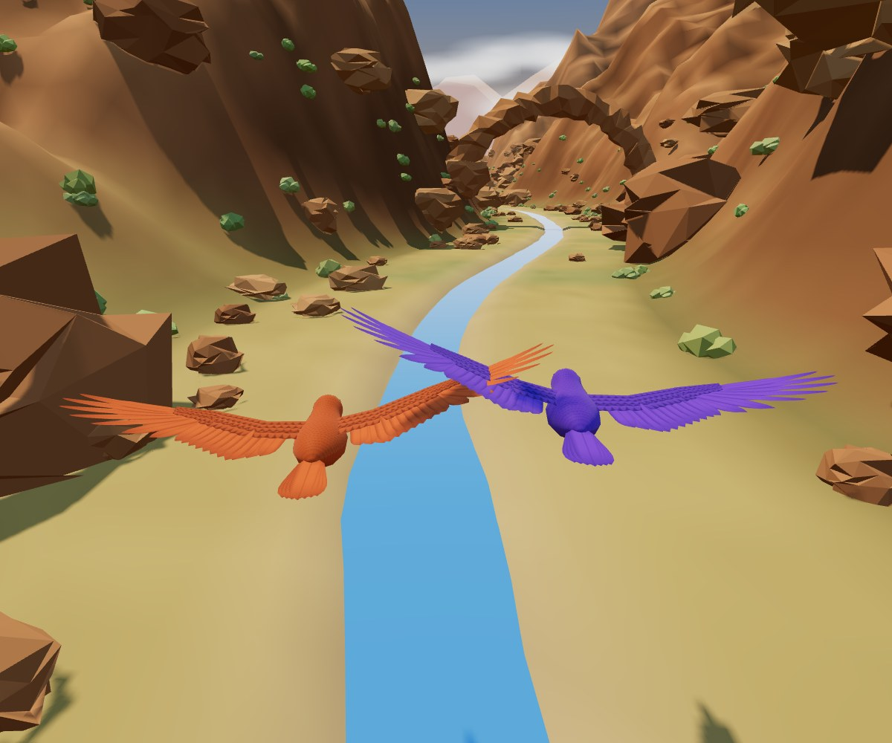

# Heartbeat Games

Players wear a small optical sensor on their wrists, and their movement controls games. 
Big visuals, few words, short rounds, and **cooperation over competition**.



## The games

| Button | Game | Players | How it plays |
|---|---|---|---|
| 1 | **Fly Together** | 1 or 2 | Two birds leave the nest in search of a better life together! Arms out like wings; tilt to steer a bird down a winding canyon. Flying close together speeds you up. The canyon narrows and changes as you go: Alpine → High Desert → Box Canyon. Each round starts in a nest, where the game learns each player's arm pose, and ends with a "photo" of the two birds. |
| 2 | **Climb Together** | 1 or 2 | Two chameleons escape captivity together! Hands up and climb on the spot to climb as a chameleon; lean the climb to steer. Push the front off your tank, then climb past books, potted plants, and through an open window to freedom. When a cat or a crow comes, **freeze**: a chameleon that holds still camouflages into the background. Climbing close together is faster. |

## What you need

- **Sensors:** two Polar Verity Sense optical sensors, worn on top of the wrist.
- **A Windows laptop** with Bluetooth, and **Google Chrome** (the page uses Web Bluetooth).
- **[AutoHotkey v2](https://www.autohotkey.com)**, plus **`UIA.ahk`**, a free library from the [UIA-v2 project](https://github.com/Descolada/UIA-v2) (MIT License). These drive the launcher that clicks through Windows' Bluetooth pairing popups. **`UIA.ahk` isn't in this download, and the launcher won't run without it:** see step 2 below.
- **Optional:** an Elgato **Stream Deck** as the controller. Key pictures are in [`streamdeck/`](streamdeck/). Any keyboard works too: every button is Ctrl + Alt + Shift + a key (see below).
- **Optional, for testing:** **Node.js**, for the simulated-sensor test scripts.

## Getting started

1. Download the zip of this repo and put it somewhere that isn't synced by OneDrive or similar, for example `C:\HeartbeatGames`.
2. **Get `UIA.ahk`:** download it from
   <https://raw.githubusercontent.com/Descolada/UIA-v2/main/Lib/UIA.ahk> (the link downloads it straight away;
   it's the `Lib/UIA.ahk` file of the [UIA-v2 project](https://github.com/Descolada/UIA-v2)) and put it in the
   main folder, **next to `heartbeat-launcher.ahk`**, named exactly `UIA.ahk`. Or skip this step: `setup.bat`
   (step 4) offers to download it for you. Step-by-step help is in [`GET-UIA.txt`](GET-UIA.txt).
   Known to work: UIA-v2 version 1.1.3.
3. Edit [`config.js`](config.js) with your sensors' IDs (the 8 characters printed after "Polar Sense").
4. Double-click `setup.bat` once and accept the permission prompt. It creates a **Start Heartbeat Games** desktop shortcut. The launcher needs administrator rights, because Windows hides its pairing prompts from ordinary programs.
5. Turn on both sensors, double-click the shortcut, and wait for **All set!** (about a minute per sensor, since Windows pairs each sensor every time).

At closing time press **Alt + F4**. This also switches the sensors back to their normal mode.

**No sensors?** Open `heartbeat-games.html` in Chrome and press **Ctrl + Alt + Shift + F9** for demo mode with simulated sensors.

### Controls (Ctrl + Alt + Shift + …)

| Key | Does |
|---|---|
| 1–9 | Open a game from the menu |
| S | Start / play again |
| B | Back (press twice to stop a round) |
| R | Reconnect a sensor that never connected (staff) |
| X | Closing time, the same as Alt + F4 (staff) |
| F9 | Demo mode: simulated sensors |

## How it works

- **The games are a web page, opened straight from the folder** (`file:///`, no server, no internet needed). Plain JavaScript with classic `<script>` tags; 3D is drawn with [three.js](https://threejs.org) (r158, included in `js/vendor/`).
- **Sensors:** [`js/sensor.js`](js/sensor.js) connects over Web Bluetooth and switches each Verity Sense into its fast "SDK mode" for 416 Hz motion data, using Polar's measurement service (documented in Polar's [polar-ble-sdk](https://github.com/polarofficial/polar-ble-sdk)). The games read simple things from it: how much a player is moving, which way is up (tilt), and sudden bursts.
- **Calibration, every round:** each game learns each player's pose (for example "hold your wings out", then "tilt to the left"), so it doesn't matter which wrist the sensor is on or how the strap sits.
- **The launcher** ([`heartbeat-launcher.ahk`](heartbeat-launcher.ahk)) opens Chrome full screen, asks the page to connect each sensor, and clicks through Chrome's and Windows' pairing popups, but only for the sensor IDs in `config.js`. The page reports its progress in the window title; the launcher writes what happens to `heartbeat-log.txt`.
- **The shell** ([`js/app.js`](js/app.js)) runs the setup screen, menu, controller buttons, automatic reconnection and the game runner. Each game is one file in [`games/`](games/) that calls `HG.registerGame({...})`. The full "game contract" is documented at the top of `js/app.js`. While the sensors connect, the shell gets the 3D games ready in the background (building their worlds and drawing them once, hidden), so they don't stutter when first played.

Hard-won notes about the sensors and Bluetooth are in [`AGENTS.md`](AGENTS.md), under "Sensors and Bluetooth".

## Reusable pieces

- **[`games/lib/crow.js`](games/lib/crow.js):** a low-poly crow with a real wing skeleton (shoulder, elbow, wrist, separate flight feathers that fan and fold). It glides, flaps, banks, flares to land and perches, steered by three simple controls. Its look is made in **Blender** ([`blender/`](blender/)): a script builds the model on the skeleton and another exports it as a plain script file the game loads, so it still runs offline from the folder. See it on its own in [`tools/bird-lab.html`](tools/bird-lab.html).
  It can also look at something, peck and caw (the crows in Climb Together).
- **[`games/lib/chameleon.js`](games/lib/chameleon.js) and [`cat.js`](games/lib/cat.js):** a chameleon that climbs walls with a rocking walk, swivels each eye on its own, curls its tail and camouflages; and a cat that prowls, sits, looks around, crouches, pounces and hisses. Both are built from the parts in [`creature-kit.js`](games/lib/creature-kit.js) (bendy tubes for bodies and tails, two-bone legs that keep their feet planted, and the camouflage material). The chameleon's and the cat's looks are made in Blender like the crow's, from reference photos (see [`storyboards/chameleon-model/`](storyboards/chameleon-model/README.md) and [`storyboards/cat-model/`](storyboards/cat-model/README.md)). See them on their own in [`tools/creature-lab.html`](tools/creature-lab.html).
- **[`games/lib/flight.js`](games/lib/flight.js) and [`flight3d.js`](games/lib/flight3d.js):** the winding valley, the ecosystems, the nest start with per-player calibration, and the 3D world, with real shadows (the birds', and trees' and rocks' well down the valley ahead) and a river that mirrors the sky.
- **[`games/lib/glow.js`](games/lib/glow.js):** a soft glow round the brightest things and slightly darker corners, for any three.js scene, written to work from a plain folder (three.js's own version needs modules).
- **[`games/lib/climb3d.js`](games/lib/climb3d.js):** Climb Together's world, built in code from the storyboards, with a level camera that keeps two-point perspective. The room is lit by warm afternoon sun through a window (a spotlight shaped by a painted window picture), soft light bouncing from all round, and dust floating in the light; the alley is in cool shade, with evening sun across the top of its brick wall; and above, the roof and rocks are in raking afternoon sun with soft blue light from the sky; and climbing the giant tree, it turns to golden hour, ending with the sun setting over the valley, birds gliding across it and pollen drifting in the light. Soft shading where surfaces meet (floor and wall, a box on the ground, a rock stepping up from the one in front) makes things sit into each other, and a soft glow spills round the brightest things.
- **[`games/lib/photo-finish.js`](games/lib/photo-finish.js):** the end-of-round effect that freezes the last frame, zooms in, and turns it into a Polaroid.

## How we made these games

Games start as **hand drawn whiteboard storyboards**, photographed and colour-coded: **pink** for the world, **blue** for characters, **green** for movement, **black** for the body and on-screen text. The storyboards behind the games are in [`storyboards/fly-together/`](storyboards/fly-together/) and [`storyboards/climb-together/`](storyboards/climb-together/).

This project is developed with Claude Code (Anthropic's coding assistant), and the whole process is written down as a playbook in [`docs/making-games/`](docs/making-games/):

1. Read the storyboards.
2. Describe them back to the artist and confirm.
3. Check each movement against what the sensor can sense.
4. Build the game from the template.
5. Test it with simulated sensors.
6. Ship it.

The playbook is useful even without Claude: it holds the design rules, the sensor facts and the testing approach.

To try a game without sensors:

```
npm install --save-dev playwright
npx playwright install chromium
node tools/try-game.mjs --game 1
```

This plays the game in a hidden browser with simulated sensors, prints what happens and saves screenshots to `test-output/`.

## Project layout

```
heartbeat-games.html    the page: layout, styling, and the list of scripts
config.js               settings: sensor IDs, sample rate, round length
js/                     sensor connection, the shell, and three.js
games/                  one file per game; lib/ for shared parts; art/ for pictures; examples/ for templates
tools/                  troubleshooting pages (sensor tests), the bird lab and the creature lab, and test scripts
storyboards/            the storyboards each game was designed from
blender/                the crow's source in Blender: build and export scripts, painted textures
streamdeck/             Stream Deck key pictures
heartbeat-launcher.ahk  the launcher; setup.bat / setup.ps1 install it
AGENTS.md               detailed project notes: how it all works, decisions made, known quirks, glossary
READ ME FIRST.txt       the short version, for staff and volunteers
docs/making-games/      the playbook for making a new game
```

## Using this project with an AI assistant

The project is set up so that any AI model can get up to speed quickly:

- **[`AGENTS.md`](AGENTS.md)** is the starting point: a reading order, ground rules, the full project notes
  and a glossary. Many AI coding tools read this file automatically.
- **[`llms.txt`](llms.txt)** is a short index of the important files.
- **`HEARTBEAT-GAMES-BUNDLE.md`** is every document and source file in one text file, for tools that take a
  single upload. Rebuild it with `node tools/make-ai-bundle.mjs`. (Pictures aren't in it: upload any you need.)

## Credits

- [three.js](https://threejs.org), MIT licence (`js/vendor/three-LICENSE.txt`).
- [Bricolage Grotesque](https://fonts.google.com/specimen/Bricolage+Grotesque), SIL Open Font Licence, loaded from Google Fonts (falls back to a system font offline).
- [UIA-v2](https://github.com/Descolada/UIA-v2) by Descolada, used by the launcher and downloaded separately (see its licence there).
- Sensor protocol details from Polar's [polar-ble-sdk](https://github.com/polarofficial/polar-ble-sdk) documentation.

## Licence

Heartbeat Games is free and open source, made by Jack's Urban Meeting Place (JUMP). It uses two
licences, one for code and one for everything else:

- **Code** (`.js`, `.mjs`, `.cjs`, `.py`, `.html`, `.ahk`, `.ps1`, `.bat` files) is under the
  **[MIT License](https://opensource.org/license/mit)**. The full text is in [`LICENSE`](LICENSE).
  Use it, change it and share it however you like, as long as you keep the copyright notice.
- **Storyboards, artwork, pictures and documentation** are under
  **[Creative Commons Attribution-ShareAlike 4.0](https://creativecommons.org/licenses/by-sa/4.0/)** (CC BY-SA 4.0).
  The full text is in [`LICENSE-ART.txt`](LICENSE-ART.txt). You're free to use, change and share them,
  including commercially, as long as you **give credit** to Heartbeat Games and **share what you make
  from them under the same terms**.

Built with Claude Code 2.1.317 (model: Claude Opus 5.5).

The third-party parts keep their own licences: three.js (MIT, `js/vendor/three-LICENSE.txt`),
Bricolage Grotesque (SIL Open Font Licence) and UIA-v2 (downloaded separately; see its own licence).
